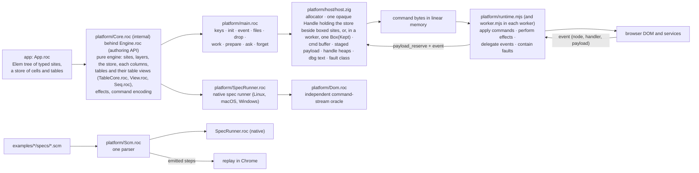
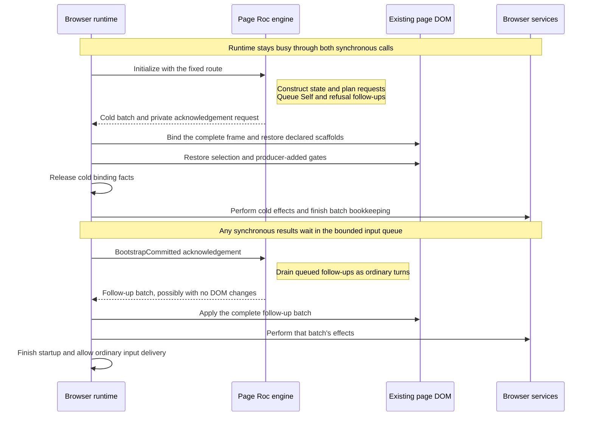
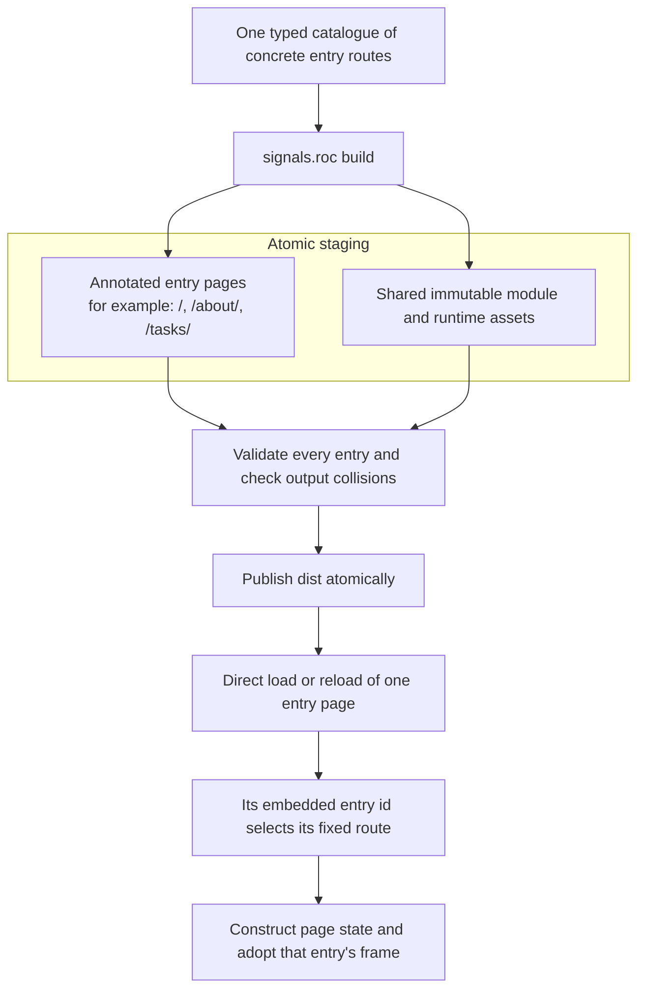
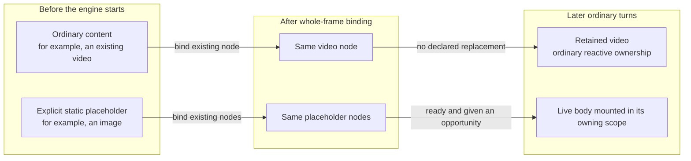
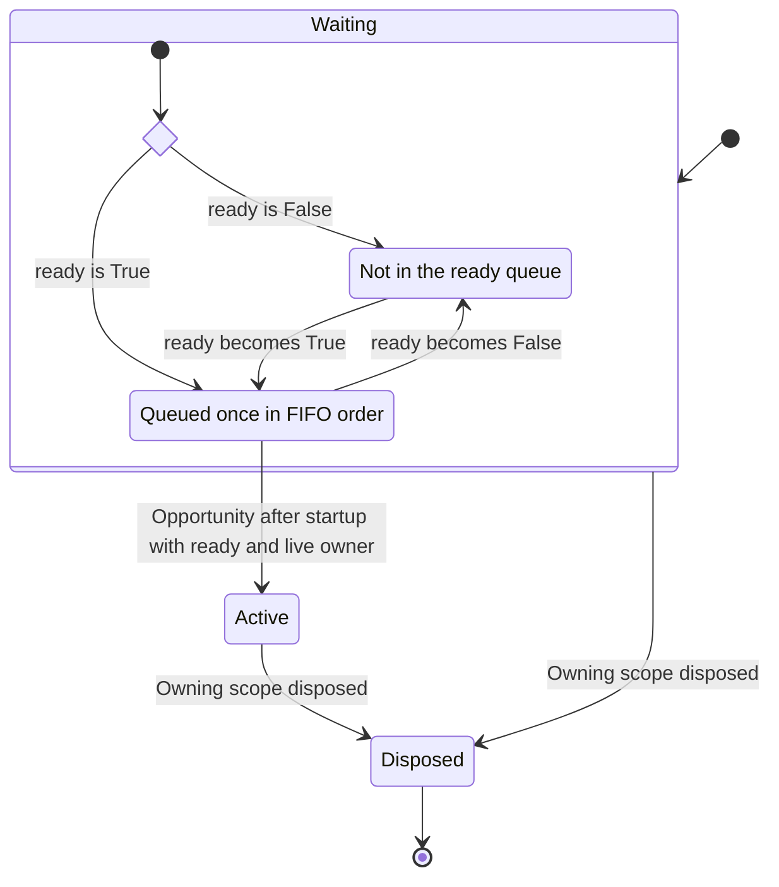

# Roc Signals — Target Design

This document is the single authoritative design for Roc Signals. It describes
the architecture we are building toward and the invariants every part of it
must hold. It is forward-looking and enduring: it describes the system as it is
meant to be, not the state of a work queue. Live work tracking belongs in issues
and pull requests.

## How to read and evolve this design

The main body defines semantic laws, ownership boundaries, complexity
obligations, and the reasons for them. The appendices hold detailed contracts
without making every representation choice a permanent principle:

- [Appendix A](#appendix-a-api-surface) records the engine API surface and the
  target vocabulary above it. Public module documentation and the
  [reference](www/content/docs/reference.md) describe what ships; a target
  signature is not a claim of availability.
- [Appendix B](#appendix-b-wire-protocol) records the Wasm exports, the command
  stream, event records and payload layouts. It is normative for one protocol
  version and evolves only through a coordinated producer/consumer change.

Paragraphs marked **Target** describe intended behaviour the engine does not
implement yet. They are design, not status: they say what the implementation
must converge on, and they never license a different interim meaning.

Internal representations may change when the replacement preserves these
contracts and improves measured cost or clarity. Scope-owned lifetime,
construction-site identity, one holder for each piece of state with what
changed taken from the write, and the command stream as the only output that decides anything are
architectural laws; a column layout, a hash-table probe sequence, the width
of a signature word or a node-id encoding is an engineering choice. Neither an optimization nor a compiler
workaround may change application meaning.

Current setup, gates and measurement practice belong in
[contributing](www/content/docs/contributing.md); numeric baselines,
implementation gaps and delivery plans belong in issues.

## Thesis

Roc Signals exists so that a Roc developer can build an interactive browser UI
in pure Roc and trust it the way they trust the rest of their Roc code: values
in, values out, and reactive semantics that can be checked without a browser.

The application describes its UI once, as a tree of typed sites. Every dynamic
part of that tree — a piece of local state, a conditional, a keyed list, a
table view, a derived signal, an effect — is a *site*: one Roc closure
that owns its own typed storage. State the whole application shares lives in
a *store* that the instance holds beside its sites. The reactive engine is ordinary Roc code
inside the platform. Each external input (a DOM event or an effect result) is
one pure turn over the engine's state that returns the next state and
a byte stream of rendering and effect commands. The engine re-evaluates only
the sites and holes that read what the turn wrote, prunes equal values
at every observation point, and emits only the DOM operations those changes
imply. There is no virtual DOM and no per-event re-render.

One rule shapes how state is held: **every write says what it touched.** The
engine never finds a change by comparing a large value with an earlier copy
of it. In Roc a value is updated in place only while it has exactly one
holder, and an earlier copy kept for comparison is a second holder: every
write would then copy what it changes, and the comparison would cost the size
of the value on top. So the engine keeps one holder for each piece of state
and learns what changed from the write itself, at two grains: which pieces of
state a turn wrote and, inside a table, which rows.

The host is deliberately small. A Zig Wasm host allocates memory, holds one
opaque engine state between calls, stages payload bytes, keeps the text of the last call’s `dbg`s and classifies faults.
A JavaScript runtime applies the command stream to the DOM and performs the
requested effects. Neither decides anything the engine has already decided.

The one-sentence wedge: **pure Roc, no VDOM, work local to what changed, and
fast native specs backed by the same specs replayed in a real browser.**

It is for Roc developers building interactive browser applications —
dashboards, forms, routed multi-page apps such as Conduit. It is not a general
replacement for the JavaScript ecosystem, not a UI toolkit for other languages,
not a native desktop GUI platform, and not a server-rendering platform.

## Product Goals

Each goal is a property the platform must hold for its whole life. Gaps between
this document and the implementation are tracked in issues.

1. **The idiomatic way is the correct way.** The simplest thing an author can
   write must be the thing the platform is designed for. An encoding trick, a
   positional convention, or boilerplate the platform could derive is a defect
   of the API, not of the author. A pointer zone's key is an application
   name handed back unchanged, not a workaround encoding: the platform
   never resolves the key or looks anything up by it.
2. **Composition is first-class.** UI is built from typed, reusable
   components: a type, its pure operations, and a view that is handed the
   shared state it uses and owns its local state and effects. A component
   names no application's store, so it can be published as an ordinary Roc
   package.
3. **The scaling promise holds for apps, not just the engine.** Work
   proportional to the changed set is a property authors get by writing
   idiomatic code. Where a natural idiom would defeat it, the platform provides
   the primitive (`derive`, keyed selection, row templates, tables and their
   views) that restores it, and the property is pinned by observable counters.
4. **Failure is controlled and legible.** An app that compiles and whose
   specs pass does not fail at runtime for a reason the platform could have
   told its author earlier, and what does fail is caught at the earliest
   layer that can catch it (see
   [How failure is controlled](#how-failure-is-controlled)). Every contract
   violation — a duplicate key, a value outside a switch's cases, an effect
   feedback loop, a malformed payload, an exhausted resource — is reported
   as a classified, readable diagnostic naming the rule and the construction
   site, identically natively and in the browser.
   A bare trap is never an acceptable way to fail. A silent no-op is
   acceptable only where this design names it, says why no earlier layer can
   catch it and says what the author has in its place: a test that sees it,
   or a rule that avoids it.
5. **There is exactly one door to the outside.** Events enter, and effects
   leave, through the declared effect channel and the command stream. Apps do
   not call JavaScript. A service the platform does not model is reached
   through a *port*: a declared request kind whose messages leave in the
   command stream and whose answers enter as turns, performed by JavaScript
   the page supplies at mount. The host never exposes its state to an app,
   and no JavaScript value enters Roc.
6. **Cost is visible and bounded.** Payload size, startup, per-event work, and
   memory are measured, and budgeted wherever the repository alone decides
   them: the size of the platform’s JavaScript is checked, and the size of a
   module, which also follows the compiler, is reported, and in-flight work has fixed caps with
   typed refusal.
7. **Testable at the right boundary.** Reactive semantics, ordering, work and
   cleanup are asserted in fast, deterministic native specs. The same specs
   replayed in Chrome establish actual input, focus and integration behaviour.
   A decoded DOM model is evidence within its model, not proof of browser
   behaviour.
8. **Approachable and honest.** A Roc developer can learn the model from the
   documentation alone, and what the documentation says is what the platform
   does.
9. **Interaction and accessibility are part of correctness.** Controlled inputs
   preserve caret, selection and composition; focus is an explicit command;
   moving a surviving row preserves its DOM node.
10. **Intent and coordinated state are expressible directly.** Repeated
    occurrences stay distinct even when their payloads are equal, and one
    event expresses one atomic domain transition, decided by one pure
    function however many pieces of state it spans.
11. **The first frame comes with the document.** A page can show its first
    frame before its module arrives: the build renders it from the app's own
    mount. **Target:** default site builds prerender every declared concrete
    entry route. Fixed initial inputs let the engine bind that complete frame
    by reserved annotations, preserving ordinary content and replacing explicit
    placeholders later through normal scoped turns. Legacy pictures retain
    their defined replacement startup.

### Success criteria

- **Engine invariants:** native specs with work and effect counters, the
  `Dom.roc` oracle, roc-fuzz property targets, long seeded walks of every
  app in the native spec runner, and soak runs with flat live allocations
  and Wasm pages.
- **Author outcomes:** maintained apps contain no workaround encodings
  (pointer zone keys are names the platform only hands back unchanged); a
  write to one store cell wakes the readers of that cell, wherever they sit,
  and not the rest of the tree; a write to one row of a table costs the same
  engine work whatever the table's size; a one-row change in a keyed list
  does constant engine work outside the list's own reconciliation; every
  contract-error class has a spec asserting its diagnostic.
- **External evidence:** the keyed js-framework-benchmark run against declared
  comparison frameworks, Conduit passing its journey against a RealWorld
  backend in Chrome, and recorded compressed sizes of the platform’s JavaScript files, checked,
  and of each example’s module, reported.
- **First frame:** the built page paints before the module arrives, stays
  inert until ordinary mounting, and behaves like an unprerendered mount
  after replacement. Native and Chrome specs cover the same app behavior.
  **Target adoption:** deterministic entry frames bind whole in both runners,
  with fresh independent engine state and the same subsequent behavior as a
  plain mount. Focused browser handoff contracts establish parsing, controls,
  selection and resource continuity across engines. No DOM digest or browser
  consensus establishes identity. The module's size still determines when it
  becomes interactive.

### When a capability is built

The platform builds a browser capability when real applications are expected
to need it. It does not wait for a maintained example to be blocked. What it
requires is that the capability lands whole:

- a stated use in real applications, and what an app must do today without
  it;
- an API in the platform's own vocabulary, with what it deliberately leaves
  out;
- bounds and the behaviour at each bound;
- a failure analysis: each thing that can go wrong, the layer that takes it
  and what happens (see
  [How failure is controlled](#how-failure-is-controlled));
- an Appendix B entry wherever it touches the wire;
- the same meaning in both spec runners, for every step that drives it. An
  input no runner can drive faithfully is named in
  [The `.scm` spec language](#the-scm-spec-language) and held by a contract
  test;
- a runtime contract test;
- a demonstration: an example upgraded to use it or, where no example fits,
  a test app with specs.

A capability is declined for a reason in this design, such as: it cannot
mean the same in both runners, it needs a synchronous answer the engine
cannot give, it crosses a Non-Goal, or a port serves it as well. It is never
declined for want of an example.

### How failure is controlled

Failure is inevitable: the outside world fails, resources run out, and the
platform, the compiler and the browser have bugs. Roc has no
failure-and-unwind channel, so a crash is never caught and resumed: it
poisons the instance. The platform therefore does not promise an app without
runtime errors. It promises that:

- an app that compiles and whose specs pass does not fail at runtime for a
  reason the platform could have told its author earlier;
- what does fail is caught at the earliest layer that can catch it, is
  legible, and does not corrupt what is left.

The layers, in order of preference:

1. **Impossible to write.** A type rules the mistake out and the compiler
   rejects it: opaque types, typed props records with defaults, closed tag
   unions, a payload type that fixes which handler an event takes, and
   internal operations absent from app-facing types. A later layer is right only when no type expresses the
   rule.
2. **A value the app must handle.** A failure of the outside world arrives
   as typed data the app matches (`Refused`, `Timeout`, `Network`,
   `PortFailed(...)`, `FileFailed(...)`, `WorkLost(...)`, a `Try`), never as
   an exception and never fabricated. A mistake in the program is the next
   layer's: no value may disguise it.
3. **A contract error at the narrowest boundary.** A programmer error no
   type expresses, such as a duplicate key, is rejected where it is first
   knowable (when the program or a catalogue is built, at mount, at the end
   of the turn) with a classified diagnostic naming the rule and the
   construction site. It poisons the instance, and recovery is a fresh one
   (see [Error Containment](#error-containment)). How much outside input
   arrives is a bound instead, the next layer's. Outside data that would
   break a rule the app keeps, such as two rows with one key in a server's
   answer, is the previous layer's where the constructor it enters through
   answers it as a value: `Table.from_list` answers `DuplicateKey(key)`, so
   the type keeps the rule and the app decides what the user sees. Where
   no constructor does yet (an `each` site's list), the app checks data
   where it enters.
4. **Bounded.** Every queue, table and buffer that grows with outside input
   has a declared bound and a declared behaviour at it (see
   [Boundedness](#boundedness)): a typed refusal where the work can be
   refused, as the in-flight cap answers `Refused`, and poison only where
   dropping would corrupt, as when a feedback loop fills the ingress queue.
5. **Contained.** What still goes wrong is confined (see
   [Error Containment](#error-containment)): a trap discards its batch and
   never publishes a prefix, a poisoned instance keeps the last applied DOM
   and refuses further calls, a worker fails alone, a port handler's throw
   becomes a value, and an executor fault is contained like a crash. This is
   the floor, never the plan for a failure an earlier layer can take, and it
   does not undo an effect already performed.
6. **Checked by tests the design requires.** An invariant no type expresses
   is held by a test (see [Testing Architecture](#testing-architecture)):
   roc-fuzz targets with reference models, the settle check after every
   step, seeded walks, soaks with flat allocations, contract tests of the
   runtime and the host against the wire, the independent `Dom.roc` oracle,
   both spec runners meaning the same, and pure `expect`s over decisions. A
   rule of an app's own logic, which the platform cannot model, is the last
   layer's.
7. **Left to the app's author.** This is allowed only as a stated
   trade-off: what is left, why no earlier layer can reasonably catch it,
   and what the platform gives the author in its place. That is usually a
   pure test that sees it and, where no test can, a rule that avoids it.
   Among those this design leaves: a component handed the wrong cell of the
   right type, a transition that left out a reset, and a write to a key a
   table does not hold.

A failure is taken at the earliest layer that is **reasonably practicable**,
and backed by later ones where they apply. That weighs API ergonomics, code
size, the Roc compiler as it is and the cost of a check on a hot path. Two
rules are firm:

- **A rule the compiler can carry is never left to a check at mount.** A
  contract error poisons the whole instance, and a check that runs only when
  its site mounts ships a typo in a rarely opened branch.
- **A bound whose count follows the app's data (rows drawn, messages
  received) is never a poison where a typed refusal or a structural bound is
  possible.**

Fuzzing controls the engine's own invariants. Generated sequences, checked
against reference models, hold propagation completeness, identity reuse,
effect lifetime, table views equal to a rebuild, allocation balance and wire
decoders that are total. A capability that adds an engine sequence adds it
to a fuzz target.

A capability's failure analysis is written against these layers, and is part
of landing whole (see
[When a capability is built](#when-a-capability-is-built)).

## Non-Goals

Each item is a scope decision with the condition under which it would be
reconsidered.

- **Per-request server rendering, streaming and SEO claims.** The platform
  is a client-side runtime. A first frame rendered at build time is part of
  the target design: the command stream remains the only render output, the
  engine commands binding of the declared annotated frame or ordinary plain
  construction, and JavaScript never reconstructs meaning. A corrupted annotated
  frame faults and requires explicit fresh recovery; it does not select a
  different meaning through mismatch repair. Per-request rendering or streaming is reconsidered
  only if a build-time frame cannot serve the intended apps. Search engines
  may index a picture; the platform makes no promise about it.
- **A native desktop GUI host.** The engine is web-only. A GUI platform would
  be a separate platform consuming its own command vocabulary, not a second
  engine.
- **Multiple roots per Wasm instance.** One mount owns one instance.
  Reconsidered only if many-widget embedding measurements show per-instance
  cost is unacceptable.
- **Recovery from allocation failure inside an instance.** Running out of
  memory, a Roc crash or a failed `expect` poisons the instance; recovery is a
  fresh instance. Separate prepare and commit phases, and allocation-failure unwinding,
  are deliberately not part of the architecture: the engine state is
  Roc data updated in place, and a Roc call has no failure-and-unwind channel.
  Reconsidered only if Roc gains one.
- **Host-held Roc values.** The host never holds, clones, compares or drops a
  Roc value other than the one boxed engine state, a worker instance's one
  boxed prepared state (see [Prepared state](#prepared-state)), and
  the byte lists it exchanges with Roc. Each box is opaque, moves whole
  into one Roc call and back out of it, and is dropped only by Roc, so the
  host needs no rule for sharing a Roc value: it never has one to share. The
  converse is allowed: Roc may hold a handle to a browser object, whose
  allocation is a slot in a typed host heap (see [Files](#files)). The host
  mints it, Roc's reference count is its lifetime, and the host learns of
  its last release when Roc frees it; the host never holds the handle.
- **A general-purpose JavaScript FFI.** A use the effect channel cannot
  express is a reason to extend its typed vocabulary, not to bypass it.
  Ports are that extension for services the page supplies, not a bypass. A
  port is one of three shapes of the effect channel — a command, a call with
  one answer, or a subscription — under a name the program declares and the
  page's JavaScript implements. Roc never calls JavaScript synchronously,
  never holds a JavaScript value, and is never called by it; every message is
  data in a declared encoding with the channel's id, bound, scope and
  lifetime. A capability the platform models (HTTP, storage, timers, history,
  focus, workers, files, cryptography, layout observation, media queries, time, entropy,
  the user's languages and time zone, and writing the clipboard) is not a
  port's business. Reading the clipboard on demand remains a port. Formatting
  with the browser's CLDR data is not modelled and may use a port. A live
  connection (a WebSocket or event stream) is a port subscription. Its
  reconnect policy is the app's state, written in Roc; the handler ends a
  lost connection rather than reconnecting by itself. Nothing that needs a
  synchronous answer (a default to prevent, a layout measurement inside a
  turn) can be one. The hosted effects a worker task calls (see
  [Workers](#workers)) are not an FFI either: they are a closed, typed
  vocabulary of the platform (reading a file, building one), callable only
  inside a job in a worker, never an import table an app extends.

## Non-Negotiable Constraints

1. **No compiler changes.** Everything is ordinary Roc plus a thin Zig host.
   Reproducible compiler defects are filed upstream and worked around narrowly
   (see [Compiler limitations](#compiler-limitations)); they never become
   platform semantics.
2. **No guessing or recovery that changes meaning.** Neither the engine nor the
   host guesses what changed, scans to rediscover identity, or repairs invalid
   input. What a turn changed is what its writes say they wrote. Invalid
   input is a contract error.
3. **Work scales with what changed, and the data structures must honour it.**
   An event re-evaluates only the holes and sites that read what it wrote and
   emits only the DOM operations those changes imply. A path that is linear in
   the changed set on paper but reaches it by scanning all nodes, all sites, a
   whole table or the whole DOM, or by comparing a large value with an
   earlier copy of it, is a violation. See
   [Complexity budget](#complexity-budget).
4. **The engine is pure Roc; the host only allocates, stages, keeps a call’s
   `dbg` text and classifies,
   and in a worker instance performs the platform's synchronous hosted
   effects on handles through the worker script.**
   All reactive scheduling, structural reconciliation, identity, effect
   lifecycle and ownership policy live in the platform's Roc engine. The Zig
   host owns the allocator, the boxed engine state between calls (in a worker
   instance, at most one boxed prepared state instead), the command buffer,
   one staged payload, the typed heaps behind the handles an app holds, the bounded text of the
   last call’s `dbg`s, and fault classification. JavaScript applies commands and performs effects. Reactive or structural logic in either is a
   defect.
5. **Types are never erased across a boundary that can disagree.** A site's
   storage is typed by the site's own closure; dispatch between sites is by
   message, never by a host-interpreted value. The encoded bytes that cross
   the Roc boundary are the command stream, event payloads, boot bytes,
   worker payloads and port messages, each with a declared encoding that Roc
   decodes and validates (a port message is JSON text in the platform's
   `PortJson` encoding, with its bytes and files beside it, which Roc turns
   into a typed value or a typed decoding error). In a worker instance only,
   and only inside a call that runs a task or a preparation (`work`,
   `prepare`, `ask`), the hosted effects also move a file's raw bytes, which
   carry no encoding and no type: a read (`read!`) answers a fresh
   `List(U8)` that the host allocates, fills from the file and hands to Roc
   with a single reference, and an append (`append!`) gives the host a list
   that it lends to the worker script, which copies the bytes out, and then
   releases. The only other values
   the host builds for Roc are freshly minted handles, each with a single
   reference, and the status codes and sizes a hosted effect answers.
6. **The command stream is the only output of the page’s instance that decides anything.**
   Everything an app does to the outside world — DOM structure, attributes,
   listeners, effects, navigation, storage, title, focus — is a command in
   the stream returned by one host call. What else the runtime reads from
   the instance is not a second way for an app to act: the program’s
   declarations, read once before mount; a fault’s class and diagnostic;
   the work record and the host’s counters, which are observation (see
   [Observation](#observation)); the list of handles Roc released during a
   call, read after its batch and effects and naming only handles no Roc
   value can reach any more; and the text of a call’s `dbg`s, read after it
   returns or traps and printed on the console. The engine, the runtime’s
   scheduling and the app never read that text back. A worker task’s effects
   act only on handles its job was sent or made, and reach the page only as
   its answer, an ordinary result.

## First Principles, Not Imitation

We derive the model that fits Roc — a pure, value-oriented language with no
mutable globals and no runtime read tracking — rather than porting another
framework.

**Elm** rebuilds the view and diffs per event: O(view size). We keep Elm's
discipline (pure description, effects as data) and reject the mechanism.

**Solid** discovers dependencies by running code under a mutable "current
observer". Roc cannot observe its own reads, so we cannot copy the mechanism.

**Incremental / Adapton** are the lineage we can build on: an explicitly
constructed dependency structure, ordered propagation, and an equality cutoff.

**The reframing for Roc.** Dependencies are *declared*: a `Signal(ctx, a)` carries
a signature of what it reads, the local layers and the store cells, built by
`map`/`map2` and the state, cell and row accessors before anything runs. The
engine never runs a closure to find out what it reads. Nesting gives the
order: a state, derived value or row is a layer at a fixed place on its path,
and a reader can only be mounted below the layers it reads. A store cell is
above every layer, so it is read at any depth.

**What changed comes from the write.** Elm's diff, and a cache of the previous
value in any other design, find a change by holding the value from before.
Roc updates a value in place only while it has one holder, so holding the
value from before turns every write of a large value into a copy, and the
comparison costs the size of the value as well. The engine holds each piece
of state once and has the write name what it touched: a handler answers the
set of layers and cells it wrote, and a table's operations record the rows
they changed. Equality pruning stays where values are small: at holes, at
the rows of a list, at `derive`.

**The tradeoff, stated plainly.** Declared reads are conservative. A hole that
reads `{cond, A, B}` to express `if cond then A else B` is re-evaluated when
`B` changes even while `cond` selects `A`; equality pruning suppresses the
output, not the evaluation. Value-dependent structure uses `when`, `switch`,
`each` and `table_view`, which rebuild a subtree when its shape changes, so
dynamic reactivity and dynamic structure share one mechanism. The same
conservatism has an app-level consequence: one coarse piece of state with
many projections wakes every projection on every change. The partitioning
rule — independently changing concerns are separate cells or separate local
states, rows edited by key are a table, and state that belongs to one row is
that row's — is the documented pattern that keeps app work local.

## Architecture



The engine is `Core.roc`, `Sig.roc` (read signatures, exact write sets and
the three scheduling decisions read from a write set: what a written layer's
site does, what the root's pass carries, and how far a walk goes) and three
modules of its own for tables: `TableCore.roc`
(rows by key and the changes from a turn), `View.roc` (a sorted, filtered, windowed view kept up to
date from those changes) and `Seq.roc` (a table view's ordered keys). `Engine.roc` is
the authoring API over them. Its opaque `Table` wraps the internal table;
bookkeeping is a function of the unexposed `TableCore` namespace, never a
member of a type an app can name.

The repository has one platform (`platform/main.roc`), web only, shipped as
one release bundle. An app has one entry, `main.roc`, binding its `program`
as `main`, and the platform builds it for two targets with per-target link
inputs:

- **`--target=wasm32`** compiles the app and engine to Wasm with the thin
  host. It is the product.
- **`--target=x64musl`** (Linux), **`arm64mac`** and **`x64mac`** (macOS)
  and **`x64win`** (Windows) give the app's native `.scm` spec runner: the
  platform's `SpecRunner.roc` drives the same `main` against the `Dom.roc`
  oracle, linked with a small native host (`host/spec.zig`: entry point,
  allocator, file and output services, worker jobs in child processes). The
  Wasm link drops the runner from an `--opt=size` module, which keeps a
  few kilobytes of it; a development module keeps what its linker does not
  remove, about 0.9 MB. Every build still compiles the runner before
  linking, since a platform provides one list of entries for all its
  targets. Because
  the engine is pure, the runner drives it by calling its turn
  functions and decoding the command stream; there is no simulated host
  with its own semantics. The host is one file for every system: what
  differs between systems (how a file is opened, a process started or
  memory obtained) is a small set of functions in `host/os_posix.zig` and
  `host/os_windows.zig`, never a difference in what a step means, so a spec
  means the same on every system the runner builds for. The Windows host
  links no C runtime, only kernel32, so the platform carries no Microsoft
  library and nothing is fetched for that target.

The same runner walks an app (`--walk`): a seeded sequence of user events
on live controls and of what the browser does around the app, from a fresh
mount, with every worker job run for real in a child process and every
other request answered from the answers the app's own specs give. It is
the platform's test of the engine over long sessions of real apps, built
from each app's ordinary `main.roc`, so an app carries nothing for it.

Fuzz targets cannot share that entry: roc-fuzz requires a `target : Target`
value and links its own libFuzzer host, and a platform has one `requires`.
The platform's own targets, under `fuzz/` and beside the test apps that
drive the engine, are ordinary roc-fuzz apps: a roc-fuzz release is their
platform, and the engine is a package, `platform/main-fuzz.roc`, a package
root beside `main.roc` over the same files that exposes the internal
`Core`, the runner and the oracle. That works because the engine is pure:
no module of the package reaches a hosted function (a job's effects arrive
as values, see [Workers](#workers)), and the modules that do (`Files`,
`Effects`, `Hosted`, `Cli`) belong to the platform alone. The package is
repository-only and not in the release bundle, and no app uses it: an
example that fuzzes its own pure logic does so with roc-fuzz alone, in a
target named for what it checks (`fuzz-<subject>.roc`) that imports
nothing of the platform. roc-fuzz's allocation counters serve the fuzz
targets; the native host counts allocations itself for the spec runner's
walks and soaks.

Both hosts run the one engine and add no semantics of their own. What a test
observes of the engine (its work, its effect table, its allocations) comes
from the engine's own counters, the `Dom.roc` oracle, and the allocator
counters of whichever host runs it.

## Representation: Sites That Own Their Storage

The engine's data model is **one closure per site, each capturing only its
own typed storage**, with the application's shared state in one store that
the instance holds beside the site tree, as plain data no closure captures.

### Sites and messages

A mounted site is an `Inst(ctx)`: a closure taking the current environment, a
message and the turn accumulator, and returning its replacement, an
outcome and the accumulator. Messages are:

- `Fire(path, pos, handler, payload)` — route an event or effect result down
  the site path to the block that owns the target.
- `Changed(pass)` — a refresh. `Turn(mask)` is a pass of a turn: some of what
  `mask` names changed; refresh what reads it. `Check` is the settle check (see
  [Fuzzing, walks, soak and contract tests](#fuzzing-walks-soak-and-contract-tests)),
  a harness's pass that refreshes everything. The two are different tags, so a
  turn whose mask has every bit set is still a turn.
- `Dispose(remove)` — release this site, emitting `REMOVE` for its top-level
  nodes when `remove` is set (an ancestor that removes its own DOM passes
  `False` to children).

Every site kind — `state`, `when`, `switch`, `remount_on`, `each`,
`table_view`, `derive`, `resource`, effect sites, and the root site, which
holds the view's top block and receives the store in its context for each
call — implements these three messages.
The engine therefore needs no node table, no erased value registry and no
type tags: the closure's own captures are the typed storage, and the only
dispatch is the message.

A site also answers a fourth message, `Describe`, which is a harness's
question and outside the reactive model (see [The probe](#the-probe)): the
site notes what it holds and asks its children. It is sent only to a copy
of the tree that is then dropped, never in a turn, so no site decides
anything by it and no answer is read back by the engine.

### Contexts, layers and cells

A site's environment is a typed context:

- `Root(st)` — the top of the tree. It carries the program's store, whose
  store type is `st` (`{}` for a program without one).
- `In(outer, s)` — inside a state, derived or asynchronous layer of type `s`.
- `Row(outer, item)` — inside one row: of an `each` site (its key and item)
  or of a table view (the table's key).

Each `In` or `Row` adds a *layer*, named by its index on the path from the
root. Values crossing into a nested context are lifted explicitly (`lift`,
`lift_row`). Lifting changes the reader's path through the environment, never
what it reads: a layer keeps its index.

Every context type also answers one method, `store`, with a
`Reach(ctx, st)`: how that context reads the store, and how it returns itself
with a function applied to the store. `Root` answers from what it carries;
`In` and `Row` build theirs on the enclosing context's. A store *cell* is
therefore read and written in any context, at any depth, with no `lift`, and
a function that reaches the store asks of its context:
`where [ctx.store : () -> Engine.Reach(ctx, st)]`. Reading and writing are
one requirement, not two: a reach holds both.

A function that must not occur under a row asks a separate question:
`where [ctx.outside_rows : () -> Engine.OutsideRows(ctx)]`. `Root` answers
it, and `In` forwards its enclosing context's evidence; `Row` does not.
`OutsideRows(ctx)` is opaque, state-free evidence, with no environment or
store reference. Thus `on_document_key` cannot compile in a row or in a
layer nested within one, without a mount-time failure that follows row data.

**Read signatures.** The public `Engine.Signal(ctx, a)` holds either a
constant value or a varying Core recipe, as an opaque representation. Mapping
a constant runs once at construction; combining one constant with a varying
signal preserves the latter's keyed selection. Lifting preserves this mark.
A zero ordinary mask never proves a signal constant: row keys and keyed
selections remain varying.

A varying `Core.Signal(ctx, a)` is `{ mask, read, sel }`: a signature of
what it reads, a reader from the environment, and an optional keyed selector.
A signature has two words. The layers' word has a bit for each layer index
and the cells' word a bit for each cell's position in the store, each taken
modulo the width of its word. A signature can only over-approximate: two
layers far enough apart on one path, or two cells far enough apart in the
store, share a bit, and a shared bit costs an evaluation that equality
pruning then discards. A reader of something that changed is never skipped.
A cell never shares a bit with a layer, so a store of any size leaves the
precision of local state as it was, and layers nest without a limit.

Text literals produce constant text signals. Interpolation parts provide
`to_text_signal`; one literal has one part type, with explicit conversion for
mixed signal types. Constant pieces are assembled at construction. The joined
reader samples each varying part once and joins text once. It preserves one
keyed selector only when exactly one varying part has it and all other varying
parts have zero ordinary mask; otherwise selection dependencies become ordinary
reads, as in map2. Manual hook calls require one more static segment than
parts and raise a named contract error on any arity mismatch.

Exactly six signal attach forms use existing static builders for constants:
text_s, attr_s, class_s, test_id_s, prop_s and ref_s. Static references retain
their ordinary reference hole and sampling. A constant row property still uses
the existing per-row property hole, since cloning does not copy live control
state and selects must see their options first. Explicit attr_presence retains
its Dyn route; controlled shown properties and other signal-consuming sites
retain their required machinery. Constant recognition invents no reference or
absence representation and changes no wire counter's meaning.

**Write sets.** What an event wrote is kept exactly wherever exactness
decides something. A write set names the layers written by index, without
wrapping, and carries the cells' word beside them. Which site settles a
written layer, what a site hands up, and what a reparented reaction may still
touch are all read from the set, never from a signature. Only the root
settles cells, so for them the word is enough: a write to one cell also
visits the readers of a cell that shares its bit, and they prune.

A `State(ctx, s)` is a piece of state as one context sees it, local or
shared. It is a lens (`get`, `modify`) with what a read of it listens to
and what a write through it reports. A `HandlerOf(ctx, p)` is an environment
transformer over a typed payload that answers what it wrote,
`(ctx, p) -> (ctx, written)` (`Handler(ctx)` is its text alias),
and a `Reaction(ctx, a, result)` is the same for a typed effect result. The set is the
handler's answer, not a property fixed before it runs, so a handler that
decides what to write from what it reads reports only the writes it made,
and nothing is declared twice.

### The store

State that more than one part of the application cares about (the session,
the current location, a page's loaded data, the rows of a list) lives in the
*store*: a set of *cells*, each one piece of state read and written through a
`Cell(st, a)`. In a large application
the code that writes a piece of state and the code that reads it are often
far apart; because every context reaches the store, no level between them has
to carry it.

- **Described once.** An app describes its store with Roc's record builder:
  each field is `Engine.cell(init)`, `Engine.table(start)` or another
  description, so a feature describes its own cells and the app nests them:
  `{ session: Engine.cell(Anonymous), article: Article.cells({}) }.Engine.Cells`.
  The builder combines fields pairwise (`Cells.map2`), so a description's
  storage is the nested pairs of its fields' storage, and each cell's place
  in that nesting is known where the description is built. The builder
  takes two fields or more; a description of one cell is the cell itself,
  named by `map`: `Engine.cell(init).map(|c| { c: c })`.
- **Lenses are generated, never written.** From its place each cell gets its
  position, which gives its signature bit, and its getter and modifier,
  composed from the pair projections on the way down. Two hand-written
  lenses can overlap, and a write through one then leaves a reader of the
  other stale with nothing in the types to catch it; generated from the
  description, each covers exactly its own cell. What is generated is a
  modifier, not a setter: a modifier hands its function the cell's value
  uniquely owned, where a setter is given a value built while the old one
  was still held, which for a large value is a copy. The storage is the
  builder's
  nested pairs, not a record the author wrote, because Roc has no field
  accessor or updater as a value to address such a record with (see
  [Compiler Limitations](#compiler-limitations)). The author never spells
  the storage type: `_` stands for it in every annotation.
- **Named.** `Engine.store(tag, cells)` builds the store, and `tag` is a
  value of a type declared for that store, usually the one tag of the module
  that builds it. The tag is held nowhere. It is part of the storage type,
  `Stored(tag, st)`, and so of every cell, write and reach of that store:
  a cell of another store is a compile error wherever this one is reached,
  even when the two stores' cells have the same types. It is a value, not a
  phantom type fixed by an annotation, because an annotation can be left
  out.
- **Started.** `store.cells()` is the record of cells the description
  described. `store.with_initial(cell, value)` starts a cell at a value that
  depends on the boot data, and `Engine.program_store(cfg, start, view)`
  mounts the view over the store `start(boot)` gives. A start is not a
  write: a table started this way has no changes.
- **Held beside the sites.** The instance is the store's one holder. It holds
  the store as plain data beside its site tree, never inside a site's closure.
  Each root call moves it into the root context and returns it with the write
  set, so a write at any depth receives its cell's value uniquely owned. The
  platform's `Program(st)` carries that storage type through mount and
  events without exposing engine state. The platform's `requires` clause
  binds `Store` to the type inferred from the app's `main`; no separate
  app-level `Store` declaration is required.
- **Started again by a write.** A cell lives as long as the instance and is
  never disposed, so state that should start fresh, such as a page's form
  once the reader leaves the page, is started again on purpose.
  `description.with_reset(|cells, reset| ...)` hands a description's cells out
  together with one write that puts every cell it describes back to the
  value it was described with (not a value `with_initial` gave it). The
  write is generated where the lenses are, so a cell added to the feature
  later is covered with no other edit, and it goes through each cell's own
  lens, so a table in the group is put back as a whole rewrite. The engine
  does not apply it: the transition that leaves the page includes it (see
  [Values, Handlers, and Coordinated State](#values-handlers-and-coordinated-state)).

### Blocks and holes

The static content of a site that draws no rows is flattened at mount into a
*block*:

- *holes* — dynamic text, attributes and element properties, each with its read signature, reader
  and last observed value (emitted, or echoed by a controlled browser property);
- *reference holes* — named element addresses, whose signal updates the
  reference map without emitting a DOM command;
- *handlers* — in mount order, so a handler number is a dense index;
- *children* — nested sites with their static read signatures;
- the block's node ids and its top-level nodes (for removal).

A refresh with mask `m`, the signature of what changed, re-evaluates the
holes whose signature intersects `m` and any controlled shown hole marked
by its own browser echo, emits a command only when the new
value differs from the last one, and
descends only into children whose signature intersects `m`. A site's reads
are computed statically (`elem_reads`) without mounting it, including the
reads of branches that are not currently mounted, so a conditional listens to
everything it could need. A layer site's reads include its own layer and the
layers below it: a pass from above reaches a changed layer only through the
signatures of the sites above it.

An element takes one handler per event type, whatever its policies or payload
kind. Two handlers for one event type on one
element are a `contract` error at mount, naming the event, the element and
the site: the runtime keeps one listener per event and element, so the
second would be dropped without a word. Two things that must both happen are
one handler made with `also` (see
[Values, Handlers, and Coordinated State](#values-handlers-and-coordinated-state)).

### Keyed lists: templates and typed columns

`each(rows, key, template)` draws a list that is a plain value, and it has
its own representation:

- The row template runs **once per site**, against a `RowRef` accessor rather
  than a row value. It compiles to a DOM template (sent once as `TEMPLATE`)
  plus a hole table: text, attribute, property, event, reference and nested-site placeholders.
- Rows are **typed columns** indexed by slot: items, keys, the last value of
  every live hole, nested site instances, dirty marks, plus `order` (slots by
  position), a free-slot list, and an open-addressing key index from the exact
  key bytes to a slot.
- Creating a row costs one `INST` command and column appends. A row whose
  template contains nested sites (`state`, `when`, `each`) is *dynamic* and also
  owns a small list of child instances.
- Handlers in a row template receive the row's key and item through the
  context when they fire; they never capture a row.
- Keyed selection (`keyed` with `RowRef.select`) lets a row depend on "is this
  row the selected one" so a selection change re-evaluates exactly the old and
  the new selected rows.

Reconciliation compares the new list against the site's columns with fast
paths for a common prefix and suffix, swapped ends, pure insertion and pure
removal, and otherwise a keyed move planned with a longest increasing
subsequence, so surviving rows move rather than rebuild. A row also keeps an ordered index of its currently shown dialog and popover
addresses. A changed shown command updates only that address in the rows on
its call path; hiding and disposal remove it before an id can be reused.
The index supports direct affected-owner removal and preserves show-intent
chronology across template holes and nested sites. Moving a row re-emits
those shown properties in that order, without scanning the row's tree.
Reinsertion loses native top-layer membership, so re-showing can restack the
moved controls above unmoved ones and focus their first control again.
A browser echo of true that emits no new show keeps the existing order.
This bookkeeping holds command addresses, never application identity.

A kept row whose new
item is equal to its old item is pruned; a changed item marks the row dirty and
only its live holes that read the row layer are re-evaluated.

One reconciliation emits its commands in a fixed order. First the
structure: the `MOVE`s of swapped ends, then the rows the new list drops,
removed in their old order (`REMOVE` each, or one `CLEAR` when the list
empties a site that is its parent's only child), then the rows it adds and
the kept rows that move, created and moved. Then
the holes: each row the turn marked, in the order it was marked, has its
marked holes re-evaluated and their changes emitted (`SETTEXT`, `ATTR`,
`HPROP`), and its nested sites refreshed. A row created in the turn is
drawn whole by its `INST` and is not visited again. Where rows are created
and moved depends on the path. A pure insertion creates from the first
new row to the last; a swap of the two ends emits two `MOVE`s; the general
path places from the last position to the first, creating each new row,
and moving each kept row off the longest increasing run of old positions,
before the row placed just after it. On that path rows that enter together
are therefore created, and the requests their effect sites issue at mount
are issued, from the last to the first, the reverse of a mount, a pure
insertion and a table view.

That comparison is linear in the list and needs the list from before, which
is right for a list that is small or computed: the options of a select, the
items of an answer, a list a `derive` produced, a few rows in local state.
Rows the user edits by key, and anything sorted, filtered or long, are a
table drawn through a view.

### Tables and views

A *table* is a store cell that holds rows by key, made with
`Engine.table(start)` from the table it starts at. Its cell is an ordinary `Cell(st, Table(k, v))`; its
value changes only through the table's own operations, and each of them
names the rows it touches.

- **Rows by key.** `Table(k, v)` maps a key to a row, finding it by the key's
  own equality and hash. `insert`, `put`, `replace`, `update` and `remove`
  each touch one key; `update_all` replaces every row, and so does a `set`
  of a new table. `Table.from_list` builds a table from keyed rows, or
  answers `DuplicateKey(key)` for the first key two rows share, and
  `Table.empty` is a table with no rows. Rows written in the program are
  checked while compiling: a top-level constant that matches on
  `from_list` and crashes on `Err` is evaluated by the compiler, so a
  repeated key is a compile error naming it. `get`,
  `contains` and `len` read, and so do `fold` and `to_list`, which visit
  every row in no particular order. A table has no order of its own: an
  order the user chooses is a field of the row that a view sorts by.
- **The last writing turn's changes.** Beside its rows a table keeps, for
  every key its last writing turn wrote, the row as it was before that turn's
  first write of the key, or the fact that it was absent. A key written twice keeps its first entry, so the
  changes are bounded by the distinct keys one turn writes. An operation that
  replaces every row does not record per key: it marks the changes as a whole
  rewrite. The changes are how a keyed write says which rows it touched, and
  where each used to sit.
- **Counted.** A table counts its writes and remembers the count at which its
  changes began. A view remembers the count it is up to date with. A view
  that has seen exactly the count the changes start from can bring itself up
  to date from the changes; any other has missed writes and builds again.
  A table whose count equals the start of its changes holds the rows its
  writing turn began with, which is what lets a view at that count take the
  table as unchanged. Within a turn the count can go down: a write that hands
  back the table as an earlier handler of the same event read it stores that
  table's count.
- **No write can leave a view behind.** A table cell's generated modifier
  puts the table into its recording phase and notes its identity and where
  its changes began before the function it applies runs. If what comes back
  is that same table, changed by its own operations, the changes stand: it
  has the cell's identity and start and is still recording. If it is any
  other table (a new one, another cell's, one saved in an earlier turn), the
  cell stores it as a whole rewrite. So a `set` of a new table, a generated
  reset and a function that ignores its argument are all whole rewrites, and
  none can leave a view showing rows the table no longer has.
  Identity and count alone cannot tell a saved table from the cell's own:
  two `Store` values taken up from one store are two histories with the
  same cell identities, and they can reach one count with different rows.
  The phase does. Every table an app can keep past a turn was rearmed when
  that turn ended, so it is not recording, and a recording table exists
  only inside one turn of one history, where it descends from the rows the
  turn began with. A table saved across a turn that wrote nothing is a whole
  rewrite too.
  A mounted program's table identities are disjoint from those in a `Store`
  value, so a table read with `Store.read` and set into a live cell is a whole
  rewrite.

`Table.update`, `replace` and `remove` of a key the table does not hold leave
it as it was, because an earlier write of the same event may have removed
that row. `Table.insert` of a key the table holds leaves it as it was, as
`update` of a key it does not hold does: a decision that must tell the user
the key exists reads the table first. A table cannot be built from two rows
with one key: `Table.from_list` answers `DuplicateKey(key)`.

A *table view* (a view in this section) draws part of a table: the rows a query
keeps, in the query's order, and of those only the rows inside a window.
`Engine.table_view(table, { query, plan, window }, template)` is its site.

- **The query is data.** `query` is a value the site can compare: the filter and
  order the user chose, the kind of thing a URL or a saved filter holds. `plan`
  turns it into a `QueryPlan(k, v, s)`, the three functions a view needs: `keep`
  (is this row in the view), `sort` (the value it is ordered by) and `compare`
  (the order of two sort values). A record of functions cannot be compared, so
  with the functions as the query the site could not tell a changed query from
  the same one.
- **The order is total.** `Engine.sort_by({ keep, sort })` builds a plan by
  the sort value's own `order_relative_to`, then the key's own order. A table
  has no insertion order for ties to keep. The key's order must agree with its
  equality: `Same` exactly when equal. Lookup still uses its equality and hash.
  `Order` supplies paired priorities, ascending or descending values in one
  type, and explicit UTF-8 text order; application types can provide their own
  order without importing the platform. `Order.utf8` is not locale collation
  or normalization and allocates no encoded key. The plan stores `(sort, key)`,
  so it retains the key both there and in the ordered entry.
  `QueryPlan` with its own `compare` is the primitive, like `List.sort_with`
  beside `List.sort_by`. With that form, `Same` must identify only one row's
  sort value. Two different rows comparing `Same` are a contract error at
  mount, after a write and between keyed writes of one event. The site absorbs
  changes one key at a time, so two rows trading places can tie between the
  writes. That form's sort value includes the key wherever its field can tie.
- **The view's storage.** The site owns the ordered keys of every row the
  query keeps, each with the sort value it was placed by, the window, and the
  keys the window shows. The ordered keys are held in chunks, so placing a
  row moves at most one chunk's entries and finding the chunk is a binary
  search; because an entry carries its sort value, a search never reads a
  row.
- **The window.** `window` is `{ start, count }`. The site keeps the place of
  every row the query keeps but creates nodes only for the `count` rows from
  position `start`. Scrolling is a write of the window. A window that
  reaches past the last row draws the rows there are, and
  `Engine.every_row`, whose count is the largest there is, draws every row
  the query keeps.
- **Kept from the changes.** When its table was written, the site reads the
  changes. For each written key it works out the key's place under the row as
  it was (from the changes) and under the row as it is (from the table). If
  the place is the same, the ordered keys are not touched; otherwise the
  entry is removed and inserted again. The rows drawn are worked out again
  only if a change landed at or before the window's last row.
- **One change of the rows drawn.** A pass that reaches the site brings the
  ordered keys up to date with the table, reads the query and the window,
  and only then changes the rows drawn, once: one comparison of the rows
  drawn before with the window now. An event that writes two of the table,
  the query and the window therefore never takes a row out of the window
  and back. A row drawn before the event and after it is one row
  throughout, and no row is created that the event does not leave drawn.
  The pass that reaches the site carries every write of the event the site
  can read (see
  [Glitch freedom and ordering](#glitch-freedom-and-ordering)): a local
  state written with the table has joined it above the site, and a
  `derive` of that state has followed. So the table, the query and the
  window arrive together, whichever of them are cells and whichever local.
- **Applied as row operations.** The site's rows are an `each` site's rows:
  the same once-per-site template, typed columns, nested sites, fire path and
  disposal. Only reconciliation differs. A row that left the window is
  removed, one that entered is created, one that moved is moved with its
  nodes and anything nested in it, and one whose row was written is marked,
  so its holes that read the row are re-evaluated and pruned there. No list
  of rows is built, kept or compared, and the commands are the ones an
  `each` site emits. Every row that left is removed
  first, then rows that entered and rows that moved are created and moved
  from the first to the last, each before the next row that stays put, as
  a mount creates them, and then the marked rows' holes are refreshed. For
  rows that own requests that is the order the requests are issued in, and
  so which are refused at the in-flight bound.
- **Rows are found by the typed key.** The site indexes its rows by the
  table's key, through the key's own equality and hash. It never makes a
  text of a key to find a row: an inspected value is a debugging
  representation, and two keys that print alike must not become one row.
  Text keys are the contract of `each` alone.
- **Rebuilt when the changes cannot serve.** The site builds its view again,
  with a pass over the table to filter and a sort of the rows kept, when it
  has missed writes, when the table was rewritten whole, when the query
  changed to an unequal value, and when the changes are so large next to the
  table that absorbing it would cost more. A rebuild costs the table,
  however few of its rows the view keeps, so the changes are weighed against
  the table's size: a view of a few rows of a large table absorbs a write of
  all of them. Rows that are in the window before and after a rebuild are
  kept, not recreated.
- **A drawn row is handed its row.** The template receives the row's key, fixed
  for the drawn row's lifetime, and a `State` of the row. A read is the row at
  that key in that table; a write is `Table.update` of that key through the
  table's cell. A component drawn over a `State` therefore draws a table's row
  unchanged, and a write through the row's `State` can reach no other row and no
  other table. Any other write (remove, insert, a write of several rows) goes
  through the table's cell. A row read after its key left the table in the same
  event is a `contract` error naming the site.
- **A drawn row's orphans read the table.** The row's context holds its key,
  not its row, so a request admitted below a drawn row that reparents to the
  table view site reads the row as the table holds it when its result or a
  progress report arrives: a row that only left the window reads its current
  row, and a key removed and inserted again reads the new row. When the
  table no longer holds the key, the orphan's reaction or progress decision
  does not run: the result counts as delivered and the run counts once as
  `skipped`. Its writes to store cells are skipped with it, because the
  decision that would make them cannot take its reading of the row. This is
  one lookup of the key per result. No earlier row is kept for it: a whole
  rewrite leaves none to keep, and a copy held by the site would be a second
  holder of every drawn row.
- **Up to date before anything else.** On every `Changed`, whatever it names,
  a view site first brings its view up to date with its table, which is a
  comparison of two counts when nothing was written. The root's pass
  carries every cell a turn wrote and is the turn's first, so a refresh
  that starts at a layer's site afterwards finds the view up to date. The
  site checks all the same: drawing from a view the turn's writes have
  passed would name rows the table no longer has.
- **Cleared before the next writing turn.** Every view reads the same
  changes in the turn's one `Changed` pass. After it, the root rearms the
  recording phase of exactly the table cells the turn wrote, without changing
  the record. Before the next writing turn's first modifier runs, that
  generated modifier clears the record; further modifiers and `also` handlers
  in the same event retain its first earlier row per key. A turn that does
  not write the table leaves the record unchanged. Rearming has no public
  observation and starts no second propagation pass (see [One turn](#one-turn)). Clearing
  can reclaim the previous writing turn's J earlier rows before this turn's
  modifier, costing O(J_previous) even when the current turn writes one key.
  This moves reclamation from the previous turn's end; over a session its
  work is proportional to recorded keys, not a worst-case O(J_current) bound.

A plain reader of a table cell (`todos.signal().map(|t| t.len())`, one row by
key) is an ordinary reader of the cell: it is evaluated on every write to the
table and pruned at its hole. Only a row of a view wakes for its own row
alone.

`Table.inverse` gives the writes that undo what the changes hold, and
`Table.apply` applies such a list, recording each write like any other. The
changes remain until the next writing turn begins. A later event's decision
may read the last writing turn's inverse before its writes begin, then apply
it to undo that turn. An inverse taken inside a modifier describes the current
writing turn instead. A history that must outlive the next table write keeps
the inverse in its own cell. `Table.changes` reads the same retained record,
so a signal over changes or inverse stays true through unrelated turns.

The changes' bookkeeping is the engine's alone: clearing them, giving a table
its cell's identity, judging what a write of the cell left, and reading the
two counts. An app that gave another table the cell's identity would pass
it off as the cell's own, and every view would go on showing rows the table
no longer has. These operations are functions of the unexposed `TableCore`
namespace, separate from the members of `Engine.Table`. Roc's associated
members are public through aliases too; keeping bookkeeping off every
app-facing type makes it impossible for an app to call it.

**Known limits.**

- A change of query, a whole rewrite of the table, changes large next to
  the table and the mount of a view each cost a pass over the table and a
  sort of the rows kept.
- A move is linear in the rows drawn: the window's changes are found by
  comparing two windows. A view is meant to be windowed; with every row
  drawn, one moved row costs the whole view.
- A row's own state (a `state` nested in its template) goes when the row
  leaves the window, by a scroll, a change of query, or a move past the
  window's edge. State that must outlive that is a field of the row.
- Each view of a table pays for each written key, and each plain reader of
  the table is evaluated on each write to it.
- A table is written with `update`. A `set` of a table built from a reading
  of the same cell copies the table, and is a whole rewrite unless the
  reading was taken after an earlier write of the cell in the same event (a
  handler composed with `also`), when it is still a keyed write.
- A write to a key the table does not hold writes nothing and reports no
  error, so a row handler that names another table's cell by mistake is
  silent. An error would punish a write that lost a race with its row's
  removal, which no app can avoid. An `expect` over `Store.after` sees that
  the transition wrote no row.

### State, derivation and conditionals

- `state(init, body)` adds a layer holding a typed value per instance of its
  context (per row inside a row). It is *local* state: it is created with the
  piece of the view around it and goes with it. A handler below it writes
  through the state lens; the layer reports itself when written.
- `derive(input, body)` evaluates `input` once per change of what it reads,
  exposes the result as a new layer, and stops propagation when the
  recomputation is equal. Readers that read only the derived value do no work.
- `resource(input, cfg, body)` is the asynchronous counterpart of `derive`: a
  layer whose value is folded from the answers to requests issued for its
  input (see [Supersession and asynchronous layers](#supersession-and-asynchronous-layers)).
- `when(cond, yes, no)` and `switch(sel, cases, body)` build only the selected
  branch, as a block anchored by an empty text node, and rebuild it when the
  selected value changes. `switch` lists every case so its static reads are the
  union over them; a value outside `cases` is a contract error. Because an
  unselected branch is never built, recursive UI is expressed directly.
- `remount_on(key, body)` builds `body()` and, when `key` changes to an
  unequal value, disposes it and builds it again, as `switch` does when its
  case changes. It is how local state that belongs to one key, such as a
  draft for the open message, starts again when the key does. The
  site keeps the key to compare, so a key is small, such as an id.

`guard_leave(dirty)` is a site that renders no DOM and owns no id or
in-flight slot. Its closure keeps its last Boolean and contributes one to
the engine's count while mounted and true. A signal change or disposal
updates that count. At the end of the turn, like focus, the root emits at
most one `GUARD on` command, only when whether any guard is true differs
from the last value emitted. Disposing one true guard and mounting another
in one turn therefore emits nothing. While any guard is on, the runtime
asks the browser to confirm leaving; the flag, decided by the last batch,
is the policy, so `beforeunload` needs no turn. No app callback runs there.

### In-place ownership

The engine's speed depends on Roc updating each piece of state in place. The
ownership law that makes this hold is:

- **One holder per piece of state.** Exactly one closure references a site's
  storage; the instance alone holds its plain store beside the site tree.
  Consuming and rebuilding each holder leaves the updated storage uniquely
  owned. The native runner also moves its instance out before an engine call,
  so its bookkeeping cannot retain a second store reference during a write.
- **The environment is moved, not shared.** A handler receives the context by
  value and returns it. A state's value moves into the environment for the
  reducer and comes back out, and the store moves into the root context and
  comes back out, so a reducer or an `update` sees its value uniquely owned.
- **No earlier copy is kept to find a change.** States and cells do not keep
  the previous value for equality pruning, because that copy would be a
  second holder and every write would copy what it changes. What changed
  comes from the write. Pruning happens at holes, rows of a list and
  `derive`, where the values compared are small.
- **Earlier rows are bounded by the last writing turn.** A table's changes
  hold one earlier row per distinct key that turn wrote, or a whole-rewrite
  marker. Those rows may live until the next write of the table or disposal
  of its holder; there is no time bound and no earlier whole table is kept.
  Clearing releases them before the next turn's first modifier receives the
  uniquely held table. A row holding a large value is copied at most once
  while recording the first earlier value for that key in one writing turn. The
  next writing turn pays for releasing the previous record, O(J_previous);
  retaining changes delays that cleanup rather than making it constant.

Patterns that hold this law against current compiler behaviour (returning a
rebuilt site from each branch directly, holding the instance and its sites
opaque over transparent bodies) are workarounds for upstream issues and are marked
as such in the code. They are not semantics. Holding the store beside the
sites is not one of them: the store is the instance's state, not a site's
storage, and it moves through the environments rather than being captured.
The law above is what the engine asks of the compiler, and the compilers the
platform is built with fall short of it (see
[Compiler Limitations](#compiler-limitations)). Through the host's box:

- a write of one element of a list in a store cell, and a small write beside
  it, are in place in development and shipping (`--opt=size`) builds;
- a keyed write of a table is in place in a development build, and a
  shipping build copies the table's rows on each one (roc-lang/roc#12957);
- a write of a local state's value copies it in both, because a boxed site
  closure captures it (roc-lang/roc#13012); a table view's ordered keys are
  captured the same way, which the guard does not measure.

The allocation guard (`tests/runtime/write-scaling.mjs`, development and
shipping builds of one fixture) asserts the writes that are in place and
prints, beside its issue, each that is not, so a regression fails and a fix
shows.

The same law constrains apps. These patterns copy silently on every update:

- filtering or mapping a list that another reader still holds;
- keeping a large state below smaller ones instead of outermost;
- deriving projections that retain the whole state;
- a `set` of a value built from a reading of the same large cell, or an
  `update` whose function holds that reading. The reading is a second
  holder. An `update` by a function of the value alone is in place, as far
  as the compiler keeps the law above, except that a table's first write
  of a row in a writing turn copies that row once to record its earlier
  value.

Per-event allocation counts are how such a copy is caught; a soak's plateau
shows only what is retained.

Memory is reclaimed deterministically by reference counting: disposing a site
drops its closure, which releases everything it captured. The structure is a
tree of closures with no back-references, so there are no reference cycles.

## Values, Handlers, and Coordinated State

A layer or a cell describes a current value. An event describes an
occurrence. Equality prunes value propagation; it never merges two separately
accepted events. A report replaced before delivery was never accepted:
a source declared as a report states a value rather than an occurrence.

State lives in three places, and each is written in its own way:

| Place | Holds | Lives | Written by |
|---|---|---|---|
| Store cell | State more than one part of the app cares about | As long as the instance | A write (`set`, `update`) in a decision's list |
| Table (a store cell) | Rows edited by key and drawn sorted, filtered or long | As long as the instance | The table's operations, in a write of its cell or through a view row's `State` |
| Local state (`Engine.state`) | What one piece of the view cares about: whether a menu is open, the text of a draft | As long as that piece is mounted; `remount_on` starts it again | `State` reducers |

- **A handler is a pure environment transformer.** It runs only when its
  event fires, receives the payload, and answers the environment with its
  writes applied and the set it wrote.
- **Local state is written by reducers.** `update`, `update_by`, `set_value`,
  `set_value_by` and `on_result` are applied to the value the
  state holds at that moment. The same `State` API writes a table view's row, and
  `cell.state()` gives a component written over a `State` a cell to draw
  without knowing it is one.
- **A write to shared state is a value.** `cell.set(value)` replaces what a
  cell holds; `cell.update(f)` applies a function to it. Each is a
  `Write(st)`: which cells, and how. `update` hands `f` the value uniquely
  owned, which is what a large value needs; `set` is for a value that does
  not depend on the old one.
- **A decision is one pure function from a reading to a list of writes.**
  `Engine.handle(|payload| writes)` makes a handler of one and
  `Engine.react(|issued_for, res| writes)` a reaction. `handle_by(signal, ...)`
  and `react_by(signal, ...)` also give the function a reading of `signal`, taken
  once, when the event or the answer arrives and before any of the
  decision's own writes. A reading of several values is one `Signal` of a
  record: `Signal.map2` has the shape Roc's record builder calls, so
  `{ a: va, b: vb }.Engine.Signal` reads what both read.
  `Engine.does(writes)` is the handler of a list that needs neither the
  payload nor a reading. These constructors, the reducers `set_value` and
  `set_value_by`, and handler composition are generic over the event's
  payload: text, files or a later declared kind use the same family. A
  handler of one payload can attach only through a kind of that payload.
  A transition usually touches several cells that must agree. One function
  sees one reading and returns every write, so there is no order to get
  wrong; a reaction per cell would decide the same transition again for each
  cell, each from a different state of the others, and a wrong order would
  give wrong output with no error.
- **The write set is taken from the list.** The engine applies the list in
  order and reports exactly the cells it names. A handler carries no static
  write mask and nothing is declared twice. A decision that returns `[]`
  writes nothing, wakes no one and runs no pass.
- **Order inside a list.** Writes to different cells are each computed from
  the one reading, so their order cannot matter. Two writes to one cell are
  applied in order: an `update` after another write of its cell sees that
  write's result, and a write of one cell after the reset of its group
  refines the reset ("start again, but with this"). Any other `set` or reset
  over a cell the same list already wrote is a `contract` error: every value
  in the list comes from one reading, so it could only throw the earlier
  write away. The rule is per cell. Inside a table, the row operations of
  one list apply in order, and the engine does not see a row replaced twice.
- **`also` makes two handlers one event.** `first.also(second)` runs `first`
  and then `second` for the same event as one transition: `second` receives
  the environment `first` returned, and the event reports the union of what
  both wrote. `Reaction.also` is the same for one result. It is how a local
  write and a decision are one event: a menu that closes itself and records
  the choice in a cell. The same-cell rule above covers one decision's list,
  not a composition: a `set` composed after another handler's write of that
  cell replaces it. A decision composed second takes its reading from the
  environment `first` returned:
  `draft.update(|_| "").also(Engine.handle_by(draft.signal(), ..))` reads the
  emptied draft. Writes compose: whatever `first` wrote, a local state or a
  cell, a table's row included, is what `second` and its reading see. What
  is computed from state is not recomputed between them. A `derive` or a
  `resource` layer in that environment, and an `each` row's item, hold the
  value of the last pass, before this event, until the event's own pass
  recomputes them; a reading that combines a state `first` wrote with a
  `derive` of it therefore sees the new state beside the old derived value.
  A decision that needs a value computed from `first`'s write reads what
  that value is computed from, not its `derive`. Both handlers have the same
  payload type, including when that payload is the files of one event.
- **One event is one atomic transition.** All writes made while an event
  fires are in place before any observation runs.
- **A reset is a write the transition includes.** The generated reset of a
  feature's cells (see [The store](#the-store)) is one more write in the list
  of the transition that leaves the page. The engine cannot know that a
  transition should have included it; a pure test of the transition can.
- **A decision is tested as a function.** `store.after(writes)` applies a
  list to the store's starting storage as a turn applies it, the same-cell
  rule included, and `read(cell)` reads a cell of the result. A transition
  is checked by a top-level `expect` with no engine and no browser. Each
  `after` is one pure turn: a written table starts its record before its first
  modifier and retains the first earlier row per key for the list. The turn
  rearms exactly the table cells its writes name. Unrelated tables retain
  their last writing turn's changes. A decision may read the preceding
  inverse before building writes; the first modifier sees the new record.
- **Equality is an observation contract.** A successful `==` lets the engine
  keep the last emitted value and skip every downstream observation. It must
  imply that no observation can distinguish the two values. A conservative
  comparison that reports a difference only costs extra work.

**Target:** issuing a request is an occurrence, not a value. Today an effect
site issues requests when its watched value changes, so a repeated submission
with an equal payload must carry an app-level serial to issue again. That is a
workaround encoding under Goals 1 and 10; the target is a handler-level
request primitive whose occurrences are distinct by construction, entering the
same effect table and lifetime rules.

## Identity: Construction Site Within Explicit Scopes

There are no author-written node ids or event ids. Three identities serve
different purposes and must not be conflated:

- **Structural identity** is the construction site within a live owning scope:
  the path of child positions from the root through blocks, branches and
  rows. It governs the lifetime of local state, branches and rows.
- **Application identity** is a key within one site: exact text within an
  `each` site, the table's typed key within a view. It preserves a surviving
  row's state across changes to what the site draws, not across disposal or
  across independent sites.
- **A store cell** is its place in its store's description. It does not
  depend on where it is read or written, and it lives as long as the
  instance.

Rules:

- **Scopes contain positional shifting.** Branches, remounted bodies and rows
  are scopes, so adding or removing UI inside one does not shift identities
  in its siblings.
- **An `each` key is exact UTF-8 bytes.** No normalization, case folding or
  hash-only equality. A duplicate key within one site is a `contract`
  diagnostic naming the key and the site path; it is never an alias.
- **A table's key is a typed value.** A table, and every view of it, finds a
  row by the key's own equality and hash, never by a text made from the key.
  A key occurs once in a table by construction: `Table.from_list` answers
  `DuplicateKey(key)` for two rows with one key, and `insert` of a held key
  leaves the table as it was.
- **Engine ids are private.** DOM node ids, handler numbers, site ids, cell
  positions and effect ids are dense integers minted by the engine. Apps
  never see them; focus targets are named references scoped to the element
  that declares them. A reference's name is an address in the app's
  vocabulary, never a row's identity: rows are found by their keys. Two live
  references with one name are a `contract` error, and the empty name names
  nothing. An app may build a name from a row's key because a typed reference
  carried through the plain-data request channel would need a value registry;
  the duplicate check makes a collision an error rather than an alias.
- **Ids are recycled, never aliased across a live lifetime.** Freed node ids,
  slots and site ids are reused only after their owner is disposed. An event
  that arrives for a freed id finds no route and is dropped.

### Observable lifetime rules

| Change | State and effects | Rendered structure |
|---|---|---|
| Reorder a surviving key | Preserve its row state and active work | Move existing nodes |
| Insert or remove another key | Preserve unaffected rows | Insert or remove only the affected rows |
| Update an item, same key | Preserve the row; re-evaluate holes that read the row | Update only changed holes |
| Remove a key | Dispose the row's sites; stop their scoped effects (subscriptions, timers, operations on files on the page, jobs of tasks that say `on_dispose: Stop`); admitted requests, kept jobs included, reparent to the `each` site | Remove its node |
| Reinsert a removed key | A new row lifetime | Build new structure |
| Change an item's key | End the old row, create a new one | Remove and insert |
| Move an item between `each` sites | Dispose at the old site, create at the new | No cross-site transfer |
| Write a row of a table | Preserve the row in every view whose window holds it before and after; re-evaluate its holes that read the row | Update only changed holes; move its nodes if its place changed |
| A row leaves a table view's window (a scroll, a change of query, a move past the window's edge, removal from the table) | Dispose the row's sites, as for a removed key; its admitted requests reparent to the table view site. The table's row is untouched | Remove its node |
| A row enters a table view's window | A new row lifetime. Rows that enter in one turn are created from the first to the last, as a mount creates them | Build new structure |
| One event writes two of a table view's table, query and window | A row in the window before the event and after it is preserved; no row is created that the event does not leave drawn | One change of the rows drawn: move, remove and insert as the window after the event requires |
| Change a table view's query, or rewrite its table whole | Rows in the window before and after are preserved; the rest leave or enter | Move, remove and insert as the new window requires |
| Switch a branch or case | Dispose the departing branch; ancestors survive | Mount the selected branch |
| Change the key of a `remount_on` | Dispose the body; local state inside starts again; admitted requests reparent to the site | Remove the body's nodes and build it again |
| Hide a region with an attribute or class | Its sites stay live | Nodes stay |
| Write a store cell | The cell and everything mounted survive; its readers refresh | Update only changed holes |
| Dispose the root | Dispose everything it owns; the instance drops the store | Remove its nodes |

A turn decides each site's structure once, from what the turn left: a
`when`, `switch` or `remount_on` reads its selector or key once, an `each`
site reads its list and reconciles once, and a table view changes its rows
drawn once (see [One turn](#one-turn)). So no scope is disposed and created
again within one turn. A scope whose branch, case, key or row is the same
after the turn as before it is kept, whatever the turn wrote between: a
selector written away and back in one event, or a table's row removed and
inserted again by one event, leaves its scope as it was. A scope ends
within a turn only because its identity changed, and the scope created for
the new identity is new.

State that must survive filtering, pagination or route changes belongs in the
store: a cell, or a field of a table's row. Keeping a scope alive is never
inferred from a reused key, and there is no implicit `keep_alive`.

## Explicit Scopes and Disposal

A removal is animated only through a browser view-transition snapshot. The
runtime never retains a node after its `REMOVE` or `CLEAR`, because its id
may already name a new owner. A long exit that retains a live node is app
state, disposed by a later write.

Every site is a scope. Disposing it:

1. disposes its children in order (each child disposes its own);
2. releases registrations outside the node tables with `RELEASE`, including
   size and seen observations, before
   emitting `REMOVE` for its top-level nodes when its parent is not already
   removing an ancestor (or `CLEAR` when an `each` or view site is the sole
   child of its parent);
3. frees its node ids, routes, focus references and, for an `each` or view
   site, its site id;
4. stops its scoped effects (`CANCEL`): subscriptions, intervals, timers,
   operations on files on the page and jobs of tasks that say `on_dispose:
   Stop`, and drops queued follow-ups addressed to it (counted stale);
5. hands its admitted requests up as orphans, the jobs of tasks that say
   `on_dispose: Keep` among them (see [Disposal and
   reparenting](#disposal-and-reparenting)).

An observation on an element inside a row belongs to the row root, so one
`RELEASE` releases its observations without scanning other rows. Nested
sites dispose and release their own observations before an ancestor removal
or clear detaches them.

Dropping the site's closure releases its storage. Nothing is left registered in
the host or the runtime for a disposed scope: the runtime holds DOM nodes by id
and effect handles by id, and the commands above release both. A file handle
the scope's storage held goes when its last reference does, which disposing
the scope brings about unless a value outside it still holds the handle.

A table view site is a scope as an `each` site is, and each row it draws is a
scope. A row is disposed when it leaves the window, whether or not the table
still holds its key: what was the row's own goes, and the table's row stays.
A table view site that is disposed drops its view; the table and its changes are the
store's and are not touched.

The store is not a scope. Its cells are never disposed while the instance
lives, and no disposal starts one again: only a write does. A reaction
reparented from a disposed scope therefore writes cells exactly as it would
have, while its writes to the scope's retired local state are skipped.

**Leak invariant:** after any sequence of events returns the UI to an earlier
shape, live allocations, live effect ids, live file handles and Wasm pages
return to a plateau.
Soak runs assert it natively and in Chrome.

`on_cleanup(name, value, plan)` is a site that renders nothing and reads
nothing while it is live. When its scope is disposed it reads `value` in the
scope's last environment and turns it into commands with `plan`, in the
disposing turn. A plan returns a list of `Command`: the tag union of the
requests that are emitted and forgotten (history, title, storage writes,
focus, port commands, saves) and of nothing else. A request that awaits a
result would outlive its owner, and no value of that type is one, so a
cleanup that asks for one does not compile. The rule is the type's, because
a check made when a scope is disposed would first run in whichever branch
closes last. The engine turns each command into the request it issues with a
total `match`. A function that builds a command (`File.save`, a port
command's `send`) is typed by the one tag it returns, so its value fits a
list of requests and a list of commands alike. Cleanup runs are counted per
name in the engine's work record (Appendix B) so specs assert them
(`expect-cleanup`); `cleanup(name)` is the form that only counts.

## Propagation: Turns, Ordering, and Pruning

### One turn

Every external input — a DOM event or an effect result — is one *turn*:

1. **Route.** A static node's route gives the site path and the handler number
   comes from the event record; a row node gives its site's path and the
   slot. An event for a freed node is dropped without touching state.
2. **Fire.** The event travels down the path. The instance moves the store
   into the root context, and each layer the event passes moves its value
   into the environment. The owning block runs the handler. A reducer is
   applied to the local state it names; a decision takes its reading and
   returns its list of writes, which are applied to the store in order. The
   handler answers the environment and the exact set of layers and cells it
   wrote. An open-state event first records the browser's value in its paired
   shown hole and marks that hole dirty, before running the handler. This is
   a browser fact, not a write to an application cell or local state.
3. **Settle.** The environment travels back up and each layer takes its value
   back. A state layer the event wrote, with nothing written above it on the
   event's path and no cell written, starts the event's pass at its own
   site: it refreshes its own subtree there, so a write to one local state
   never visits the readers of a sibling at the same depth. A written layer
   that has something written above it (an outer layer, or a cell) hands
   its write up and waits at its site for that write's pass. An
   asynchronous layer that an answer changed refreshes its own subtree at
   its site. The instance takes the store back from the root answer.
4. **Changed pass.** If the turn wrote cells, the instance moves the store into one root `Changed`
   pass with their signature. Each site refreshes the holes that read
   something in it and descends only into children that read something in
   it. When the pass reaches the site of a layer that waits, the layer
   joins it: the site adds its own layer to what the pass carries, for its
   own subtree. A table view site reads its table's changes here, with its query
   and its window, and changes the rows it draws once. A waiting layer the
   pass did not reach has no reader in common with it, since nothing in its
   subtree reads what the pass carried. The site that started the pass (the
   root for a cell, otherwise the outermost written layer) then sends a
   walk down the event's path, which refreshes each such layer's subtree
   at its own site. An echoed shown hole joins the ordinary pass when it
   reaches its block; otherwise the same path walk reaches that one marked
   hole, including beyond an equality-pruned derive. It is evaluated once,
   after all writes and derives above it. With no writes and no echo, a turn
   runs no pass. No sibling is visited to discover an echo.
5. **End of turn.** When the pass has refreshed every reader, the root site
   rearms, in the store the instance moved into the pass, exactly the table
   cells the turn wrote, retaining their changes
   until the next writing turn's first modifier. When no table was written,
   that is one test of the turn's signature against the tables' bits. Sharing
   a signature bit does not rearm an unrelated cell. A table the turn wrote
   is rearmed whether or not a view draws it. The reference names the turn mounted or renamed are
   checked for duplicates, after every departing reference has been removed
   and before focus is resolved. Then focus requests made during the turn are resolved to
   node ids and emitted, and follow-up turns queued by the turn run next, in
   order.

### Glitch freedom and ordering

Every write of a turn is in place before any site refreshes: a decision's
list is applied whole, and handlers composed with `also` run to the end,
before the environment starts back up. So no hole, branch, row or effect site
ever observes a partial write set.

Within a pass, order follows nesting: a `derive` layer is recomputed, and a
`resource` layer begun for a changed input, before anything below it reads
it; a branch decision is made before the branch's holes are refreshed; an
`each` site marks rows for outer-layer and selection changes before
reconciling its list, and a table view site brings its view up to date before it
touches a row, so a row created in this turn is evaluated exactly once.

One pass settles everything an event wrote on its path. When one event
writes more than one thing there, such as a local state and a cell through
`also`, or two nested layers, the pass starts at the outermost write: at the
root for a cell, otherwise at the outermost written layer's own site. Each
layer written below it joins the pass where the pass reaches its site: the
site adds its layer to what the pass carries, for its own subtree. Order
within the pass follows nesting, so when the pass reaches a reader it
carries every write of the event that the reader can read, and every
`derive`, `resource` and row above the reader has followed them. A reader of
two written things is evaluated once.

Two passes, one for each write, would break this in either order. With the
inner layer first, a reader below it that also reads something derived from
the outer write (a `derive`, a `resource`, a row's item) meets the new inner
value beside the old derived one. With the outer write first, a reader of it
and of a `derive` of the inner layer meets the new outer value beside the
old derived one. Each is a pair that never held: a text would be written
twice, and an effect site would issue a request for it.

A layer's bit is added at its own site and nowhere above it. A layer is
readable only below its site, so nothing outside its subtree can need it,
and no reader of a sibling layer at the same index is woken. A waiting layer
the pass does not reach has nothing in its subtree that reads what the pass
carried, so no reader is shared between them. A walk down the event's path
after the pass refreshes that layer's subtree at its own site, where the
layers written below it join in the same way. The walk visits the sites on
the event's path and evaluates nothing outside the subtrees it refreshes.

The walk follows the event's path by child positions, not by identities,
and the turn may have changed what lies on it. Positions change only where
the turn built a scope: a `when`, `switch`, `remount_on` or `placeholder`
that built its block, in the pass or in a refresh the walk made, or a row
the pass created, which may take the slot of a row it removed. Below such a
site the event's positions name what the new block holds, not the event's
path, so the walk never enters a block the turn built: a site that chooses
its block stops the walk when it built that block after the event came down
through it. Nothing there waits, since the block was built from the values
the turn left. Rows of one `each` or table view share their template, so a
new row in a reused slot has the old row's positions down to its first
site that chooses its block, which was built with the row and stops the
walk; a slot that holds no row ends it, and a kept row keeps its slot
wherever it moves. A written layer whose scope the turn disposed is not
refreshed anywhere: its value goes with its scope, as if the write had
never been made, and it counts nothing in `dirty_source_roots`. Nothing is lost that a reader could see, since a
layer is read only inside its own scope, and the event's writes to cells
and to surviving layers stand.

Effect results and follow-ups are turns of their own, applied in arrival
order, except that a report replaced in place keeps the place of its
source's waiting entry. Which of two concurrent results should win is application state, never
a host inference.

### Equality pruning

Pruning happens at observation points:

- every hole compares its new value to its last observation: a command, or
  the browser value an open-state event echoed;
- `each` compares a kept row's new item to its old item;
- `derive` compares its recomputation to its last value;
- `resource` compares its layer after each `pending` and `resolve` to its
  previous value;
- `when`/`switch` compare the selected branch, and `remount_on` its key;
- a table view site compares its query and its window with the ones it holds;
- effect sites compare their watched value.

States and cells do not prune on write: a handler that returns an equal value
still reports what it wrote, and the readers below prune. A table does not
compare either: a keyed write records its row whether or not the new row is
equal, a view marks the row, and the row's holes prune. This is deliberate
(see [In-place ownership](#in-place-ownership)).

### Re-entrancy

Synchronous browser callbacks raised while JavaScript applies a batch, or
while Wasm runs, never re-enter the engine. They are queued and delivered as
their own turns after the current batch.

The runtime's ingress queue has two budgets of 4096 entries each. Entries
*waiting* were queued while the runtime was idle: reports waiting for their
frame, one replaceable entry per source. An idle input that finds 4096
waiting drains the queue early (rule 6 below), so the number of sources,
which follows the app's data, never causes a poison. Entries *raised* were
queued since the runtime last left idle, while a turn ran or a batch was
applied; when the runtime returns to idle, whatever is still queued is
waiting. A raised entry beyond its budget is a feedback loop between the DOM
and the engine. That overflow is not refused event by event (which would
drop non-lossy input or strand an in-flight id): it poisons the runtime with
class `resource_limit`, reported like any other fault, and waiting entries
never count towards it. A full raised budget while a marked batch waits for
its view-transition callback instead forces that batch to apply and drains
the queue. Early effects and DOM application retain the ordinary busy
overflow rule. The queue therefore retains at most 8192 entries. A drain
never returns the runtime to idle holding more than 4096: it delivers the
oldest early instead, which only a drain cut short by a view transition can
need.

A drain delivers at most 4096 turns for raised entries; reports that waited
for their frame spend none. A loop that raises only one further event per
turn never fills the raised budget, but still cannot settle: its 4097th
raised turn in one drain poisons with `resource_limit`.
The native runner keeps the same two budgets and the same drain budget for
the inputs one step raises.

### Reports and occurrences

A report source states a current value. `OnlineChanges`,
`VisibilityChanges`, `MediaChanges(query)`, `StorageChanges(key)` and port
subscriptions declared `Latest` are report sources, identified by request id.
An awaited HTTP, upload or fetch request whose reaction asks for progress is
also a report source, identified by its request id: its progress reports do
not retire that id, and its final result is an occurrence. Other sources join
only through a declaration that states their identity and which results are reports.
An `on_pointer_paced` move is identified by its declaring element, handler
number and pointer id. Element identity, rather than a recycled node id,
keeps a new element's reports separate; two pointers never replace each
other's moves. Scroll reports are identified by element and handler; size
and seen reports by element and kind. Media uses its subscription id.
Several observer entries for one target enter in callback order and the
report index retains the newest. Disconnected targets are skipped.
Clicks, key presses, input, change, submit, focus and file events, final
request results, `Every` port messages, subscription `Closed` and `Threw`,
interval ticks and `Popstate` are occurrences. Their repeated occurrences
remain distinct. A `Latest` message represented by `PortFailed(TooLarge)`
is still a report; another message can replace it and the subscription
continues.

A report's payload is fixed when reported, never read again at delivery.
The runtime applies the declared delivery policy through one ingress queue:

1. A report source has at most one replaceable entry, reached through its
   source index. A newer report replaces that entry's payload in place,
   keeping the source's position. A quiet source needs no index entry.
2. Queuing an occurrence pins all earlier reports in O(1), by advancing
   the index's epoch. A later report from a pinned source starts a new
   entry behind the occurrence.
3. Reports raised while idle wait for `requestAnimationFrame`, with one
   `FRAME_WAIT_MS = 100` timer alongside it. Whichever fires first drains
   the queue and cancels the other. When `environment.visible()` answers
   false, a microtask drains at the end of the reporting task instead.
   A busy runtime waits until its batch has applied. A drain whose turn
   starts a view transition stops there: the reports left behind wait for
   the next frame, which is requested at once. Size reports drain when
   their ResizeObserver callback returns: it runs after the frame drain and
   before paint, so another frame would paint the old layout once.
4. An occurrence joins the queue and drains it immediately in order when
   idle. Click commands therefore retain user activation. While busy it
   waits for the batch's ordinary drain.
5. Delivery is an ordinary turn through the event or result's existing
   entry, and removes its index entry.
6. A report that finds 4096 waiting while idle is queued, and the entries
   ahead of it are delivered early: the oldest becomes the initiating turn,
   the report takes its freed slot, and the older entries then drain. The
   report keeps its place and waits for its frame unless an occurrence
   pinned it. The number of sources can follow app data and never causes a
   poison merely because reports waited for a frame.

An occurrence arriving at a full waiting budget also drains in order. The
oldest entry becomes the initiating turn; the occurrence occupies its freed
slot and pins earlier reports before that initiating turn runs. Inputs the
initiating turn raises join the raised budget behind it. This preserves
both budgets and the order of reports raised during delivery.

An occurrence follows every report queued before it, each with its newest
value from before the occurrence, and precedes every report raised after
it joined. Entries leave in the order they joined the queue, and a
replaced report keeps its entry's place, so a source keeps the place of the
report that made its entry. Three things take a report out of this order
without delivering it: `CANCEL` of its source, a DOM report whose target
was disconnected or whose element no longer declares its handler (below),
and a poison, which discards the queue.
`Every` port messages enter ingress when their subscription's turn comes,
not when the handler emits: a report raised between emit and that turn is
delivered first. This retains the bound on port traffic; an app needing a
single order sends both values on one subscription.

A `StorageGet` callback reads storage when it runs, after the preceding
ingress and batch focus work. Its answer is then an occurrence. The native
runner likewise defers the read itself, so a queued occurrence that writes
storage before the callback is reflected in the answer.

`CANCEL` makes all waiting reports of its request or subscription dead and removes
its source index entry. Draining skips them without delivery or stale
counts. A waiting DOM report follows the
existing element and node identity checks; a new element with a recycled
id cannot replace an old element's report. Poison and unmount discard the
queue and index and cancel scheduled drains.

The frame lets reports from separate browser tasks meet before the page
draws. Hidden pages use the microtask because background timers can be
throttled; the 100 ms timer bounds waiting for a visible page given no
frames. It is a runtime liveness bound, not a mount option. There is only
one frame request and one timer, and the source index is bounded by the
ingress queue. These policies change neither engine turns nor wire bytes.

In `manualEffects` mode reports wait for `releaseReports()`. Spec runners
release after each report step unless `hold-reports` is in force, so a
step is its own frame. An occurrence inside a hold still drains reports
ahead of it and leaves the hold in force. A hold and the replacement count
belong to one document: nesting a hold, releasing without one, ending a
spec while holding or leaving the document while holding is a step error.
`manualWork` and `manualIntervals` alone leave reports on the browser's
frame schedule.

### Complexity budget

The scaling claim must hold in the data structures. N is the total mounted
tree, R the readers (holes and sites) of what a turn wrote, L the row count
of the affected `each` site, K the rows whose item or position changed, T
the rows of a table, W the rows a view draws (its window) and J the distinct
keys a turn wrote in a table.

| Operation | Budget | Forbidden |
|---|---|---|
| Apply a marked view-transition batch | Two reads of the command bytes; browser capture follows the document and each named element | claiming browser capture costs only the changed set |
| Route an event to its handler | O(path depth) | scanning nodes or sites |
| Dispatch a document key | O(live document-key handlers), at most 32; matching is linear in the keymap inspected | scanning nodes or scopes |
| Build a pointer's zone payload | One browser hit test, then O(ancestor depth) to the nearest zone | scanning every zone or keeping a registry of zone values |
| Write a local state | O(R) evaluations, plus the static structure on the path to them, all inside that state's subtree | visiting the readers of a sibling state |
| Write a store cell | O(R) evaluations, plus the static structure on the path to them, whatever the depth of the writer | carrying the cell through the scopes between; comparing the cell's value |
| Write several things in one event (`also`) | One evaluation of each reader of any of them, O(R) over them all, plus a walk of the event's path, O(path depth), for a written layer the pass did not reach | evaluating a reader of two of them twice; visiting the readers of a sibling layer at a written layer's depth |
| Apply a decision's list | O(writes), plus a check of each replacing write against the writes before it | declaring the write set apart from the list |
| Keyed selection change | 2 rows re-evaluated | O(L) row re-evaluation |
| `when`/`switch` flip, `remount_on` key change | O(disposed + mounted subtree) | rebuilding siblings |
| `each` list change | O(L) key and item comparisons, O(K) row evaluations and DOM commands | O(L) row re-evaluation or rebuild; O(L²) planning |
| Refresh an echoed shown property | One paired hole, in the ordinary pass or its path walk | refreshing siblings or discovering changes from DOM state |
| Re-show controls after a row move | O(shown addresses in that row), in recorded show-intent order | scanning all descendant nodes or all rows |
| Row event | O(1) to find the row (slot from the node id) | key or list scan |
| Keyed writes to a table, per table view | Per written key: two placements with the query, a search of the ordered keys and a move inside one chunk. O(W) more when a change reaches the window. O(J) row evaluations and DOM commands at most | a pass over the table; a comparison of two lists of rows; a copy of the table |
| A move of a row within a view | O(W) | O(T) |
| Change a table view's window | O(old window + new window), plus the chunk count to find the position | touching the ordered keys or the table |
| Change a table view's query, rewrite a table whole, write more than a fixed fraction of a table's rows in one turn, mount a view | O(T) to filter, and a sort of the rows kept | — |
| End of turn | O(exact write-set words + written cell IDs), with expected constant lookup in the construction-time table-cell index; only written tables rearm | visiting every table cell, a view, or the rows of a table |
| Dispose a scope | O(scope size) | work outside the scope |
| Effect result lookup | O(in-flight), bounded by the cap | unbounded tables |
| Mount, rename, dispose or resolve a reference | One map lookup per affected name; duplicate checks visit only names touched by the turn | scanning all references |

`each` is honest about its cost: comparing a new list value with the site's
columns is linear in the list, as any keyed reconciliation of a list value is.
What it must never do is evaluate or rebuild unchanged rows. A list whose
rows are edited by key at a size where that comparison matters is a table,
whose writes name their rows.

A table view is honest about its costs too: a rebuild is linear in the table, and
a move is linear in the rows drawn. What it must never do is pay the table's
size for a keyed write.

Calling one Roc closure is not a constant-time guarantee for its body; reducer,
comparison, key, `keep` and `sort` costs count toward the operation's budget.

## Components

A component is a *type module*: a type, the pure operations on it, and a
view. Roc organises code around types, so the unit of composition is the
unit the language already has. A component is not a site: the engine mounts
the elements its view returns and knows nothing else about it.

- **The type is the component's state.** It is opaque to everyone else, and
  every change to it is a pure function on the type, tested with a plain
  `expect`.
- **The view is handed the cells it uses.** Shared state reaches a component
  as a props record of cells, and the view is generic over the store and
  over its context: `view : Props(st) -> Elem(ctx)` with
  `Props(st) : { story : Cell(st, Story), session : Cell(st, Session) }` and
  `where [ctx.store : () -> Engine.Reach(ctx, st)]`. The record says exactly
  which shared state the component reads and writes. Because the view names
  no store and no fixed context, it works at any depth, in a row, and in another
  application.
- **Private state stays local.** What only the component cares about is an
  `Engine.state` in its view. It needs no entry in the store, cannot be
  reached by code that has no business with it, and starts again by itself
  when its piece of the view is disposed, or when a `remount_on` around it
  changes key.
- **A feature describes its own cells.** A module exports a description of
  the cells its component needs, with a reset where they should start again,
  and the application nests it in its store.
- **Only a module that composes components imports the store.** The store's
  description names each component's type, so the store's module imports the
  components; a component that imported the store back would make the two
  import each other. The composing module (a page, the application's root)
  imports both and hands each component its cells. Passing is one level
  deep: a cell needs nothing to reach a deeper scope, so nothing is threaded
  through the scopes between.
- **Nothing is sent upward.** There is no action type and no outward
  channel. A component that must tell the rest of the application something
  writes a cell it was handed, in the same decision as its own change, or
  runs a handler or a reaction it was handed, composed with its own by
  `also`. What it needs from above arrives as ordinary values in its props:
  values, cells, an element to place, a handler.

A view has no fixed environment: it is typed over the context it is used in,
so the compiler specialises it for each context type it is mounted under.
That is what lets one view read the store and be drawn in a row with no
ceremony. Its price is code size, since a view used under many context types
is compiled for each; that cost is carried with the compiler issues (see
[Compiler Limitations](#compiler-limitations)) and the open question on
code size.

What the types do not catch: a component handed the wrong cell of the right
type compiles. A view generic over the store accepts any cell of the type it
asks for, which is what lets a component be published (Goal 2). Two cells of
one type are told apart by a spec or by a pure test of the transition, not
by the compiler.

## The Command Stream Is the Only Output

Only output means the only way an app acts on the page. A fault’s diagnostic
and the text of a `dbg` are read beside the stream and decide nothing
(Non-Negotiable Constraint 6).

Each host call returns one complete command batch. The engine accumulates
commands into a `List(U8)` in the turn accumulator and hands it to the
host as the call's result; the host keeps it readable through `cmd_ptr` and
`cmd_len` until the next call, which hands the buffer back to Roc for reuse.

Rules:

- **Atomic publication.** A batch becomes visible only after the call returns
  successfully. A trap discards it; JavaScript never observes a prefix of a
  failed call. A marked view-transition batch is published whole later than
  the call returns, never earlier.
- **Apply, then perform.** The runtime applies DOM commands in stream order and
  collects effect commands, then performs the effects after the whole batch is
  applied, so an effect never observes a half-applied DOM. A shown property
  hides in stream order but queues a show at its position among the commands
  performed after the batch, when its content exists. A later decision for
  the same property supersedes an earlier queued show, including a later
  hide. The runtime checks the captured element and per-property intent
  token before performing it; a removed or superseded target is skipped.
  Other surviving shows, effects and reference commands keep stream order.
  A marked batch that starts a view transition is the exception described below.
- **Decided, not interpreted.** The runtime does not diff, reorder, coalesce or
  skip commands, except for the protocol-defined partition of a marked batch
  that starts a view transition:
  effects that name no node precede its DOM, and node effects follow it, each
  class in stream order. Its only state is the id → DOM node tables, parsed templates
  and live effect handles the commands told it to keep, plus the ingress
  queue and its index of report sources, the guard flag the last `GUARD`
  command set, the keymaps rendered on nodes and
  the document-key registrations commands registered, and the elements
  commands told it to observe, released by `RELEASE`, teardown or poisoning. Manual mode also keeps
  the bounded passive scroll, transition and native-callback observation data
  described below. At most one transition batch waits for its update callback,
  with its parsed templates and effect metadata; its command bytes stay in
  the host-owned buffer, without a copy. `RELEASE`, teardown
  and poisoning remove those registrations. Input delivery applies a declared
  policy; it does not decide application meaning. The controlled-value guard
  and the shown-property live-state table below are explicit protocol guards,
  not application-state diffing. Shown intent tokens exist only to reject
  superseded work within a batch.
- **Fresh views.** Any call may grow Wasm memory. The runtime re-reads
  `memory.buffer` after every call that can allocate, including
  `payload_reserve`, and never holds a view across one.
- **Determinism.** The same mount and the same sequence of inputs produce the
  same command bytes.

The mount element's namespace URI, optional prefix and exact local name are
engine inputs, separate from the app-visible `Boot`. The runtime measures
these finite facts; Roc uses them to resolve the context of raw constructors
and check literal placement. Neither side scans the mount's ancestors. A
mount under SVG retains that context, including an HTML child context under
`foreignObject`. Native and browser specs supply the same root facts. A
proof that a mounted state is fixed must account for these inputs as well as
the program and any app-visible boot values; an entry that reads no `Boot`
does not by itself prove independence from its enclosing element.

An element's child container is explicit in the command
representation: ordinary DOM children and an HTML template's `content` are
distinct targets. Roc chooses the container before encoding; the runtime
applies that choice. `Engine.element` keeps its ordinary DOM-child behavior,
while parsed markup places an HTML template's contents in the explicit
content target, for both HTML and XML source. These operations can resolve
the same element name while choosing different containers. Row templates
and hole paths preserve that distinction too.
Template content remains owned by the engine's ordinary scopes and is
disposed with them, but does not contribute to the template element's
`textContent` or ordinary descendant locators. The independent oracle models
both containment and observation rather than treating inert content as drawn
children.

Element properties, such as a control's live value, are their own commands,
from a closed table in Appendix B. Attribute commands set attributes, and
the runtime preserves each attribute's decided name, presence and text.
Each property row fixes its value type, encoding, allowed elements
and the attribute name it claims, if any; the runtime applies the
engine-decided value rather than inferring control state from a name.

### A prerendered first page

A first page is rendered from the app's actual pure engine output through the
independent `Dom` oracle. The configured renderer has one node walk for markup,
physical/logical child facts and producer scaffolds. It is not a second app
view or a browser-side reactive interpreter. The module's arrival still decides
when Roc-dependent controls become interactive.

Legacy opt-in pictures retain replacement startup: a marked `data-roc-picture`
root is held inert, the ordinary init batch replaces its contents in one task,
and producer-added inertness is lifted before node effects. Authored inert text
is preserved. A non-HTML root requires the explicit immediate ordinary HTML
owner marked `data-roc-picture-inert-parent`; no wrapper or enclosing namespace
is invented. Host-template markup which its parser would repair is refused.
The producer's opaque-HTML and exact parse-back refusals still apply.

**Target — deterministic annotated startup.** The following contract replaces
the earlier target based on whole-DOM digests and matching fingerprints. It is
an intentional architectural change: the build and page reproduce fixed initial
inputs, bind the complete first frame by reserved engine annotations, then use
the ordinary engine to update content and replace explicit placeholders.

#### Deterministic bootstrap is an API guarantee

For the same compiled app, bootstrap configuration and declared mount context,
the initial engine state, construction order, addresses and logical mount plan
are fixed. Fresh construction and annotated binding use different executor
instructions for that same plan; they need not have identical wire bytes.
The native producer and Wasm page use the same pure app/engine source under
the supported toolchain, not literally the same executable. Their logical plans
must be checked for agreement. No answers, user events or environment-dependent
updates enter before the bootstrap commits.
Ordinary external input is delivered only after the initial frame is bound.

The deterministic startup entry is the default for new sites. Its view and
store initializer receive the declared initial route, but are not handed live
Boot data. They can prepare ordinary immutable descriptions and construct
fresh state from fixed inputs. There are no hosted page functions and no live
clock, randomness, URL, storage, locale or viewport reads available to those
initializers. A callback may return a top-level prepared description; it need
not rebuild that description every mount. Existing Boot-reading program entries
remain supported with their current ordinary startup behavior. Eligibility is
recorded privately by these constructors; authors cannot set a Boolean flag
on a Boot-reading program to opt it into annotated adoption.

A fixed store initializer creates each instance's own store, table identities
and state, using the existing generated handles and ordinary engine. This is
not serializing engine state into HTML and does not depend on #248's compiled
state optimization.

The actual root's expanded name and container context must match the declared
bootstrap root; the build refuses a template with another root and Roc checks
the measured root facts at mount. Deployment supplies the matched HTML/module
assets as one compatible build. This is a compatibility contract, not a claim
that any HTML page generated by some version of the same app is interchangeable.
The existing versioned protocol remains checked. The tool also stamps a single
build token into generated frames and their generated loader/manifest, which
names the immutable module/runtime assets. Check that token before binding;
a stale or mismatched pair is a compatibility fault, never fresh fallback.
This identifies the generated build, not a digest or canonicalization of DOM
content. Serving different bytes under a content-addressed asset name violates
the deployment contract.

The simplest entry has one route and no extra initial data. A multi-route site
uses the route value declared for that generated page as its initial input.
The producer records an entry identifier with the frame; the client resolves
that identifier through the same compiled route catalogue. Both executions
therefore use the same explicit route and fixed route configuration. The
browser's current URL is not substituted during adoption. Current URL, query,
fragment and session data enter in later normal result turns.

Do not serialize a user's live Boot or store to obtain determinism. Apps needing
current browser data request an environment snapshot after bootstrap through
an ordinary typed one-shot effect. That service samples the existing declared
storage/environment inputs when its next-task read runs, after the bootstrap
acknowledgement, and answers with Boot-shaped public data; it follows
normal admission, refusal, ownership and result-turn rules. Its constructor is
available with this startup entry; its result cannot change the bootstrap call.
Other later HTTP, storage, media, time and entropy results use their normal
channels. Native image/media loading from the rendered document is browser work,
not an engine effect held behind this barrier. Native specs control later
result delivery explicitly.

#### Bootstrap barrier and first live turn

Current Core.init drains mount-time Self/refusal follow-ups. The new entry must
not inherit that behavior before adoption: a Self can replace an initial node
and recycle its address, leaving no matching node for an earlier creation in
the raw trace. Deterministic final output does not solve that replay problem.

The important boundary is between binding the cold frame and delivering its
queued follow-ups. Initial effect planning and admission still happen normally.



No browser task yields between the two calls. Native document resources, such
as images or video, may already have loaded before this sequence begins.

The new constructor introduces one private acknowledgement, without a second
effect lifecycle:

1. Construct the fixed initial store, sites and DOM plan. Evaluate initial
   request plans and apply ordinary admission, ownership and refusal rules.
   Queue Self/refusal follow-ups normally, but stop before the root drains them.
   No result reaction, external input or placeholder opportunity runs yet.
2. Return and apply the entire cold create-or-bind batch, followed by its normal
   effects. All logical nodes and handlers are bound before those effects run.
   Requests can start here even if a queued Self will cancel them in step 3;
   cancellation, handles, counters and result ownership remain ordinary rules.
3. After the complete batch, effects and release bookkeeping return, answer
   Roc's private acknowledgement request through the normal ingress. Drain the
   queued follow-ups with ordinary complete-turn semantics. Apply that call's
   whole batch and effects. Both startup batches are unmarked. An acknowledgement with no follow-ups or
   DOM updates still has valid batch framing and completes startup; it cannot
   depend on at least one Self or refusal being queued.
4. Finish startup, release temporary indexes and allow normal input delivery.
   `mount` resolves here; explicit placeholders can still be Waiting. Later
   results and opportunities enter ordinary turns. No user event is replayed.

Fresh and adopted mounts use this same ordering. The producer captures the cold
frame after step 1, before acknowledging it. It separately validates the
acknowledgement in the oracle without performing hosted effects or supplying
external answers. Do not publish the post-follow-up DOM as the cold frame.
Existing program entries keep their current lifecycle. This is a deliberate
startup timing change: current init can cancel a request before the host ever
performs it, whereas the new entry may perform then cancel that request. An app
must not rely on cancelling an already issued request to prevent its external
side effects; a placeholder/readiness condition can defer the request itself.

The acknowledgement is one platform-only occurrence per instance, not an
app-callable request alias, in-flight slot or callback queue. A duplicate,
missing-state or out-of-order acknowledgement is a classified protocol fault.
Every ingress, including file/key payload routes and results, checks the same
startup state. Synchronous effect answers wait in the runtime's existing bounded
input queue; acknowledgement precedes their delivery. Normal queue refusal and
containment still apply. No Roc call reenters command decoding or invalidates a
buffer still in use. There is no task yield between cold apply and acknowledge.

Producer-added gates are restored after the complete cold DOM binds, before
node effects (including focus) run. The runtime remains busy until the
acknowledgement settles, so synchronous focus/change notifications cannot start
an app turn midway through startup. No browser input task can interleave these
synchronous calls. The resulting visible controls are usable when mount returns;
if either call faults, startup containment holds the declared HTML root (or
its explicit HTML owner for a foreign root) inert until fresh recovery. Native
interaction is not promised inside a faulted fallback. Restore gates
by their actual DOM object, never by an address that a Self may recycle.

No dormant-effect start pass, effect-site index, sampled-input copy, speculative
state or second boxed engine state is introduced. The only additional engine
state is the bounded startup phase and the ordinary queue it already owns.
All initial effect kinds keep their normal evaluation and lifetime semantics;
only delivery of initial follow-ups moves across the cold-batch barrier.

Default-mount and per-entry validation run through acknowledgement, preserving
fixed request/declaration/follow-up checks. Deferred placeholder bodies retain
separate activation specs. Do not claim validation of every unused branch.

#### Build every declared entry route by default

`roc signals.roc build` produces annotated prerendered HTML for every declared
concrete entry route. There is no repeated --picture list in the normal
workflow. The app supplies one finite typed route catalogue used for entry
selection, URL construction and build enumeration; the CLI does not crawl links, inspect arbitrary
Roc functions, or maintain a second route list. A single-page scaffold declares
only `/`. Direct loads and browser reloads of any catalogue entry receive that
entry's initial frame and adopt it with the matching app module.

One catalogue supplies both the pages to build and the fixed entry selected
when each page loads. The normal build stages every declared concrete entry.



Dynamic route families need concrete enumeration or a declared shell and hosting
rule. Query and fragment values are later browser facts, not extra build pages.

Route-specific startup is part of the first design, not a deferred extension.
An entry binds a public URL path to a fixed initial route/configuration value.
The engine emits that selected entry's annotations through the same mount.
Only the bounded entry identifier and necessary public bootstrap facts go into
HTML; private browser storage and the full live Boot are never captured there.
No general snapshot of the application store is introduced.

Reuse the current producer and atomic dist staging. Emit a page at each route's
checked output path, with links to shared content-addressed module/runtime
assets linked for its depth. Rewrite only generated loader/template references
and the manifest, preserving the existing Dist boundary: never search/replace
app-emitted attributes, text, annotation values or startup data. A render/refusal, unsafe path, duplicate output
or asset collision fails the build without partially publishing dist. Query
and fragment variants cannot produce conflicting files for one path; they
normally affect the later live turn, not the fixed path's bootstrap.

Parameterized or data-dependent route families require a finite declared set of
concrete entries or an explicitly authored static shell. Do not claim that a
static build enumerates every possible database id or URL. The catalogue selects initial entries and supplies canonical path/link helpers;
it does not introduce a JavaScript router or automatically replace an app's
ordinary navigation decisions. App state/history operations choose later views.

For annotated loads, the embedded entry id is authoritative until bootstrap
commits, even if live query/fragment differs. For a development or --no-prerender
load, Roc resolves the pathname against declared concrete entries before it
hands the fixed route value to the app. Query/fragment are not initializer
inputs. Unknown paths select an explicitly declared fallback entry, or refuse
entry selection with a classified diagnostic if there is none. A static host
can serve an explicitly built shell for a dynamic path only through its
configured fallback/rewrite rule; that shell retains its own entry id. The tool
does not invent hosting rules or silently assume all unknown URLs mean `/`.

Provide an explicit `--no-prerender` build opt-out. New scaffolds use the eligible
entry by default. Existing Boot-dependent startup must migrate to a deterministic
entry plus later facts, or use that explicit opt-out. Default builds must not
silently omit a declared route or pretend an ineligible program has an adoptable
picture. Plain/development mounting and old build artifacts remain separately
defined compatibility paths.

#### Content and placeholders

Content present in the deterministic bootstrap is intended to survive startup.
This is the default Keep contract for the initial frame; an additional wrapper
function solely to restate that default is unnecessary.

An explicit placeholder owns temporary static content and a live body. The
same ordinary initial engine mount draws that static content in the producer
and browser. There is no special picture-mode application view and no eager
mount of the live body just to produce the picture. Its appearance is real
initial UI whose later replacement is intentional.

Both kinds of content participate in the same initial adoption. Only the
placeholder has a planned later replacement.



Retention does not freeze content: later declared updates and scope disposal
still apply. A placeholder delays live-body instantiation; its immutable recipe
may be prepared earlier to establish declared reads.

The app-facing startup surface uses the existing Engine and Html namespaces:

- `Engine.program_startup` and `program_startup_store` receive one typed entry
  catalogue and initial-route callbacks, without live Boot. An immutable prepared
  ordinary description can be returned by those callbacks. The catalogue also
  supplies checked paths for links and the default build enumeration.
- `Html.Static` placeholder content with checked markup and escaped text, without
  live handlers, local state, refs or engine effects. Its implementation must
  lower through ordinary descriptions and the existing renderer; it is not a
  second generic constructor interpreter.
- `Html.placeholder` takes nominal props, static content and a deferred live body.
  Props contain `ready`, default True. Auto progression is the default. The
  body may return an ordinary prepared Elem, including the existing prepared
  store-root pattern. Static images/styles may load browser resources normally.
- A typed environment snapshot request for post-bootstrap facts. Existing
  ProgramProps declarations continue identifying which storage/media/zone
  inputs the app needs; they grant no initial access to their values.

Do not add generic activation policies or arbitrary priorities yet. The public
promise is that an eligible placeholder progresses automatically, not that
large pure Roc functions can be interrupted.

Authors put shared size/aspect-ratio constraints on ordinary layout containers.
Use native video poster when the player itself should already exist; use an
image placeholder when constructing the player should wait. No automatic frame
extraction, geometry inference or zero-layout-shift guarantee is introduced.

#### Engine annotations and whole-frame adoption

Reserve exact private attribute names for engine-generated node, frame and
logical-child annotations. Application constructors and literals must reject
those names; existing authored bootstrap opt-in markers remain separate.
This deliberately changes the current design rule that all claim roles live
outside owned DOM. No annotation is an application identity or a public id.

The producer annotates the ordinary initial command output with its engine node
addresses. Those addresses are valid here because the entire initial execution
is the same, including keys, branches and allocation order. Generic table keys
need no new serializer; bootstrap rows can be retained with the rest of the
frame. After bootstrap, keyed equality and scope identity are exactly the
existing engine rules. A node id is never inferred from text, DOM position or
an inspected key.

Element annotations give direct bindings. Parent annotations carry the logical
child facts already available from the renderer: adjacent/empty text runs,
comment addresses and control scaffolds. They let Roc command text splitting,
empty text creation and scaffold restoration without wrapper elements or a
separate whole-page envelope. Authored comments never acquire an engine role
from their spelling. The exact private encoding must be specified with the
wire implementation, using bounded counts and lengths.

Retain the renderer's refusal of opaque `Html.unsafe_html` in a cold frame.
Executable markup and custom-element behavior that can mutate managed structure
before binding are outside this entry profile: refuse unsupported declarations
at build/entry validation, rather than publish an adoptable claim. An explicit
placeholder can defer such live construction through the ordinary engine, or
the app can choose plain mounting. Native iframe documents remain separate
browser-owned content. No shadow-tree or custom-element hydration protocol is
introduced here.

Roc derives create-versus-bind/assert instructions from the same cold mount
plan. It does not execute another application view or compare application state.
Producer creation bytes and page binding bytes may differ; their declared UI,
addresses and effect stream must agree.

Initial declarations must have one writer per expanded attribute name on each
element. The deterministic entry rejects duplicate ordinary attribute declarations,
as properties/listeners already reject conflicting claims. Do not assert each
write against the final HTML of a last-write-wins sequence: even a deterministic
`src=a; src=b` cannot bind without repeating a resource setter. This is a narrow
new entry-profile contract, checked where descriptions/literals enter the engine,
with the construction site named. The same rule covers template holes and
static attributes after name expansion. Later ordinary updates remain writes.

Startup performs one bounded annotation traversal, including template content,
then binds the complete initial command batch to those nodes. It does not
canonicalize the whole tree, hash it, compare browser snapshots, infer local
compatibility, or discover replacement regions. Known logical-text/scaffold
instructions are part of producing the same frame, not mismatch recovery.
The executor preserves native selection endpoints across the text boundaries
Roc tells it to normalize, rather than assuming `splitText` preserves them in
every browser. Capture at most 64 current ranges plus primary direction before
mutation; map text offsets and container boundaries using only the declared
partitions, and restore before node effects. This bounded browser state is not
application state or identity and is released before another Roc call. An
excess range count is a named startup resource refusal before DOM changes.
A backward single range needs `setBaseAndExtent` or `collapse` plus `extend`;
an unsupported direction capability, or a backward/complex multi-range primary
that those APIs cannot restore without clearing other ranges, refuses before
normalization. Forward multi-range restoration keeps the primary range last;
controlled value writes still own their usual selection behavior. No browser
sniffing or inferred text matching is needed.

The operation is O(initial frame) once. No adoption data is carried on an
ordinary update path.

The annotated path retains the existing producer limits of 16 MiB for the entire
page, 262144 physical nodes and depth 1024. Add cold-only limits of 262144 logical
address bindings (including aliases and omitted text) and 8 MiB aggregate
annotation values. Count logical and physical resources separately; aggregate
page bytes still include annotation syntax. Builds refuse excess with the route
and resource named, leaving dist intact. These are annotated-frame limits, not
new limits on later ordinary reactive UI.

The executor validates annotation lengths and integer framing before decoding
lists or indexing. It uses a bounded temporary map, not an array allocated by
the largest supplied id. Every supplied address must occur in Roc's expected
binding set; every expected address must bind. Several declared aliases may
name one physical node where the ordinary plan allows it; one address cannot
name two nodes. Template content has its own container. Overflow, duplicates,
missing entries and unexpected format are executor diagnostics, not repair
requests. Boundary corruption remains out of contract without becoming unchecked
allocation or an unsafe memory access. Exact private spelling/byte encoding is
an implementation proof obligation; the limits are chosen here explicitly.

Roc commands adoption and its explicit bind/assert/write operations. The
runtime resolves annotated addresses and executes them; it does not decide
reactive identity or choose a fallback. Preconditions include unique ids,
expected node kinds/names, expected ownership/container relationships and
complete command bindings. Annotations are checked transport, not permission
for arbitrary ids to index tables unchecked.

Already represented attributes and text are not rewritten merely to prove
ownership. In particular, adoption does not detach/reinsert retained elements
or repeat correct resource source setters. Explicit property/scaffold/control
commands still run where markup is insufficient. All engine-owned initial
nodes are bound before initial effects or input delivery. Release the binding
index before acknowledgement; keep only explicitly bounded gate restoration
facts until restoration, then release them too. The engine thereafter uses its
normal id tables, routes and site tree.

#### Contract violations and native behavior

Roc exclusively owns the managed structure. Third-party DOM edits, stripped or
forged annotations and mismatched deployed assets violate the adoption contract.
They are not a new input class for a tolerant reconciler. Where executor
assertions detect a violation, report a classified startup diagnostic, poison
that instance and offer the existing explicit fresh-mount recovery. Do not
attempt local repair, retry preparation, expand replacement through active
siblings or silently reinterpret the page. This is not a security boundary
against scripts already running in the page.

The contract concerns engine structure and declared values; it does not outlaw
normal browser-owned media playback, selection or native UI state. Such state
is retained where no declared Roc write owns it. Roc-controlled values have
explicit ownership and gating before activation. An arbitrary extension's
added disabled/inert attribute is outside the supported ownership contract;
there is no promise to repair it or preserve its meaning.

Native links and declared native content can be useful before the module
arrives. Roc-dependent controls wait until BootstrapCommitted has settled; no
events are captured for replay and no attempted interaction activates a body.

The producer's one model walk carries ancestor event-ownership facts and marks
controlled interactive subtrees under the supported entry profile. Own and inherited handlers,
controlled properties and managed form behavior count. Gate managed forms and
editable surfaces that could change engine-owned structure conservatively.
The entry profile admits native links, media and readable content explicitly;
forms, controls, editable surfaces and native interaction whose result changes
managed structure remain gated even when they have no own Roc listener.
An associated label cannot remain interactive while its target is gated: derive
that gate from the declared form-control relation in the same bounded producer
pass/index, or refuse an unsupported relation. Do not infer it by rescanning DOM
ancestors for each control. Browser-owned playback and selection of declared
native content remain permitted.

Native associations must stay within the managed root: a label and its target,
a form and every associated control, and native radio groups cannot connect
managed content to elements outside that root. The producer and engine own no
outside elements to gate or restore. In browsers, an external label can toggle
an inert target, and an external submit button can submit an inert form. The
app author must keep these relationships inside the root, including when later
page scripts add elements; startup does not sweep the surrounding document.
Browser contract probes exercise these external associations to preserve this
ownership requirement. Within the root, native details controls are gated;
named details groups are refused because parsing can remove an authored `open`
attribute through the group's native exclusivity before startup can bind it.

Restore only producer-added inert facts, preserving authored inert/disabled
values. Do not add disabled as a second producer gate.
Independent native text/links outside these gated ranges remain available; an
app placing content under a controlled ancestor cannot claim that content is
independent of that owner. Producer-inserted gates are scaffolds with explicit
Roc restoration instructions, never browser-inferred policy.

An HTML root receives no automatic whole-root inert blanket. A non-HTML root
uses its existing explicitly declared immediate HTML inert owner until startup
completes; no promise of early native interaction is made within that owner.
Refuse unsupported control-gating constructions with a named build diagnostic
rather than silently gating all unrelated content. Test ancestor handlers,
label/target relationships, authored gates and accessibility exposure. Reject
unsupported declarations in the entry profile; do not advertise arbitrary mixed
HTML as supported before those tests pass. Forms retain the existing mounted
policy of preventing native submit defaults; the pre-engine gate makes that
handoff explicit rather than advertising working preactivation native forms.

Plain mounting without a picture remains ordinary construction. Legacy
replacement-only pictures keep their defined path. The new annotated path has
no automatic mismatch fallback; a loader can explicitly choose a plain mount
before entering it, and fault recovery creates a fresh instance.

#### Later replacement and automatic progression

All initial retained content is adopted as one frame before any deferred live
body mounts. There are no half-adopted pending regions, retained picture claims
waiting for future activation, or cross-call staged bootstrap commits.

A placeholder is then an ordinary owning site: Waiting, Active or Disposed.
It owns only its live description, static body and readiness bookkeeping.
Waiting does not retain an earlier store/environment or allocate live-body
state, subscriptions, refs or requests. The body thunk may nevertheless run to
prepare its immutable description and declared-read signature, as ordinary
conditional bodies already can. Auto promises deferred live instantiation, not
that all CPU in an arbitrary description-building thunk is deferred. Never
sample a live reading while preparing that recipe. Measure recipe preparation
separately from mounting; top-level ordinary descriptions can reduce it. Ordinary Changed routing updates its
readiness through declared reads; a body receives the current environment when
it mounts. Recipe preparation may happen earlier, independently of mounting.

An eligible Waiting site appears at most once in a FIFO ready queue. True-to-
false readiness removes it; false-to-true appends it; delivery rechecks readiness
and owner generation before constructing anything. Active sites ignore later
readiness changes; ordinary branches dispose them. Removing a waiting site
unlinks it and releases its description/static scopes without starting work.
A nested placeholder becomes eligible only when its enclosing live body mounts.

The two boxes inside Waiting are queue membership, not additional lifetime
phases. The static body remains drawn until a valid opportunity mounts the live
body or the owning scope is disposed.



Once Active, readiness changes do not send a site back to Waiting. One
opportunity mounts at most one eligible body, using current state. Nested
placeholders become eligible when their enclosing live body mounts.

Activation consumes the waiting site's readiness and one-shot body factory.
The active site owns its live block and transport anchor; it must not retain
an unused factory that captures the body's original runtime input beside its
current state. An authored reset or remount recipe retains the values it
actually needs through its ordinary handler or scope ownership.

Roc requests one cancellable browser-task opportunity while ready work exists.
Its result enters the normal turn mechanism after BootstrapCommitted. The
runtime only supplies that opportunity; Roc selects the FIFO owner. One
opportunity mounts at most one eligible body, replacing its explicit static
range, then applies normal settling/follow-ups and effects in that complete
call. No speculative body awaits later DOM acceptance.

This closed platform service has at most one registration per instance,
including a callback already posted to the input queue. It is not an awaited
app request and does not consume `max_inflight`; that bound may be zero without
stalling placeholders. Give it explicit protocol records and counters, owner
phase/generation checks, cancellation and teardown. It carries no app payload or
captured environment. A callback arriving at the existing input-queue bound
causes classified containment, never silent loss or eager activation.

Use one specified browser-task adapter (`MessageChannel`, or `setTimeout(0)`
when unavailable), with cancellation invalidating its generation. This is
mechanical effect execution, not a host policy for choosing sites. Idle callback
availability has no role. Automatic progression means progress as the host
runs tasks; there is no wall-clock guarantee while a page is suspended or its
event loop is blocked. The native runner supplies the same occurrence explicitly
and never activates a body merely because time passed in the test process.

Queue storage follows waiting sites, one entry per eligible site. There is no
separate cap that activates overflow eagerly. Remove an entry on False or
disposal; cancel the registration when none remain. Recheck both current
readiness and the live generation before mounting. Completing BootstrapCommitted
arms the first registration when the queue is nonempty, even when that acknowledgement had no follow-ups or DOM writes.
Afterwards, queue transitions arm it when needed, and a delivered opportunity
arms its successor only after its complete turn settles. This bounds externally retained callbacks independently of placeholder count.

Each replacement costs its own static/live subtree, and unlink is O(1) with
indexed links. No root/pending-site sweep occurs per opportunity or ordinary
write. One synchronous body is not preemptible; expensive authors divide work
at placeholder/component boundaries. Preserve scope disposal, effects,
reparenting, handles and uniqueness exactly as ordinary branch mounting does.

The private ready-owner index is a compressed radix tree over U64 addresses.
For Q > 0 live entries it has Q leaves and Q-1 forks, in addition to each owner's
route path; an empty index retains none. Removing an entry immediately collapses
its now-unary parent. There are no historical owner records or retained
peak-capacity slots. Each traversal
visits at most 64 forks; insertion and removal each use at most two traversals.
Updates rebuild only that bounded path, preserving changed-set work even in
compiler shapes where builtin dictionary removal makes the next insertion copy
all entries (roc-lang/roc#13194). Structural validation and equality walk the
index only in diagnostics, never on an ordinary update path.

#### Descriptions, instance construction and DOM binding

Description preparation, runtime parameter binding, instance construction and
DOM binding are distinct phases. Preparing an immutable ordinary view description
may happen while compiling and may be reused by independent mounts. It samples
no live state, retains no earlier environment and creates no mounted scope.
Each instance owns fresh store/table identities and live site storage. An
optimization must preserve this ownership and in-place update law; serving an
immortal mounted value is not permission for first-write whole-table copies or
allocation-counter exemptions.

A placeholder's body may be prepared early to establish declared reads, while
its state, refs, handlers and effects belong only to its later mounted scope.
Current state reaches that scope through the normal turn, never a captured old
store. A static placeholder uses the checked markup lowering and existing
renderer, without another constructor interpreter.

Row instances may contain dynamic sites already mounted in the cold frame.
Their inserted siblings can shift the template skeleton's ordinary child
positions before adoption starts. The renderer therefore supplies explicit
row-hole targets as bounded frame-local logical ordinals. These transport
locations do not name app identity or serialize keys. Binding asserts the
compiled template skeleton and resolves the declared targets, skipping only
explicitly declared dynamic ranges; it does not rediscover a row by DOM position.

### Applied in a view transition

`ViewTransition(types)` is a command issued by an ordinary effect site over
what changed, so result turns animate by the same rule as DOM events. It
awaits no result and occupies no in-flight slot. The unit is the complete
batch of one host call: requests from its turns, including `Self` follow-ups,
merge through a hash set in first-issue order. The mount call, including its
follow-ups, is always unmarked. No CSS identifier validation or type-count
cap is imposed; the command buffer's structural bound is the bound.

Every nonempty page batch has a flags byte. A marked batch ends with one
`TRANSITION` holding the collected types (Appendix B). The engine decides
this mark; the runtime never infers it from DOM changes.

When `viewTransitions: "document"` (the default), the actual document is not
hidden and `document.startViewTransition` exists, application has two reads:

1. Read the whole buffer in place, retain `TEMPLATE` definitions and collect
   effects and types, without changing the live DOM. After framing validation,
   perform `FX`, `CANCEL`, `NAV`, `STORAGE`, `TITLE`, `PORT`, `SAVE` and `GUARD` in
   stream order. These effects name no node. Saves and port commands issued
   in a click's turn still run in its listener's stack.
2. Ask `document.startViewTransition({ update, types })`, falling back to
   its function form without types if the options form throws. In its guarded
   update callback, read the buffer again and apply DOM commands in stream
   order, without redefining templates or repeating early effects. Perform
   node effects (`REF` and queued shown-property work) in their stream order,
   drain released file handles, clear busy and drain queued inputs.

This partition deliberately changes cross-class effect order: a reference
command issued before an HTTP request runs after it. An early effect sees
the old DOM; a node effect sees the completed new DOM. Neither sees a
half-applied batch. Resolve files when their effect is performed and hold
the browser object until result or cancellation; releases still drain only
after DOM application and remaining effects.

While the callback waits, no page-instance Roc call or payload staging is
allowed. The host's command buffer stays valid and is never copied. Inputs
queue against the old page, and are delivered after the update; queued DOM
events whose element was removed or whose id was recycled are dropped.
The callback runs at most once. After 1000 ms without it, apply directly and
skip the transition; a later callback does nothing. A full raised budget of
the ingress queue while waiting also forces application and draining, rather
than poisoning.
This exception applies only to the waiting gap: overflow during early effects
or DOM application keeps the ordinary busy feedback-loop bound. Unmount,
poisoning and recovery invalidate old callbacks and release pending metadata.

With the API absent, the option `"off"`, or actual
`document.visibilityState === "hidden"`, read once and apply directly with
effects after the DOM. The app's `environment.visible()` is not this browser
safety check.
If starting a transition throws after early effects ran, apply directly
without repeating them. An early-effect fault leaves the old DOM and drops
the batch; effects already performed stand. A callback fault is contained as
`executor`, and skips the animation. Rejected `ready` or `finished` promises
are bounded passive monitor diagnostics, never application faults.

A transition belongs to the document: it can capture the page and each named
element, holds rendering until the update, and replaces any preceding
transition, including another mount's, at its final state. This browser cost
follows the page and named elements, rather than the changed set. An embedder
that does not own the page chooses `viewTransitions: "off"`. The engine's
propagation work is unchanged. Names come from app keys and CSS; duplicate
live names can lose the animation without losing the update.

A removed row survives only as a browser snapshot. `REMOVE` and `CLEAR`
detach nodes and release identity normally; keeping an outgoing node would
let a recycled id route input to its new owner and make the oracle disagree
with the browser. For a long exit that must retain real content, the app
keeps an explicit leaving row and removes it on a scoped timer's `Fired(_)` or
`Refused` result. Entrance CSS can use `@starting-style`; `MOVE` remains
`insertBefore` and may replay it. `Element.moveBefore` would change focus
semantics and is not adopted. No frame subscription is introduced: CSS
interpolates values, `Interval` supplies coarse progress, and a custom
canvas element owns any drawing frame loop.

The transition overlay's `pointer-events: none` permits input to uncaptured
UI, but captured subtrees remain unavailable to hit testing until their
snapshots finish. Reading List disables the root capture, names book rows
by their table keys, and keeps its form and shelf buttons outside captures;
controls inside books still incur that browser cost. Its shared app CSS
handles reduced motion and uses `@starting-style` only as the fallback where
view transitions are unsupported. The runtime does not alter the app's CSS.

Manual mode records applied marked batches, skips each animation once its
update ran, and exposes `idle()` until `finished` settles. Replay waits for
it before the next step, so native and Chrome specs see the same final DOM
without an overlay intercepting input. Both runners retain transition
observations under the same bounds: newest 4096 records and at most 1 MiB
of encoded type bytes (four length bytes plus UTF-8 bytes per type).
Ordinals and the total count are absolute U64 values, represented as decimal
strings at the JSON boundary. Eviction makes an old ordinal unavailable;
an oversized record clears older history and is itself unavailable. Neither
changes app progress or the total count. U64 exhaustion disables observation
with an explicit diagnostic, never app execution. This bounded observation
history does not cap types in an actual batch.

## The Effect Channel

Effects are data. An effect site watches a value and, at mount (`watch`,
`watch_latest`) or only on change (`watch_changes`, `on_post`), turns it into a list of
requests. A site's `Reaction` is given the value the request was issued for
and its result, and is a reducer over a local state (`State.on_result`) or a
decision over store cells (`Engine.react`, `react_by`). A `resource` site
turns the answers into a layer instead of a write.

**Requests the user's action asks for.** A handler writes state and never
issues a request: a request issued from a handler would have no site, so no
owner path, reaction, scope or disposal rule, and would be a second
mechanism. A request a click asks for (a save, an add, a write to browser
storage) is instead *posted*: the app keeps an `Outbox(item)` in its state,
usually in a store cell, the reducer or decision that changes the state
posts the item in the same step, and an `on_post`
site over the outbox issues `plan(item)` in that turn, with `watch_changes`'s
lifecycle (nothing at mount, nothing cancelled). The outbox carries a serial
beside its latest post, and two outboxes are equal only when their serials
are, so posting an item equal to the last is still a change and comparing
is O(1). Each request's issued-for value is the outbox as the site saw it,
so its reaction is given its own post's item however many posts are in
flight. The site sees one value per turn, so a second post to one outbox in
one turn would replace the first unseen: the site checks that the serial
moved by at most one since it last looked, and a larger step is a
`contract` error naming the site. Several things sent at once are one post
of a list. Because the outbox is ordinary state, a pure `expect` on the
reducer or the decision sees both what changed and what is sent.

An effect plan returns `List(Ask(output, error))`. Each ask pairs one request
with the reader of its own raw result. The site retains that reader beside
the request's issued-for value, separately for every admitted request, and
its reaction receives `Try(output, error)`. `Ask.map_ok`, `map_err` and `map`
adapt heterogeneous requests to one application answer vocabulary before the
list is built. Only those transformations and sent-request inspection are
public members; constructing or invoking the reader is internal machinery.
A resource retains its reader too: receiving a result never recomputes its plan.

Disposal reparents a kept request's issued-for value and reader together.
Cancellation, supersession, terminal results and refusal drop that reader;
progress and nonterminal subscription messages retain it. The in-flight
table's existing terminal/liveness decision is authoritative, carried on
internal delivery without another table search. Progress uses the original
issued-for value without invoking its result reader. This adds no host-held
Roc value, wire kind, queue or bound. `command` adapts an unawaited command
into a typed plan; `raw` deliberately exposes the whole raw Result union.

### Request kinds

- **Commands** are emitted and forgotten: history `Push`/`Replace` (`NAV`),
  `Title` (`TITLE`), local and session storage set/remove (`STORAGE`), and
  `Focus`/`Blur`/`SelectText`/`ApplyValue`/`FocusInPlace`, `ScrollIntoView`
  and `ScrollTo` on a named reference (`REF`, resolved at the
  end of the turn). With a port's command and a save, below, they are the
  tags of `Command`, the type a cleanup's plan returns (see
  [Explicit Scopes and Disposal](#explicit-scopes-and-disposal)).
- **`ViewTransition(types)`** is also a command: it marks the call's batch,
  never the mount batch, and merges types in first-issue order as described
  in [Applied in a view transition](#applied-in-a-view-transition).
- **Awaited requests** get an id: `Http`, `StorageGet`, `SessionStorageGet`,
  `ClipboardWrite`, `Timer`, `Work` and
  the operations on a file the app holds (see [Files](#files)) deliver one
  result, preceded, when the site asks for it, by transfer progress reports
  that do not retire the id; `Interval` and `Popstate` are subscriptions that deliver any number
  of results until stopped.
- **HTTP options.** `http(HttpProps)` builds a typed ask carrying `Http` with a required URL and
  defaulted method (`GET`), headers and body (empty), timeout (`Unlimited`),
  cache (`Default`) and credentials (`SameOrigin`). Cache is `Default`,
  `NoStore`, `Reload`, `NoCache` or `ForceCache`; credentials is `SameOrigin`
  or `Include`. `File.fetch` offers both options; `File.upload` offers only
  credentials. Neither transport can honour `Omit`, and `OnlyIfCached`
  needs a mode the request does not carry, so neither is expressible.
- **Transfer progress.** A separate `ProgressReaction(ctx, a)` receives the
  issued-for value and `Transfer { direction, done, total }`. Direction is
  `Sending` or `Receiving`, counts are U64 and total is `Known(U64)` or
  `Unknown`. `State.on_progress` builds a local reducer; `react_progress`
  builds a pure decision over store cells. Attaching it with
  `reaction.with_progress(props, handler)` asks for progress on every `Http`,
  `Upload` and `Fetch` the site issues. `ProgressProps.every_ms` defaults to
  100, raised to at least 16. `Reaction.also` composes attached progress
  handlers atomically in operand order, using the smaller interval for the
  composed site; a subsequent `with_progress` replaces that attachment.
  There is no progress arm of `Result`, and
  `resource` and `gather` have no reaction on which to request it. Progress
  uses the ordinary report queue: one waiting value per id, replaced in
  place. The final result drains earlier progress before delivery;
  cancellation and timeout discard waiting progress. No report is delivered
  after the final result. A report for a live request that did not ask for
  one is a contract error at its issuing site.
- **`Work`** runs a job of a task from the program's worker catalogue (see
  [Workers](#workers)), in a Web Worker that instantiates the same compiled
  module. A catalogue entry is a namespaced, unversioned name and an
  effectful entry from input bytes and the handles of the job's files to
  the answer's bytes, registered with `with_workers`; the page's instance
  and every worker instance evaluate the same `main`, so both see the same
  catalogue, and the module is the compatibility unit. A worker instance
  never mounts: its engine calls are a job's (`work`, or `prepare` and `ask`
  for a preparation's task). The job's result is an ordinary result turn:
  `Work({ output, files })`, whose files are now the page's handles, or
  `WorkLost(fault)` when the worker's instance faulted or no worker could
  run it. The request carries the task's timeout, its disposal and cancel
  policies and, for a preparation's task, where the preparation's input
  lies in its own.

  Apps use the typed layer above it, `Worker`: a `Task(input, output,
  error)` is a name and a function over the app's own types, and the bytes
  on the wire are a `Wire` payload the compiler derives from those types, so
  an app writes no codec and a request can only name a task with matching
  types. Because the page and every worker are one module, the payload
  carries no type information or version. A type crosses if it has the
  derived codec hooks: numbers, `Bool`, `Str`, lists, records, tuples, tag
  unions, files (as handles) and nominal types that opt in; functions,
  `State` values and signals do not, which the compiler rejects.
  `Worker.resource` is a `resource` whose requests are jobs of one task: a
  layer holding the task's answer for an input, where a newer input stops
  the job of an older one.
- **`Self`** asks for a follow-up turn whose result is `Now`: how an effect
  site changes state in response to its value changing without writing during
  the turn that is evaluating.
- **Ports** reach a service the page's JavaScript supplies. `PortCommand` is
  a command (`PORT`); `PortCall` is awaited with one result and kept on
  disposal like `Http`; `PortSubscribe` is a scoped subscription. Each
  carries a port name and a message: JSON text in the `PortJson` encoding,
  the byte blocks its `{"$bytes":N}` markers name and the files its
  `{"$file":N}` markers name, which travel beside the text and are never
  encoded as text. A module keeps its ports in one annotated record and
  `Port.registrations` derives every field, including nested records. The
  program combines those catalogues with `with_ports` (at most 64, each name
  once, 1 to 128 bytes). Invalid catalogues fail where built, at compile time
  for top-level constants. Record fields derive in lexical order, but handlers
  and requests address ports by name. A complete module omitted from the
  composing catalogue can still be undeclared. A non-port field names its full
  field path in the diagnostic. The catalogue walk visits record fields and
  authored nesting, with no runtime registry or browser object retained.
  A request for an undeclared
  port, or for a port of another shape, is a `contract` error naming the port
  and the site, checked at the end of the turn like a worker task's name.
  The runtime refuses to mount a page whose `ports` option does not implement
  every declared port with a handler of its shape, or implements one that is
  not declared. Apps use the typed layer, `Port`, whose message types are
  derived like `Wire`'s.

### Workers

A **task** is a registered, named function whose jobs run in a worker
(`Worker.task`): `run! : input => Try(output, error)`. It is roc-gui's
`Action.task` adapted to a separate instance of the module: the body cannot
be a closure at the call site, because a closure cannot cross to a worker,
so it is a top-level value registered once, and the context it needs is its
input. Page code stays pure; a task is where a computation leaves the
page's thread, and the only place effects run.

**One kind of worker function.** A pure calculation, one that can fail, a
question over a prepared state and a job that reads and writes files differ
only in what a job's body does, and the platform does not need to know
that: a `run!` may be a plain
calculation (`run!: |text| Ok(count_words(text))`) or call the hosted
effects below, and the compiler accepts either, since a lambda literal may
fill an effectful field whatever its body. So there is one constructor, one
request kind (`Work`), one result (`Work({ output, files })`), one entry
for a job of a task in each host (`work`; a preparation adds `prepare`,
`ask` and `forget` for its state, below) and one job path in each spec
runner. (The result's `output` is the answer's raw bytes, the encoded `Ok`
value or `Err` error and a flag byte; it is not the task's `output` type
parameter, which `Task.result` decodes it into.) A job always answers a
`Try`: the task's own failures (input that does not parse, a file
the browser can no longer read, a builder over its bound) are values the
app chose, and the typed layer keeps them apart from the platform's:
`Worker.Error(error) : [Failed(error), Timeout, Refused, TooDeep, NanKeys, TooManyFiles, Lost(WorkFault)]`.
A crash in a job is `Lost`, never `Failed`. `TooDeep`, `NanKeys` and
`TooManyFiles` are what the payload cannot carry, met by the app's data:
an input or an answer nested deeper than 128 levels of the app's own
containers, one holding a dictionary with more than one NaN key (NaN is
unequal to itself, so a `Dict` can hold several, but the payload writes
every NaN as one canonical NaN and so cannot tell them apart), or an
answer holding more than 16 files. Nothing is sent or answered, nothing is
admitted to the in-flight table for a refused input, and the worker and
its prepared state are kept. The 128 is measured, not derived: encoding and
decoding are recursive, and the bound is chosen with a measured margin over
the weakest configuration, a round trip through a Chrome dedicated worker
on a development build (the measurement is beside `max_nesting` in
`WorkerCodec.roc`). A browser contract test
(`tests/browser/deep-payload-browser.mjs`) holds the worst shapes' round
trip at exactly 128 in a dedicated worker on a development build, so a
compiler whose frames grow until the bound no longer fits fails it. The
encoder counts as it goes and does not descend past the bound, so encoding
itself cannot overflow. A complete lift waits on
the compiler: Roc cannot drop or compare a recursive value much deeper
than about 1,900 levels in a worker (roc-lang/roc#12917), and development
Wasm frames are about three times optimized ones (roc-lang/roc#12922).

A task that cannot fail names its error `Worker.Never`, a nominal type with
no values, and a `match` on its result needs no `Failed` arm. The empty
union `[]` would say the same, but the compiler derives no `Wire` codec for
it, so the platform supplies a type whose codec it writes by hand (encoding
is unreachable; decoding any bytes is refused). A task's error, like its
input and output, must be `Wire.Sendable`; a top-level task is annotated,
because an error left to inference does not resolve.

- **Same channel.** A `Work` request takes an id, counts against the
  in-flight cap, is answered once in a result turn, and is cancelled,
  superseded and counted as any awaited request is. `Worker.resource`,
  `watch_latest` and `resource` take a task, or a preparation's task, anywhere
  they take a request.
- **Handles cross by token.** A file in a job's input is not read before the
  job runs. The request names its handle and range (FX kind 8); the runtime
  resolves the handle to the browser's `File` when it applies the batch (when
  the call returns for a marked transition's early effect) and
  posts the whole file with the job, by reference; the worker's host mints
  a handle of its own for each (`files_stage`), in the request's order, and
  the job's `File` values hold those local handles, with the names and
  ranges the payload gives them. On the way back the answer names the
  instance's tokens of the files it holds; the worker script posts their
  `Blob`s by reference, and the page's runtime mints fresh page handles for
  them through the result path port answers use (result tag 10, staged with
  `files_stage` and delivered with `event_files`). Each instance holds its
  own reference to the browser object, so either side letting go cannot
  invalidate the other's.
- **Effects are synchronous and act on handles.** `File.read!` reads a range
  into the job's memory (`FileReaderSync`), one copy; `contents!` and
  `contents_utf8!` read the whole range. `Files.build!` opens a **builder**,
  `append!` copies bytes out of the job's memory into a part of it,
  `append_file!` adds a range of a file the job holds by reference, and
  `finish!` composes the parts into one immutable file (constant time) the
  answer may hold. A builder may start from a file (`start_from: From(f)`),
  which is how a job appends to an earlier job's output without copying
  it. Every effect is synchronous: a job may block inside one while the
  browser does the work (a read waits for the file), but it cannot await
  anything, since no timer, page event or asynchronous response can reach
  a running job without JSPI or cross-origin isolation, which the platform
  does not adopt. Nothing a job does can be observed until it answers. An
  effect that blocks for a response, such as the synchronous request in the
  Target below, fits this rule; there is none yet.
- **The engine reaches no hosted function; a job's files carry them.** The
  platform root hands the engine its job effects (`Core.JobEffects`, from
  `platform/Effects.roc`) when it starts a job, a preparation or a
  question, and every `File` and `Builder` made in that call carries them,
  so `file.read!` and `out.append!` are methods while the engine's modules
  import nothing hosted and build as a package of their own for the
  platform's fuzz targets (see [Testing Architecture](#testing-architecture)). A file on
  the page carries none: page code cannot call an effect, and one reached
  with a page's file is a contract error. Carried effects take no part in
  a file's equality, inspection or encoding. Opening a builder has no file
  to carry them, so it is the one effect an app reaches through a
  platform-only module, `Files.build!`; an app module that imports `Files`
  builds only on the platform.
- **A written file is an immutable value.** A builder exists only inside the
  call that opened it (a job, or a preparation's `prepare!`), holds its
  parts in the worker script, and cannot be sent anywhere (it is not
  `Wire.Sendable`, so naming one in an answer does not compile). When the
  call returns, the worker script closes every builder it opened, finished
  or not, and a later use is a `contract` error. A cancelled, timed-out,
  crashed or lost job therefore leaves nothing the page can see, "append
  across jobs" is atomic per job (the previous file is unchanged unless the
  new one is delivered), and a builder a prepared state kept cannot make
  one job's answer depend on what an earlier job wrote. A finished file is
  a value and may be kept anywhere, a prepared state included.
- **Disposal and cancellation are the task's choice.** Every task carries
  `on_dispose : [Stop, Keep] ?? Stop` and `on_cancel : [Stop, Finish] ??
  Stop`. `Stop` on disposal is a timer's rule: a computation nobody will read
  is only cost. `Keep` reparents the request as `Http` does, for a job whose
  external effect (a file the user asked for) must not be lost when a panel
  closes; its answer reaches the nearest surviving ancestor. On `CANCEL`
  (disposal with `Stop`, or a `watch_latest` or `resource` site moving on) the
  engine forgets the id as always; `Stop` ends the worker running the job,
  while `Finish` lets the job complete and the runtime drops its answer, so
  the worker, and any prepared state it holds, is kept. A timeout always
  ends the worker, a finishing job's included: a cancelled job that has not
  completed by its timeout, or ten minutes after it was performed when it
  has none, has its worker ended as a timed-out job's is, so no job holds a
  worker for good.
- **Where effects can run.** The hosted effects are imports of the one
  module, linked only when an app's tasks reach them, so a module without
  them imports nothing. The worker script supplies real ones; the page's
  instance and the inline instance get stubs that throw. The host never
  calls one outside a job: each hosted function first checks the flag the
  host sets for the length of `work()`, `prepare()` and `ask()`, and
  otherwise poisons the instance with `contract: <effect> is a worker effect
  and ran outside a job`; a job's entry on a mounted instance is a contract
  fault too. Page code cannot call an effect at all (the compiler rejects
  it). With `workers: "inline"` a job runs on the page's thread in a second
  instance and answers as in a worker when it reaches no hosted effect;
  one that reaches one (`FileReaderSync` exists only in a worker) unwinds
  that instance's call through the stub, is answered
  `WorkLost(Unavailable)`, and the inline instance is replaced for the next
  job, as a faulted worker is. The page's instance is never touched.
- **Bounds.** A job may append at most `maxOutputBytes` (a mount option,
  256 MiB by default) to its builders, counting bytes copied out of its
  memory, not files appended by reference: a builder's parts are in-memory
  `Blob`s, which the browser does not page to disk, and a larger in-memory
  `Blob` was measured unreadable. Beyond it `append!` answers `TooLarge` and
  the job decides. An answer holds at most 16 files, which the worker's
  engine checks: a larger answer is answered `TooManyFiles`, none of its
  files reach the page, and the worker is kept; when the page has no free
  slots for an answer's files nothing is minted and the job receives
  `WorkLost(ResourceLimit)`. A job holds at most 64 handles (files and
  builders) at once, else it is a `resource_limit` fault of its worker.
- **The native runner** runs a job in a child process and serves the same
  hosted functions from the spec's files: each file the job was sent holds
  its bytes, a builder collects copies, finishing moves them behind a fresh
  handle, the builders a call opened are closed when it returns, and the
  answer's files come back with their bytes, which the runner then holds
  under the page handles it mints. A spec therefore gives the same answers
  natively and in Chrome.

**Target:** synchronous HTTP in a task (a `Blob` response from a synchronous
`XMLHttpRequest`, measured to work in a worker), an origin-private file
kind with one writer at a time, builders backed by an origin-private file
for output beyond the in-memory bound, and progress reports. Each changes
this section when it lands.

### Prepared state

Some tasks share an expensive first step: three views of a document each
parse it, a search and a facet count each index the same records. A
**preparation** is a step `prepare! : init => Try(state, error)` and any
number of tasks over its state, `run! : state, input => Try(output,
error)`, registered together (`Worker.preparation`, `Preparation.task`,
`Preparation.registration` listing each task's `registration()`). A
preparation's tasks are tasks: the same request kind, policies and result;
to the engine a job of one is a `Work` request whose input begins with the
preparation's. The words: the *preparation* is the registered step and its
tasks; the *prepared state* is the value `prepare!` returns, which a worker
instance may keep between jobs (`Core.Kept` boxes it with the closure that
runs its tasks, and the host holds that box); the monitor names the
preparation whose state an instance keeps in its `held` field.

**Keeping the state is never observable in an answer.** A job's answer is
exactly what preparing afresh and running the task would give. A worker
instance that prepared a state may keep it and run later jobs over the same
input from it, so they cost the task rather than the preparation, but
whether it does is an optimisation the runtime may or may not achieve. It
shows in time and in the monitor, never in a result, and the native spec
runner simply prepares afresh for every job. That holds because a
preparation's answer must be a function of its input: `prepare!` may read
the files its input holds (an immutable handle reads the same bytes every
time) and build files private to it, and nothing else; the hosted effects
are all of that kind.

- **Failure is a value.** `prepare!` answers a `Try`, and its error is the
  error its tasks share, so a preparation that cannot be made (a file the
  browser can no longer read) answers each of its tasks' jobs
  `Failed(error)`, which the app matches like any task's failure, rather
  than a crash the app could only see as `Lost`. Sharing one error type is
  what lets one answer path carry it: the kept closure encodes the
  preparation's failure as the job's answer without knowing which task
  asked.
- **Identity.** A kept state answers a job only for the same preparation and
  the same input: the preparation's name, the exact bytes of its encoded
  input, and the handle token and range of each file the input names.
  Nothing is hashed; the runtime compares the bytes, so its cost is the
  input's size per job, and a large input belongs in a `File`, whose
  identity is its handle and range. Tokens are generation-tagged and never
  alias. A comparison that is conservative only costs a preparation.
- **Holding.** The registration erases the typed state into a closure
  (`Core.Kept`) that runs the preparation's tasks by name. A worker's host
  holds at most one `Box(Kept)`, exactly as a page's host holds `Box(App)`:
  `prepare` builds it, `ask` moves it into one call and back out with the
  answer, and `forget` hands it to Roc to drop. The state never crosses to
  the page, so it need not be `Wire.Sendable`. The files it holds are
  handles of the worker's instance, which stay live with it.
- **Placement** is the runtime's and decides nothing about answers. A job
  runs on the worker holding its key, waiting behind it while it is busy;
  otherwise it prepares on an idle worker holding nothing, a new worker
  while the pool has room, or the least recently used idle holder, whose
  state it replaces.
- **Read-only.** A task cannot change the state: a state-threading task
  would make an answer depend on which jobs ran before it on that worker,
  and a lost worker would need a replay log to recover it. A builder the
  state kept is closed with the call that opened it (see [Workers](#workers)).
- **Release.** No kept state outlives its file: when the page releases a
  handle, every state keyed on it is let go (at once on an idle worker,
  after its job on a busy one). A worker letting go of its state takes no
  job until that `forget` has answered, for at most 10 s (see
  [Bounds](#bounds)); a `forget` that faults or does not answer in time
  discards the worker with no job lost. A worker whose linear
  memory has grown past the `maxWorkerBytes` mount option is retired after
  its job, its state with it, since linear memory never shrinks.
- **Cancellation.** `on_cancel: Finish` is what keeps a state across a
  superseded job: the job completes, its answer is dropped, and the worker
  keeps the state for the next job. At most one such job per worker, so the
  pool bounds them, and each in time: a finishing job keeps its timeout,
  and one with none is ended ten minutes after it was performed (the
  longest timeout a request may carry). A timeout always stops the
  worker, and a job's timeout includes its preparation.
- **Faults.** A crash in a preparation or a task poisons that worker only:
  the job is `WorkLost` with the fault class, the state is gone, and the
  next job prepares again elsewhere. Jobs waiting for a lost holder are
  placed again, so none waits forever.

### Ids, results and staleness

- Awaited ids are instance-wide, issued in order from 1, and a refused
  request takes the next one too. `Self` follow-up ids are a separate
  internal space and never appear on the wire. Neither is reused; what
  happens when they run out is in [Boundedness](#boundedness).
- A result enters exactly as a DOM event does: one turn on the reserved effect
  node `0xffffffff` with the id as handler number, firing down the owning
  site's path, where the reaction runs with the issued-for value, followed by
  the Changed pass.
- A result whose id is not in flight — never issued, already delivered,
  cancelled, or purged — is dropped before any state is touched and counted
  `stale`. The owning site also checks that it holds the id, so a successor
  site at the same path never receives its predecessor's results.
- Results are typed: `Http({ status, headers, body })`, `Network(message)`,
  `Timeout`, `Value`, `Missing`, `Fired(I64)`, `Location`, `Online(Bool)`,
  `Visible(Bool)`, `Now`, `Refused`, `Work({ output, files })`,
  `WorkLost(fault)`, `Fetched({ status, headers, body })`,
  `FileBytes(bytes)`, `FileText(text)`, `Digest(bytes)`, `FileUrl(url)`,
  `FileFailed(reason)`, `Copied`, `ClipboardFailed(NotAllowed | Unavailable)`,
  `StorageFailed({ store, key, reason })`, `PortAnswer(message)` and `PortFailed(Threw(text) |
  TooLarge | Closed)`. A subscription ends at its first `Threw` or `Closed`,
  which retires its id: the id leaves the in-flight table as a cancelled
  one does and a later message for it is stale, but the engine emits no
  `CANCEL`, since the page's JavaScript already ended it, and the message
  is delivered to the reaction and counted `delivered`, not `cancelled`
  (see [Counters](#counters)). `TooLarge` reports one message and the
  subscription goes on. `WorkRefused(TooDeep | NanKeys)` and
  `PortRefused(TooDeep)` are engine-local and never on the wire: a request
  whose payload the engine will not write is refused without being admitted
  (it takes an id but no slot, and its result arrives as a follow-up, as
  the in-flight bound's `Refused` does).
  Application failures are values; contract violations are diagnostics,
  never fabricated results. A worker’s diagnostic text and a job’s `dbg` text go to the page’s
  console, never into its result.
- `http` and file upload deliver the full response at every status as
  `Try(Response, HttpFailure)`. `http_body` explicitly selects a 2xx text body
  and classifies other statuses as `HttpError.Status(code)`. File fetch
  likewise delivers status, headers and a file body at every status; selecting
  a 2xx body is an application's mapping, never an implicit transport policy.

### Bounds

What an app means is decided in Roc and carried on its requests: a job's
timeout, a call's timeout, how much a read of a file accepts. What a
deployment allows is a mount option, named `max…Bytes` or `maxWorkers`
(`maxWorkers`, `maxWorkerBytes`, `maxFileBytes`, `maxOutputBytes`,
`maxPortBytes`), which caps what any request asks for.

- **In-flight cap.** The in-flight table holds at most 32 awaited requests by
  default (configurable per program). A request beyond it is not issued: it is
  refused, counted, and its owner receives a typed `Refused` result in a
  follow-up turn.
- **Follow-up depth.** What is bounded is a chain of follow-ups, not their
  number. A follow-up queued by an external turn (a DOM event, an effect
  result, the mount) has depth 1; one queued by a follow-up of depth d has
  depth d + 1. A chain deeper than 64 is a `contract` error (an effect
  feedback loop, such as a refusal retried while the table is still full)
  that poisons the instance, naming the depth and the site. One turn may
  fan out into any number of independent follow-ups, such as a refusal for
  each of a hundred rows that fetch at mount: they are all depth 1.
- **Follow-up breadth.** A loop in which each follow-up queues two or more
  would grow exponentially before it reached depth 64, so one host call runs
  at most 64 follow-up turns of depth 2 or more per in-flight slot, and at
  least 4096; one more is a `resource_limit` error naming the site. The
  follow-ups of depth 1 are not counted. The external turn queued them
  itself, one for each request it issued past the in-flight bound and one
  for each `Self`, and nothing adds to them once that turn has returned, so
  their number is bounded by what the one turn issued. It follows the app's
  data: a turn that mounts five thousand rows that each fetch is refused
  about five thousand times. A count that follows the rows drawn is no
  loop, and a poison there is what
  [How failure is controlled](#how-failure-is-controlled) rules out. What
  reaches the bound is a loop that multiplies, or a follow-up whose own turn
  fans out past it.
- **HTTP timeout.** Each request carries `timeout_ms` (0 = none), capped at
  600 s. A timeout delivers `Timeout`; the runtime arms at most one timeout
  timer per admitted request, plus at most one sampling timer for a request
  that reports progress. Both are cleared on completion, failure, timeout
  or cancel. Sampling uses an internal monotonic clock, never another read
  of the app's wall-clock environment. Large U32 intervals are scheduled
  without the browser's signed-32-bit timer clamp shortening them.
- **Work timeout.** Each job carries `timeout_ms` (0 = none), capped at
  600 s like an HTTP timeout. Its expiry stops the job by terminating its
  worker and delivers `Timeout`. A cancelled job that finishes (`on_cancel:
  Finish`) keeps its timeout, and one with none is bounded by the cap, so
  a cancelled job holds its worker for at most 600 s after it was
  performed.
- **Worker pool.** The runtime runs at most `maxWorkers` workers (a mount
  option; by default the browser's core count, at most 8), one job each at a
  time, reusing idle workers. Jobs beyond the pool wait in a FIFO queue, which
  the in-flight cap bounds. Stopping a job — cancel (unless its task says
  `Finish`) or timeout — is terminating its worker, which is replaced when the
  next job needs one; there are no cooperative checkpoints. A worker whose
  linear memory has grown past `maxWorkerBytes` (a mount option, default 128
  MiB) is retired after its job. A worker letting go of its prepared state
  takes no job until its `forget` answers; a forget is the platform's work,
  not an app's, so its bound is the platform's: one not answered within 10
  s is discarded as a lost worker (`executor`), with no job lost, and the
  jobs waiting for it are placed again. Discarding it loses only a spawn,
  since the state was being dropped, and it keeps a worker that died
  without a word from holding the pool.
- **Prepared states.** At most one per worker, so at most `maxWorkers`;
  each is bounded with its worker by `maxWorkerBytes`.
- **Job output.** A job appends at most `maxOutputBytes` (a mount option,
  default 256 MiB) to its builders, answers with at most 16 files, and
  holds at most 64 handles at once (see [Workers](#workers)).
- **Catalogue.** At most 64 names (a preparation's and each of its tasks'
  count), each once. A duplicate or a 65th is a `contract` error when the
  catalogue is built, naming the task; issuing work for a name the
  catalogue does not hold is a `contract` error naming the task and the
  issuing site.
- **Port messages.** A port's answer or message is at most `maxPortBytes`
  (a mount option, default 4 MiB, at most 64 MiB) of JSON text and bytes
  together, else `PortFailed(TooLarge)`; one that carries more files than
  the page has free handles for is `PortFailed(TooLarge)` too, and none of
  its files is kept. Each subscription declares how its
  undelivered messages wait: `Latest` follows the
  [report rules](#reports-and-occurrences), keeping one replaceable entry;
  `Every(n)` keeps up to n ≤ 1024 in order and refuses `emit` beyond them (it
  returns false and takes nothing). The runtime keeps at most one `Every`
  message per subscription in its ingress queue, so that traffic adds at most the
  in-flight cap to it. A call's `timeout_ms` is capped at 600 s like HTTP's.

### Disposal and reparenting

An admitted effect belongs to the intent that started it, not to the scope that
rendered the control:

- **Subscriptions (port subscriptions included), intervals, timers,
  operations on files on the page (reading one into the page, a digest, an
  object URL) and jobs of tasks that say `on_dispose: Stop` (the default)
  are scoped.** Disposing
  their site emits `CANCEL`, counts them `cancelled` and forgets them; a
  result that arrives later is stale. A job is scoped by default because
  computing an answer nobody will read is only cost. A task decides for
  itself, because its job may have an effect worth keeping: one that says
  `on_dispose: Keep` is kept and reparents like `Http`.
- **Admitted requests (`Http`, `Upload`, `Fetch`, `StorageGet`,
  `SessionStorageGet`, `ClipboardWrite`, port calls,
  jobs of tasks that say `Keep`) reparent** to the nearest surviving
  ancestor site — the `when`, `switch` or `remount_on` that replaced its
  body, or the `each` or view site that removed the row. When the result
  arrives, the reaction runs in that ancestor's current environment. Its
  progress handler runs there too, under the same rules for writes.
  Disposed layers are snapshots there: a write to a retired state is skipped
  and counted (`skipped`), writes to surviving states commit, and the write
  set names only surviving layers. The scope that held the state is gone, so
  there is nothing to write. A spec asserts `effects_skipped`. A decision's
  writes to store cells always commit, since the store outlives every scope,
  except for the orphan of a table view's row whose key has left the table,
  whose reaction does not run (see [Tables and views](#tables-and-views)).
- A reparented orphan retains a snapshot of its retired layers until its
  result arrives; the in-flight cap bounds that retention.
- Only tearing down the instance invalidates delivery.
- A superseded call, or one whose timeout expired, aborts its handler's
  `AbortSignal`; disposal does not, since the call is kept.

Equal requests are distinct occurrences once issued. Abandoning an in-flight
request is application state expressed in what its reaction reads, unless the
site's explicit policy is supersession.

### Supersession and asynchronous layers

The engine never cancels a request because a newer one exists: `watch`,
`watch_changes` and `on_post` keep everything they issued, and which answer wins is the
reaction's decision. Superseding is a policy a site declares, not an
inference:

- **`watch_latest(v, plan, react)`** issues like `watch`, but owns only the requests
  of its current value. Before it issues for a new value it gives up
  everything it still owns from earlier values: every awaited request still in
  flight, of any kind (an admitted `Http` request included), gets `CANCEL`,
  leaves the in-flight table and counts `cancelled`; a follow-up or refusal
  still queued for it is dropped and counts `stale`. A late answer for a
  cancelled id is then stale like any other. A `plan` that returns `[]` makes a
  change a pure cancel. Disposal keeps the per-kind rules above: supersession
  is about a value being replaced, disposal about an owner going away. So
  the site owns only its current value's requests for one lifetime of the
  site. A kept request (`Http`, a port call, a job of a task that says
  `on_dispose: Keep`) of a disposed `watch_latest` is an orphan of the
  nearest surviving ancestor, and its answer runs the reaction there even
  after a `watch_latest` mounted again in its place has issued for a newer
  value: the new site is a new scope, which neither owns nor cancels it.
- **`keep_current(v, plan, react)`** issues at mount and each unequal value,
  keeping every request while delivering readers and reactions only for the
  latest issuing step. Every request of that step is eligible. An empty or
  commands-only plan also replaces the eligible step; an equal value does not.
  Older results and progress still count as delivered to their site, but run
  neither their retained typed reader nor their reaction. Subscriptions are a
  contract error before admission, even at an in-flight bound of zero; use
  `watch_latest` for them. A one-shot `Timer(0)` is legal.
  On disposal, eligibility freezes for each admitted request. An eligible
  orphan also requires its declared signal, read from the surviving ancestor's
  passed environment, to equal its issued-for value. The check captures no
  environment or store; retired local reads use the existing snapshot and
  writes to retired state remain skipped. A remount is a new scope, not a
  generation shared with the orphan. This is intended: after a dispose and
  a remount, an eligible orphan and the remounted site can both answer, the
  orphan's reaction at the ancestor while the ancestor's signal still equals
  the value it was issued for, and the new site's for the requests it
  issued at its own mount. Neither withholds the other's; a reaction that
  must apply one answer only decides that from what it reads. Existing
  cancellation, refusal, retirement and reparenting rules remain in force.
  The site's index contains only outstanding ids from its current step,
  including queued follow-ups and refusals. Final delivery removes an id;
  progress retains it. Lookup is expected O(1). The pinned Dict retains bucket
  capacity after removal, so physical storage follows the current step's
  high-water capacity until replacement or disposal. Existing owned-request
  lookup and removal remain linear in the site's owned requests. An eligible
  orphan performs one declared-question read and equality check per result or
  progress report; live delivery needs no guard read. Like reaction readings,
  this result-time read is outside the propagation sampling counter.
- **`resource(input, { init, pending, plan, resolve }, body)`** is a layer whose
  value follows the answers to requests issued for its input. At mount the
  layer is `pending(init, a)` and `plan(a)` is issued. When the input changes to
  an unequal value, the site supersedes exactly as `watch_latest` does, sets the
  layer to `pending(s, a)` and issues `plan(a)`, all in the Changed pass before
  anything below reads the layer, so the turn that changes the input already
  renders the start of the new request. A result for a request the site owns
  sets the layer to `resolve(s, a, res)` with the value `a` it was issued for.
  The layer prunes like `derive`, which means the site holds the previous
  value while `pending` and `resolve` run; they receive it shared, so a large layer
  should be rebuilt rather than updated in place. An answer that changes
  the layer refreshes the site's own subtree at once, at any depth, and
  reports no write upward: it writes nothing else, so no pass above has
  anything to settle first, and only the site's subtree can read the layer
  (see [One turn](#one-turn)). An answer that folds to an equal value
  refreshes nothing. The site is a scope: disposing it disposes its body and applies
  the per-kind rules to its requests, and an admitted answer reparented to a
  surviving ancestor writes the retired layer, a snapshot, so the write is
  skipped and counted. Each request a site owns records its position in the
  list `plan(a)` returned, and `resolve` is told it (`resource_at`, the
  engine's form; `resource` ignores it), so a layer built from several
  answers knows which request each answers without comparing results.
- **`gather(asker, inputs, body)`** is a `resource` over a list that asks one
  request per input and holds a `Gathered` layer: each input's job
  (`Working`, `Answered(output)`, `Failed(error)`), settled at its position
  as its result arrives in any order, and `all`, a `Remote` of the outputs in
  input order once no job works, or the first failure in input order. A new
  list marks every job working and `all` pending, keeping its answer, and
  supersedes the old question's requests as `resource` does. It adds no site
  kind and no rule: each job takes an in-flight slot, a refusal is that
  job's failure, and disposal is `resource`'s. `Worker.gather` is this for a
  task's jobs; it neither windows nor retries, so a question is split into
  no more parts than the in-flight bound, and the pool queues the jobs
  beyond `maxWorkers`.

`Remote(output, error)`, the layer `follow` and `gather` hold, is a
transparent nominal type, so its fields, record literals and inspection are
those of the record, and it has `answered()`, the latest answer as a `Try`
(kept while a newer request is pending, `NoAnswer` before the first answer
and after a failure).

A request kind added to the channel needs no rule of its own here: superseding
cancels whatever is in flight, and disposal treats the kind as scoped or kept
according to whether it has an external effect worth preserving.

### Counters

The engine counts `issued`, `delivered`, `stale`, `refused`, `cancelled`
(stopped by disposal or supersession), `reparented` and `skipped`, and exposes
the live ids. They are part of the work record (Appendix B, indices 32–39),
so both spec runners read them: specs assert the cumulative ones as the
`effects_*` metrics; the live gauge is not a metric, and specs assert what is
outstanding with `expect-pending-effects` and `expect-interval` instead. The
effect-channel fuzz model asserts all of them exactly after every step.
`effects_progress` separately counts delivered transfer reports (index 47),
including those a `keep_current` site withholds from an older step, and
excluding replaced reports; they do not increment `effects_delivered`.

The counters keep one law, true after every host call, when the follow-up
queue is empty:

- **Every request id is issued or refused.** A request either takes a slot
  in the in-flight table, with one `FX`, and counts `issued`, or is refused
  without being admitted and counts `refused`: at the in-flight cap, and
  the engine-local refusals (`WorkRefused`, `PortRefused`, a crypto request
  the engine rejects before any work). A refused request takes an id but no
  slot, sends nothing and has its result queued as a follow-up. So the id
  the next request takes is `issued + refused + 1`. A `Self` follow-up
  takes an id of the follow-up space and counts in neither.
- **Every issued request is live, cancelled or retired.** `issued = live +
  cancelled + retired`, where `live` is the gauge and *retired* is the
  number of results that took an id out of the table: the final result of
  a one-shot request, and the `Closed` or `Threw` that ends a port
  subscription. A subscription its JavaScript ended leaves the table with
  no `CANCEL` and is not counted `cancelled`; only disposal and
  supersession cancel. Tearing down the instance counts nothing.
- **Everything that arrives at a site is counted once.** A result, a
  subscription message, a transfer report and a follow-up turn (a refusal
  or a `Self`) count `delivered` when they reach a site that holds their id
  (an orphan's adoptive ancestor included, and a result a `keep_current`
  site or a view row's orphan does not run), `effects_progress` for a
  delivered transfer report, and otherwise `stale`. `stale` is therefore
  late results (an id never issued, already retired, cancelled or purged),
  results and reports that reach a site that does not hold their id, and
  follow-ups dropped by supersession or disposal before their turn. It
  also counts each focus or scroll command whose reference names no live
  element when the turn ends, which has no id. Each refusal is thus counted
  once in `delivered` or `stale`, and so is each retirement.
- **`reparented` counts adoptions, not requests.** Each time a surviving
  site takes an orphan over it counts one; an orphan whose adoptive
  ancestor is disposed in turn is adopted again and counted again, and it
  stays in the table, and in `live`, until its result. `skipped` counts
  writes an orphan's reaction made to retired state, and the runs of a
  view row's orphan whose key has left the table.

Since a message a subscription goes on after is not retired and a `Self`
follow-up is never issued, `delivered + stale ≥ refused + (issued − live −
cancelled)` is the law in the counters alone; the effect-channel fuzz model,
which knows each arrival, holds every counter exactly.

### Observation

How work performs is observed from outside the engine and never decided
there. The runtime's monitor (`runtime.monitor`) watches work jobs, worker
instances and turns. The pool and the runtime report each transition to it
after they have acted, so observing changes no scheduling, result or
ordering, and an observer that misbehaves is dropped rather than obeyed. It
offers a snapshot of plain data, synchronous lifecycle events with ordering
guarantees, and optional User Timing entries that the browser's own tools
display. Every time it reports is on the page's clock: a worker's stamps
are converted through that worker's time origin, and spans across threads
carry the browser's timer coarsening, reported as measured rather than
corrected. By default it holds sizes, names and times, never payload bytes.
Its cost is a few clock reads per job, and none for a turn nobody asked to
see. The engine's own account stays the work record: the monitor reads it
and adds nothing to it. The engine's probe ([The probe](#the-probe)) is
observation in the same sense, for harnesses only: the engine writes its
facts after it has acted and never reads one back, so a harness that
records a session sees the same commands, counters and results as one that
does not.

### `dbg`

Page code is pure and a task’s effects are a closed vocabulary, so `dbg` is
how either says something that is not a command or an answer. The host
keeps the inspected text of one call, bounded, and the runtime prints it
after the call. A job’s text travels with its answer or fault. A trap
retains it; ending a worker loses it. The compiler supplies the value alone,
without a source location. Nothing reads it back, and printing cannot fail
a turn. A deployment chooses `dbg: "off"`, which prevents text from reaching
the console or a fault but does not remove formatting cost. The first `dbg`
then explains in one value-free line that output is off. Production builds
should contain none; the compiler warns of each in an optimized build.

### The environment at boot

Boot bytes and program declarations use tagged, length-bounded sections in
one tag space (Appendix B). Each table row states its declaration body,
boot body, source and default. Every section applicable to that direction
is required once, in ascending tag order; tags do not provide compatibility
or permission to skip unknown data. Empty boot bytes mean all defaults,
including location `/`. Declarations must contain their sections even when
their lists are empty.

A value an app reads at boot is declared through the defaulted
`ProgramProps`; a catalogue of request kinds is a `with_…` method. `Boot`
is a defaulted nominal record, built and read as ordinary record data, so
a later field breaks neither a program nor a pure test that builds one.

The mount's `environment` option supplies read-only fact readers, each
optional: `online()`, `visible()`, `matchMedia(query)`, `now()`, `seed()`,
`languages()` and `timeZone(days)`; the last four are described under
[Time, entropy and locale](#time-entropy-and-locale). `online()` and
`visible()` are called at boot and on their browser events for live
subscriptions. `matchMedia(query)` is called at boot for each
declared query and when its subscription is created; that subscription
retains the returned object and reads its `matches` when `change` arrives.
The object must supply Boolean `matches` and `addEventListener` and
`removeEventListener` methods. Defaults read the browser through the
runtime's existing window and document options.
Report scheduling also reads `visible()` to choose a frame or the hidden
page's microtask drain.
Services remain separate: `storage`, `fetch` and `ports` perform requests
and writes. The URL comes from the document's location, which navigation
commands write, and deployment limits remain `max…` options.

Unknown environment keys and non-functions refuse mount. A reader that
throws or returns the wrong type refuses mount when boot is being read;
after boot it is an `executor` fault. The runtime never keeps a stale
fact or skips the event to conceal that failure.

The spec parser resolves one `Environment` with stated defaults and owns
cross-form checks; both runners mount from it, and emitted spec JSON
includes it. A cross-document mount carries the current environment
through `next_document`, incrementing the document seed with an explicit
diagnostic at U128 exhaustion. Replay installs readers
over that value in each new document and seeds storage without an
app-visible marker. A step that sets an unchanged fact dispatches nothing.
Nondeterministic facts reach either runner only from the spec or their fixed
defaults, never a real clock or entropy source.

A value steps can change is set up with `initial-<name>` and changed by
`set-<name>`; a value fixed for the document uses `(<name> …)`.
Storage predates this naming rule: `local-storage` seeds it and the app's
writes change it. File fixtures and deployment limits are not environment
facts.

### Time, entropy and locale

The boot data includes `now_ms : I64` (milliseconds since the Unix epoch),
`seed : U128`, ordered `languages : List(Str)` and a `Zone` offset table.
Their defaults are 0, 0, `["en-US"]` and `utc`. They are inputs fixed for the
instance; the engine never reads a clock or makes entropy. A mount and the
same inputs therefore still produce the same command bytes.

The environment readers supply these facts: `now()` defaults to `Date.now()`,
`seed()` to sixteen bytes from `crypto.getRandomValues`, `languages()` to the
browser's preferred languages, and `timeZone(days)` to the probe below.
Signed times accept a safe-integer JavaScript Number or an I64 BigInt,
without rounding. The seed reader returns `Uint8Array(16)` in little-endian
order. There is no entropy fallback: an unavailable or failing source
refuses mount. The default language reader keeps the first sixteen tags
that fit the 64-byte limit and supplies `["en-US"]` when none remain;
injected readers must already meet the bounds.

`Fired(at_ms)` carries the same reader's time when a timer or interval
callback runs. Counting ticks would drift when the browser delays them.
`Self` still answers the unrelated, bare `Now`: it reads no clock. There is
no additional clock request and no timestamp on every turn.

A displayed clock is a cell initialized from `boot.now_ms`, then written by
an `Interval` reaction. It is as old as its last sample. A decision that
stamps an action instead posts to an outbox whose site issues `Timer(0)`;
its reaction writes the supplied `Fired(t)` time. That sample is a task after
the action and can be delayed further by background throttling or suspension.
It occupies an in-flight slot; `Refused` must be handled, as the examples do
by using their clock cell. Decisions remain pure functions of supplied data.
The wall clock may move backwards; apps handle that rather than assuming a
monotonic clock.

A zone is an opaque table `{ name, from_ms, until_ms, offsets }`. Each offset
gives `{ from_ms, minutes }`, minutes east of UTC. Its span is inclusive; one
to 128 entries are strictly ascending, the first starts at the span's
beginning, and every entry lies within it. Only boot, which checks the table
it reads, and `utc` make a zone, so no app can hand the engine a malformed
one. `zone.name()` reads its name and `zone.offset_at(time)` returns
`OutsideZone` outside the span, by binary search over at most 128 entries,
with no check per call. It never guesses from the nearest offset beyond the
stated span. `utc` has one zero offset over the whole I64 range. A zone name has at most 64 UTF-8 bytes; an unknown browser
name is the empty string.

The program declares `zone_days : U16` (366 by default, at most 7305) on each
side of mount. This is app meaning, carried in its declarations, not a
mount limit. The default probe uses the captured mount time, samples
`-new Date(t).getTimezoneOffset()` daily in both directions, and bisects each
detected change to a millisecond. It reads the browser service and encodes
facts; it decides no reactive meaning. If more offsets than fit are found,
both ends are shortened until the table fits, still containing mount time.
The returned bounds state exactly what was probed. A requested span outside
the browser's Date range refuses mount; injected I64 time and a valid
injected zone may still cover that time.

The probe's work is bounded: at most 14,611 daily samples and at most 27
bisection reads per detected change before the offset cap is reached.
The environment contract tests run the default and maximum declared spans
under UTC and Australia/Sydney and record reads and elapsed time; a dense
synthetic zone checks truncation and its bounds. Probe work belongs to the
mount's startup cost, never to an update path.

Languages and the zone stay as mounted until reload. There is no subscription
to a language or zone change. A worker never mounts or gets these services;
a job that needs time or randomness takes them as input so its answer remains
a function of that input.

Formatting is pure app Roc. The platform ships no calendar or PRNG; the time
sample shows civil dates and a SplitMix64 stream seeded from both halves of
the boot seed. Browser CLDR formatting can be requested through a port, never
synchronously from a hole. Field Notes uses a 30-second clock for relative
ages and `Timer(0)` for capture times, including refusal and backwards time.
Reading List sends its database a whole book with an id and time minted in Roc.

Both spec runners use the parser's manual clock, initially 0. `set-time` and
`advance-time` deliver nothing; `run-effect` and `tick-interval` stamp their
`Fired` with the current clock without moving it. Cross-document navigation
keeps that clock and mounts document k with seed N + k, checked for overflow.
The spec's zone is true for all time and its languages are fixed. JSON carries
I64/U128 values as decimal strings. Only the app's readers are controlled:
page JavaScript and port handlers still read their real clock, so an example
that needs deterministic stamps makes them in Roc.

### Bytes in text and cryptography

`Base64` is a pure utility for bytes an app keeps in a text service, such as
local storage or a text envelope. `encode` writes standard RFC 4648 base64
with padding. `decode` accepts only that canonical form: no whitespace,
URL alphabet, missing or extra padding, or nonzero unused bits. It answers
`NotBase64` instead of repairing input. Both operations are linear in input
and output. Storage remains text; a port's byte blocks remain byte blocks.

`WebCrypto` supplies cryptography as typed asks in the ordinary effect
channel. Encrypted project files and browser storage need fresh salt,
password-based key derivation, authenticated encryption and hashes. An app
would otherwise implement these through ports and maintain a key registry in
its own JavaScript. The platform owns primitives and lifetime; Roc owns the
password, KDF cost, associated data, envelope and lock/unlock decisions.

- `random_bytes(count)` asks for secure bytes independently of the boot seed.
  Production uses `crypto.getRandomValues`, in chunks of at most 65,536 bytes,
  with no fallback. A zero-byte request succeeds without an entropy read.
- `derive_key` derives an AES-256-GCM key with PBKDF2-HMAC-SHA-256 or
  SHA-512, using the exact UTF-8 password, the app's salt and required
  iteration count. Salt is at least 16 bytes and iterations at least one;
  invalid external envelope parameters answer `InvalidParameters`.
  No normalization, envelope interpretation or password-strength policy is
  inferred. A browser key is non-extractable and usable only for encrypt and
  decrypt. No import, export, key serialization or worker/port transfer is
  provided.
- A `WebCrypto.Key` is opaque and holds one `Box(U64)` in a separate typed
  key heap. Its Roc reference count is its lifetime, exactly as a file's
  is: storage may keep it while unlocked, and writing that storage without
  it releases it when its last reference goes. The host holds only its
  token, never key material; the runtime holds the browser `CryptoKey`.
  Equality means the same live handle. Inspection is redacted. A key is
  neither a project id nor a manually released token.
- `encrypt(key, { plaintext, associated })` creates a fresh secure 12-byte
  IV for each operation and returns `{ iv, ciphertext }`. Ciphertext includes
  the appended 128-bit GCM tag. An app cannot supply an encryption IV.
  `decrypt` takes that fragment and the same associated data; wrong keys,
  changed ciphertext and changed associated data answer `NotAuthentic`,
  without any plaintext. An IV other than 12 bytes or ciphertext shorter
  than its tag answers `InvalidParameters`.
- `digest` hashes bytes with SHA-256, SHA-384 or SHA-512. A file already
  behind a handle uses `File.sha256` to avoid bringing its bytes into Roc.

Every crypto operation is scoped, takes an in-flight slot and follows ordinary
routing, retained typed readers, supersession, cancellation and counters.
Disposal cancels it. The executor resolves a named key when performing the
batch's effect, before draining released handles; a request therefore keeps
its browser key even if Roc dropped its last reference in the issuing call.
Marked transitions resolve it with other early effects. A key result is staged
only when its ordinary result turn is delivered; a canceled or stale result
never mints a key. Poisoning, unmount and recovery release browser keys.

Deployment limits are `maxCryptoBytes` (8 MiB by default, at most 64 MiB)
and `maxCryptoIterations` (1,000,000 by default, from 1 to 10,000,000).
The byte ceiling may be zero; constant-sized digest output does not count.
The byte ceiling counts the combined password and salt for derivation,
plaintext and associated data plus the 16-byte output tag for encryption,
ciphertext and associated data for decryption, the input of a digest, or the
requested random-byte count. A request beyond a limit answers `TooLarge`
before cryptographic work or output allocation. Core refuses requests beyond
the structural maximum before encoding lengths. Each instance has 64 key
slots, separate from its 64 file slots; a derivation without a free key slot
answers `Refused`. An exhausted token generation also refuses another key,
never wrapping or aliasing an earlier lifetime. Retired slots remain reserved
until the post-effect drain.

Browser SubtleCrypto cannot abort an operation. Cancellation discards its
answer, but the executor keeps its operation count until the promise settles.
At most 32 crypto operations may be pending or running, including canceled running ones; another
answers `Refused`. Recovery does not reset that count while old work still
runs. There is no retry queue. This bounds the work that canceled requests
could otherwise keep starting beyond the engine's in-flight bound.

Failure follows the ordinary layers: closed hash types prevent unsupported
algorithms, external envelope mistakes answer `InvalidParameters`, byte and
iteration ceilings answer `TooLarge`, admission/keys/executor bounds answer
`Refused`, missing secure cryptography answers `Unavailable`, failed GCM
authentication answers `NotAuthentic`, and another cryptographic service
failure answers `Failed`. Malformed wire data and wrong result kinds are
contract errors, never authentication failures. Crashes remain contained.
JavaScript garbage collection and browser key implementations provide no
promise of immediate physical erasure; locking releases the platform's
references, not every copy a browser or a compromised page could hold.

Both spec runners use real PBKDF2, AES-GCM and SHA-2. Manual effects replace
only randomness with an explicitly test-only deterministic stream, reset at
each document: concatenate SHA-256 blocks of UTF-8 `roc-signals spec crypto`,
one zero byte and an eight-byte little-endian block index starting at zero.
Consume bytes in `run-effect` execution order, retaining the unused suffix of
a block. Its consumed-byte count is U64; an operation that would overflow it
answers `Failed` without consuming bytes. The native executor addresses that same stream by its U64 byte offset
and refuses exhaustion as `Failed`, without wrapping; browser replay follows
the same byte bound. This never uses the production boot seed and is not encryption for
real data. The native host keeps key material only behind typed handles,
wipes it on release, and gives a deferred operation a private, bounded key
hold before reclaiming an issuing batch's released handles. These holds
are native executor machinery, not additional app keys or Roc key bytes.
`run-effect` performs one pending crypto operation; `expect-keys` observes
live app key handles; `max-crypto-bytes` and `max-crypto-iterations` setup forms
supply deployment limits. Known-answer vectors, tampering, cancellation,
last-reference release and native/browser round trips hold these contracts.

### Connectivity, visibility and media

As sections of [the environment at boot](#the-environment-at-boot), whether
the browser is online and the page visible is part of the boot bytes
(`Boot.online`, `Boot.visible`), and the `OnlineChanges` and
`VisibilityChanges` subscriptions report the browser's state: changes
raised before the next frame reach the app as one turn with the newest
value, delivered as
`Online(Bool)` or `Visible(Bool)` from the browser's `online`/`offline` and
`visibilitychange` events. Like every subscription they are scoped: disposing
their site stops them.

Programs declare media queries in `ProgramProps.media`, at most 32 distinct
queries of 1–256 UTF-8 bytes each. Boot includes each declared query and its
Boolean match, available through `boot_media(boot, query)`; an undeclared
read returns `Err(Undeclared)`. This pure read has no construction site to
name, so the error is a value the app must handle. `MediaChanges(query)`
subscribes to a declared query and reports `Matches(Bool)` through the
ordinary effect channel. An undeclared subscription is a contract error
naming the query and site; an admitted subscription uses an awaited slot,
so the in-flight bound can answer `Refused`.

The environment's `matchMedia(query)` supplies the query object used for
boot and subscription; the default calls the runtime's window. A first
render therefore knows the preference rather than learning it a turn later.
Specs give undeclared-in-setup queries their fixed false default and supply
query objects the driver can change. `set-media` changes the app's fact,
not the page's CSS media rules. Cross-document mounts carry these facts as
they do connectivity and visibility.

`on_post_by(box, reading, plan, reaction)` is the same effect site as
`on_post`, with a declared reading sampled only when a new post issues.
Both signals contribute declared read dependencies, so the reading has
settled before the plan runs. Only the outbox's item is retained and used
for post equality and issued-for identity; the reading is transient and is
not stored for comparison. The plan's returned readers may explicitly
capture values from that reading; each capture lives with its own request
and cannot be changed by a later sample. A change to the reading alone
issues nothing, nor does mount. The plan receives `(reading, item)` and
the reaction still receives `item`. It preserves the two-post contract and
same-turn issuance, including browser activation. An editor posts a small
revision or format marker and samples its document at issue, avoiding a
second long-lived reference that would make later edits copy the source.
An app that needs answer identity carries that identity in the item.

### Storage availability

Local and session storage are independent services. The program declares
`storage_keys` and `session_keys`; their boot sections carry pairs and
`Boot.storage_available` / `Boot.session_available`. `boot_storage` and
`boot_session` read a key or return `Missing`. The runtime's `storage` and
`sessionStorage` options default to the browser services. A service is
unavailable when absent, when reaching it throws, or when reading a declared
key throws or yields a value Roc text cannot hold (not a string, or one with
a lone surrogate). Its boot pairs are then empty rather than partial, so an
app tells an unreadable store from a key never written by
`storage_available`. Availability is fixed for the instance. Storage is
written by other tabs, other versions of the app and other scripts on the
origin, so what it holds is external input: an unreadable value is never
repaired into other text and never a fault. A later `StorageGet` or
`SessionStorageGet` answers `Missing` when the key holds nothing this
document can read: no value, a service that is absent or throws, or an
unreadable value. Session storage survives a reload in the same
tab; a new tab has its own session.

A set or remove is a command and consumes no awaited slot. A successful
write adds no result turn. A failed write persists nothing and warns in
the console. Each live `StorageWriteFailures` subscription receives
`StorageFailed({ store, key, reason })` one task after that write's batch:
`store` is `Local` or `Session`, `reason` is `Quota` or `Unavailable`.
These are occurrences, never replaceable reports. One scheduled task holds
the pending failure recipients. It freezes that task's group before delivering
its results; a failure caused by a result waits for a later task. Failures
already gathered for that group are delivered before a storage-read task
scheduled between the failed writes. Each recipient still enters through
its own ordinary turn; no result is coalesced. The native browser model
keeps this grouping separate from its read and clipboard tasks.
An app with no subscription learns nothing except the warning: a command carries no result, and making
each keystroke's draft write awaited would add a slot and a second turn.
The author can instead subscribe and check `(session-storage-full)` or
`(local-storage-full)` in a spec. The subscription itself can be `Refused`
at the in-flight bound, which the app must handle.

### Other documents' storage

`StorageChanges(key)` subscribes to a local-storage key, without requiring
a boot declaration. A real `storage` event for that service reports its
`newValue` as `Value(text)`, or `Missing` for a removal, a `clear()` or a
value Roc text cannot hold, as a read of it would answer. The
value is captured at arrival, never read again at delivery. It is a report
source: one replaceable queued entry per subscription, with the ordinary
frame ordering and cancellation rules. A `clear()` reaches every live
subscription. One window listener serves all live storage-change ids and
is removed at the last cancellation or teardown. Session storage has no
cross-tab subscription. The runtime classifies an event by the captured
storage service's identity. If it could not acquire that object, it cannot
identify a local event and does not guess from an unrelated storage area.
A failed read from an acquired object can still make boot availability
false while leaving that identity available for reports. The spec's
unavailable-store setup specifically makes the window getter throw;
`storage-elsewhere` still changes the other document's underlying store,
but that setup's receiver has no identifiable local report source.

A document's own write raises no event, including a write by another mount
in that document. Mounts that must communicate there can use an app's port
over `BroadcastChannel`. Another tab's write can race this tab's own later
write; a report still carries the other tab's value even if the store no
longer holds it. Local storage has no transaction that could order these
writes. The app decides whether to take theirs or keep its own, through
pure decisions with `Store.after` tests; an app that must converge keeps a
revision in its stored value.

### Clipboard and leaving

`ClipboardWrite({ text, html })` writes plain text or one item containing
both text and HTML, using `Clipboard.text` or `Clipboard.html`. It answers
`Copied`, `ClipboardFailed(NotAllowed)` or `ClipboardFailed(Unavailable)`;
The typed ask reads these as `Ok({})` or the corresponding failure,
including the in-flight `Refused` outcome. A denied
permission, absent activation or unfocused page is `NotAllowed`; an absent
clipboard service is `Unavailable`. The browser operation cannot be aborted,
so the request is kept through disposal and its reaction moves to the nearest
surviving ancestor, like HTTP. Reading the clipboard on demand remains a
port; paste text is the user's offered input.

The guard's `beforeunload` listener reads only the last applied flag,
calls `preventDefault()` and sets `returnValue = true`. It never enters
Roc. It is installed only while on, uses no message text and needs sticky
activation. Browsers may skip it, especially on mobile, so it is a courtesy;
a session draft is the safety net. The last applied guard survives poisoning,
when unsaved state can no longer be saved; unmount and recovery remove it.
In-app navigation remains the app's own `Push` decision.

### URL utility (public Url module)
Url                                  # opaque checked URL
Url.ParseErr, Url.SegmentErr          # typed parse and builder refusals
Url.parse : Str -> Try(Url, Url.ParseErr)
Url.from_quote : Str -> Try(Url, [BadQuotedBytes(Str)])
Url.to_str, Url.to_inspect : Url -> Str
Url.is_eq : Url, Url -> Bool
Url.to_hash : Url, Hasher -> Hasher
Url.origin : Url -> [Relative, Absolute({ scheme : [Http, Https], host : Str, port : [None, Some(U16)] })]
Url.request_target, Url.path : Url -> Str
Url.path_segments : Url -> List(Str)
Url.query, Url.fragment : Url -> [None, Some(Str)]
Url.query_pairs : Url -> List((Str, Str))
Url.without_fragment : Url -> Url
Url.resolve : Url, Str -> Try(Url, Url.ParseErr)
Url.append_path_segments : Url, List(Str) -> Try(Url, Url.SegmentErr)
Url.append_query_param : Url, Str, Str -> Url
Url.with_query, Url.with_fragment : Url, [None, Some(Str)] -> Try(Url, Url.ParseErr)
Url.parser_for, Url.encoder_for       # generic string codecs, checked on parse

# Files

A file the user gives the app — chosen in a file input, dropped or pasted —
reaches it as a **handle**, never as bytes on the page. The browser keeps
the file; the runtime holds its `File` under a token; the host mints a
`Box(U64)` holding the token in its blob heap; and the engine pairs each
handle with the name, size and type the event's file record carries into a
`File` value the handler's reducer receives (`State.set_value`). The page's
heap holds a few dozen bytes per file whatever its size.

A handle's lifetime is Roc's reference count. A `File` is an ordinary value:
it can be kept in a state, put in a list, compared, sliced
(`File.slice`, a range of the same file) and sent to a worker task. When
the last value holding a handle goes — its state is written without it, or
the scope holding that state is disposed — Roc frees the box, the host
retires the slot, and after the call the runtime lets the `File` go. No
handle dangles: nothing can name a file once nothing holds it. What keeps a
file alive is what keeps any value alive, including the less visible holders
— a `resource` site's previous value, a reparented request's snapshot, a table's
retained earlier row from its last writing turn, or a slice of a list that
held it, which keeps the whole list's elements alive — and `expect-files`
makes it assertable. Removing a File-valued table row therefore need not
release its handle: that earlier row can hold it until the table's next write
or disposal of its holder. Retained handles still count against the instance's
64-handle bound.

An instance holds at most 64 handles at once. An event that carries more
files than there are free slots delivers the ones that fit and counts the
rest in `Received.refused`; nothing is minted for them. A result that
carries files is all or nothing: a job's answer with no room for its
files is `WorkLost(resource_limit)`, a port's answer or message is
`PortFailed(TooLarge)` and a fetched body `FileFailed(TooLarge)`.

**Reading a file is delegation to a worker.** A task's input may hold
files: `File` is `Wire.Sendable`, and its encoding is its place in the
request's file list plus its name, type, size and range, while the handles
and ranges travel beside the payload in the `FX` (Appendix B). When the
runtime performs the request it resolves each handle to its `File` while
the batch's released handles still name their files, and posts the whole
files with the job: a `Blob` crosses to the worker by reference, so no byte
is copied on the page and nothing is read before the job runs. The job
receives handles and reads exactly the ranges it asks for through effects
(`File.read!`, `contents!`, `contents_utf8!`; see [Workers](#workers)), so
how much of a file enters the job's memory, and when, is the task's
decision, and a large file is read in chunks. Every read in a job is an
effect: there is no pure accessor that would crash on the page, so page
code that tries to read a file in a job's way is rejected by the compiler.
The page's heap never holds a file's bytes. On the page a file has no bytes
until the app asks for them with a request (below).

A file that can no longer be read (the user's file changed or went away) is
a read answering `Unreadable`, which the task passes on in its own error
(`Failed(Unreadable)`) or handles: a file the user changed is not a fault of
the task or its instance.

`FileError` is one closed type for every operation on a file, so an app
names a file's failure the same way whichever operation met it; each
operation states which of its arms it can produce.

**Reading a file on the page is an explicit, awaited request.** For a small
file, or a simple app, bringing the bytes into the page is acceptable, and
the author says so: `File.read_bytes` and `File.read_utf8` are requests
answered by `FileBytes(bytes)` or `FileText(text)`, never pure accessors,
because the bytes are not on the page until the browser has read them. The
runtime reads the file's range into a buffer of its own on the page's thread
and copies it once into the instance's memory as the result; the engine
checks text is UTF-8 and answers `FileFailed(InvalidUtf8)` when it is not,
since that is a fact about the file, not a broken protocol. A range over the
read's own `max_bytes` (`File.read_bytes({ max_bytes })`, 8 MiB unless the
app says otherwise), or over the page's `maxFileBytes` ceiling whatever the
app asks, is `FileFailed(TooLarge)`, unread. How much a read accepts is the
app's decision, made in Roc and carried on the request; what a deployment
allows is the mount's. The default is deliberately modest, because each
read in flight holds a whole copy on the page, and larger files belong in a
worker. A read
belongs to its site like a timer: disposal or supersession cancels it, and
the bytes the browser was reading are dropped.

**Operations act on a file where it lives.** Most of what an app does with
a user's file needs none of its bytes in Wasm, so the channel offers it as
requests that take the handle and are performed on the browser's own file:

- `File.upload` is an HTTP request whose body is the file or its range
  (`Upload`, FX kind 12). The browser streams it from the file; it is
  answered as `Http` is, and like `Http` it has an external effect worth
  preserving, so it is kept when its site is disposed and reparents. A file
  the browser can no longer read fails it as the browser reports that, a
  network failure.
- `File.sha256` digests the range with WebCrypto and answers the 32 bytes
  (`Digest`). WebCrypto has no incremental digest, so the runtime reads the
  range into a buffer of its own, outside the instance's memory, bounded by
  `maxFileBytes`; a browser without WebCrypto (a page outside a secure
  context) answers `FileFailed(Unavailable)`.
- `File.object_url` answers a URL that shows the range (`FileUrl`), for an
  `` or `<video>`. It is a request, not a rendering primitive: the URL
  is a value the app renders through ordinary attributes, and making it is
  a service of the browser like any other. Its lifetime is the handle's:
  the runtime makes one URL per range of a handle, answers the same URL for
  the same range, and revokes a handle's URLs when it drains the handle's
  release, so the app keeps the file beside the URL for as long as it shows
  it. A handle gives at most 16 ranges URLs; a further range is
  `FileFailed(TooLarge)`.

Digests and URLs are pure in effect, like a read, so they are scoped.

**Files leave the app as downloads, and arrive from the network.**

- `File.save` is a command (`SAVE`, opcode 20) that saves the file's range
  as a download under its own name or another. The runtime resolves the
  handle when it applies the batch and, after the batch, clicks a link
  with a `download` attribute over an object URL it revokes a moment
  later. For a marked batch starting a view transition, resolution and the
  download happen when the call returns, before its deferred DOM update.
  A save issued in a click's turn runs inside that click's listener,
  so the browser sees the user's gesture; a save issued later (from a
  task's answer) runs without one, and Chrome may hold back a second
  automatic download, which the platform documents rather than hides. The
  browser tells the page nothing when it does, so no layer can report it
  and no spec can see it. A save issued in the turn of the click that asks
  for it carries the user's gesture. The save picker (`showSaveFilePicker`)
  is not built. The same synchronous turn preserves activation for
  `ClipboardWrite`, an app's port command and a port call (permission or
  sharing, for example), provided its handler starts the browser operation
  before yielding; a later result turn has no
  such guarantee.
- `File.fetch` is an HTTP request whose response body becomes a file the
  page holds (`Fetch`, FX kind 15, answered `Fetched({ status, headers,
  body })`, result tag 21 with one staged handle). The body is the
  browser's `Blob` and never enters the instance's memory: a large one
  stays on disk, measured. With progress requested, uploads and default-cache
  file downloads use `XMLHttpRequest`, keeping the body out of JavaScript.
  A download with a non-default cache mode and progress instead reads a
  fetch stream, holding the body in JavaScript memory up to `maxFileBytes`.
  A mount's own `fetch` always performs all requests when supplied: receiving
  progress then counts that stream, and an upload reports sending complete
  once. Both transports answer the same status and headers, and a fetched
  file's type is the `Content-Type` header, or empty when absent. An upload
  with progress crosses origins with a CORS preflight, which its server must
  answer even if the upload without progress would be a simple request.
  HTTP text receiving counts its fetch response stream. A total is unknown
  when length is absent, encoded, or the runtime cannot establish that it
  names the decoded body. A body over `maxFileBytes` is
  `FileFailed(TooLarge)`; otherwise it fails and is kept on disposal as
  `Http` is. The file is a file like any other: it can be read, digested,
  shown, uploaded, saved, or sent to a task.

There is no pure `File.join` (a file that is several files in order, on the
page): every request kind, the wire format and the native runner would need
a composite handle, while a task's builder already joins files by reference
with `append_file!`.

**A request holds its browser file until it is answered.** The runtime
resolves every handle a request names when it applies the batch, or when
the call returns for a marked transition's early effect, before it drains
the handles the batch released, and the request keeps that `File`
(or its slice) until its answer is delivered or it is cancelled. A request
can therefore name a file whose last handle Roc drops in the same batch, and
the runtime's handle table holds only the files of live handles.

### Target effects

**Target:** further browser services, each as a request kind or subscription
in this channel, each landed whole (see
[When a capability is built](#when-a-capability-is-built)):

- a save destination the user picks (`showSaveFilePicker`, Chromium only and
  needing a gesture), as a request answering `[Canceled, Chosen(handle)]`.

## Browser Events and Policies

The runtime installs two delegated listeners per event type on the mount root,
one capturing and one bubbling, the first time a `LISTEN` command or a template
event hole names that type. The event's own `bubbles` flag decides which acts.
A bubbling event walks up from the target to the nearest element with a
handler for that type. A key handler is passed over unless its rendered
keymap hears the key; document declarations are considered only by the
document listener, never by this ancestor walk. An event that does not bubble reaches only a handler
on its target. The runtime then finds the nearest element carrying a routing
node id and dispatches `(node, handler, payload)`. A row reference's command
id does not change routing: its events still use the row's id.

The set of event types is open, so `Engine.on` takes an `EventType`.
Any nonempty computed type is available through `from_str`; the nonempty
rule is the platform's, since the DOM accepts an empty event type. A misspelt type,
or an event declared on an element that never raises it, reaches nothing.
Nothing reports that silent outcome: an earlier check would need a closed
list kept in step with every browser and custom element.
`from_str` and literals apply one rule: they also reject retired
policy/file suffixes and text handlers on `keydown` or `keyup`, with the
typed builder to use, so an event type an app holds never fails at mount.
No known-event catalogue restricts custom events.
Typed attach functions cover the events of `Html`'s controls and helpers;
a spec that expects a handler to run fails in both runners.

What an event carries is decided by its handler's declaration: a payload
kind from a closed, versioned set (Appendix B). The text kind carries UTF-8
text decided by event type, and the files kind carries the files the event
holds. The paste-text kind, attached by `Html.on_paste_text`, is allowed only
on `paste`. It reads `clipboardData.getData("text/plain")` during dispatch,
prevents the element's paste default and delivers `Text(Str)` or `TooLarge`.
Pasted text that is not well-formed Unicode is not delivered (see below).
`maxPasteBytes` is a deployment bound, 4 MiB by default; an over-bound string
is never staged into Wasm. The browser's
[`getData` API](https://html.spec.whatwg.org/multipage/dnd.html#dom-datatransfer-getdata)
first provides a whole string, with no preceding byte-length query. The
limit therefore bounds validation, UTF-8 copying and Wasm staging, after
that unavoidable browser read. The runtime first checks the string's
constant-time UTF-16 length, then checks candidates' UTF-8 size and Unicode
within the bound. This explicitly qualifies the issue's "unread" wording:
refusal precedes encoding and staging, rather than the browser's own read. An element has one handler per event type, so
it accepts pasted files or pasted text. An ordinary text-kind `paste`
continues to carry its ordinary empty string. Text the browser holds as
UTF-16, such as an input's value that a script set, can hold a lone
surrogate that Roc text cannot. Such an event is not delivered: its declared
policies have acted, no turn runs, and the monitor counts it in
`page.textRefused` with a passive `event-text-refused` event. It is never
repaired into replacement characters, which would hand the app text nobody
wrote, and never a fault, since any page script can raise it. A handler is generic over its payload, and a kind is attached only
to the event types its row allows. Decoding happens once, after routing,
and a malformed payload is a `contract` fault naming the site.

### Keyboard input

`on_key` attaches one `HandlerOf(ctx, Key)` with a required signal of
`Keymap`, an optional `on: Down|Up` (default `Down`) and `stop` (default
false). `Key` carries `key`, `code`, Ctrl, Alt, Shift, Meta, repeat and
composing flags, and `heard`, the original declared `Chord` that matched.
`Chord.plain` and its modifier methods build chords; `primary` returns
Ctrl and Meta alternatives. The ordinary handler constructors and `also`
serve this payload too. `Html.on_keydown` is removed, and a text
handler cannot be attached to `keydown` or `keyup` at all: the event type
is refused where it is made, a literal when the app is checked
(`Web.EventType.from_quote`) and a computed one by
`Web.EventType.from_str`, which answers `NotAnEventType` naming `on_key`.
The engine's check when it mounts the element is a platform invariant
(`internal:`), and the runtime's when it attaches the listener an
`executor` fault; no app can reach either.

`Keymap.prevent` and `keep` list ordered chords with their default policy.
`concat` lists the left entries first; `outside_text` restricts entries to
targets outside text-entry inputs, textarea, select and contenteditable.
`every` catches all keys, including composing ones, and prevents nothing.
Concatenation keeps one `every`, heard anywhere if either operand's is.
An empty keymap hears nothing. A keymap is an ordinary rendered value,
with equality pruning, including a property hole in a row template.

Matching first filters entries by their target restriction. It then tries
all exact matches in listed order, all physical fallbacks in listed order,
and finally `every`. Ctrl, Alt and Meta must equal the chord's. One ASCII
letter compares without case; other keys compare exactly. Shift must equal
except when the chord is exactly one Unicode scalar with general category
Punctuation or Symbol (`P*` or `S*`). Space, digits, letters of other
alphabets and named keys still compare Shift. The native oracle uses
roc-lang/unicode 4.3.3 (Unicode 17) through its own one-scalar decoder; the
browser uses its Unicode category regular expression. A contract compares
every valid scalar and rejects any package/browser upgrade disagreement.
Neither implementation keeps a copied range table. This check establishes
agreement with the tested browser, not a universal JavaScript Unicode version.

A physical fallback is available only to a chord naming one ASCII letter
or digit, when the event's key is not an ASCII letter or digit and its code
is the corresponding `KeyK` or `Digit1`. Thus Cyrillic Ctrl+K can match a
Latin shortcut, whereas Dvorak's ASCII key keeps its labelled meaning.
Exact matches outrank fallbacks anywhere in the list. Composing events
(`isComposing` or keyCode 229) skip both and can reach only `every`.
`heard` is the declared chord, so a handler never repeats these rules;
under `every` it is the event's own chord. Missing or empty event keys do
not dispatch. A key or code that is not well-formed Unicode names no key a
chord can name, so no keymap hears it, `every` included: any page script can
dispatch such an event, and it is external input, never a fault.

A matching entry decides prevention synchronously. A policy is matched
against the DOM the browser dispatched over; the turn that delivers the
event can follow a later batch. The captured payload is never rematched.
A key nobody hears costs no turn. A keymap has no separate size limit:
like another rendered value, it can follow data; duplicate chords use the
first entry whose restriction holds. An empty declared chord is valid but
unhearable; browser event keys remain nonempty.

`on_document_key` takes the same props and handler but asks for
`outside_rows`. Its declaring element owns its lifetime. Of this mount's
live document declarations, the most recently mounted matching one wins.
It hears only events reaching the document that no local handler of this
mount dispatched. Focus may be on the body or outside the root. Disposing
a modal restores the shell's older shortcuts. At most 32 document handlers
are live per instance; a 33rd is a mount `contract` error naming its site.
`RELEASE node` removes its registrations before `REMOVE` or `CLEAR`.
The independent oracle rejects a node leaving without that release.
Poisoning, unmount and recovery remove document listeners too.

`stop` keeps its ordinary `stopPropagation` meaning. At the root it stops
an event before document listeners; at the document it stops propagation
to window. Other listeners on that same document still run. Each mount
installs its keydown and keyup document listeners at initialization, even
before a conditional declaration appears. These two instance-owned listeners
run in mount order; no mount can undo a
listener that already ran.

Reserved browser chords cannot be prevented: Chrome's Ctrl/Cmd+N, T and W,
and macOS Cmd+backquote and Cmd+Tab. macOS emits no keyup for a key released
while Cmd is held, and Windows AltGr reports Ctrl+Alt. An app must account
for these limits; layout fallback does not turn reserved keys into app keys.

### Pointer input

`on_pointer` chooses `[Down, Move, Up, Cancel]` and a
`HandlerOf(ctx, Pointer)`. The pointer record carries its id, kind, changed
button, held buttons, modifiers, whether it is primary, and
`at: Outside` or `In({ zone, x, y })`. The fractions `x` and `y` are in
1/10000 of a zone's box, from 0 to 10000. No pixels or element size reach
Roc. A drag's target is therefore pure arithmetic, reproducible by the
native oracle. A splitter or swipe can use fractions; a drag ghost that
follows the pointer in pixels is outside this API.

`Prop.pointer_zone`, set through `prop` or `prop_s`, marks any element with
a zone key. It claims and mirrors no attribute. An empty key marks no
zone and is passed over. At each pointer dispatch the runtime calls
`document.elementFromPoint`, unaffected by capture, and walks up to the
nearest nonempty zone inside the mount. It rounds and clamps fractions
of that zone's box. This is one hit test per raised event, including a
move later replaced before delivery; a report never reads layout again
at delivery. A nearest zone with non-positive width or height has no
representable point and reports `Outside`; the runtime does not choose
another ancestor zone. Event coordinates and box coordinates must be
finite, never converted from invalid numbers to invented fractions.
`pointercancel` always carries `Outside`.

The key is application text. The platform hands it back unchanged and
never resolves it, while an app parses it with one pure, tested function.
It has no role in site or table identity and needs no value registry.

`on_pointer_capture` attaches a `pointerdown` that calls
`setPointerCapture(pointerId)` on the declaring element before dispatch,
even when its turn must wait in ingress. Waiting for a Roc result would
miss the browser's synchronous window. The browser releases capture at
up or cancel; the runtime holds none. A refused capture still dispatches
and is reported by the monitor's `page.captureRefused` count and passive
`pointer-capture-refused` event. Reporting never changes dispatch.

`on_pointer_paced` attaches a `pointermove` as a report source: the newest
waiting move for each declaring element, handler and pointer replaces
the earlier one. Down, up and cancel are occurrences, so an up cannot
overtake its waiting move. An app drawing a stroke chooses ordinary
`on_pointer(Move, …)` when each sample matters.

The event tag and separate capture and pacing attach functions make a
misspelt event, capture on a move, pacing on a press or another payload's
handler impossible to attach. Public `Policy` remains the record of
`prevent` and `stop`; capture and pacing cross as the private bits of
those typed declarations. Capture here is pointer capture, distinct from
the DOM's listener phase.

Disposing a capturing element can lose its up. An app where that can
happen supplies up and cancel handlers on a stable ancestor, knowing it
will also hear ordinary pointer events there. The platform cannot infer
which state a lost event should reset. Kanban instead keeps its grip
stable during a drag and supplies all four handlers; the drop itself
writes the cards and clears the drag together, with the keyboard buttons
still available. Its target markers are read through a per-lane `derive`,
so a move does not wake every card's marker reader.

### Layout observations

`Layout` is plain data with `Scroll { top : U32, left : U32 }`,
`Size { width : U32, height : U32 }` and
`Seen { intersecting : Bool, ratio_permille : U16 }`. `Html.on_scroll`
attaches a paced scroll handler. It reads offsets when the event is raised,
rounds CSS pixels and clamps them to the U32 range. Left is distance from
the start edge: RTL negates the browser's negative `scrollLeft`; a still
negative left or top is clamped to zero. Column-reverse and overscroll thus
report zero for negative positions.

`Html.on_size` and `Html.on_seen(props, handler)` declare observations, not
DOM listeners or awaited requests. `size` and `seen` are not browser event
names; real `resize` retains its ordinary DOM meaning. Their typed attach
functions choose the codec and report policy; `SeenProps.ahead` defaults to
false and is unavailable on the other kinds.

The runtime has one shared ResizeObserver and one IntersectionObserver for
each ahead setting. Seen uses the browser's default threshold, reporting
entry and exit. Ahead uses both `rootMargin: "100%"` and
`scrollMargin: "100%"` so nested clipping scrollers admit an early sentinel.
A browser without scrollMargin reports that nested sentinel when it enters
view instead: later, never a false early fact. Size reports the content box;
all dimensions are rounded CSS pixels. Nonfinite browser measurements are
executor faults rather than wrapped integers or substituted values. Seen ratios round to per mille and
stay within 0–1000.

Each observed element/kind is registered under its engine owner: its own
node, or the row root for a template element. Reverse lists let `RELEASE`
unobserve only that owner's elements in O(released observations); removal
never triggers a sweep of every observation. Teardown and poisoning
disconnect the shared observers. The live-observation gauge counts the
registrations, not cumulative work; the oracle rejects removal of anything
still observed. Observations consume no in-flight slot, so data-sized rows
are bounded structurally by live nodes rather than a fixed observer cap.

These are facts the app writes into its cells through normal handlers.
A fixed-height table window follows scroll and size reports at
O(old window + new window). Its spacer height must come from row count,
independent of drawn rows, and the container must set `overflow-anchor:
none`. Otherwise drawing a window can move its scrollbar and generate
another report. An observed box must take its size from its container,
not from what its handler draws. Browser depth limits postpone resize
loops to later frames; neither kind of loop fills the queue, so only the
app's layout ends it. The guides state these author obligations; Chrome
contracts check a scroll that settles in one turn and a resize that changes
once then settles. No measurement request, variable-height virtualization,
page-scroll model or named intersection root is introduced.

### Other event policies

A declaration may carry policies from a closed table, as a record the
compiler checks (`{ prevent: True }`). They are static, because the
browser's synchronous response window closes before the engine could
decide, and they cross the wire as bits. `prevent` calls `preventDefault`
when the handler dispatches. `stop` calls `stopPropagation` for an event
that bubbles, so listeners above the mount root do not receive it.
Nearest-handler dispatch already isolates handlers within the mount.
For an event that does not bubble, `stop` does nothing: stopping it at the
capturing root would keep it from its own target.

Event types are bare text. A type ending in a retired suffix (`:prevent`,
`:files` or `:prevent:files`) is a `contract` error at mount naming
`on_with` or `on_files`. Another colon is part of the type, so a custom
event such as `x:y` remains valid.

`on_files` takes its event as `[Change, Drop, Paste]`, so a files handler
cannot attach to an event that carries no files. The runtime captures the
files during dispatch, before a drop's or paste's list is emptied. The
files kind's `Drop` prevents the default of both `drop` and `dragover` on
its element, without another turn, so a file is dropped there rather than
opened by the browser. An event carrying no files dispatches nothing. A
file input needs no policy: its chooser opens on the user's own click.

Keymaps provide dynamic prevention over an engine-rendered value. Form-data
payloads are declined: controlled inputs already write fields into state as
they are typed, including browser autofill, so a submit reads that state.

## Attributes

An attribute's text and its presence are separate facts. `attr(name, text)`
and `attr_s(name, signal)` set a present attribute, including when its text
is empty. Empty text has HTML meaning: `alt=""` marks a decorative image,
and an option's `value=""` is a real empty choice rather than its text.
This holds for Boolean attributes too: raw empty text and `"false"` remain
present. Typed HTML helpers encode their chosen presence before emission.

`attr_presence(name, signal)` takes a signal of `[Absent, Present(Str)]`.
`Absent` removes the attribute; `Present("")` keeps it with empty text.
This is one attribute mechanism: the string constructors wrap their value
as `Present`, and the same hole owns its reader and last observation.
The reader runs once, and equality pruning compares presence as well as
text, including in row templates. A change between absent and empty emits
one attribute command without changing the element's identity.

A conditional URL or chart attribute expresses its missing case as
`Absent`. The runtime never guesses absence from an empty string or a
name. `Html.flag_maybe` is `Present("true")` while its flag is true and
`Absent` otherwise. A static attribute that should not exist is normally
omitted from its element's attributes.

## Markup Literals

A *markup literal* is a string literal, with or without interpolated holes,
whose expected type is `Html.Markup(ctx)` or `Svg.Markup(ctx)`. It writes a
mostly fixed piece of a view as markup and is checked while the module
compiles. `markup.to_elem()` gives an ordinary `Elem(ctx)`, placed among
constructors like any other element. `Html.Markup` is an HTML fragment,
with SVG and MathML embedded where the HTML parser embeds them; `Svg.Markup`
is an SVG fragment whose root is an SVG element: a standalone `svg`, or a
part of a drawing such as `g` or `path`.

**Checked while compiling, by the pinned parser.** The type's `from_quote`
and `from_interpolation` hooks run when the compiler evaluates the literal,
and they hand its fixed segments to the pinned roc-parser release: its
`Html` parser in a body fragment context, or its `Svg` parser, each
requiring the exact authored structure and exact foreign spelling. The
platform writes no markup grammar or vocabulary of its own. The parser
checks syntax, element and attribute names against its vocabulary, each
fixed attribute value against its attribute's grammar (an input's `type`,
a Boolean attribute, `hidden`, an ARIA value, `viewBox`, path data), content
models and the exact case of SVG names. A rejection is a compile error at
the literal, with the line and column inside it, in words the platform
writes over the parser's typed problem. A literal in a function nothing
calls is not checked until something calls it (see
[Compiler Limitations](#compiler-limitations)).

**The repair rule at the literal.** Markup the HTML parser would rearrange
is refused, not built as a different tree: the parsed tree must be exactly
the written nesting, so a block in a `p`, table structure outside a table,
a nested `a` or a child of a void element is a compile error at the
literal, and every element that is not void is closed explicitly. A
foreign name in the wrong case, which HTML parsing would silently correct,
is refused with the spelling it would become. A literal whose root is a
table part (`tr`, `td`, `tbody`, …) is parsed again in a template's content
context, where such a root is legal, and accepted only when that parse is
exact. What the literal cannot see is its own root against the element a
constructor places it in; that is the construction check of
[A prerendered first page](#a-prerendered-first-page), with the same rule,
and an `Svg.Markup` whose root is not `svg` is refused there under a parent
that is not SVG.

**Holes are signal parts.** A hole is a part of the kind a signal literal
takes (`part.to_text_signal`), and one literal's parts share one type, so
a plain value beside a signal is lifted with `Engine.const`. A hole stands
in two places only: in text, and as the whole of a quoted attribute value.
The parser places it by an explicit token, never by a placeholder in the
text, and refuses a hole anywhere else: in a tag or attribute name, in part
of a value, in a comment or a declaration. A hole
lowers to an ordinary text or attribute hole: it keeps its declared reads,
a constant part is drawn once, and its values are text the engine sets,
never parsed as markup and not checked against the attribute's grammar. A
value that needs that check belongs on a constructor of a typed value.

**Refused by the platform.** On top of the parser's rules a literal
refuses an event-handler attribute (`onclick`), fixed or not; a hole as
the value of a Boolean attribute, since presence cannot follow text; an
attribute a property row claims on its element (`value` and `checked` on
an input), which `Engine.prop` sets; a document declaration or processing
instruction; and anything but exactly one element root, including a
comment or text beside it.

**Lowered to ordinary elements.** `to_elem` builds, when the view is
constructed, the elements `Engine.element` would build from the tree the
compiler checked: exact expanded names, fixed attributes with explicit
presence (a Boolean attribute written bare or with its own name is present
with empty text), `class` and `data-testid` through `class` and `test_id`
or their signal forms, authored comments as comment nodes, and a
`template`'s children in its content fragment. Whitespace-only text that
holds a line break is indentation and makes no node; other text is kept
exactly. Construction is linear in the literal; nothing is parsed then or
on an update, and the literal adds no site kind, hole kind or command. An
explicit call of a hook parses the segments it is given at that call.

**Handlers and dynamic structure stay constructors.** A literal holds no
handler and no child element: neither is a text signal, so no part could
say which position it fits. Listening, controls, `when`, `each`, table
views and components are constructors and typed `Html` functions placed
around a literal or inside the children of a constructor beside it. A
literal and the typed element functions build the same elements; the
literal is for structure that is mostly fixed (a card, a drawing, a static
table header) and checks what a name type cannot see, a value against its
attribute and an element against its parent, while a constructor checks a
name alone and sets the value it is given.

## Opaque HTML and checked destinations

`Html.unsafe_html(tag, attrs, html_signal)` is an explicit escape hatch for
computed HTML. It creates one stable wrapper with ordinary attributes and
handlers and no engine-managed children. A private `inner_html` property uses
ordinary property holes and equality pruning, including row templates. Equal
strings emit nothing; each changed command assigns `innerHTML` once and replaces
all imported descendants. Comparison costs string size; browser parsing and
replacement follow the content. Engine updates never traverse those descendants.

This is an explicit exception to exact authored-tree checking and complete native
DOM observation. The browser parses the string; the oracle retains it without
parsing. Imported descendants have no engine ids, references, handlers, state or
scoped requests. Metadata-like attribute spellings remain ordinary HTML data.
Both spec runners exclude imported descendants from locators; wrapper attributes
remain observable. Operations requiring imported text, descendant-derived names
or faithful interaction fail explicitly. Browser contracts inspect imported
content directly. Pictures containing an unsafe wrapper, even initially empty,
are refused. Ordinary builds and mounting remain supported.

Contents receive no escaping, validation or sanitization. Browser insertion
behavior applies: nested scripts are ordinarily inert, but inline handlers,
custom elements and embedded documents can execute code. Safety is the app
author's responsibility; no earlier platform layer can determine the intended
trust policy. Replacement and removal follow wrapper ownership, without inferred
Roc cleanup or cancellation of JavaScript the content started. A queued DOM event
retains its original target only in its existing bounded ingress entry and is
dropped if that target was detached, even if its routing wrapper survives.

`Web.Link` is opaque. `from_str` returns `Try(Link, [UnsupportedScheme(Str)])`;
`from_quote` rejects literals during compilation, `text` preserves accepted
authored text, and equality compares that text. Relative references and explicit
HTTP, HTTPS, mailto and tel schemes are accepted. Scheme detection trims leading
and trailing C0 controls and spaces, removes TAB/LF/CR throughout, and folds ASCII
case as the browser does. It checks scheme policy, not hostname validity,
reachability or destination trustworthiness.

`Html.link` requires a checked destination and refuses extra attributes that
replace it at construction. `Html.href` supplies one for custom link layouts;
`Html.href_s` takes explicit `Absent` or `Present(Web.Link)`. Apps handle refusal;
choosing `Absent` removes any earlier destination and repeated absence prunes.
Raw `Engine.attr`, computed markup APIs and unsafe HTML retain their semantics.
Image-source and exported-HTML restrictions remain explicit application rules.

`Engine.on_click` receives `HandlerOf(ctx, Click)`; `on_click_with` adds static
`Policy`. Button helpers use that same payload. A click captures modifiers and
optional nearest-link facts (authored href, target attribute text and download
presence) through one ancestor walk bounded by the mount. HTML and SVG anchors
are supported; SVG href precedes qualified XLink href. JavaScript passes raw
text, never resolved URLs or browser nodes; navigation is Roc's decision.
Prevention stays synchronous and declaration-driven. Generic `on("click", ...)`
retains its text payload. Native specs exercise managed links; browser contracts
exercise opaque descendants. Malformed payloads are routed-site contract faults.

## Dialogs, Popovers and Scrolling

`Html.dialog(label, props, attrs, children)` pairs a required `open` signal
and `on_close : HandlerOf(ctx, Bool)` with one controlled dialog property.
`modal` is fixed at construction, `Modal` by default or `NonModal`. The
dialog element stays mounted while closed; its content is one conditional
scope mounted only while open. Removing an open dialog would bypass native
focus restoration, so closing hides before disposing that content.

`Html.popover(label, props, attrs, children)` makes a named div with a fixed
`dismiss: Auto|Manual` (default Auto), an `open` signal and required Boolean
`on_toggle` handler. Auto popovers accept Escape and outside pointer
press-and-release dismissal. Showing another unrelated auto popover hides
older ones; showing a modal hides auto popovers that do not contain it.
Manual popovers are appropriate when unrelated controls must stay shown
together. Popover children remain mounted while the browser hides them.
Placement and anchor positioning are ordinary authored CSS, not engine
geometry or an application JavaScript callback.

The shown rows and open-state codec are private to these helpers. The
Engine record forms take the complete props, including the echo handler,
just as the Html helpers do. A controlled dialog reserves
`open`, `popover` and `closedby`; a controlled popover owns its one static
`popover` declaration. Extra or dynamic declarations are mount `contract`
errors, with HTML's ASCII-insensitive attribute names. `beforetoggle`
handlers on either controlled helper are also contract errors: canceling or
observing that intermediate lifecycle is outside this capability. Ordinary
attributes and event declarations on raw elements keep their meanings.

The open-state payload is read from the element when the native event is
dispatched, rather than from an older event's state strings. `close` echoes
whether the dialog is open; `toggle` echoes whether the popover is shown.
Before its handler, the engine updates the paired hole's last observation:
false is hidden; true retains a dialog's declared showing mode. It marks
that hole for the event's ordinary settlement. When state agrees, no additional shown property write is emitted; accepting
a close can still dispose dialog content or update other UI. An ignored
close re-evaluates the signal and reopens the control.
A delayed close dispatched after reopening carries true. This rule applies
to constant properties and template property holes too, without a second
propagation mechanism or a static handler write mask.

Hiding happens in stream order, ahead of content removal. Showing waits
until after the batch at its stream position among effects and reference
commands. A later decision for the same shown property invalidates an
older queued show, so show followed by hide in one batch cannot resurrect a
closed control. A later removal also invalidates the target. The runtime
applies each surviving decision against live browser state:

| Value | Closed | Open, non-modal | Open, modal |
|---|---|---|---|
| Hidden | Nothing | close | close |
| Open | show | Nothing | close, then show |
| Modal | showModal | close, then showModal | Nothing |

A popover is shown or hidden only if its current state differs. Failure to
reach the requested state, including an external listener canceling a show,
is an `executor` fault naming the node. The adapter never silently claims a
show succeeded. The browser's dialog focusing steps see mounted content:
autofocus, otherwise the first focusable descendant, otherwise the dialog.
A modal close restores its connected opener; a non-modal close restores it
only while focus is still inside. Removing an open control produces no
restoration on behalf of the engine; an app that needs another destination
posts focus in the same decision that removes it.

`FocusInPlace(name)` focuses with scrolling prevented. `ScrollIntoView`
takes block/inline alignment (`Start`, `Center`, `End`, `Nearest`) and
`ScrollBehavior` (`Auto`, `Instant`, `Smooth`). The narrow-tag constructor
`scroll_into_view(name, props)` defaults both alignments to Nearest and
behavior to Auto, so its result fits requests and cleanup commands alike.
`ScrollTo` takes top/left `Edge` values (`Keep`, `Start`, `End`, `Px(U32)`)
and a behavior. Left is distance from the logical start edge; RTL maps
`Px` and `End` to the corresponding negative CSSOM offset. End is resolved
by the browser when performed; geometry
never enters Roc. These commands use the reference map, count missing
addresses stale and consume no awaited id. A scroll command is an action,
not a persistent value to reconcile. A spec asserts the performed command,
not whether layout put something in view.

Two unrelated auto popovers cannot both remain shown if each ignores the
other's automatic hiding. An app must accept the toggle or make its desired
states compatible; pure decisions test that rule. The platform does not
arbitrate a winner or infer which state to rewrite. Each turn and retained
registry stays bounded, but incompatible app decisions can keep generating
browser tasks. This is an application liveness error, not a reason to
invent a consecutive-event threshold or poison valid large fanout.

Native close and toggle callbacks are browser tasks, not synchronous method
results. Toggle callbacks coalesce and read live state when dispatched.
Different HTML task sources have no promised relative arrival order;
`close` uses user interaction and dialog `toggle` uses DOM manipulation.
Applications must not depend on a total order between those sources. The
native oracle exercises a legal interleaving; decisions spanning them are
tested in both orders and specs assert order-independent settled results.
See the [HTML dialog algorithms](https://html.spec.whatwg.org/multipage/interactive-elements.html#close-the-dialog).

Manual replay passively observes pending native callbacks and waits up to
20 seconds for them, rather than assuming one zero-delay timer settles UI.
The tracker holds at most live controlled nodes, with a per-node close
count and coalesced-toggle mark; it checks identity after deferred marking
and forgets removed targets. A weak modal-order index supplies reachability
facts without DOM-wide searches. These observers never create an event,
choose a result or schedule production input. The native driver's effectful
clock bounds a pump of the same pure UI-task transitions; a timeout or
observer counter exhaustion fails observation, leaving app faults untouched.
Pure fuzz targets pump their own bounded generated sequences.

## Controlled Inputs

The `value` property is a guarded update, not a blind assignment:

- an equal value is a no-op, so caret and selection stay;
- a differing value is deferred while the control is focused or composing
  (IME), and applied on blur, unless a later input echo already matched it.

`ApplyValue(name)` explicitly applies the last rendered `Prop.value` at
that reference after the whole turn, even while focused and even when an
equal signal produced no new property command. The runtime retains that
rendered value independently of the deferred write. A composing control
waits until `compositionend`; an input that already equals it clears the
pending write. This command is the app's explicit choice to replace a draft,
not an exception for all key turns. A reference without a declared
`Prop.value` on input, textarea, select or option is an end-of-turn
`contract` error naming the reference and site. An absent reference is
stale, as for focus. A file input still cannot take `Prop.value`.

This applies to text-like controls (text inputs, number-input draft strings,
textarea). The `checked` property takes a `Bool`. A `<select>`'s value is re-applied
when an option is inserted below it or an option's value changes. Forms are
app-managed: the runtime listens for `submit` from mount, even without an
app handler, and prevents every submit that reaches the root. A form never
navigates or closes a dialog through its native submit default.

Focus is an explicit command on a named reference (`ref(name)` on an element;
`Focus`/`Blur`/`SelectText`/`ApplyValue` requests). A reference that is not mounted at the
end of the turn is counted stale: it may leave in the turn that asks for it,
so rejecting the request would punish a race the app cannot avoid.
`expect-focused` checks the resulting focus in both runners. Focusing an
element that cannot take focus leaves focus where it was, as `element.focus()`
does; the engine does not interpret focusability.

`ref_s(signal)` lets the name follow a signal, including a row's key in an
`each` or table view template. A rename emits no DOM command. The empty name
holds no reference and can be used for unselected rows. References live in a
map from name to live nodes and their construction sites: mounting adds one
node, disposal removes that node, and a rename does both. Each touched name
is checked at the end of the turn; more than one live node is a `contract`
error naming the name and both sites. Checking then lets a departing row
and an entering row share a name within a turn. Resolution is one lookup.

App `focus`/`blur` handlers listen to the
bubbling `focusin`/`focusout` and carry the control's value. A disposed target
never receives a delayed focus or value write.

Native specs model this contract through the oracle; they do not establish
real IME, keyboard or assistive-technology behaviour. Chrome tests (typing,
mid-text edits, a CDP IME composition) do.

Properties are a closed table, attached with `prop` or `prop_s`, and pruned
like attributes, including in row templates. A property on an element its
row does not allow, a property declared twice on an element, and an
attribute with a name a row claims on that element are `contract` errors
at mount. Outside that row's elements the name remains an ordinary
attribute: `value` on a custom element sets its attribute only.

A `value` property on a file input is a `contract` error when applied,
naming the node, in the runtime and the oracle alike. The input's `type`
can follow a signal, so a mount check cannot decide it. `Html.file_input`
offers no value property.

## The Thin Wasm Host

The Zig host (`platform/host/host.zig`) owns exactly:

- **one opaque `Handle`** — the engine state between calls, a box containing
  the plain store beside the boxed sites. `Core.split` and `Core.join` move
  the parts only at this boundary. Until roc-lang/roc#12953 is resolved,
  the sites cross inside a boxed one-item `Iter`; the outer handle is still
  one pointer and the host inspects neither part
  (see [Compiler Limitations](#compiler-limitations));
- **the command buffer** — the last call's `List(U8)`;
- **one staged payload** — a Roc `List(U8)` allocated by `payload_reserve`;
- **the allocator** — `roc_alloc`/`roc_dealloc`/`roc_realloc` over the Wasm page
  allocator with an inline header, and always-on counters (allocations,
  deallocations, requested bytes, reallocations, live count, live bytes). An
  allocation of a megabyte or more takes whole Wasm pages rather than the
  page allocator's power-of-two classes, so a large list costs its own size
  in linear memory, not up to twice that;
- **the fault state** — a class and a bounded diagnostic buffer reserved
  statically;
- **the last call’s `dbg` text** — 4096 bytes of entries reserved statically
  in `host/dbg.zig`, keeping at most 1024 bytes of each entry at a code-point
  boundary and its full byte length. Newest entries survive; oldest whole
  entries are dropped until half the buffer is free and counted. The U32
  dropped count saturates, reported as “at least” at its maximum. Calls and
  payload/handle staging clear it; a trap preserves it. The host never
  interprets its text.

- **in a worker instance, at most one opaque `Box(Kept)`** — a
  preparation's state between jobs (see [Prepared state](#prepared-state)),
  and the flag that says a job is running.

It never interprets the state or the commands. Each engine call clears the
host's slots *before* moving the state, buffer and payload into Roc, then
stores what Roc returns, so a trap mid-call cannot leave a dangling owner.

Payload staging lays out a Roc `List(U8)` exactly as Roc expects: one
refcount word (1) before the elements, capacity stored shifted left by one
(the low bit marks a seamless slice). At most one staged payload exists; staging
again frees the undelivered one. The host never holds a seamless slice.

There is no other host state. No registry of values, closures, listeners,
timers or tasks lives in Zig: timers, network requests and work are performed
by the runtime from `FX` commands and come back as events.

The host keeps **typed handle heaps**, one for files (see [Files](#files))
and one for cryptographic keys (see [Bytes in text and cryptography](#bytes-in-text-and-cryptography)):
fixed arrays of slots in static storage, each the allocation of one
`Box(U64)` Roc holds, whose payload is the token the runtime knows a browser
`Blob` or non-extractable `CryptoKey` by. Tokens carry their heap kind, so a
file token never resolves as a key. It is not a registry of Roc values: the
host never holds a handle, and Roc's own reference count decides when one
goes. `roc_dealloc` offers each address to the heap first (two compares, no
scan); the heap retires a slot whose last reference went instead of freeing
it, so its token stays valid until the runtime has performed the call's
effects, which may still name it, and then drains the released tokens with
`files_released` or `keys_released`. A drop inside a Roc call therefore never reaches
JavaScript. Handles for an event are staged like its payload: at most one
staged set, released by the host itself if no call takes it. The host lays
the set out as Roc lays out a list of refcounted values, with the list's
length and then its refcount before the elements; a list of plain bytes has
only the refcount. A freed or
resized address inside the heap that is not a handle's last release is an
incoherent instance and poisons it.

A worker instance is the same module with the same host, used through the
entries of a job. `work` moves the staged payload and the handles
`files_stage` minted for the job's files into `roc_engine_work`, sets the
in-job flag for the length of the call, and keeps the answer (`n:u32
(token:u64)* output:rest`) in the command buffer's slot until the next call,
releasing the previous answer first. It never mounts, so it holds no engine
state, and a job's entry called on an instance that has one is a contract
fault. The engine hands the host a list of its own, never a slice of the
input.

A preparation's task runs through two more entries. `prepare` first hands
any kept state to `roc_engine_forget`, then moves the staged payload and
handles into `roc_engine_prepare`, with the in-job flag set, and keeps the
`Box(Kept)` it returns. `ask` clears the slot, moves the box, the staged
payload and handles into `roc_engine_ask`, with the flag set, and stores the
box and answer it returns. `forget` hands the box to Roc to drop. Ownership
is therefore always single: before a call the host owns the box; during it
Roc does; after it the host owns what Roc returned; on a trap the box is
abandoned with the heap, as the engine state is; and a terminated worker
abandons it with its memory.

A job's hosted effects are exported Zig functions (`roc_task_*`) that refuse
to act unless the in-job flag is set, and each calls one import of the
worker script (`env.js_*`): the host moves bytes in and out of linear
memory, allocates a read's list, mints handles in the blob heap, and
releases the lists it was given; it holds no builder, part or `Blob`, which
live in the worker script under the instance's tokens. When a call returns,
the worker script closes every builder the call opened, and the handles the
call let go have been released by Roc (retired, not freed), so the worker
script reads the answer's tokens, posts their objects, and then drains
`files_released`, leaving the instance holding only what a kept state
holds.

## Error Containment

Every program must mount at the default environment. An app may check its
default first page while compiling with a top-level `Engine.mounts(main)`
constant of type U64. It calls the ordinary driver with empty boot bytes and
returns the mount batch's byte length. The check reports reached failures in
the app's own file: engine contracts at the constant, and an app's explicit
crash or inline `expect` at that expression when the compiler has its source.
It checks no unvisited route, branch or future result. Removing the constant
disables the check; the scaffold and maintained app entries include it.
Mount-time element contracts name the site's path and element position; where
available, a static test id, id, aria-label, name or first static descendant
text adds a hint bounded to 64 UTF-8 bytes. Dynamic labels are not sampled.

A Roc crash, a failed `expect`, or an allocation failure **poisons** the
instance:

1. The host records a class from a closed set and up to 512 bytes of
   diagnostic text in static storage (no allocation).
2. It discards the staged commands and payload and abandons the state (the Roc
   heap may be mid-mutation, so nothing is freed), leaving the call’s `dbg`
   text in place.
3. It traps.

The classes are `contract`, `resource_limit`, `out_of_memory`, `app_crash` and
`expect_failed`. The engine raises `contract:` and `resource_limit:` crashes
with a message naming the rule and, where there is one, the construction-site
path — for example `contract: duplicate key "r0" in each at site /3/0`. Any
other crash is `app_crash`.

A poisoned instance never re-enters Roc: every engine entry point traps
immediately, and only `fault`, `err_ptr`/`err_len`, `dbg_ptr`/`dbg_len`, `metric` and `cmd_len`
answer. `drop` is idempotent at the containment boundary.

The runtime catches every trap, reads the class, diagnostic and call’s `dbg` text through fresh
memory views, reports them, detaches its input listeners and cancels its effects,
drops queued events and staged effects, keeps the last applied DOM as fallback,
and refuses later calls without entering Wasm. The leave guard its last
applied batch left stays until unmount or recovery. An executor failure (a bug in
applying a command, including an external listener preventing a controlled
show from reaching its requested state) is contained the same way with
class `executor`.
A fault while a marked batch's early effects run drops its unapplied DOM
commands and keeps the page before the batch; performed effects stand.
A fault in the guarded transition update is an `executor` fault and skips
the animation. Transition promise rejections are passive monitor diagnostics.

`recover()` mounts a fresh instance from the same module; it never resumes a
poisoned one. External effects already performed are not undone. Poisoning
or unmounting the page's runtime terminates every worker it started and
lets go of every file the app was given: the heap is abandoned with the
instance.

A worker instance is contained the same way, alone: a fault while it runs a
job poisons that instance only. The runtime discards the worker, answers
its job with `WorkLost` carrying the instance's class (`executor` when the
worker script itself failed, `unavailable` when the browser has no workers
or an inline job reached a worker effect), and reports the diagnostic to the
console and the `onWorkerFault` mount option; the page's instance is
untouched. A fault observer the page supplies (`onFault`, `onWorkerFault`,
`onPortFault`) that throws changes nothing: it never keeps a result from
its request. A prepared state the worker kept
is gone with it, and the next job over that input prepares again. A job's
builders and their parts go with a discarded worker too: nothing a failed
job wrote is ever delivered. A fault while a worker lets go of its prepared
state, with no job on it, discards that worker the same way, and the next
job goes to another. In `workers: "inline"` mode the second instance is
contained alike, including when its `forget` traps while the page's own
apply lets go of the file its state was prepared from: that instance is
dropped and the next job gets a fresh one, and the page is never poisoned.

**Contract errors the engine raises:** duplicate key; switch value not in its
cases; row template not a single element; two live references with one name;
two handlers for one event on one element; a decision whose list
replaces a cell an earlier write of the same list wrote (named by the site
whose handler or reaction fired, the cell's position in the store and the
two writes' places in the list, since the record builder hands the engine
no field names); two rows of a plan with its own `compare` that compare `Same`; a table view's row read after its key left the table in
the same event;
a typed timeout of `Ms(0)`, an interval of zero milliseconds, or a timer or
interval longer than 2,147,483,647 milliseconds;
an effect follow-up chain deeper than 64;
a result reader given a raw result of the wrong kind; a worker catalogue with a
duplicate name or more than 64 names; work issued for a task the
catalogue does not hold;
a port catalogue with a duplicate name, more than
64 ports, a name that is empty or longer than 128 bytes or an `Every` bound
outside 1–1024; a request for an undeclared port or for a port of another
shape; a media catalogue with duplicate queries, more than 32 queries or a
query outside 1–256 UTF-8 bytes, or a subscription to an undeclared query;
a hosted effect reached outside a job, or a job's entry called on
the page's instance; `Builder.append!`, `append_file!` or `finish!` on a
builder that was finished, or that the call which opened it has left
behind (a builder a prepared state kept); in the worker, a job for a name that is not a task of
its own (a preparation's name, or a preparation's task through `work`),
and a job of a task its preparation does not list; event payload not
valid for its handler's payload kind (for text, not UTF-8); a property on an element its
row does not allow, a property declared twice on an element, or an
attribute with a name a property row claims on that element; a controlled
helper with reserved attributes or a `beforetoggle` handler; a 33rd live
document-key handler, or `ApplyValue` without a
declared value property at its reference; boot
bytes or an effect result that do not follow Appendix B (truncated, trailing
bytes, unknown tag, flags other than 0 or 1, text that is not UTF-8).
Boot faults include unknown, repeated, missing or out-of-order sections,
storage pairs while storage is unavailable, and a pair for a key the
program did not declare; language counts or lengths outside their bounds;
and a zone with an invalid span, count, order or offset range. The diagnostic
names the section. A program declaring more than 7305 zone days is a
contract error when it is built. A bare result tag 5 is truncated, never a
timer answer with an invented time.
A timeout constant evaluated while compiling fails at that constant; a
computed `Ms(0)` faults when constructed. Invalid timer and interval delays
fault before admission, with their issuing site's path, before a command batch
is published. These diagnostics name the value and rule; `Unlimited`
explicitly requests no timeout.

**Resource limits:** node ids (2³² − 2 live nodes); a store description with
2³² or more cells; any count the template
encoding carries in one byte —
static attributes, children, holes, hole path depth, row handlers — above 255;
more follow-up turns of depth 2 or more in one host call than the breadth
backstop allows.
Each is checked before it could wrap. The runtime adds `resource_limit` for
more than 4096 ingress entries raised since it left idle, or a drain
delivering more than 4096 turns for raised entries, and refuses a module of another protocol version
before running it, and a page whose port handlers do not match the
program's declarations before mounting it.
It also raises `contract` for a `value` property applied to a file input,
which `Dom.roc` raises too: the element's current type makes the program's
mistake knowable only where the property is applied.

A port handler is the page's own JavaScript and is contained like a
browser service: a handler that throws or rejects, answers with
something that is not JSON data (a `Map`, a function, a cycle, a NaN), or
answers with something whose reading throws (a getter or a `Proxy` trap,
which run the page's code while the runtime reads the answer) answers
its request `PortFailed(Threw(message))` and releases its entry, an answer that is too large answers
it `PortFailed(TooLarge)`, and a command handler's failure is
reported to the console and the `onPortFault` mount option. A thrown value
whose message cannot itself be read is described as such. None of them
poisons the instance, and none leaves a call unanswered. A value given to a
subscription's `emit` that cannot be read is the emitter's own error, thrown
back to it, as one that is not JSON data is. A command has no result to carry a failure. An app
that must know its message was handled declares a call, whose failure is a
value. A message the app's value nests more than 512 containers deep is
not sent: a call or a subscription is answered `TooDeep` without being
admitted, and a command is written as `UNSENT` instead of `PORT`, which the
runtime reports to the console and `onPortFault` as a command handler's
failure, never poisoning.

**Target:** the diagnostic names the construction path for every contract
error (some messages lack it).

## Boundedness

Every queue, table and buffer that grows with external input has a declared
bound and a declared behaviour at the bound:

| Resource | Bound | At the bound |
|---|---|---|
| Awaited requests in flight | 32 (per-program setting) | Typed `Refused` follow-up |
| An admitted request kept past its owner, with no timeout (an `Http` or port call with `Unlimited`, a kept job without one) | Its in-flight slot, until its result arrives or the instance is torn down | Nothing retires it: it holds the slot, and its orphan's snapshot, for as long as no result comes |
| Request ids, issued and refused together | U32, from 1, never reused; `Self` follow-up ids are U32 from 2³¹ | No declared bound. From the 2³¹st request, request ids lie in the follow-up space, where a request and a `Self` follow-up can share an id and the follow-up chain's depth is misjudged; when either counter would pass 2³² − 1 its increment overflows and the instance traps (`app_crash`), with no diagnostic naming the bound |
| Follow-up chain depth per host call | 64 | `contract` poison |
| Follow-up turns of depth 1 per host call | One for each request the external turn issued past the in-flight cap, and one for each `Self` it asked for | All run |
| Follow-up turns of depth 2 or more per host call | 64 per in-flight slot, at least 4096 | `resource_limit` poison |
| HTTP timeout, work timeout | 600 s | Capped; typed `Ms(0)` is a contract error, `Unlimited` means none |
| Timer delay / interval period | At most 2,147,483,647 ms; interval at least 1 ms | `contract` before admission and publication; `Timer(0)` remains legal |
| Authored store description | Fewer than 2³² cells | `resource_limit` at construction, before assigning table identities |
| Transfer progress sampler | One latest sample and one timer per request that asks for progress | Reports no more often than the requested interval (floor 16 ms); final, failure, timeout or cancel clears the timer |
| A cancelled job that finishes (`on_cancel: Finish`) | Its timeout, else 600 s after it was performed | Its worker is terminated as at a timeout |
| Worker catalogue | 64 names (a preparation's and its tasks' each count) | `contract` poison |
| Port catalogue | 64 ports, names 1–128 bytes | `contract` poison |
| A port answer or message | `maxPortBytes` (default 4 MiB, at most 64 MiB) | Typed `PortFailed(TooLarge)` |
| Nesting of a port message | 512 containers (each list, set, tuple, record, dictionary and tag with a payload), both ways | The app's call or subscription: typed `TooDeep`, nothing sent or admitted; its command: not sent, reported to the console and `onPortFault`; an answer: typed `Undecodable` |
| Replaceable `Latest` report or `Every` backlog per subscription | 1 (`Latest`) or n ≤ 1024 (`Every(n)`) | `Latest` replaces; `Every` refuses `emit`; reports pinned by occurrences count within ingress |
| `Every` port messages in the ingress queue | 1 per subscription | The next waits for its turn |
| Replaceable reports per source | 1 | A newer report replaces its payload in place |
| Report entries per source | 1 plus entries pinned by queued occurrences | Counted within ingress |
| Report source index | At most the ingress queue | Removed when delivered or cancelled |
| Scheduled report drains | One frame request and one timer | Hidden pages use a microtask instead |
| Wait for a frame | 100 ms | Timer drains |
| Workers per runtime | `maxWorkers` (default: core count, at most 8) | Jobs queue |
| Prepared states | One per worker | The least recently used idle holder's is replaced |
| A worker's linear memory | `maxWorkerBytes` (default 128 MiB), checked after each job | The worker is retired, its state with it |
| A worker's pending `forget` | 10 s | The worker is discarded as lost; no job is lost |
| Queued and running jobs | The in-flight cap | Typed `Refused` follow-up |
| Worker output held by the host | 1 | Previous one freed |
| Staged payloads | 1 | Previous one freed |
| Diagnostic text | 512 bytes | Truncated |
| `dbg` text of one call |4096 bytes of entries;1024 bytes of one entry’s text | Oldest entries dropped and counted; text cut at a code point with full length retained |
| A job’s `dbg` text sent to the page | At most two call buffers, preparation and task | A stopped/lost worker sends none |
| Crypto keys live in one instance | 64, separate typed heap | Typed Refused for another derivation |
| Crypto bytes per operation | maxCryptoBytes, default 8 MiB, at most 64 MiB, combined operands/output tag as stated above | Typed TooLarge before cryptographic work |
| PBKDF2 iterations | maxCryptoIterations, default 1,000,000, at most 10,000,000 | Typed TooLarge |
| Pending or running browser crypto operations | 32, canceled operations included until settled | Typed Refused, no queue |
| File handles live in one instance | 64 | The event's further files are not delivered and are counted in `Received.refused` |
| Bytes one read of a file into the page takes | The read's `max_bytes` (default 8 MiB), at most `maxFileBytes`; reads in flight are bounded by the in-flight cap | Typed `FileFailed(TooLarge)`, unread |
| Bytes one digest reads | `maxFileBytes` (default 256 MiB) | Typed `FileFailed(TooLarge)`, unread |
| Object URLs of one file handle | 16 ranges, revoked with the handle | Typed `FileFailed(TooLarge)` |
| Bytes one job appends to its builders | `maxOutputBytes` (default 256 MiB) | `append!` answers `TooLarge`; the job decides |
| Files one job's answer holds | 16 | Typed `TooManyFiles`; nothing answered; the worker and its prepared state kept |
| Nesting of a worker input or answer | 128 levels (each list, set, dictionary, record, tuple, tag with a payload, and file) | Typed `TooDeep`; nothing sent or answered; the worker and its prepared state kept |
| Page slots for a result's files | The page's free handle slots | A job's result `WorkLost(ResourceLimit)`, a port's answer or message `PortFailed(TooLarge)`, a fetched body `FileFailed(TooLarge)`; nothing minted |
| Handles one job holds at once | 64 (the worker's heap) | `resource_limit` fault of that worker |
| Bytes of one fetched body | `maxFileBytes` (default 256 MiB) | Typed `FileFailed(TooLarge)` |
| Live node ids (rows included) | 2³² − 2 | `resource_limit` poison |
| A table's changes | One earlier row per distinct key its last writing turn wrote, or a whole-rewrite marker | Released before the next writing turn's first modifier or disposal of the holder; unrelated turns retain them, with no time bound |
| Runtime ingress queue | 4096 entries waiting, queued while idle, and 4096 raised since the runtime last left idle: at most 8192 | An idle input at a full waiting budget drains early; at a full raised budget a waiting transition applies and drains, and other overflow is `resource_limit` poison; a drain leaves at most 4096 at idle |
| Transition batches waiting for update | 1 | Inputs queue; a full raised budget forces apply and drain |
| Wait for transition update | 1000 ms | Apply directly and skip animation |
| Transition observation history | Newest 4096 records and 1 MiB encoded type bytes, absolute U64 ordinals | Evicted or oversized records fail observation only; oversized entries clear prior history; exhaustion disables observation, never app progress |
| Live document-key handlers | 32 per instance, structurally outside rows | `contract` at mount naming the site |
| Declared media queries | 32 distinct queries, 1–256 UTF-8 bytes each | `contract` at catalogue construction |
| Boot languages | 1–16 strings, at most 64 UTF-8 bytes each | Default reader retains the first that fit, or `en-US`; invalid injected readers refuse mount and invalid bytes are a named section contract fault |
| Zone table | `zone_days` each side of mount (366 by default, at most 7305); 1–128 offsets | Default probe shortens both ends to fit, retaining mount time; outside the stated span `offset_at` returns `OutsideZone` |
| Zone name | 64 UTF-8 bytes | Unknown or oversized browser name is empty; invalid injected data refuses mount |
| Live observations | One registration per observed element and kind; follows live nodes | Node resource bound; no fixed data-sized cap |
| Leave guards | Live sites contribute a count; one runtime flag and at most one listener | No in-flight slot or refusal; unmount/recovery clear the flag, poisoning retains it |
| Storage-change reports | One replaceable waiting entry per live subscription | New event value replaces the old entry in place |
| Deferred storage-write failures | Pending recipient occurrences plus ingress entries at most 4096; one FIFO and scheduled task | `resource_limit` on overflow; cancel drops its pending identities, poison/unmount clear the queue |
| Manual clipboard observation | Last successful text and HTML plus a U64 count per document | Remount resets observation; count exhaustion fails observation only, never the write |
| Paste text | `maxPasteBytes`, 4 MiB by default | `TooLarge`, without staging the string into Wasm |
| Manual scroll history | Newest 4096 performed records per document, weak target identities, cumulative U64 ordinal | Older assertions fail retained-history diagnostics; ordinal exhaustion disables observation, never scrolling |
| Manual native-UI readiness | Live controlled nodes; per-node U64 close count or coalesced toggle mark; 20 s observation deadline | Explicit observation failure, never app poison |
| Manual pointer log | 4096 dispatch records, taken after each input step | `resource_limit` on overflow; production retains no log |
| Spec driver pointers | One mouse/pen gesture or up to 16 touches, without overlap between modes | Step error before input; no such limit on production pointer dispatch |
| Turns one drain delivers for raised entries | 4096; reports that waited for their frame spend none | `resource_limit` poison |
| Payload kinds and element properties | Closed tables with one-byte indices | Unknown wire numbers are contained as `executor` |
| Event policies | Closed table of 32 bits | Unknown fields do not compile; unknown wire bits are contained as `executor` |
| Monitor job history | `history` option (default 128, at most 1024) | Oldest overwritten, counted |
| Monitor retired instances | 16 | Oldest overwritten, counted |
| Monitor per-task figures | 64 names (the catalogue) | Further names under `*` |
| Monitor subscribers | 16 | A further subscribe throws |
| Monitor User Timing entries | 1024 per thread | Its own entries cleared |

Wasm memory growth is an allocator mechanism, not a resource policy. Persistent
columns and free lists must plateau under repeated valid activity; soak runs
assert it.

The engine's probe ([The probe](#the-probe)) keeps no bound on the facts it
records, by design: an instance a host runs never records, and only a
harness starts recording and takes the facts, after every step it runs.

## Testing Architecture

### The `.scm` spec language

`.scm` specs are the platform's Playwright-style test language and the single
source of truth for application-visible behaviour. A spec names a test, an
optional setup (the environment resolved by the parser with stated
defaults, and the files and limits the spec gives the app), and a list
of steps written against the rendered UI:

- **Locators** — `role` (implicit or explicit role plus accessible name),
  `label` (`aria-label`), `text` (the element holding a text node),
  `test-id` (`data-testid`).
- **Actions** — click and real-click, fill, change, select an option, check
  and uncheck, submit, focus and blur, navigation and history back/forward,
  and giving the app setup files: `choose-files` in a file input,
  `drop-files` and `paste-files` on an element. A setup file, `(file NAME
  TYPE TEXT [REPEAT])`, is its contents written in the spec, so both runners
  give the app the same bytes: the native runner mints the files' handles in
  its host's heap, and the browser runner chooses them through DevTools or
  carries them in the browser's own drag and clipboard events. A setup
  file's name, type and contents are the spec's input, so every one of
  these steps gives the app exactly the declared name, type and bytes, in
  both runners and on every system. The parser therefore refuses a declaration
  the browser could not carry exactly: a name that is not one file name
  on disk (empty, holding `/` or a NUL byte, `.` or `..`), and a type that
  is not lowercase printable ASCII, which the `File` constructor would
  lowercase or drop. Chrome's chooser would take a chosen
  file's type from the operating system's table of file name extensions,
  which differs between systems (`.log` is `text/x-log` on Linux and has no
  type on macOS; `.bin` is `application/octet-stream` on one and
  `application/macbinary` on the other), so `choose-files` chooses the
  files, written to disk, in an input no page code sees and sets the app's
  input to files made again from them with the declared types, still read
  from disk (`check` holds this: once a chosen file's disk file is removed,
  a read, a slice and a worker's read of it fail), with the `input` and
  `change` events a choice fires; it fails
  if the app's input then holds anything but the declared files. The
  browser's inference of a type from a name is therefore not exercised by
  a spec: no platform code depends on it, since the runtime passes on the
  type the browser gives a file and a built file's `Auto` type is the type
  of the file it starts from.
- **Assertions** — text, value, checked, disabled, attribute presence and
  value, visibility and absence, location, document title, local storage,
  pending effects.
- **Effects** — `stub-http` and `run-effect N` (answer the N-th awaited HTTP
  request or upload with the staged answer, fire a timer, run a worker job,
  or perform an operation on a file, in issue order), `expect-upload N FILE
  START LEN` (the N-th is a pending upload of that range of a setup file),
  `expect-request N` checks selected method, URL, cache and credentials of
  the N-th currently pending effect, in issue order; `progress-effect N`
  reports exact U64 sending or receiving counts for a current pending
  transfer that requested progress, without retiring it. These two steps
  number the current pending list, including timers, calls and jobs;
  completed or cancelled entries no longer count. `lose-work` and
  `time-out-work` (answer a pending worker job `WorkLost` with a fault class,
  or `Timeout`, without running it), `expect-pending-work`, interval ticks,
  `set-visibility`, `set-online`. A fetch takes the staged `stub-http`
  answer, its body becoming the file. `(max-output-bytes N)` in the setup is
  the runtime's
  `maxOutputBytes`; `(max-paste-bytes N)` likewise sets `maxPasteBytes`.
  `expect-saved K NAME TEXT` asserts the K-th file the app
  saved in this document (its name and contents) and `expect-saves N` how
  many it saved.
- **Ports** — neither runner calls the page's port handlers; port traffic
  is stubbed as HTTP is. A port call shares `run-effect`'s occurrence
  numbering: `expect-port-call N port json` checks its message and
  `answer-port N reply|throw|too-large|timeout` answers it (an answer's JSON
  is delivered as written, so a spec can answer what the app's type does
  not accept). Optional `:bytes ("BASE64" ...)` on a reply or
  `emit-port` supplies byte blocks beside that unchanged JSON. The one Roc
  parser strictly decodes canonical Base64 once and emits the resulting bytes
  for browser replay. Numeric `$bytes` markers still name zero-based blocks;
  neither runner rewrites JSON or infers an attachment from a string. Invalid
  base64, duplicate/unknown fields and attachments on failure answers are hard
  parse errors. Subscriptions are addressed by port: `emit-port`,
  `close-port`, `fail-port` and `expect-port-subscriptions`.
  `expect-port-subscription-arg port K json` checks the one-based K-th
  currently active subscription on that port, retaining no history. Commands are
  logged per document: `expect-port-sent port K json` and
  `expect-port-sends port n`. Replacement is observable in both runners
  through `hold-reports`, `release-reports` and `expect-reports-replaced`;
  real frames and timers are covered by runtime contract tests.
- **Work** — `mark-metrics`, `expect-metric-delta`,
  `expect-metric-delta-at-most`, `expect-updates`, `expect-cleanup`,
  `expect-interval`.

The grammar has **one parser, written in Roc** (`platform/Scm.roc`), which
produces a typed list of steps. Both runners consume it:

- the **native runner** (`SpecRunner.roc`, which the platform bundles: each app's `main.roc` built for `x64musl`, `arm64mac`, `x64mac` or `x64win`) drives
  the engine directly and asserts against the `Dom.roc` model;
- the **browser runner** replays the same steps, emitted as data by the same
  parser, against the real runtime in headless Chrome.

`dbg` is not a step and no step observes it. Both runners print `[dbg] text`
for page code and `[dbg task "name"] text` for a job. Native settle-oracle
reader evaluations are muted. Native output keeps every entry; Chrome keeps
the newest 4096 entry bytes of each call. A preparation prints for every native
job and only when actually prepared in Chrome. A `dbg` reached while constructing
a top-level constant or checking the default mount may print during compilation
instead of a runner invocation; declaration evaluation counts are not guaranteed.

**Both runners implement every step, and the browser is the reference.** A
step means what it does in Chrome; the native runner models that against the
oracle and never defines a meaning of its own. In particular:

- a location an app or spec writes is reported as Chrome serializes it: URL
  input first drops leading/trailing C0 controls and spaces, then removes TAB,
  LF and CR throughout; path, special-query and fragment percent-encode sets
  apply to the remaining bytes. Existing percent escapes are preserved. Empty
  query and fragment delimiters are omitted from the reported location, while
  the runner's existing URL/history strings retain them for document identity.
  The path set is Chrome's as measured, which also encodes `^` and `|`. A
  reference with a scheme (`mailto:`, `tel:`, `https:`) or an authority (`//h`,
  or `\\h` and `/\h`, which Chrome reads so) leaves the app in both runners.
  This bounded same-origin model does not resolve dot segments, normalize
  backslashes or parse hosts, so it refuses what would need them rather than
  report a location Chrome would not: the parser refuses a spec location
  naming another host or holding a backslash or a `.` or `..` segment (plain
  or percent-encoded) in its path, and a link or an app's `Push` or
  `Replace` to such a path fails the step natively, naming what is not
  modelled. Its definition (`Scm.unmodelled_location`,
  `SpecRunner.serialize_reference`) shares no code with the engine's own
  `platform/Url.roc`;
- effects are always manual: HTTP requests, timers and worker jobs wait for
  `run-effect`, which fires a timer, answers an HTTP request with the one
  staged answer, and runs a worker job — in Chrome in a real worker, the step
  waiting for its result turn; natively in a child process the runner
  starts from its own executable on every system, a fresh instance as a
  worker is, which reads the job through a pipe and calls the same entries
  a worker instance calls (`work`, or
  `prepare` and `ask`) and serves the job's hosted effects from the setup
  files' bytes and builders of its own (see [Workers](#workers)), so a task
  that crashes loses only its job, with the crash's fault class, as it does
  in a worker. There is one job path in each runner, whatever the task's
  body does. A job that has not finished after 30 s fails the step in both
  runners. A spec's time is manual: a job's timeout never expires on its
  own — the runtime's manual mode arms no timeout timer — and
  `time-out-work` expires it. A preparation's task runs the same way: the
  native child prepares afresh and asks, which is what keeping a state must
  equal, so a spec observes answers, never whether a worker kept a state.
  Storage reads answer by themselves in the
  following turn, as the runtime answers them. An operation on a file is
  performed on the setup file's bytes: a read or a URL by the native runner
  itself (its URL names the handle and range, so a spec asserts what the
  app does with a URL rather than its text), a digest through its host,
  which computes SHA-256 as WebCrypto does, so both runners give the same
  digest. A job's answer's files come back with their bytes, which the
  runner holds under the handles it mints, so a later read, digest
  or save of them gives the same bytes in both runners. A save is logged by
  both runners in manual mode instead of downloading;
- a click is a real mouse click with the browser's default actions (a
  checkbox toggles and a radio checks, each with `input` and `change`; a
  submit button submits its form if the form's controls are valid; a link
  navigates) unless the dispatched handler's `prevent` policy prevented
  them. Before the default action it delivers `pointermove`, `mousemove`,
  `pointerdown`, `mousedown`, the focus change, `pointerup`, `mouseup` and
  `click`, in that order. A prevented `pointerdown` suppresses `mousedown`,
  `mouseup` and the focus change; `click` still fires. `real-click` differs
  only in failing on a disabled control;
- focus moves as in Chrome, and a text control the user changed gets
  `change` when it loses focus. Engine `REF` commands are applied after
  the batch and raise the same focus events as programmatic focus in
  Chrome, each as a turn. `expect-focused LOC` checks the active element,
  and `expect-no-focus` checks that focus is on the document body;
- `fill` is Playwright's: it refuses a control that cannot hold the value.
  Both runners refuse, with one message, what Chrome's typing would not
  leave as given: a disabled control (its own `disabled`, or a disabled
  field set's outside its first legend, which the oracle models as HTML
  does), a read-only one, text longer than `maxlength` in UTF-16 code
  units, a line break in a single-line control (Chrome types a space), CR
  in a textarea (Chrome types LF) and white space around an email address.
  A scripted `change` fails when the control's value setter would rewrite
  the value (a line break in a text control, white space in an email or URL
  control, a malformed number, date, month or time, a color that is not
  lowercase `#rrggbb`, CR in a textarea): Chrome compares what the control
  holds, and the native runner refuses the values it knows the setter
  changes and those it does not model (a range value that is not an
  integer Chrome keeps on its integer step and bounds, and any week or local
  date and time value). A form submits after the oracle's constraint validation,
  which models `required`, an email control's address and a number
  control's integer value within `min` and `max`, and bars disabled,
  read-only, hidden and button controls as HTML does; natively, a submit
  of a form whose controls carry a constraint the oracle does not model
  (`pattern`, `minlength`, `step`, a URL value, a required radio group,
  and the rest `SpecRunner.unmodelled_constraint` names) fails the step
  rather than guess whether Chrome submits;
- an element behaves as its exact namespace and local name say, as the
  browser's element interfaces do (#225, #246): HTML's `hidden`, `popover`
  and `contenteditable` act only on HTML elements, so an SVG `<g hidden>` is
  drawn and a link inside it takes focus; a link is an HTML `a` with `href`
  or an SVG `a` with `href` or the XLink `href`; `tabindex` makes an HTML,
  SVG or MathML element focusable and no other; controls, dialogs and forms
  are HTML elements of that exact local name; and the implicit roles a
  locator matches are those of HTML elements and of the SVG `a`;
- a navigation to a URL that differs from the current one only in its
  fragment stays in the document; any other mounts the app afresh in a new
  document. History traversal across documents is refused, because a
  browser may restore a cached page rather than mount afresh;
- the parser resolves the spec's environment once: location `/`, local
  storage available with no seeded pairs, online and visible unless a
  setup form says otherwise. Time defaults to 0, seed to 0, languages to
  `["en-US"]` and zone to UTC. `set-online`, `set-visibility` and the current
  clock carry into a later document; its seed is N + k, document k from 0.
  Setting an unchanged connectivity or visibility fact dispatches nothing.

### Drafts, storage events and leaving

Setup forms `session-storage` and `session-storage-unavailable` follow local
storage's seed and availability rules. A seed with an unavailable store is
a spec error. `session-storage-full` and `local-storage-full` make sets fail
with `Quota`, while reads and removals still work; seeding a full store is
allowed. `clipboard-denied` answers each clipboard write `NotAllowed`.
Session storage survives cross-document navigation in the same tab.

`storage-elsewhere`, `storage-elsewhere-removed` and
`storage-elsewhere-cleared` change the model as another document would,
raising a report only for a real change. A clear of nonempty local storage
reports `Missing` to every live key subscription; an empty clear raises
nothing. Chrome uses a second page of the origin, so these are real storage
events. They honour `hold-reports`. Each report retains its event's value,
independent of a later local write.

`paste-text` dispatches a `ClipboardEvent` with a `DataTransfer` and delivers
the text through its declared payload kind. Session assertions are
`expect-session-storage` and `expect-no-session-storage`. Clipboard
assertions are `expect-clipboard`, `expect-clipboard-html` and
`expect-clipboard-writes`. A clipboard write and a `StorageFailed` answer
by themselves in the following turn, as a storage read does, and take no
`run-effect` occurrence number. Clipboard assertions observe successful
writes in the current document rather than reading the OS clipboard; like
SAVE observations they reset on remount. A denied copy changes neither
contents nor count. Exhausting the U64 count fails observation only.

`leave-page URL stay|leave|unasked` alone may leave a guarded, activated
document. `stay` must see a dialog and decline it; `leave` must see a dialog
and accept it; `unasked` must see none. Acceptance mounts the app afresh at
URL. Chrome calls `location.assign` and handles the real beforeunload
dialog; an unexpected or missing dialog fails. A dialog outside this step
fails the step that caused it. Natively any other action, including a
link's click or `navigate`, that would leave while guard and sticky
activation are on fails and names `leave-page`. The walk takes no such
step. Sticky activation follows the parser's activation table and carries
across the supported same-origin document navigations and reloads;
`paste-text`, the three storage-elsewhere steps and `leave-page` grant none.
A fresh tab starts false. The native model preserves this browser fact,
separately from a new document's reset CloseWatcher cancellation allowance.

This carry-over deliberately corrects the earlier assumption that all
activation resets on a new document. A plain-HTML Chrome contract verifies
new document identity, expired transient activation, retained sticky
activation and the later real leave dialog. It agrees with the
[upstream same-origin activation test](https://github.com/web-platform-tests/wpt/blob/master/html/user-activation/navigate-to-sameorigin.html)
and the [proposed HTML carry-over rules](https://github.com/whatwg/html/pull/11454).
No browser state is patched to make a spec pass; cross-origin navigation,
redirects and cross-document history traversal remain outside the runners'
supported app navigation.

### Manual clock and document facts

`initial-time` and `set-time` accept I64 milliseconds or exactly
`YYYY-MM-DDTHH:MM:SS[.sss]Z` UTC text with a valid calendar date. `advance-time`
takes a nonnegative U64 duration and rejects an I64 overflow. These clock
steps deliver nothing and fire no timer. `run-effect` and `tick-interval`
use the clock as it stands; timer order is issue order, never time order.

`(seed N)` takes a U128; each new document uses the next checked value.
`(languages TAG ...)` supplies one to sixteen strings of at most 64 UTF-8
bytes. `(time-zone NAME MINUTES (AT MINUTES) ...)` gives a first offset
from the start of I64 time and ascending changes, true over all I64 time.
The parser owns these bounds, UTC parsing and cross-form checks. Replay
installs them through the ordinary readers, not CDP overrides or a global
Date patch. Walks advance the clock by a second to a day, sometimes backwards;
an interval tick advances it by that period before firing.

### Transition assertions

`(expect-transitions N)` checks the absolute number of applied marked batches
in the document; `(expect-transition K TYPE ...)` checks the exact ordered
types of the one-based K-th batch. Both runners decode independently and
retain the bounded history described above. An assertion of an overwritten
or oversized record fails with a retained-history diagnostic. Manual Chrome
replay skips animations after update and waits for `idle()` before another
step. The runtime contract tests exercise real snapshots and input during
animation; specs assert engine intent and final DOM.

### Native UI and scrolling steps

`(dismiss)` is Escape down and up at current focus, honoring key prevention,
CloseWatcher cancellation and native dialog/auto-popover dismissal.
`(expect-shown LOC hidden|open|modal|popover)` tests live shown state rather
than document presence, of an HTML `dialog` or an HTML element with `popover`.
On any other element it fails in both runners, as `expect-checked` does on an
element that is not an HTML `input`, `expect-disabled` on one that is not an
HTML form control, option, option group or field set, and `expect-value` on
one that is not an HTML `input`, `textarea`, `select`, `option` or `button`:
an element without that state has no default reading. Actions refuse hidden dialog/popover descendants,
elements outside the top modal, and elements the browser does not draw: an
HTML element inside SVG outside `foreignObject` or inside MathML outside a
token element, and the child of an SVG element that draws none (the rule
is `SpecRunner.drawn`, measured in Chrome; an open modal dialog or shown
popover is drawn anywhere); observations may read inert background.
Tab skips inert elements. The driver settles native callbacks after mount
and each step with the bounded passive observation described above.

`(expect-scroll K LOC into-view|to)` checks the K-th performed explicit
scroll command, with one-based U64 ordinals; `(expect-scrolls N)` checks the
absolute U64 count in this document. The manual history retains 4096 newest
commands and element identity, never reused node ids; an overwritten
ordinal fails. JSON carries these counts as decimal strings to retain U64
precision. No geometry, final offset or animation completion is asserted.

`Scm` supplies one explicit activation classification for every step, shared
by both runners. Actual clicks (including check/uncheck only when clicking),
nonempty fill, press except Escape, mouse/pen down and touch up grant
activation. Disabled/no-op clicks, empty fill, pointer move/cancel,
mouse/pen up and scripted change/select/submit/focus do not. A new document
starts without the CloseWatcher cancellation allowance; a prevented cancel
consumes that opportunity until the next actual activation. Sticky activation
for a leave guard is separate: it starts false in a fresh tab and is retained
across the supported same-origin document navigations and reloads. Existing
same-document history traversal preserves it too; cross-document history
traversal remains unsupported by the runners. It is
not consumed by a prevented cancel. Native callbacks preserve each task source's order
and toggle coalescing without promising cross-source ordering.

### Layout and media steps

`initial-media "QUERY" BOOL` in setup provides a declared query's boot
value; absent values default false. `set-media "QUERY" BOOL` changes its
subscription reports, refusing an undeclared query. `report-size LOC WIDTH
HEIGHT` and `report-seen LOC yes|no [PERMILLE]` inject the same facts into
both runners and fail without a matching observation. Real observer timing
and geometry belong in Chrome contracts. `expect-observed N` checks the
live gauge; `expect-media-subscriptions "QUERY" N` checks its subscriptions.

`scroll LOC TOP LEFT` is a report step and a real scroll in Chrome. It
fails if the browser cannot reach the exact requested position, or if the
resulting turn leaves it elsewhere. A scroll to the current position raises
nothing. Typed scroll, size, seen and media honor report holds and grant no
activation. An ordinary text-kind scroll remains an occurrence: it drains
earlier reports even inside a hold, rather than acquiring paced delivery
from the spec form.

On an element with a scroll handler (typed or text), `ScrollTo` with
`Start`, `Px` or `Keep` updates the oracle's offsets and raises the report
at the end of the step if they changed. Chrome waits a frame for the real
event and checks the same position; use Instant for a deterministic command,
since Smooth or CSS-smooth Auto may still be intermediate then. `End` on a
handled scroller and `ScrollIntoView` inside one fail in both runners: their
landing position needs layout the oracle lacks. Chrome also fails any step
that changed a handled scroller without a scroll step or modelled command,
including focus, click or drawing that moved its scrollbar. It names the
element and directs the spec to scroll first. Natively that mistake can
pass, because there is no layout to reveal it; the Chrome run proves it.

### Pointer steps

`pointer-down LOC` accepts `:at X Y`, `:button main|middle|secondary`,
`:pointer mouse|pen|touch`, `:id N` and `:modifiers (shift ctrl alt meta)`.
`pointer-move LOC` and `pointer-up LOC` accept `:at X Y` and `:id N`;
`pointer-cancel` accepts `:id N` and only a touch pointer. Down defaults
to main, mouse and no modifiers, with id 1 for mouse or 2 for pen and
touch. Move and up default to id 1, and cancel to id 2; they never guess
the current pointer. Mouse always uses id 1 and nonmouse pointers cannot
use that id. A pointer already down, an up or cancel for one not down,
or a cancel for a nontouch pointer is a step error. A buttonless mouse
move is allowed.

The automation channel supports only one active non-touch press, mouse or
pen. Overlapping mouse/pen presses share a compatibility-mouse target in
Chrome, so both runners reject a second non-touch gesture before input.
Touch and non-touch gestures also share compatibility-mouse state, so
they cannot overlap in a spec. The driver supports either one mouse/pen
gesture or up to 16 touch pointers. A 17th touch fails before input, as
the browser driver refuses it and can otherwise leave its input state
incoherent. Replay maps full U32 local aliases to small reusable driver
contact slots; it never wraps the aliases. Browser-assigned pointer ids
are separate. These bounds apply to the spec driver, not production input.

Ids track active pointers, not persistent objects. Native nonmouse ids
are the spec's names; Chrome assigns its own and replay maps them back
only when checking the pointer log. App logic can compare active ids;
specs must not assert the browser's numeric choices.

`X Y` are integer percentages, 0–100, of the nearest nonempty zone at or
above LOC. Without `:at`, a zone's centre is 50 50 and an element in no
zone is outside. LOC inside another element's zone requires `:at` in
that zone, because the oracle cannot locate its centre. Chrome computes
the point from the zone's box and checks that its hit test finds LOC or
a descendant with the same nearest zone. A nested zone covering the
point, a box without positive area or another hit fails the step rather
than changing the target. Its logged fraction must equal `X × 100` and
`Y × 100` exactly.

A click's pointer sequence follows the same centre rule only when it
reaches a pointer-kind handler. A click that reaches none is unaffected
by its zones. A paced pointer move is a report step, released at the end
of the step unless held; an up first delivers its waiting moves.

The native model keeps each pointer's buttons, down target and capture
target. Capture retargets events but not the zone beneath the point.
Touch captures implicitly. Mouse and pen produce compatibility mouse
events and focus; a main-button up produces click, while a nonmain up
produces auxclick. A single-contact touch tap produces mousemove, mousedown, mouseup and
click after its up; preventing its down suppresses those compatibility
mouse events while click still occurs. A touch that moved produces none.
Once a touch set has contained multiple contacts, none of its releases
produces compatibility mouse events or click; this state ends only when
the last contact ends. Chrome checks `touch-action:none` before a touch
down. An unchanged logical touch move fails in
both runners, and Chrome also refuses physical movement within its tap
slop, which the oracle's layout-free model cannot measure.

An up's click targets the capturing element, or the nearest common
ancestor of the pressed and released elements without capture. If the
up's turn removes or moves the pressed element or any ancestor, mouseup
instead targets the old parent of the detached node and no click follows.
`MOVE` counts because insertion removes and reinserts the node. The
oracle records detach history and checks only the pressed ancestor path;
it retains no earlier DOM and scans no whole tree.

The browser's automation API cancels all active touches together. To
preserve the meaning of `pointer-cancel :id`, both runners refuse it when
more than one touch is active; they never cancel unnamed pointers or
fabricate a per-pointer event. Cross-document navigation with a pointer
down is also a step error, since a physical press can outlive the old
document while the native browser model starts afresh. Same-document
navigation keeps the gesture.

Manual pointer logs hold at most 4096 records and are taken and cleared
after each input step. Overflow is `resource_limit`, never silent loss;
each document starts with an empty log. Walks drive complete pointer
gestures over live zones, ending with up or a supported cancel.

### Grammar boundaries

There are no native-only or Chrome-only steps. Hover is outside the grammar:
neither runner delivers `pointerover`, `pointerout`, `pointerenter`,
`pointerleave` or their four mouse counterparts. The browser replay stops
them at `window` before the app loads. Which element is under the cursor
after layout shifts needs layout the oracle lacks, and Chrome can raise
these events without a step. Contract tests cover their dispatch, and an
author can test a hover handler as a pure function.

`contextmenu` is also excluded from both runners. Chromium sends it on
press on Mac/Linux and release on Windows, so one portable native meaning
cannot reproduce it. Replay stops it at the window and prevents its
default menu. Production runtime dispatch remains available and is
covered by its contract tests. This is an explicit limit of pointer
steps; secondary pointer payloads and auxclick remain in the grammar.
The platform-dependent placement follows
[Chromium's mouse-up implementation](https://chromium.googlesource.com/chromium/src/+/refs/heads/main/third_party/blink/renderer/core/frame/web_frame_widget_impl.cc).

`gotpointercapture` and `lostpointercapture` are likewise outside the
spec grammar: its capture model drives the four pointer events above and
their stated mouse and focus followers, rather than capture lifecycle
callbacks. Replay filters them; production generic dispatch remains
available and contract-tested.

### Keyboard steps

`(press LOC "Shift+ArrowDown")` focuses the locator, then raises keydown
and keyup. If keydown navigates, the driver waits for the new document
to load and mount before releasing the key there; both phases require
physical browser evidence. `(press "Escape")` instead uses the current
focus or body. Prefixes
are `Control`, `Alt`, `Shift` and `Meta`, with exact modifiers. There is no
platform-dependent `ControlOrMeta`. One US-key table in `Scm.roc` supplies
key, code and modifiers to both runners through the emitted JSON. It
contains printable ASCII, Enter, Escape, Tab, Space, Backspace, Delete,
arrows, Home, End, PageUp, PageDown and F1–F12. Write `Shift+?` and
`Shift+A`; `?`, `A` without Shift and `Shift+a` are parse errors.

Unprevented Tab follows positive tabindex then DOM order, skipping disabled,
hidden and inert elements. Enter activates a button or link and supports implicit
form submission. Enter on a file or color input clicks that control instead
of submitting; the chooser UI is outside the DOM model, as for a mouse click.
Ctrl or Meta suppresses button, file/color and implicit-form activation;
Alt and Shift retain it. Space activates buttons, checkboxes and radios on
keyup, including with modifiers, only while the original pressed control
still holds focus and its pressed ancestry has not been detached.
Escape performs native dialog and auto-popover dismissal unless prevented;
function keys and caret-only movement have no modelled change.
Modified Enter on a link has platform-dependent navigation, download or
new-context defaults. Both runners refuse it unless the app prevented the
default, for any Ctrl, Alt, Shift or Meta modifier. Plain Enter remains
supported. The model does not type text or edit a caret. Both runners
refuse an unprevented default they cannot model: printable keys or Space without
Ctrl/Meta, Backspace/Delete and Ctrl/Meta+A/C/V/X/Y/Z in text entry; Enter
in textarea or contenteditable; arrows, Home, End and PageUp/PageDown in
selects, radios and number, range, date, time, month, week or datetime-local
inputs. These key/control rules and their input-type selectors are data in
`Scm.roc`, emitted once for Chrome rather than restated there. A prevented
key is allowed. Use `fill` to enter text. Composition remains a runtime contract
test, not a spec step. Escape grants no user activation.

Inputs no runner implements — composition and custom events — are not
part of the grammar: IME composition is covered by the runtime's
contract tests. An unknown step
is a hard parse error in both runners, and neither runner may weaken a step;
it fails.

An `expect-absent` names a locator that another step of the same spec requires
to match, or says `:never-drawn`; the parser rejects any other, so a misspelt or
renamed locator fails at parse instead of passing. A marker on an anchored
locator is also a parse error. Locators are compared exactly as written. Suite validation also requires a
positive observation of every family-marked subject somewhere in that app's
complete spec suite. It runs before filtering or emission, so selecting one
story cannot hide missing spelling evidence. A subject never positively drawn,
written, run or started anywhere needs no vacuous negative assertion. The
runner's explicit suite-check mode checks syntax and this evidence without
mounting an engine; parser failures retain their parse classification.

Names in negative and zero-count assertions need evidence before a runner
can trust their spelling. The program's declarations are the first authority
for ports (including their kind), worker tasks and media queries. Negative
storage assertions may instead use that spec's seeded or positively observed
key in the same store; setting local storage from another document establishes
that key too, while removal and clear do not.

Names with no declaration must be shown elsewhere in the same spec, before
or after the negative: `expect-attr` or `expect-has-attr` shows an attribute
name on any locator; a positive cleanup count shows a cleanup name; a
positive interval count or `tick-interval` shows a period. Otherwise the
negative carries its family marker: `:never-written`, `:never-runs` or
`:never-started`. A marker on an anchored subject is an error. These markers
establish the per-spec negative form, with suite-wide positive spelling evidence
as for `:never-drawn`; they never change an operation's runner meaning. One exhaustive `Scm.evidence` classifies every operation,
and the locator query and declaration preflight consume its projections.
Setup has its own exhaustive classification and retains its source position.

`expect-has-attr`, `expect-attr` and `expect-no-attr` share the same present
reading in both runners, including present-empty text. Live property readings
are always present: `disabled`, and `checked` or `value` on their applicable
controls. Presence assertions on those readings are vacuous; use the dedicated
value/state assertions. The parser refuses their spellings in `expect-no-attr`
and directs the author to those assertions. Ordinary attribute values retain
the exact text the app wrote, and an ordinary attribute is named by its exact
local name in no namespace: `TITLE` is not `title`, and `xlink:href` is the
attribute with that local name, never the XLink-namespaced `href`. Chrome
reads it with `getAttributeNS(null, name)`, since `getAttribute` would fold
case on an HTML element and match a qualified name.

Coverage is checked: the native runner's step dispatch is an
exhaustive `match`, and `check` compares the browser runner's handler table
with the parser's form tables (`replay.mjs --check-grammar`).

### The `Dom.roc` oracle

`Dom.roc` decodes the command stream into a small DOM model, independently of
the engine: it shares no code with `Core.roc`. Every native assertion reads
that model, never engine state. It mirrors the runtime's delegated dispatch
(nearest handler, then nearest engine id) and decodes effect commands in
stream order, partitioning marked batches into early no-node effects and
node effects after the DOM, as the runtime does. Thus specs can model a
browser — location and history, title, storage, pending requests, live subscriptions — driven only by what the engine
emitted. Because the oracle sees only the wire, a spec that passes natively
exercises the same protocol the browser runtime consumes.

The oracle's configured document renderer also writes the prerendered first
page, independently of `Core.roc`. **Target:** the same walk emits bounded
reserved node/child annotations and explicit row-hole/scaffold facts for
whole-frame binding. Independent parser/browser contracts and authored-tree
controls check renderer and handoff mistakes. They do not add a runtime digest,
a JavaScript reactive model or browser-dependent identity.

### Work assertions

Work assertions read the engine's own counters. The engine keeps them as plain
fields of one record in its turn accumulator — commands emitted by opcode, and
the named counters below — and the effect counters in its effect table, so
counting never allocates, and returns them with every host call as the work
record (Appendix B). Both runners read that record: natively through the
program's call results, in Chrome through the `metric` export and
`workRecord()`. The native runner also checks, at every work step, that the
per-opcode counters agree with the commands the `Dom.roc` oracle decoded (and
the issued and cancelled effect counters with its `FX` and `CANCEL` commands),
and the walks and the effect-channel fuzz target check it after every batch. A
metric name not in this table is a parse error. What an instance retains has no
metric: soak plateaus assert it.

| Step or metric | Definition |
|---|---|
| `mark-metrics` | Snapshot every counter |
| `expect-reports-replaced n` | Waiting reports replaced in this document, read from the runner's ingress model or the runtime's manual count; separate from engine work counters |
| `rows_created` | `INST` commands: rows created by mount, by an `each` reconciliation or by a table view's window |
| `rows_removed` | Rows a reconciliation removed and rows that left a table view's window (a row disposed with its whole site is a disposed scope, not a removed row) |
| `rows_reused` | Old rows an `each` reconciliation kept. A reconciliation whose list is equal to the old one (nothing created, removed, moved or changed) counts nothing, and a view, which compares no list, counts none |
| `rows_updated` | Rows kept whose content was written: a row of an `each` site whose item changed, and a row a view draws before and after the turn whose row in the table was written. With `rows_created`, `rows_removed` and `rows_moved` it says exactly what a turn did to the rows a view draws |
| `rows_moved` | `MOVE` commands |
| `view_transitions` | Host-call batches marked for transition, regardless of browser support or deployment choice; never mount |
| `create_element`, `bind_event`, `set_metadata` | `ELEM`, `LISTEN` and `TITLE` commands |
| `set_text` | `SETTEXT` and `TEXT` commands |
| `set_value`, `set_checked` | Control state the engine set: `PROP` and `HPROP` for the `value` / `checked` rows, and `INST` property holes of those rows |
| `patches_emitted` | DOM commands (opcodes 1–12 and `PROP`/`HPROP`, 21–22) |
| `derived_calls_into_roc` | Signal reads the engine makes to propagate, one for each call of a signal's reader however many signals it combines (a `map2`, a record of signals or an interpolated text is one). At mount: each hole, a text, attribute, property or reference given as a signal, even one that reads nothing (a key handler's keymap is a property hole, read once as its element is built, though a constant keymap reads no layer); a literal is not a hole, and the authoring API makes a constant text, attribute or property one, the condition of a `when`, the value of a `switch`, the key of a `remount_on`, a placeholder's readiness, the input of a `derive` or a `resource`, the list of an `each`, the watched value of every effect site (`watch_changes` and `on_post` included, though they issue nothing then) and the value of a `guard_leave`. In a pass, each of those again where its signature meets what the pass carries, and each hole a browser echo marked; a placeholder's readiness again on its activation. A row created by a mount, a reconciliation or a view's window: each varying hole of its template once (a constant property, a handler and a nested site's anchor count none; the nested site counts its own). A kept row marked by the turn: each of its live holes that reads what marked it (the row, an outer layer or its selection), and a hole a browser echo marked. A cleanup's value when its scope is disposed. A table view: each read of its query or its window (both at mount; in a pass, each whose signature meets what the pass carries) and each row it places with the query's `keep` and `sort`, one for the pair: every row of the table at mount and for a rebuild (missed writes, a whole rewrite, changes large next to the table), one for each side of a written key it absorbs on which the row exists (two for an update, one for an insert or a removal), and every row of the table again when the query changed to an unequal value. Not counted: an `each` site's key function, key and item comparisons, the per-row value of a keyed selection, handlers, decisions and their readings (`handle_by`, `react_by`), plans, reactions, reducers, `pending` and `resolve`, a `keep_current` orphan's question, a table view's comparisons, and the settle check, whose pass runs on a copy whose counters are dropped |
| `scopes_created` / `scopes_disposed` | Scopes mounted / disposed: `when` and `switch` branches, `remount_on` bodies, and the rows of `each` and table view sites |
| `dirty_source_roots` | What a turn wrote: one for each cell, and one for each layer when its readers are refreshed, whether its site started the pass, joined it or was reached by the walk after it (a layer disposed before then counts none; a `resource` answer that folds to an equal value writes none, and a decision that returns no write counts nothing) |
| `each_key_hashes` / `each_key_compares` | Keys hashed and full-key comparisons made by keyed reconciliation (lookups and inserts; a key hashed for a lookup is not hashed again to insert it, and a removal uses the stored hash) |
| `effects_progress` | Delivered transfer reports, including those withheld by `keep_current`, excluding replacements; the request remains in flight and the final-delivery counter is unchanged |
| `effects_issued`, `effects_delivered`, `effects_stale`, `effects_refused`, `effects_cancelled`, `effects_reparented`, `effects_skipped` | The engine's effect counters (The Effect Channel, "Counters", which states the law they keep): awaited requests issued (one `FX` each); results, subscription messages and follow-ups delivered to a site that holds their id (including withheld keep_current results); stale results, dropped follow-ups and unresolved reference commands; requests refused without being admitted (at the in-flight cap, and the engine-local refusals); requests cancelled (one `CANCEL` each); adoptions of an orphan by a surviving ancestor; and reparented writes skipped because their state was retired |
| `expect-updates loc n` | The located element's creation plus every later `ATTR`, `HATTR`, `SETTEXT` or `TEXT` that wrote it or a text node directly inside it, and `PROP`/`HPROP` whose row claims an attribute; natively from the oracle, in Chrome from a MutationObserver of the mirrored attributes |
| `expect-interval ms n` | Live `INTERVAL` subscriptions with period `ms` |
| `tick-interval ms` | Deliver `Fired(current_clock)` to every live interval with period `ms`; a step with none live fails. `tick-interval-if-active` is a no-op when none is live |
| `expect-cleanup name n` | Runs of `on_cleanup` sites named `name` |
| `expect-files n` | File handles live in the app's instance after the last call: natively from the native host's heap, in Chrome from `metric(6)` |

The browser runner holds intervals for `tick-interval` (they never fire on
their own during a replay) and drives `set-online` and `set-visibility`
through the runtime's `environment` readers. It dispatches the browser's
own events only when the value changes, exercising the real listeners.
`local-storage-unavailable` makes `window.localStorage` throw before the app
loads; seeding storage in the same setup is a spec error in both runners.

### Decisions as functions

A decision is a pure function, so a transition is tested by a top-level
`expect` with no engine and no browser: `store.after(writes)` applies a list
to the store's starting storage as a turn applies it, the same-cell rule
included, and `read(cell)` reads a cell of the result. Each `after` is one
pure turn. Generated modifiers start a written table's record before its
first modifier, and retain its first earlier row per key across the list.
The turn rearms exactly its written table cells; unrelated tables keep their
last writing turn's record. `read(table).inverse()` describes that retained
turn. A table read from one `Store` value and handed to a cell in a turn of
another is a whole rewrite, even when the two values come from one store and
the table carries the count the turn starts from: two values taken up from
one store are two histories, and only the table a modifier received is the
cell's own. The existing exact write-set words select only written cell IDs through
an immutable index of generated table callbacks, built once with the store.
A turn never scans all table descriptors, unrelated rows or change records.
Reclaiming a written table's preceding record remains
O(J_previous), as in a live turn. A component's
operations on its own type are tested the same way. This is the check that
sees a transition that left out a reset or wrote the wrong cell of the right
type, which no propagation check can.

### The probe

The command stream says what a turn emitted; the probe says what the engine
holds and what a turn did, so a harness can check rules the commands cannot
show. It is two functions of `Core` beside `Core.settled`, for test
platforms and harnesses only; nothing an app can name reaches it.

- `Core.probe_tree` describes the site tree as it is stored, in document
  order: each site's kind, its layer, whether it waits for a pass, the
  signal it reads itself and the cap it was mounted under; each block's
  reported reads, each hole's mask and last value, and each child with the
  reads its parent tests a pass against; each drawn row with the marks a
  pass may give it and the reads its nested sites are tested against; the
  node ids every site and row holds, the request ids each effect site owns
  and the orphans each site adopted; each table view's ordered keys, window
  and version; and the node id allocator, the follow-ups waiting and the
  requests in flight. Like the settle check, it asks a copy of the tree
  that is then dropped (`Describe`).
- `Core.probe_start` and `Core.probe_take` record what turns do: the start
  of each turn; the pass that settles it, from the root for cells or from
  the site of its outermost written layer (or of an asynchronous layer an
  answer changed); each waiting layer that joins it or that the walk after
  it reaches; each call into a child or a drawn row; each hole and row hole
  evaluated, with the mask that woke it and whether it kept its value; each
  `derive` input read and each branch decided; and each site mounted in a
  turn, with what it reads as mounted and what its static reads give.

The rule for a fact: a stored fact is read from the storage a pass tests,
never kept or recomputed beside it, and an event fact is noted at the call
it names, beside the counter that call bumps. So a fact cannot be right
while the engine is wrong about the thing the fact describes.

The probe is observation ([Observation](#observation)): the engine writes
facts and never reads one back, so recording changes no command, no counter
and no scheduling. An instance a host runs never starts recording: a note
then costs a test of one tag and allocates nothing, and a fact that costs
work to build (a static read mask) is built only while recording. Only a
harness starts recording and only a harness takes the facts, which is why
what the engine keeps between two takes needs no bound of its own: it grows
with the turns the harness runs between takes, and the harness takes them
after every step.

The structure target checks the probe after every step. No site waits and
the root holds no write set. Each child's reads, a drawn row's marks and
its nested sites' reads cover every mask held below them except the child
site's own layer: the hypothesis under which a pass that skips a child
skips no reader. The node ids the sites hold are exactly the live ones,
none twice. Within a turn no hole or row hole is evaluated twice and no
`derive` input or branch is read twice at one place; a `derive` is read
before anything below it is evaluated; a turn runs at most one pass and
refreshes each written layer once, below where that pass started; and a
site mounted in a turn reads nothing beyond its static reads and the cap it
was mounted under. A site mounted by the first mount is not checked by that
last rule, since recording starts once the instance exists; it is when a
turn mounts it again.

In the valued modes every click is also held to a **count and shape model**
(`fuzz/structure/Counts.roc`, which imports nothing of the platform): the
signal reads `derived_calls_into_roc` counts, the scopes created and
disposed, and the written layers refreshed, which `dirty_source_roots`
counts and the probe must show in the model's order. The model compares
the page before the turn with the page after it. A reader is due when its
scope is new, or when it reads, on its own path, a layer the turn wrote or
a `derive`, `resource` or row item whose value the turn changed; a written
state is refreshed whatever value it was given, and a `derive` that
recomputes an equal value carries nothing below it. A write that gives a
state the value it had is checked on its own: its turn emits no command,
and `dirty_source_roots` and its reader's evaluation still count it.

### The reference semantics

What a turn means is stated twice: in prose here, and as an executable
reference in Lean 4 under `oracle/`. `oracle/turns` holds a kernel of
programs as data, the reference (the page from scratch, and a turn as
"apply the event's writes, then render again": a local state lives exactly
while its identity is live, and one event's writes compose in order) and,
separately, a second specification of the work a turn may do (which
readers it must evaluate, what each must see, which texts it sets and
which scopes it creates). `oracle/tables` transliterates a table's changes
and its views and states what the record and a view mean beside them. Each
module says what it is trusted for; the incremental algorithms there,
including the known-bad ones, are what is checked, never a reference.

The reference is the statement of a turn's meaning that the engine and the
Roc references inside the fuzz targets are held to. It shares no code with
them: they meet only through checked-in vector files the Lean side writes
(`fuzz/structure/vectors.trace`, its known-bad companion, and the cover
sets of `fuzz/table-changes` and `fuzz/view-follow`), whose grammar is in
`oracle/README.md`. When the engine, a Roc reference and Lean disagree,
Lean decides, unless this document says otherwise; a disagreement between
Lean and this document is a design change, made here first and then in
Lean, the Roc reference and the vectors, in one change. Lean runs on a
contributor's machine (`blueprint run oracle`), not in CI; the vectors it
wrote are what CI replays.

The reference is about the programs its kernel can express, and the
vectors about the trees the Roc structure generator can build: a property
that needs a shape neither has (deeper nesting than the generator's typed
levels, a `derive` that recomputes an equal value) is not covered by them.
The proofs in `oracle/` are about the models, not about the engine.

### Fuzzing, walks, soak and contract tests

Each kind of test lives where its subject does. An app's behaviour is its
`.scm` specs, beside it. The engine's behaviour over long sessions of real
apps is the spec runner's walk, run by the repository's scripts over every
app's ordinary `main.roc`. The engine's rules over generated programs are
the platform's roc-fuzz targets, under `fuzz/` and beside the test apps.
An example's own pure logic may have roc-fuzz targets of its own, which
know nothing of the platform.

- **The platform's roc-fuzz targets** (`fuzz/`, and `fuzz-<subject>.roc`
  beside the effect-channel and controls test apps; roc-fuzz apps on the
  engine package) decode arbitrary bytes into valid programs and check the
  engine against a reference model: keyed reconciliation, tables and their
  views (generated keyed writes, whole rewrites, many writes in one event,
  changes of query and window, and events that write several of them at
  once, against a model that filters and sorts the table from scratch and
  takes each view from the window before an event to the window after it
  in one change), effect lifecycle (issue, supersede, dispose,
  reparent, deliver, refuse, cancel, stale), generated site trees with guard
  sites checked against whether any live guard reads true, and the
  spec, wire and port formats. Their oracles, not their inputs, carry the
  value.
- **Walks.** The native spec runner walks an app (`RUNNER --walk STEPS
  --seed N FILE.scm...`) from a fresh mount, mounted as the first spec's
  setup: each step is a user event on a live control (chosen from the live
  DOM, disabled controls skipped, typing one of a fixed pool or a value the
  specs type into that control) or, while there is one, a service of the
  browser around the app: answering a pending request, ticking a live
  interval, changing visibility or connectivity for a live subscription,
  or delivering a message the specs emit on a port. A worker job runs for
  real in a child process, as a spec runs it, unless the walk loses it with
  a fault class, times it out or leaves it pending for disposal to cancel.
  Every other request is answered from the app's own specs: an HTTP request
  with an HTTP response they give its URL (else its path), a 503 or a timeout; a
  port call with an answer they give that port, a throw or its timeout.
  A walk takes no step that leaves a guarded, activated document.
  After every step the settle check must pass and the counters must agree
  with the commands; at the end the walk must leave no allocation, byte or
  file handle live. A walk needs nothing written for it, so it covers every
  app with specs. Unlike a fuzz target's, its sequences are not
  coverage-guided: generated programs (`fuzz/structure`) and the
  effect-channel model are where coverage guidance meets the engine.
- **The settle check** is the oracle every walk shares, and the native spec
  runner applies it after every step (`Core.settled`). After a turn, a root
  `Changed(Check)` pass, run on a copy of the instance that is then dropped,
  must emit no command and change nothing in the effect channel. `Check` is a
  pass of its own, not a mask: a turn's mask, even one with every layer and
  every cell bit set, is never taken for it. Its scratch transition collection starts empty, and
  any newly issued request fails the check even if its types duplicate those
  already issued in the real call. That pass re-evaluates every hole and
  descends into every child whatever the read signatures say, and the sites that settle
  their own layers pass it inward whole. Since every observation point
  prunes against what it last emitted or holds, a complete turn leaves it
  nothing to do, and a reader the turn missed (a signature or a write set
  that left out a layer or a cell, a site that was not descended into) shows
  up as the command the turn should have emitted. It needs no model of the
  app, so every walk checks propagation completeness for free.

  A table view site keeps its storage from its table's changes, not by comparing
  values, so pruning alone would not catch a table view a turn left behind. In the
  same pass each table view site therefore also builds its view from scratch, for
  the query and the window as they read then, and requires the one it holds
  to equal it: the ordered keys of the whole view, the window, the rows
  drawn, the count of writes it is up to date with, and the table rearmed
  for its next writing turn, its changes retained. A difference fails the
  check with the site's path, and the pass
  stops at that site, whose rows may name keys the table no longer has. This
  second check costs a rebuild of every table view at every step.

  The check sees only propagation: a wrong reducer or decision, a
  mis-encoded command or a wrong `last` agree with themselves and pass.
  While the copy lives it shares the instance's storage, so the pass copies
  what it touches; it stays out of measured regions.
- **Generated structure** (`fuzz/structure`) decodes bytes into a site tree
  over every site kind, bounded in depth and size, and a session of clicks
  and timer and worker-job answers over it, so the settle check meets
  nestings no fixed app contains. When every write goes to the root state,
  the page is a function of that state, and after every step it must equal a
  fresh mount started at it. The settle check sees where a turn ends, not
  what it emitted on the way, so the target also holds each turn to what a
  reader may see. One click may write two layers, and a generated reader
  shows a layer, a `derive` of it and a second layer together, in a text
  and in a `watch`'s title: a turn may write a node once, never a node it
  created, and a title must name a derived value that follows its layer. A
  reader evaluated between two of an event's writes breaks one of these.
  The generator stays monomorphic by nesting layers a fixed number deep: a
  generator recursing through `state` would need polymorphic recursion.

  The target's valued modes check the page against a **value model**
  (`fuzz/structure/Reference.roc`), which imports nothing of the platform:
  the page drawn from scratch for the tree and the local states alive, and
  a click as "apply every write of the handler, in order, then draw again",
  where a local state is carried exactly when its structural identity (its
  path of child positions, branches taken and row keys) is drawn before and
  after. Every state is written there, resources issue nothing and the
  session only clicks. After every click the engine's page must show the
  model's texts in document order, button labels included, and offer as
  many click candidates as the model has buttons. That comparison sees a
  kept scope whose state started again, a state carried across a removal
  and a structural reader that settled on one new value beside one old one;
  it does not see attributes, properties or the order of nodes without
  text, and it counts no evaluations. Structural readers may follow two
  values at once, rows keep their key while their item changes and keys
  leave and come back, derived values include one that maps two inputs to
  one, and the decoder is biased toward one shape bytes rarely build: a
  button writing an outer and an inner state with a reader of both below,
  one of them through a derived value, holding state. A pure tally of the
  seeded series (clicks writing two states one structural reader follows,
  of those some through a derived value, clicks disposing a state not at
  its start, rows drawn again after a removal, kept rows whose item
  changed) is held by `expect`s to minimum shares of its clicks, set at
  about half the shares at which the series found an event's writes settled
  by two passes and a kept row's state reset, so a generator change that
  stops reaching these shapes fails rather than passes vacuously. After
  every step the target also checks the engine's probe, and in its valued
  modes holds every click to the count and shape model ([The
  probe](#the-probe)).
- **Soak.** Every app runs a long random walk in Chrome, with Wasm pages
  and live allocations asserted flat across repeated round trips. Natively,
  each app's round trip is an ordinary spec that the spec runner also
  soaks (`--soak`): it runs the spec once, records the calls its steps make
  into the engine after the last `mark-metrics`, replays them, and requires
  the native host's live allocation and byte counters flat after a
  warm-up. A call is replayed to what it reached, not to the ids it was
  recorded under: an event goes to the listener for its event type on the
  node at the same place in the drawn tree (its path of child indexes from
  the mount root, which is the empty path), as the oracle's model of the
  page, kept from the commands, shows it in that cycle; a recorded answer
  goes to the request at the same place among those in flight. So a row
  or a branch the round trip re-creates is reached under whatever id the
  engine's free ids give it, and the soak needs no knowledge of the app. A
  place with no node or no such listener fails the soak. Each replayed
  call must also repeat its recorded call's work (rows created and
  removed, scopes created and disposed, turns, requests issued and results
  delivered), or the cycle is not the recorded round trip and the soak
  says so rather than measuring another sequence. The counters are read
  around each engine call and summed per cycle, so the measure is the
  engine's alone: the oracle's model keeps every node lifetime it has
  seen, so it grows with each cycle by design and stays outside it.
- **Contract tests** (`tests/`) cover the host (`host.zig` tests: staging,
  containment, refusal after poison) and the runtime (`runtime.mjs` against the
  wire protocol: every opcode, payload encoding, effect performance and
  cancellation, controlled inputs, containment and recovery).

## Tooling

Tooling follows the roc-automation model. Only the parts that shape the
architecture are recorded here:

- **Pinned tooling, floating compiler.** `Blueprint.roc` and its lock pin the
  scripts' Roc nightly (`roc-stable`), Zig, Node and Chrome. The platform,
  the examples and the tests are built with `roc`, the latest Roc nightly,
  which is never pinned: each pull request answers whether the change works
  with the compiler users install today. No platform or example file names a
  compiler or carries an absolute path.
- **Roc scripts.** Automation is Roc scripts under `scripts/`; one `check`
  task runs formatting, `roc test`, every example's specs natively and in
  Chrome, every fuzz target's fixed examples, the size of the platform’s JavaScript files, and the host
  and runtime contract tests. CI calls Blueprint tasks, never script paths;
  on macOS and Windows, where Blueprint does not run, CI builds apps' spec
  runners with `roc` and runs their specs, as an app author there does.
- **Fuzzing.** Every registered target's fixed examples (its declared
  examples and saved regressions) are replayed in pull-request CI, which
  shows each compiles, links and runs; CI never explores. Campaigns run on
  a contributor's machine, on demand, and what they find comes back as a
  saved example every replay keeps.
- **Releases.** A release publishes the one platform bundle (engine, Wasm
  host and runtime, and the native spec runner with its link inputs for
  Linux x86-64, macOS and Windows), `runtime.mjs`, an examples archive naming that bundle, and the
  generated API docs; `check` builds the same assets as a dry run. The shared
  roc-automation nightly runner builds the latest release's examples with the
  latest Roc nightly. Changing `roc-stable` is a maintainer's pull request.
- **Docs samples compile.** Every Roc sample in the documentation is a file
  that `check` type-checks, and a sample app's specs run in both runners.
- **Documentation stays on the site.** Contributor and user documentation live
  under `www/content/docs/`, not `docs/*.adoc` — a deliberate departure from
  the model, because the site is the product's documentation surface.

## Compiler Limitations

These are upstream compiler defects, missing features and observed dependency
compatibility failures; a reported failure alone does not establish compiler
cause. Each workaround is narrow, carries a link to its issue beside the
code, and is removed once the compiler or dependency contains the fix. None
of them is platform semantics.

| Issue | Defect | Effect on the engine |
|---|---|---|
| [roc-lang/roc#13020](https://github.com/roc-lang/roc/issues/13020) | The development Wasm backend retains removed refcounted elements after empty and partial `List.drop_last`/`Dict.remove` results until their owner is dropped; optimized builds release them | Development builds keep a removed file-valued row alive until its table is dropped. There is no workaround in the engine: no container rebuild or host-forced release substitutes for ownership. On the verified nightlies (`nightly-2026-11-13-03dce41`, `nightly-2026-11-14-a87808d`, `nightly-2026-11-15-f25da45`) the spec suite skips the Files test app's `table-a-record-keeps-handles-until-the-next-write` and `table-d-retained-handles-count-at-the-bound` in Chrome on the development Wasm build only, printing `SKIP`, and runs them in Chrome on an `--opt=size` build instead, where they must pass; natively they always run. The skip is data in `scripts/src/CompilerSkips.roc`; any other compiler runs them, and the entries go when a nightly fixes the defect |
| [roc-lang/roc#13056](https://github.com/roc-lang/roc/issues/13056) | Native compilation of an empty preparation catalogue whose error type is `Worker.Never` crashes in monotype lowering | The declaration-refusal fixture gives its always-succeeding empty preparation a named inhabited error type. Restore `Worker.Never` once fixed; no engine or declaration semantics change |
| [roc-lang/roc#13005](https://github.com/roc-lang/roc/issues/13005) | A top-level annotated constant using a missing method can crash `roc check` in `boxy_lowering` instead of reporting the missing item | The table-bookkeeping rejection fixture uses the unannotated spelling and links the issue. It still requires the compiler's missing-method diagnostic; an annotated spelling may crash until the compiler is fixed |
| [roc-lang/roc#13011](https://github.com/roc-lang/roc/issues/13011) | `nightly-2026-11-12-ce942d6` assigns callable evidence scope to a non-function stored value in an open-tag initializer test, leaving a child call without evidence during Mono and Boxy lowering | Log Explorer initializes its theme through the full union constructor and its viewer geometry through a typed producer, and the time sample closes its action initializer through its typed producer; their pure tests remain enabled |
| [roc-lang/roc#13018](https://github.com/roc-lang/roc/issues/13018) | `roc docs` on `nightly-2026-11-12-ce942d6` omits associated methods reachable through a public alias of an internal type | `ApiDocs` derives the inherited members and their comments from the source syntax tree and renders them in the API front page and PDF; coverage checks both direct module entries and this generated companion. Remove the companion when the compiler renders the inherited members |
| [roc-lang/roc#13017](https://github.com/roc-lang/roc/issues/13017) | Development Wasm allocates backing for an empty `Str.to_utf8()` result with zero capacity; consuming it through `List.concat` leaks its four-byte reference count (reproduced on `nightly-2026-11-12-ce942d6` and `nightly-2026-11-15-f25da45`) | `PortJson` writes an empty string directly as two quotes before conversion. Core writes PBKDF2 passwords through its UTF-8 string writer and skips concatenation for empty crypto byte blocks, letting those lists drop normally. The real-port Reading List journey and the real-Wasm `crypto-empty-browser.mjs` contract (empty password, empty plaintext, both empty) assert zero live allocations and bytes after unmount. These guards preserve the wire bytes and go when the compiler is fixed |
| [roc-lang/roc#12978](https://github.com/roc-lang/roc/issues/12978) | Since `nightly-2026-11-11-7679cc5`, a method's nominal defaulted props reject `{}` inside a callback stored in a record passed to a generic function | The File Effects test app gives its empty read props the explicit `Engine.ReadProps` type before constructing the callback, preserving the default read bound and every spec |
| [roc-lang/roc#12949](https://github.com/roc-lang/roc/pull/12949) | Native links now require PIC libraries and PIE startup; roc-fuzz 0.6.0's immutable Linux inputs predate that requirement | The platform builds matching PIC musl inputs with its pinned Zig. Fuzz examples and campaigns always attempt their requested targets; compiler, linker and runtime failures fail the task. Linux needs matching PIC roc-fuzz inputs |
| [roc-lang/roc#12846](https://github.com/roc-lang/roc/issues/12846) | A record captured by one closure is copied on every update under `--opt=speed/size` in some call shapes | Sites return rebuilt closures from each branch; row sites rebuilt before running a handler |
| [roc-lang/roc#13087](https://github.com/roc-lang/roc/issues/13087) | Under Boxy (`--specialize=no`, the default for size builds), `Dict.remove` copies its bucket data on every removal, making a sequence of removals quadratic; reproduced on `nightly-2026-11-18-a520eed` | The independent DOM oracle removes row membership through the equivalent `Dict.update` callback returning `Err(Missing)`. Removed keys leave the dictionary, with no tombstones, retained history or shared engine index. The original allocation-scaling guard and all inputs remain unchanged. Restore direct removal after the upstream fix passes those controls |
| [roc-lang/roc#13221](https://github.com/roc-lang/roc/issues/13221) | On `nightly-2026-11-18-a520eed`, x64mac development builds corrupt interior strings extracted or rejoined after `Str.split_on`; retained lines from repeated `split_first` also reproduce it. Runtime inputs demonstrate lost leading bytes in filename IDs, compiler versions, scaffold lines, reports, requests and paths; the original filename control preserves its bytes on arm64mac and the Nov15 compiler | Validated filename, version and parent boundaries use equivalent `split_first`/`split_last` operations. The private CLI text helper assembles owned UTF-8 parts for affected ASCII-delimited lines, requests and path guards; hidden paths are classified directly from prefixes. No character is invented or repaired, all exact native/CLI checks remain required, and a byte comparison checks generated scaffolds. Remove the helper and workaround notes once the compiler preserves slicing |
| [roc-lang/roc#13195](https://github.com/roc-lang/roc/issues/13195) | Official artifact `release-fast-e17a7826` and published nightlies `nightly-2026-11-18-a520eed` and `nightly-2026-11-19-54c51c9` retain hosted imports reachable only from unexported platform provides in development Wasm; the same source on `nightly-2026-11-15-f25da45` drops them | The worker host keeps its closed import vocabulary and refuses native spec-runner I/O. On those two published nightlies, CLI development builds and repository builders print `SKIP` for that compiler profile and use `--opt=size`, which passes the unchanged worker stories with only the declared worker imports. One complete match table, `cli/compiler-profiles.tsv`, serves the CLI, Roc scripts and direct Node CI driver. Every behavior check remains enabled; results identify the effective size profile, allocation guards use its guarantees, and shared size artifacts are built and measured once. Other compiler versions retry development builds automatically. No host imports, stubs or engine semantics change |
| [roc-lang/roc#13196](https://github.com/roc-lang/roc/issues/13196) | On `nightly-2026-11-18-a520eed` and official artifact `release-fast-e17a7826`, an optimized native JSON reader carrying text, a position and a set copies the set on each insertion after reading a string. The same function-free, file-free source is linear on `nightly-2026-11-15-f25da45`; this is separate from #13081 | `PortJson.State` is an opaque cursor over one private boxed body. Advancing it allocates a constant-sized box, preserving linear total work at a constant-factor cost on the older compiler. Its dictionary frames retain only open dictionaries' decoded names. The port-json fuzz target bounds cumulative requested bytes as well as peak memory, with large distinct-key fixed inputs; an unboxed cursor returns only after the upstream fix and those guards establish linear work |
| [roc-lang/roc#13197](https://github.com/roc-lang/roc/issues/13197) | Official artifact `release-fast-e17a7826` segfaults in post-check `lambda_solve` when optimizing the wire and placeholder lifecycle fuzz targets. The identical sources check on both compilers and pass optimized fixed replays on `nightly-2026-11-15-f25da45` | Optimized fixed replays remain required. The shared build-profile policy selects `--opt=size` instead of speed for native fuzz builds on `nightly-2026-11-18-a520eed` and `nightly-2026-11-19-54c51c9`, prints the substitution and records the actual profile; unknown compiler versions retry speed. Every member, saved input, model and leak check still runs. A compiler or replay failure remains a failed gate, and no compiler patch is part of the platform |
| [roc-lang/roc#13217](https://github.com/roc-lang/roc/issues/13217) | On `nightly-2026-11-18-a520eed`, parsing a CBOR `Value` through roc-cbor 0.6.3's generic whole-item entrypoint retains one allocation, even for one integer byte; the same ordinary native program and strict fuzz replay release it on `nightly-2026-11-15-f25da45` | The wire fuzz target validates encoded bytes through `Cbor.Raw.from_bytes`, which enforces the same strict whole-item rules without constructing an unused recursive value tree. Every original input, codec round trip and leak check remains required. Remove the workaround note after the compiler fix; the raw validation remains sufficient for this property |
| [roc-lang/roc#13194](https://github.com/roc-lang/roc/issues/13194) | On `nightly-2026-11-15-f25da45`, a Wasm dictionary moved through one opaque boxed holder allocates in proportion to all entries when reinserting after removal, in both development and size builds. Native direct-loop and some optimized engine shapes do not reproduce it; the cause is not established | The placeholder ready-owner index uses a private compressed U64 radix tree: at most 64 forks per traversal, at most two traversals per edit, and only live entries retained. Restore the builtin dictionary only after the upstream fix and development/shipping Wasm scaling controls prove that removal/reinsertion no longer copies the whole pending set |
| [roc-lang/roc#12841](https://github.com/roc-lang/roc/issues/12841) | A list captured by two closures is copied on every update | One closure per site's storage |
| [roc-lang/roc#12847](https://github.com/roc-lang/roc/issues/12847) | Calling a closure from a borrowed position emits a second copy of its body | Owned child-call loops; code size |
| [roc-lang/roc#12848](https://github.com/roc-lang/roc/issues/12848) | Every proc gets `inlinehint`; `--opt=size` emits no `minsize` | Code size of larger apps |
| [roc-lang/roc#12836](https://github.com/roc-lang/roc/issues/12836) | `Box.box` of a capture-free callable allocates on every call | Extra allocations per call |
| [roc-lang/roc#13012](https://github.com/roc-lang/roc/issues/13012) | Updating storage captured by a boxed closure can borrow that capture and copy it, in development builds and, through the host's box, in optimized ones | The instance holds its store as plain data beside boxed sites. Local state still lives in a site's closure and remains affected: a write of a list in local state copies it, in development and `--opt=size` builds. The allocation guard measures and prints it; it asserts it once the compiler is fixed |
| [roc-lang/roc#13081](https://github.com/roc-lang/roc/issues/13081) | On nightlies `2026-11-13-03dce41` and `2026-11-14-a87808d`, an opaque nominal record (`::`) with a function anywhere in its fields loses its unique hold on the list beside that field under `--opt=speed` and `--opt=size`, so every write of it copies the whole list | Three places hold such a record. `WorkerCodec`'s `Enc`, `Items` and `State` and `PortJson`'s `Out` and `Entries` hold each `Engine.File`'s job effects; `Core.App` and `Core.Sites` hold the root site beside the store. Each stays opaque, so an application cannot build or open it, and wraps a transparent body (`EncBody`, `ItemsBody`, `StateBody`; `PortJsonBody.Out`, `PortJsonBody.Entries`; `AppBody`, `SitesBody`) that only its module wraps, from a module an app cannot import: `PortJson`'s bodies live in the unexposed `PortJsonBody`, so an app can neither name one nor make an `Out` (fixtures `port-opaque-out`, `port-opaque-body`). A worker payload is then written and read in place, with the allocations of plain roc-cbor on the same values, and a write of a store cell's list is in place in a shipping build. Each body goes back into its opaque type once the compiler is fixed |
| [roc-lang/roc#13022](https://github.com/roc-lang/roc/issues/13022) | Format derivation cannot resolve inherited hooks through a public format alias | Port.Registering declares its safe format hooks directly; catalogue accumulation remains in the unexposed PortRegistry module. Wire.Sendable names the unexposed WorkerCodec types in its constraint; `Wire` exposes no alias of them, and a handwritten codec is generic over its format |
| [roc-lang/roc#13057](https://github.com/roc-lang/roc/issues/13057) | A derived `Dict` parser inserts each decoded entry without a format hook that sees the key under its type's equality, so two encoded keys that the type equates silently become one entry | `WorkerCodec` admits only keys with the builtin equality (numbers, `Bool`, `Str`, tags without payloads) and notes, for each open dictionary, the zero signs of its `F32` and `F64` keys, refusing a dictionary holding both: under the strict reader that is the only collision such a key can have |
| [roc-lang/roc#12919](https://github.com/roc-lang/roc/issues/12919) | A format with `encode_key_start` crashes monotype lowering when a derived encoder writes a `Dict` key that is a tuple, a record or a nominal type (even one over `U64` with derived codecs); `roc check` passes. Reproduced on `nightly-2026-11-13-03dce41` and `nightly-2026-11-14-a87808d` | `WorkerCodec` declares no `encode_key_start` or `parse_key_start`, so such a key in a payload is a `roc check` error naming the missing method (fixtures `wire-record-key`, `wire-nominal-key`). Restoring the hooks once #12919 and #13057 are fixed lets these keys cross |
| [roc-lang/roc#13002](https://github.com/roc-lang/roc/issues/13002) | Compile-time Dict and Set work can be quadratic in the default page's rows | Engine.mounts has inherent default-mount work; the compiler's extra superlinear cost remains upstream. Removing the app constant disables the check |
| [roc-lang/roc#13092](https://github.com/roc-lang/roc/issues/13092) | The compiler expands a mutually recursive group of two or more functions that are generic in a type variable again at every other function that calls into it, so its work is the number of calling functions times the size of the group. The native spec runner is generic in the app's state, and its event loop is such a group; reached directly from fifty other functions, it made a development build of the smallest app take about 25 seconds, against 1.1 on 0.5.0 | `SpecRunner`'s event-loop functions are named `*_in_loop` and call each other by those names; every other function reaches them through a one-line wrapper of the plain name, which the compiler expands once. `change_shown_with` calls itself rather than `change_shown`, so that pair is no group. The same build takes about 9 seconds. The wrappers and the suffix go once the compiler reuses a finished group |
| [roc-lang/roc#13080](https://github.com/roc-lang/roc/issues/13080) | `roc bump` cannot extract a package's API when an exposed method's signature names an opaque type from a module the package does not expose, though `roc check` accepts the package | The API comparison's baseline is the published 0.6.0 bundle with `WorkerCodec` added to its exposed modules in a copy, a difference the gate prints; the repair verifies the published asset's SHA-256 and fails the gate once 0.6.0 is no longer the latest release. The candidate side needs the same extraction workaround: `Wire.Sendable`'s `where` clause names the unexposed `WorkerCodec` types (roc-lang/roc#13022), so the gate compares a copy of `platform/` that also exposes `WorkerCodec`, prints that it did, and fails once the unrepaired platform extracts |
| [roc-lang/roc#12953](https://github.com/roc-lang/roc/issues/12953) | Since roc-lang/roc#12887, the host boundary rejects an opaque `Box` of a value that contains functions, though it accepts the same value as `Box(Iter(...))` | The sites cross as `Box(Iter(Core.Sites(st)))` inside the one outer `Handle`, beside the plain store; `platform/main.roc` alone wraps and unwraps them. `Core.Kept` holds its task runner as a `Box` of its own |
| [roc-lang/roc#12945](https://github.com/roc-lang/roc/issues/12945) | Under `--specialize=no`, a derived record decode leaks on every call | Worker instances grow per job in that build, so the scaling task's memory checks fail for it |
| [roc-lang/roc#12951](https://github.com/roc-lang/roc/issues/12951) | A lambda passed to a generic function is rejected when its body uses `?` on a method of its own parameter and then `?` again | A task whose `run!` reads a file and then uses `?` again is written as a named function, not a lambda in the props record; the Workers guide says so |
| [roc-lang/roc#12957](https://github.com/roc-lang/roc/issues/12957) | Nested aggregate captures in closures taken from a list can copy a uniquely held list or `Dict` on each write under `--opt=size` and `--opt=speed` | A keyed write of a table still copies the table's rows in a shipping build, also in a pure `Store.after`: a write reached through a decision's list of writes loses the unique hold on the rows. The allocation guard measures and prints it (see [In-place ownership](#in-place-ownership)) |
| [roc-lang/roc#12963](https://github.com/roc-lang/roc/issues/12963) | Roc has no field accessor or updater as a value | A store's storage cannot be a record the author wrote, addressed field by field. The record builder generates it as nested pairs, with a lens for each position (see [The store](#the-store)) |
| [roc-lang/roc#12971](https://github.com/roc-lang/roc/issues/12971) | Under `--opt=size` and `--opt=speed`, a `while` loop over a `var` holding a record of two `Dict`s, which a table is, copies both on every iteration when the function holding the loop has two or more callers | Many writes to a table in one event are a fold over the keys (`List.fold`), never a loop over a `var` that holds the table |
| [roc-lang/roc#13003](https://github.com/roc-lang/roc/issues/13003) | A `from_interpolation` rejection in a function nothing calls is not reported | `roc check` reports no rejection of a markup literal, with or without holes, in a view nothing calls or bound and never used, until something calls it. No workaround in code; the markup guide says so, and a fixture that checks a rejection calls its view |

Code size is the main open cost of the architecture and is tracked against
#12847 and #12848, with each example’s reported size beside them.
In-place writes of large values in shipping builds are tracked against
#12957; boxed local-state captures are also affected by #13012.

## Measures of Effectiveness

1. **One engine, thin host.** All reactive and structural logic is in the
   engine's Roc modules (`Core.roc`, with `Sig.roc`, `TableCore.roc`,
   `View.roc` and `Seq.roc`). `host.zig` and `runtime.mjs` contain no reactive decision.
   *Holds when:* the same engine runs in the browser module and the native spec runner with
   the same command stream.
2. **App semantics agree natively and in the browser.** Every maintained app's
   specs pass under both runners from one parser.
3. **Work scales with change.** Work counters and command counts in specs
   bound per-event work; sparse operations compare requested bytes as well as
   allocation counts across 10× data, and a keyed write to a table costs the same evaluations
   and commands whatever the table's size.
4. **No leaks; reclamation is deterministic.** Live allocations, live effect
   ids and Wasm pages plateau across long sessions, natively and in Chrome.
5. **Determinism.** The same spec produces the same command bytes every run.
6. **Legible failure.** Each contract-error class has a spec or contract test
   asserting its class and diagnostic text.

## Architectural Evidence

What a row and an event cost is decided by the representation: typed per-site
storage, rows as columns with a once-per-site template, and no host-held
values. That the engine is Roc code is not what keeps the cost low: an engine
that kept each value type-erased behind the edges of a dependency graph
would pay for that on every row, in any language.

The evidence for the representation is run, not recorded here:

- **Speed and memory:** the official keyed js-framework-benchmark in headless
  Chrome, run against declared comparison frameworks.
- **Real apps:** every maintained example's specs pass natively and replay in
  Chrome, with flat soak runs.

The cost the evidence exposes is code size: compressed Wasm per app, driven
by the compiler issues above and by per-type specialization.

## Open Questions

These are unresolved mechanism choices within the contracts above.

- **A restart a group declares.** Whether a group of cells should declare
  the value it restarts on, so that a reset cannot be left out of a
  transition. It needs a rule for an event that changes that value and also
  writes the group: either the event's own writes win over the restart, or a
  group's starting values become functions of the value.
- **A moved row without the window comparison.** Whether one moved row can be
  placed without comparing two windows, which would lift the need for a table view
  to be windowed.
- **Row state beyond the window.** Whether a row's own state should outlive
  the row's leaving the window, and where it would be held.
- **Reading a table view from a handler.** How a handler reaches what only a table view
  knows (the neighbours of a row, for an order the user chooses by dragging),
  and how an inverse taken from a table's changes reaches the cell that keeps
  a history, without a reading of the table that would copy it.
- **Row writes that name their row.** Whether a write to a table should say
  which row it writes, so that the same-cell rule can refuse a row replaced
  twice in one decision's list. A table cell written only by row writes the
  engine applies (put, remove, load) cannot be handed a table from anywhere
  else, so the table's identity and the cell's guard, which tell the cell's
  own table from another, would go with that change. So would the table
  cell's place among ordinary cells: `set`, `update`, a reset and
  `with_initial` would no longer be its writes.
- **Tables outside the store.** Whether a table may live in local state, with
  changes that some site other than the root clears.
- **Code-size levers.** How much of the per-state-type, per-context and
  per-`each`-site code cost `derive` and compiler fixes recover, and whether
  a coarser site representation is needed for the largest apps.
- **Many-widget embedding.** Whether one instance per mount is acceptable for
  pages with many small widgets.

## Appendix A: API Surface

`Base64.encode : List(U8) -> Str` and
`Base64.decode : Str -> Try(List(U8), [NotBase64])` provide canonical padded
RFC 4648 bytes in text. `WebCrypto` provides opaque `Key`, `Hash` (Sha256,
Sha384, Sha512), `Error` and `Sealed` (`{ iv, ciphertext }`), and typed asks:
`random_bytes(count)`, `derive_key({ password, salt, iterations, hash })`
(hash defaults to Sha256), `encrypt(key, { plaintext, associated })`,
`decrypt(key, { iv, ciphertext, associated })` (associated defaults to empty),
and `digest(hash, bytes)`. Each answers the operation's output or `Error`:
Unavailable, TooLarge, InvalidParameters, NotAuthentic, Refused, Failed.
Key methods are equality and redacted inspection only; no key token is public.


`Url` is a pure app utility; the engine does not use it. A checked value is
root-relative or has an explicit HTTP(S) origin. Builders take decoded text;
`append_path_segments` refuses empty and dot names, while `append_query_param`
form-encodes a pair. Readers decode exactly, and parsing refuses malformed
escapes and escaped invalid UTF-8. Resolving retains the base origin; an
authority reference needs an absolute base to supply its scheme. Parsed dot
segments normalize and other empty segments remain distinct. A normalized
root-relative path beginning `//` is refused as `MissingScheme`, because its
standalone text would mean an authority reference. This strict subset does
not accept every possible browser pathname. `request_target` is HTTP origin-form
text, not a universal fetch reference: an absolute URL retains its origin
through `to_str`, including when its path begins `//`. Request URL fields remain text.


`Web` owns the opaque `Tag`, `AttrName`, `EventType`, `Method` and
`UploadMethod` primitives;
`Engine` aliases them beside its builders. Their literals are checked while
compiling. `from_str` returns a typed refusal for computed text, and `text`
retains the original spelling. Tag and attribute grammar is context-free;
namespace-specific validity is checked where the namespace is known. Raw
well-formed names remain available independently of vocabulary checks at
literals. A tag literal accepts a listed HTML name (ASCII-insensitive), an
exact-case SVG name, or a grammar-valid hyphenated name. An exact `aria-`
prefix requires a listed ARIA spelling at a literal. The lists come from the
public parser vocabulary; there is no platform copy. Unknown names explain
the explicit raw constructor, with spelling suggestions up to two edits
including an adjacent transposition. The hyphen rule precedes a MathML
name diagnostic and does not supply a namespace. Attribute literals `class`
and `data-testid` direct an author to
their dedicated builders; computed names apply grammar only.

A `Method` is a nonempty HTTP token excluding `CONNECT`, `TRACE` and `TRACK`
in every ASCII case. A literal containing lowercase is refused unless Fetch
would normalize it: DELETE, GET, HEAD, OPTIONS, POST and PUT. Computed methods
retain Fetch's grammar and forbidden-method check, including an explicitly
computed lowercase custom method. Requests, File factories and defaulted props
hold this one concrete Method type, except an upload's, which is an
`UploadMethod`: a `Method` other than every ASCII spelling of GET or HEAD,
which carry no body. A literal one is checked while compiling and a computed
one answers `NoBody`; the rule never rewrites the retained method.

The authoring API as it stands (`Engine.roc`). Types are abbreviated; `ctx` is
the context a value or handler is used in.

**The authoring API is the whole public surface.** It is everything reachable
through the modules `platform/main.roc` exposes, including members inherited
through aliases. Nothing in it mentions, requires or returns a type an app
cannot name. The reactive and storage
types `Signal`, `State`, `HandlerOf`, `Prop`, `RowRef`, `Cell`, `Cells`, `Store` and `Table` are
opaque wrappers whose methods are documented here, and the contexts, `Elem`,
`Attr`, `Keyed`, `Write`, `Reach`, `Stored`, `Reaction`, `Program(st)`,
`Registration` and `Outbox` are aliases of opaque types in the internal
`Core` module, which holds the implementation. `Core` is not exposed, so an
app can neither name a representation nor call the interfaces only hosts and
harnesses use (`Core.driver`, `mount`, `event`, `result`, `take_cmds`,
`settled`, the effect and work counters); the generated API docs list the
authoring API and nothing else. `Request`, `Command`, `Result`, `WorkFault`,
`FileError`, `HttpError`, `Pointer`, `Key`, `QueryPlan` and `Window` are plain data and
stay structural; `Boot` and `ProgramProps` are nominal records with defaulted
fields, built and read as records. `Remote` is a transparent nominal type over a record, so an app
reads and builds it as the record and calls its methods. Every member of an
aliased type is public. Operations only the engine may perform are functions
of internal namespaces such as `Core` and `TableCore`, never members of types
an app can name. Apps import `Table` from `Engine`; its representation and
bookkeeping remain internal.

`Handler(ctx)` and `FilesHandler(ctx)` are aliases of `HandlerOf` at
`Str` and `Received`, so both use one family of reducers, decisions and
composition methods. `Policy` is a nominal props record with defaulted
fields. A payload kind and its decoder are Core-only: an app chooses one
through an attach function rather than supplying an unchecked codec.

```roc
HandlerOf.from_payload_by : HandlerOf(ctx, q), Signal(ctx, b), (b, p -> q) -> HandlerOf(ctx, p)
on_checked : HandlerOf(ctx, Bool) -> Attr(ctx)
Html.Choices(a) := { key : a -> Str, label : a -> Str }
Html.checkbox : Signal(ctx, Str), Signal(ctx, Bool), List(Attr(ctx)), HandlerOf(ctx, Bool) -> Elem(ctx)
Html.select : Signal(ctx, Str), Signal(ctx, a), Signal(ctx, List(a)), Html.Choices(a), List(Attr(ctx)), HandlerOf(ctx, [Chose(a), NotOffered]) -> Elem(ctx) where [a.is_eq : a, a -> Bool]

# Program entry
program : (() -> Elem(Root)) -> Program({})
ProgramProps := { storage_keys : List(Str) ?? [], session_keys : List(Str) ?? [], max_inflight : U64 ?? 32,
                  media : List(Str) ?? [], zone_days : U16 ?? 366 }
program_boot : ProgramProps, (Boot -> Elem(Root)) -> Program({})
program_store : ProgramProps, (Boot -> Store(st, h)),
                (Boot -> Elem(StoreRoot(st))) -> Program(st)         # store held beside the sites
program_startup : ProgramProps, Entries(route), (route -> Elem(Root)) -> Program({})
program_startup_store : ProgramProps, Entries(route), (route -> Store(st, h)),
                        (route -> Elem(StoreRoot(st))) -> Program(st)
environment : {} -> Ask(Boot, [Refused])         # live facts arrive through an ordinary result
Root                                          # the top context of a program without a store
StoreRoot(st)                                 # the top context of a program whose store's storage is st
Boot := { url : Str ?? "/", storage : List((Str, Str)) ?? [], online : Bool ?? True,
          visible : Bool ?? True, storage_available : Bool ?? True, media : List((Str, Bool)) ?? [],
          now_ms : I64 ?? 0, seed : U128 ?? 0, languages : List(Str) ?? ["en-US"], zone : Zone ?? utc,
          session : List((Str, Str)) ?? [], session_available : Bool ?? True }
Zone                                          # opaque: made only by boot and utc
Zone.name : Zone -> Str                       # the browser's IANA name, or ""
Zone.offset_at : Zone, I64 -> Try(I32, [OutsideZone])   # minutes east of UTC within the span
utc : Zone
boot_media : Boot, Str -> Try(Bool, [Undeclared])
boot_session : Boot, Str -> Try(Str, [Missing])
guard_leave : Signal(ctx, Bool) -> Elem(ctx)
Paste : [Text(Str), TooLarge]
Program(st)                                   # opaque; the app binds it as `main`, and st is inferred as the platform's Store
Program.with_workers : Program(st), List(Registration) -> Program(st)   # the worker catalogue
Registration                                  # opaque: a task or preparation; Worker makes one
mounts : Program(st) -> U64                 # check the default first page at compile time
Program.with_ports : Program(st), List(PortRegistration) -> Program(st) # the ports the page supplies
PortRegistration                              # opaque: a port's name and shape; Port makes one

# Deterministic initial entries
EntryPath                                      # checked canonical root-relative path
EntryPath.from_str : Str -> Try(EntryPath, [InvalidEntryPath(Str)])
EntryPath.from_quote : Str -> Try(EntryPath, [BadQuotedBytes(Str)])
EntryPath.text : EntryPath -> Str
EntryPath.link : EntryPath -> Web.Link
EntryProps := { namespace : Web.Namespace ?? Html, prefix : Web.Prefix ?? Unprefixed,
                local : Str ?? "div", fallback : [None, Some(EntryPath)] ?? None }
Entries(route)                                 # immutable routes, fixed inputs, no live instance storage
entries : EntryProps, List({ path : EntryPath, route : route }) -> Entries(route)
    where [route.is_eq : route, route -> Bool, route.to_hash : route, Hasher -> Hasher]
Entries.path : Entries(route), route -> Try(EntryPath, [NotAnEntry])
    where [route.is_eq : route, route -> Bool, route.to_hash : route, Hasher -> Hasher]

# Explicit deferred content
Html.Static                                   # checked fixed markup or escaped text; no live readers
Html.Static.from_quote : Str -> Try(Html.Static, [BadQuotedBytes(Str)])
Html.Static.text : Str -> Html.Static
Html.PlaceholderProps(ctx) := { ready : Signal(ctx, Bool) ?? const(True) }
Html.placeholder : Html.PlaceholderProps(ctx), Html.Static, (() -> Elem(ctx)) -> Elem(ctx)

# Signals
const : a -> Signal(ctx, a)
Signal.map : Signal(ctx, a), (a -> b) -> Signal(ctx, b)
Signal.map2 : Signal(ctx, a), Signal(ctx, b), (a, b -> c) -> Signal(ctx, c)   # what the record builder calls:
                                              # { a: va, b: vb }.Engine.Signal is a Signal of the record
Signal.lift : Signal(ctx, a) -> Signal(In(ctx, s), a)
Signal.lift_row : Signal(ctx, a) -> Signal(Row(ctx, item), a)
Signal.from_quote : Str -> Try(Signal(ctx, Str), [BadQuotedBytes(Str)])
Signal.from_interpolation : List(Str) -> Try((Iter(part) -> Signal(ctx, Str)), [InvalidInterpolation(Str)])
    where [part.to_text_signal : part -> Signal(ctx, Str)]
Signal.to_text_signal : Signal(ctx, a) -> Signal(ctx, Str) where [a.to_str : a -> Str]


# The store: cells, their description and the store built from it
cell : a -> Cells(whole, a, Cell(whole, a))                       # one cell starting at a value; a store of
                                              # one cell: Engine.cell(x).map(|c| { c: c })
table : Table(k, v)                                               # one cell holding rows by key, from its start;
        -> Cells(whole, Table(k, v), Cell(whole, Table(k, v)))    # k has is_eq and to_hash
Cells(whole, st, h)                           # opaque: a description; { a: .., b: .. }.Engine.Cells
Cells.map2 : Cells(whole, a, ha), Cells(whole, b, hb), (ha, hb -> hc)
             -> Cells(whole, (a, b), hc)      # what the record builder calls
Cells.map : Cells(whole, st, h), (h -> k) -> Cells(whole, st, k)
Cells.with_reset : Cells(whole, st, h), (h, Write(whole) -> k) -> Cells(whole, st, k)
store : tag, Cells(Stored(tag, st), st, h) -> Store(Stored(tag, st), h)
Stored(tag, st)                               # opaque: the type of the store `tag` names
Store.cells : Store(st, h) -> h
Store.with_initial : Store(st, h), Cell(st, a), a -> Store(st, h)   # a start: a table's changes stay empty
Store.after : Store(st, h), List(Write(st)) -> Store(st, h)      # one pure turn; written tables record this list,
                                              # unrelated tables retain their last writing turn
Store.read : Store(st, h), Cell(st, a) -> a
Reach(ctx, st)                                # opaque: how the context ctx reaches the store
# Everything below that reads or writes a cell in a context asks of that context:
#     where [ctx.store : () -> Engine.Reach(ctx, st)]
Cell.signal : Cell(st, a) -> Signal(ctx, a)
Cell.state : Cell(st, a) -> State(ctx, a)     # the cell as a State of the calling context
Cell.set : Cell(st, a), a -> Write(st)
Cell.update : Cell(st, a), (a -> a) -> Write(st)
Write(st)                                     # opaque: one write to the store

# Decisions: one pure function from a reading to a list of writes
handle : (p -> List(Write(st))) -> HandlerOf(ctx, p)                # given the event's payload
handle_by : Signal(ctx, b), (b, p -> List(Write(st))) -> HandlerOf(ctx, p)   # b read before the decision's own writes
does : List(Write(st)) -> HandlerOf(ctx, p)                          # a list that needs neither payload nor reading
react : (r, result -> List(Write(st))) -> Reaction(ctx, r, result)          # given what the request was issued for
react_by : Signal(ctx, b), (b, r, result -> List(Write(st))) -> Reaction(ctx, r, result)

# Local state and handlers
state : s, (State(In(ctx, s), s) -> Elem(In(ctx, s))) -> Elem(ctx)
State.signal : State(ctx, s) -> Signal(ctx, s)
HandlerOf(ctx, p)                             # opaque: a handler of payload p
Handler(ctx) : HandlerOf(ctx, Str)              # text events
FilesHandler(ctx) : HandlerOf(ctx, Received)    # file events; same constructors and methods
State.update : State(ctx, s), (s -> s) -> HandlerOf(ctx, p)
State.update_by : State(ctx, s), Signal(ctx, b), (s, b -> s) -> HandlerOf(ctx, p)
State.set_value : State(ctx, s), (s, p -> s) -> HandlerOf(ctx, p)
State.set_value_by : State(ctx, s), Signal(ctx, b), (s, b, p -> s) -> HandlerOf(ctx, p)
State.on_result : State(ctx, s), (s, a, result -> s) -> Reaction(ctx, a, result)
State.lift, State.lift_row, HandlerOf.lift, HandlerOf.lift_row
HandlerOf.also : HandlerOf(ctx, p), HandlerOf(ctx, p) -> HandlerOf(ctx, p)  # both for one event, in order
Reaction.also : Reaction(ctx, a, result), Reaction(ctx, a, result) -> Reaction(ctx, a, result)

# Browser names (public Web module, with Engine aliases)
Tag, AttrName, EventType, Method, UploadMethod   # opaque; retain authored spelling
Web.Tag.from_str : Str -> Try(Tag, [NotATag(Str)])
Web.AttrName.from_str : Str -> Try(AttrName, [NotAnAttribute(Str)])
Web.EventType.from_str : Str -> Try(EventType, [NotAnEventType(Str)])
Web.Method.from_str : Str -> Try(Method, [NotAMethod(Str)])
Web.UploadMethod.from_str : Str -> Try(UploadMethod, [NotAMethod(Str), NoBody(Str)])
# Each has from_quote : Str -> Try(Self, [BadQuotedBytes(Str)]),
# text : Self -> Str and is_eq : Self, Self -> Bool.

# Structure
element : Tag, List(Attr(ctx)), List(Elem(ctx)) -> Elem(ctx)
text : Str -> Elem(ctx)
text_s : Signal(ctx, Str) -> Elem(ctx)
when : Signal(ctx, Bool), (() -> Elem(ctx)), (() -> Elem(ctx)) -> Elem(ctx)
switch : Signal(ctx, k), List(k), (k -> Elem(ctx)) -> Elem(ctx)
remount_on : Signal(ctx, k), (() -> Elem(ctx)) -> Elem(ctx)         # built again when the key changes; k has is_eq
derive : Signal(ctx, a), (Signal(In(ctx, a), a) -> Elem(In(ctx, a))) -> Elem(ctx)
resource : Signal(ctx, a), { init : s, pending : (s, a -> s), plan : (a -> List(Ask(o, e))), resolve : (s, a, Try(o, e) -> s) },
           (Signal(In(ctx, s), s) -> Elem(In(ctx, s))) -> Elem(ctx)
Remote(output, error) := { request : [Idle, Pending],                 # what Worker.resource and
                           answer : [Unanswered, Answered(output), Failed(error)] }  # Port.resource hold
Remote.answered : Remote(output, error) -> Try(output, [NoAnswer])      # kept while Pending
gather : asker, Signal(ctx, List(input)),                                  # one request per input
         (Signal(In(ctx, Gathered(output, error)), Gathered(output, error)) -> Elem(...)) -> Elem(ctx)
Gathered(output, error) : { all : Remote(List(output), error), jobs : List(JobState(output, error)) }
JobState(output, error) : [Working, Answered(output), Failed(error)]
each : Signal(ctx, List(item)), (item -> Str), (RowRef(ctx, item) -> Elem(Row(ctx, item))) -> Elem(ctx)
RowRef.key : RowRef(o, item) -> Signal(Row(o, item), Str)
RowRef.field : RowRef(o, item), (item -> a) -> Signal(Row(o, item), a)
RowRef.item : RowRef(o, item) -> Signal(Row(o, item), item)         # the whole item
RowRef.select : RowRef(o, item), Keyed(o, v) -> Signal(Row(o, item), v)
keyed : Signal(ctx, Str), v, v -> Keyed(ctx, v)
TableViewProps(ctx, q, k, v, s) : { query : Signal(ctx, q), plan : (q -> QueryPlan(k, v, s)), window : Signal(ctx, Window) }
table_view : Cell(st, Table(k, v)), TableViewProps(ctx, q, k, v, s),
            (Signal(Row(ctx, k), k), State(Row(ctx, k), v) -> Elem(Row(ctx, k))) -> Elem(ctx)   # q has is_eq
QueryPlan(k, v, s) : { keep : k, v -> Bool, sort : k, v -> s, compare : s, s -> [Before, Same, After] }
sort_by : { keep : k, v -> Bool, sort : k, v -> s } -> QueryPlan(k, v, (s, k))
    where [s.order_relative_to : s, s -> [Before, Same, After], k.order_relative_to : k, k -> [Before, Same, After]]
Order.Pair(a, b), Order.Direction(a), Order.Utf8
Order.pair : a, b -> Pair(a, b)
Order.asc, Order.desc : a -> Direction(a)
Order.directed : a, Bool -> Direction(a)
Order.utf8 : Str -> Utf8
Order.compare : a, a -> [Before, Same, After] where [a.order_relative_to : a, a -> [Before, Same, After]]

Window : { start : U64, count : U64 }
every_row : Window                            # the window that draws every row a view keeps

# Attributes and events
attr : AttrName, Str -> Attr(ctx)
attr_s : AttrName, Signal(ctx, Str) -> Attr(ctx)
class, class_s, test_id, test_id_s
attr_presence : AttrName, Signal(ctx, [Absent, Present(Str)]) -> Attr(ctx)
                                              # explicit presence; empty text remains present
on : EventType, Handler(ctx) -> Attr(ctx)          # bare event type; text kind, no policy
Policy := { prevent : Bool ?? False, stop : Bool ?? False }
on_with : EventType, Policy, Handler(ctx) -> Attr(ctx)
on_click : HandlerOf(ctx, Click) -> Attr(ctx)
on_click_with : Policy, HandlerOf(ctx, Click) -> Attr(ctx)
Click : { ctrl : Bool, alt : Bool, shift : Bool, meta : Bool, link : [NoLink, Link({ href : Str, target : Str, download : Bool })] }
Pointer : { id : U32, kind : [Mouse, Pen, Touch, Other],
            button : [None, Main, Middle, Secondary, Back, Forward, Other(U8)],
            buttons : U16, modifiers : { shift : Bool, ctrl : Bool, alt : Bool, meta : Bool },
            primary : Bool, at : [Outside, In({ zone : Str, x : U16, y : U16 })] }
Key : { key : Str, code : Str, ctrl : Bool, alt : Bool, shift : Bool,
        meta : Bool, repeat : Bool, composing : Bool, heard : Chord }
Chord                                        # opaque; compares with ==
Chord.plain : Str -> Chord
Chord.with_ctrl, Chord.with_alt, Chord.with_shift, Chord.with_meta : Chord -> Chord
Chord.primary : Chord -> List(Chord)         # Ctrl and Meta alternatives
Keymap                                       # opaque ordered chords with policies
Keymap.prevent, Keymap.keep : List(Chord) -> Keymap
Keymap.every : Keymap
Keymap.concat : Keymap, Keymap -> Keymap
Keymap.outside_text : Keymap -> Keymap
KeyProps(ctx) := { keymap : Signal(ctx, Keymap), on : [Down, Up] ?? Down, stop : Bool ?? False }
DocumentKeyProps(ctx) := { keymap : Signal(ctx, Keymap), on : [Down, Up] ?? Down, stop : Bool ?? False }
OutsideRows(ctx)                             # opaque state-free evidence; Root and In outside rows
on_key : KeyProps(ctx), HandlerOf(ctx, Key) -> Attr(ctx)
on_document_key : DocumentKeyProps(ctx), HandlerOf(ctx, Key) -> Attr(ctx)
                                              where [ctx.outside_rows : () -> OutsideRows(ctx)]
on_pointer : [Down, Move, Up, Cancel], HandlerOf(ctx, Pointer) -> Attr(ctx)
on_pointer_capture : HandlerOf(ctx, Pointer) -> Attr(ctx)  # pointerdown; capture before dispatch
on_pointer_paced : HandlerOf(ctx, Pointer) -> Attr(ctx)    # pointermove; newest report per pointer
Prop(a)                                      # opaque: a closed property row and its value encoding
Prop.value : Prop(Str)                        # input, textarea, select, option; guarded live value
Prop.checked : Prop(Bool)                     # input's checked state
Prop.pointer_zone : Prop(Str)                 # any element; empty key marks no zone; no attribute mirror
prop : Prop(a), a -> Attr(ctx)
prop_s : Prop(a), Signal(ctx, a) -> Attr(ctx)
ref : Str -> Attr(ctx)                        # named focus reference
ref_s : Signal(ctx, Str) -> Attr(ctx)          # reactive name; allowed in a row; empty names nothing

# Reference commands
Align : [Start, Center, End, Nearest]
Edge : [Keep, Start, End, Px(U32)]
ScrollBehavior : [Auto, Instant, Smooth]
ScrollProps := { block : Align ?? Nearest, inline : Align ?? Nearest, behavior : ScrollBehavior ?? Auto }
scroll_into_view : Str, ScrollProps -> [ScrollIntoView(Str, { block : Align, inline : Align, behavior : ScrollBehavior })]

# Files
File                                          # opaque handle: a file, or a range of one
File.name, File.mime : File -> Str
File.size : File -> U64                       # bytes in this file or range
File.slice : File, { start : U64, len : U64 } -> Try(File, [OutsideFile])   # a range of it
File.spans : File, U64 -> Try(List({ start : U64, len : U64 }), [ZeroChunk])   # ranges of n bytes covering it, for read!
File.read_bytes : File, ReadProps -> Ask(List(U8), FileError)
File.read_utf8 : File, ReadProps -> Ask(Str, FileError)
ReadProps := { max_bytes : U64 ?? 8388608 }    # under the page's maxFileBytes
File.upload : File, UploadProps -> Ask(Response, HttpFailure)        # the file as an HTTP body
UploadProps := { url : Str, method : UploadMethod ?? "POST", headers : List((Str, Str)) ?? [],
                 timeout : [Unlimited, Ms(U32)] ?? Unlimited, credentials : Credentials ?? SameOrigin }
File.sha256 : File -> Ask(List(U8), FileError)      # 32 digest bytes
File.object_url : File -> Ask(Str, FileError)       # URL valid while the handle lives
File.save : File, { name : [Same, Named(Str)] ?? Same }
            -> [Save({ file : File, name : Str })]   # a command: a download; typed by its one tag,
                                              # use command(...) in a typed plan; cleanup takes List(Command)
File.fetch : File.FetchProps -> Ask(Fetched, FetchFailure)
File.FetchProps := { url : Str, method : Method ?? "GET", headers : List((Str, Str)) ?? [],
                timeout : [Unlimited, Ms(U32)] ?? Unlimited, cache : Cache ?? Default,
                credentials : Credentials ?? SameOrigin }
Fetched : { status : U16, headers : List((Str, Str)), body : File }
FetchFailure : [Network(Str), Timeout, TooLarge, Refused]
FetchError : [Network(Str), Timeout, Status(U16), TooLarge, Refused]
# In a worker job only (a task's run!, a preparation's prepare!; effects):
File.read! : File, { start : U64, len : U64 } => Try(List(U8), [Unreadable, OutsideFile])
File.contents! : File => Try(List(U8), [Unreadable])
File.contents_utf8! : File => Try(Str, [Unreadable, InvalidUtf8])
Files.build! : { name : Str, mime : [Auto, Mime(Str)] ?? Auto,
                start_from : [Empty, From(File)] ?? Empty } => Builder
Builder.append! : Builder, List(U8) => Try({}, [TooLarge])   # past maxOutputBytes
                                              # a builder used after the call that opened it: contract error
Builder.append_file! : Builder, File => {}                    # by reference
Builder.finish! : Builder => File
Received : { files : List(File), refused : U64 }
on_files : [Change, Drop, Paste], FilesHandler(ctx) -> Attr(ctx)

# Effects
Cache : [Default, NoStore, Reload, NoCache, ForceCache]
Credentials : [SameOrigin, Include]
HttpProps := { url : Str, method : Method ?? "GET", headers : List((Str, Str)) ?? [], body : Str ?? "",
               timeout : [Unlimited, Ms(U32)] ?? Unlimited, cache : Cache ?? Default, credentials : Credentials ?? SameOrigin }
Ask(output, error)                             # opaque: request and retained reader
Ask.map_ok : Ask(a, e), (a -> b) -> Ask(b, e)
Ask.map_err : Ask(o, a), (a -> b) -> Ask(o, b)
Ask.map : Ask(a, e), (Try(a, e) -> Try(b, f)) -> Ask(b, f)
Ask.sent : Ask(o, e) -> Request
ask_of : asker, input -> Ask(output, error)     # request/result protocol, adapted once
raw : Request -> Ask(Result, [])
command : Command -> Ask(output, error)
Response : { status : U16, headers : List((Str, Str)), body : Str }
HttpFailure : [Network(Str), Timeout, Refused]
http : HttpProps -> Ask(Response, HttpFailure)
http_body : HttpProps -> Ask(Str, HttpError)
timer, interval : U32 -> Ask(I64, [Refused])
again : {} -> Ask({}, error)
popstate : {} -> Ask(Str, [Refused])
online_changes, visibility_changes : {} -> Ask(Bool, [Refused])
media_changes : Str -> Ask(Bool, [Refused])
storage_get, session_get : Str -> Ask(Str, [Missing, Refused])
storage_changes : Str -> Ask([Set(Str), Removed], [Refused])
storage_write_failures : {} -> Ask({ store : [Local, Session], key : Str, reason : [Quota, Unavailable] }, [Refused])
Transfer : { direction : [Sending, Receiving], done : U64, total : [Known(U64), Unknown] }
ProgressReaction(ctx, a)                       # opaque: separate from a final-result reaction
ProgressProps := { every_ms : U32 ?? 100 }     # floor 16 ms
react_progress : (a, Transfer -> List(Write(st))) -> ProgressReaction(ctx, a)
                  where [ctx.store : () -> Reach(ctx, st)]
State.on_progress : State(ctx, s), (s, a, Transfer -> s) -> ProgressReaction(ctx, a)
Reaction.with_progress : Reaction(ctx, a, result), ProgressProps, ProgressReaction(ctx, a) -> Reaction(ctx, a, result)
watch : Signal(ctx, a), (a -> List(Ask(o, e))), Reaction(ctx, a, Try(o, e)) -> Elem(ctx)
watch_changes : Signal(ctx, a), (a -> List(Ask(o, e))), Reaction(ctx, a, Try(o, e)) -> Elem(ctx)
keep_current : Signal(ctx, a), (a -> List(Ask(o, e))), Reaction(ctx, a, Try(o, e)) -> Elem(ctx)   # keeps work; latest step answers
watch_latest : Signal(ctx, a), (a -> List(Ask(o, e))), Reaction(ctx, a, Try(o, e)) -> Elem(ctx)   # supersedes
Outbox(item)                                  # opaque: the latest post and its serial
outbox : {} -> Outbox(item)
Outbox.post : Outbox(item), item -> Outbox(item)   # one post per turn; a second is a contract error
Outbox.last : Outbox(item) -> [Unposted, Posted(item)]
on_post : Signal(ctx, Outbox(item)), (item -> List(Ask(o, e))), Reaction(ctx, item, Try(o, e)) -> Elem(ctx)
on_post_by : Signal(ctx, Outbox(item)), Signal(ctx, reading), (reading, item -> List(Ask(o, e))), Reaction(ctx, item, Try(o, e)) -> Elem(ctx)
ignore : {} -> Reaction(ctx, a, result)
on_cleanup : Str, Signal(ctx, a), (a -> List(Command)) -> Elem(ctx)   # an awaited request does not compile
cleanup : Str -> Elem(ctx)
Request : [Http({ method : Method, url, headers, body, timeout_ms, cache, credentials }), EnvironmentSnapshot, StorageGet(Str), SessionStorageGet(Str), Timer(U32),
       Crypto(CryptoRequest),
       Work({ task : Str, input : List(U8), files : List(File), timeout_ms : U32,
              on_dispose : [Stop, Keep], on_cancel : [Stop, Finish],
              prepared : [Unprepared, Prepared({ name : Str, input_len : U64, input_files : U64 })],
              refusal : [None, TooDeep, NanKeys] }),
       Interval(U32), Popstate, OnlineChanges, VisibilityChanges, MediaChanges(Str),
       StorageChanges(Str), StorageWriteFailures,
       ClipboardWrite({ text : Str, html : [Plain, Html(Str)] }), Self, Push(Str),
       Replace(Str), Title(Str), Focus(Str), Blur(Str), SelectText(Str), ApplyValue(Str), FocusInPlace(Str),
       ScrollIntoView(Str, { block : Align, inline : Align, behavior : ScrollBehavior }),
       ScrollTo(Str, { top : Edge, left : Edge, behavior : ScrollBehavior }),
       StorageSet(Str, Str), StorageRemove(Str), SessionStorageSet(Str, Str), SessionStorageRemove(Str), ReadBytes({ file, max_bytes }),
       ReadUtf8({ file, max_bytes }),
       Upload({ method : UploadMethod, url, headers, body : File, timeout_ms, credentials }), Sha256(File), ObjectUrl(File),
       PortCommand({ port, message, refusal : [None, TooDeep] }), PortCall({ port, message, timeout_ms, refusal : [None, TooDeep] }),
       PortSubscribe({ port, message, refusal : [None, TooDeep] }),
       Save({ file : File, name : Str }), Fetch({ method : Method, url, headers, timeout_ms, cache, credentials }),
       ViewTransition(List(Str))]
Command : [Push(Str), Replace(Str), Title(Str), Focus(Str), Blur(Str), SelectText(Str), ApplyValue(Str), FocusInPlace(Str),
       ScrollIntoView(Str, { block : Align, inline : Align, behavior : ScrollBehavior }),
       ScrollTo(Str, { top : Edge, left : Edge, behavior : ScrollBehavior }),
       StorageSet(Str, Str), StorageRemove(Str), SessionStorageSet(Str, Str), SessionStorageRemove(Str),
       PortCommand({ port, message, refusal : [None, TooDeep] }), Save({ file : File, name : Str }), ViewTransition(List(Str))]     # the requests that await nothing: a cleanup's plan
Result : [Environment(Boot), Http({ status, headers, body }), Network(Str), Timeout, Value(Str), Missing,
       CryptoKey(CryptoKey), CryptoBytes(List(U8)),
       CryptoSealed({ iv : List(U8), ciphertext : List(U8) }), CryptoFailed(CryptoError),
       Fired(I64), Location(Str), Online(Bool), Visible(Bool), Matches(Bool), Now, Refused,
       Work({ output : List(U8), files : List(File) }), WorkLost(WorkFault),
       WorkRefused([TooDeep, NanKeys]), PortRefused([TooDeep]), FileFailed(FileError),
       FileBytes(List(U8)), FileText(Str), Digest(List(U8)), FileUrl(Str),
       PortAnswer(PortMessage), PortFailed(PortFailure), Copied,
       ClipboardFailed([NotAllowed, Unavailable]),
       StorageFailed({ store : [Local, Session], key : Str, reason : [Quota, Unavailable] }),
       Fetched({ status : U16, headers : List((Str, Str)), body : File })]
FileError : [Unreadable, TooLarge, InvalidUtf8, Unavailable, Refused, OutsideFile]
PortMessage : { json : Str, blobs : List(List(U8)), files : List(File) }
PortFailure : [Threw(Str), TooLarge, Closed]
PortDelivery : [Latest, Every(U32)]
WorkFault : [Contract, ResourceLimit, OutOfMemory, AppCrash, ExpectFailed, Unavailable, Executor]
HttpError : [Network(Str), Timeout, Status(U16), Refused]
```

`Clipboard` builds one clipboard item with its plain-text representation:

```roc
Clipboard.text : Str -> Ask({}, [NotAllowed, Unavailable, Refused])
Clipboard.html : { html : Str, text : Str } -> Ask({}, [NotAllowed, Unavailable, Refused])
Html.on_paste_text : HandlerOf(ctx, Paste) -> Attr(ctx)
```

`Engine.Table` (`platform/Engine.roc`) is the value a table cell holds. Its key type
has `is_eq` and `to_hash`:

```roc
Table(k, v)                                   # opaque: rows by key and this turn's changes
Table.from_list : List({ key : k, row : v })
                  -> Try(Table(k, v), [DuplicateKey(k)])                # the first key two rows share
Table.empty : {} -> Table(k, v)                                         # no rows
Table.insert : Table(k, v), k, v -> Table(k, v)                         # a key the table holds: unchanged
Table.put : Table(k, v), k, v -> Table(k, v)                            # insert or replace
Table.replace : Table(k, v), k, v -> Table(k, v)                        # a missing key: unchanged
Table.update : Table(k, v), k, (v -> v) -> Table(k, v)                  # a missing key: unchanged
Table.remove : Table(k, v), k -> Table(k, v)                            # a missing key: unchanged
Table.update_all : Table(k, v), (k, v -> v) -> Table(k, v)              # change every row: a whole rewrite
Table.get : Table(k, v), k -> Try(v, [Missing])
Table.contains : Table(k, v), k -> Bool
Table.len : Table(k, v) -> U64
Table.fold : Table(k, v), state, (state, k, v -> state) -> state       # in no particular order
Table.to_list : Table(k, v) -> List({ key : k, row : v })               # in no particular order
Table.changes : Table(k, v) -> [Keyed(Dict(k, [Absent, Was(v)])), Rewritten]   # the last writing turn's changes
Table.inverse : Table(k, v) -> Try(List([Put(k, v), Remove(k)]), [Rewritten])   # undoes the retained writing turn
Table.apply : Table(k, v), List([Put(k, v), Remove(k)]) -> Table(k, v)
```

These operations are for apps. `changes`,
`inverse` and `apply` read and replay the retained writing turn. A later event
may read its inverse before writing; a history keeps an inverse that must
survive the next write. A pure test reads which rows its transition recorded.

`Worker` (`platform/Worker.roc`) is the typed layer over `Work` requests, and
`Wire` (`platform/Wire.roc`) the payload format it derives:

```roc
Worker.task : TaskProps(input, output, error) -> Task(input, output, error)
    where [input.Wire.Sendable, output.Wire.Sendable, error.Wire.Sendable]
Worker.TaskProps(input, output, error) := { name : Str, run! : input => Try(output, error),
    timeout : [Unlimited, Ms(U32)] ?? Unlimited, on_dispose : [Stop, Keep] ?? Stop,
    on_cancel : [Stop, Finish] ?? Stop }
Task.registration : Task(input, output, error) -> Registration
Task.name : Task(input, output, error) -> Str                            # what requests and the monitor name its jobs by
Task.ask : Task(input, output, error), input -> Ask(output, Worker.Error(error))
Task.request : Task(input, output, error), input -> Request                 # a Work request
Task.result : Task(input, output, error), Result -> Try(output, Worker.Error(error))
Worker.Error(error) : [Failed(error), Timeout, Refused, TooDeep, NanKeys, TooManyFiles, Lost(WorkFault)]
Worker.Never := []                             # the error of a task that cannot fail; Wire.Sendable
Worker.preparation : PreparationProps(init, state, error) -> Preparation(init, state, error)
    where [init.Wire.Sendable, error.Wire.Sendable]
Worker.PreparationProps(init, state, error) := { name : Str, prepare! : init => Try(state, error) }
Preparation.task : Preparation(init, state, error), PreparedTaskProps(state, input, output, error)
    -> PreparedTask(init, state, input, output, error)
    where [input.Wire.Sendable, output.Wire.Sendable, error.Wire.Sendable]
Worker.PreparedTaskProps(state, input, output, error) := { name : Str,
    run! : (state, input => Try(output, error)), timeout ?? Unlimited,
    on_dispose ?? Stop, on_cancel ?? Stop }    # as TaskProps
Preparation.registration : Preparation(init, state, error), List(PreparedTaskEntry(state)) -> Registration
PreparedTask.registration : PreparedTask(init, state, input, output, error) -> PreparedTaskEntry(state)
PreparedTask.name : PreparedTask(init, state, input, output, error) -> Str
PreparedTask.ask : PreparedTask(init, state, input, output, error), Question(init, input) -> Ask(output, Worker.Error(error))
PreparedTask.request : PreparedTask(init, state, input, output, error), Question(init, input) -> Request
PreparedTask.result : PreparedTask(init, state, input, output, error), Result -> Try(output, Worker.Error(error))
Worker.PreparedTaskEntry(state)               # opaque: a preparation's task, for its registration
Worker.Question(init, input) : { init : init, input : input }
Worker.resource : work, Signal(ctx, input),         # a Task or a PreparedTask
    (Signal(In(ctx, Remote(output, Worker.Error(error))), Remote(output, Worker.Error(error))) -> Elem(...)) -> Elem(ctx)
Worker.resource_when : work, Signal(ctx, [Run(input), Skip]), ... -> Elem(ctx)
Worker.gather : work, Signal(ctx, List(input)),   # one job per input
    (Signal(In(ctx, Gathered(output, Worker.Error(error))), ...) -> Elem(...)) -> Elem(ctx)
Worker.status : Remote(output, Worker.Error(error)) -> Worker.Status(output, error)
Worker.Status(output, error) : [Unasked, Working, Answered(output), Failed(error), Timeout, Refused, TooDeep, NanKeys, TooManyFiles, Lost(WorkFault)]
a.Wire.Sendable                                # a type with derived or handwritten codecs over the payload format
                                               # (a handwritten codec is generic over its format; no format type is public)
Wire.Bytes                                     # a byte payload that crosses as one block
Wire.Bytes.from_list : List(U8) -> Wire.Bytes
Wire.Bytes.to_list : Wire.Bytes -> List(U8)
```

`Port` (`platform/Port.roc`) is the typed layer over the port requests, and
`PortJson` (`platform/PortJson.roc`) the message format it derives:

```roc
Port.command : CommandProps -> Command(output)          where [output.PortJson.Sendable]
Port.CommandProps := { name : Str }
Port.call : CallProps -> Call(input, output)            where [input.PortJson.Sendable, output.PortJson.Sendable]
Port.CallProps := { name : Str, timeout : [Unlimited, Ms(U32)] ?? Unlimited }
Port.subscription : SubscriptionProps -> Subscription(arg, msg)   where [arg.PortJson.Sendable, msg.PortJson.Sendable]
Port.SubscriptionProps := { name : Str, delivery : Delivery }
registrations : ports -> List(PortRegistration) # derive an annotated record, including nested records
Command.name, Call.name, Subscription.name : ... -> Str
Command.send : Command(output), output -> [PortCommand({ port : Str, message : PortMessage, refusal : [None, TooDeep] })]
                                              # typed by its one tag, as File.save is
Call.ask : Call(input, output), input -> Ask(output, Port.Error)
Call.request : Call(input, output), input -> Request       # a PortCall
Call.result : Call(input, output), Result -> Try(output, Port.Error)
Subscription.ask : Subscription(arg, msg), arg -> Ask(msg, Port.Error)
Subscription.subscribe : Subscription(arg, msg), arg -> Request   # a PortSubscribe
Subscription.message : Subscription(arg, msg), Result -> Try(msg, Port.Error)
Port.Error : [Refused, Timeout, Threw(Str), TooLarge, Closed, Undecodable(Str), TooDeep]
Port.Delivery : [Latest, Every(U32)]
Port.resource : Call(input, output), Signal(ctx, input),
    (Signal(In(ctx, Remote(output, Port.Error)), Remote(output, Port.Error)) -> Elem(...)) -> Elem(ctx)
Port.resource_when : Call(input, output), Signal(ctx, [Run(input), Skip]), ... -> Elem(ctx)
```

`Html` (`platform/Html.roc`) is the typed element vocabulary above `Engine`:
structure (`div`, `section`, `p`, `h1`–`h3`, `ul`/`li`, `pre_s`, `link`),
controls (`button`, `action_button`, `text_input`, `number_input`, `textarea`,
`checkbox`, `radio`, `select`/`option`, `form`, `submit_button`, `file_input`,
whose props are `FileInputProps := { selection : [Single, Multiple] ?? Single,
accept : [Any, Types(Str)] ?? Any }`), accessibility attributes (`aria_label`,
`aria_invalid`, `aria_describedby`) and event helpers (`on_input`, `on_change`,
`on_focus`, `on_blur`, `on_submit`, `on_cancel`, `on_drop_files`,
`on_paste_files`, `on_pointer_down`, `on_pointer_down_capture`,
`on_pointer_move`, `on_pointer_move_paced`, `on_pointer_up`,
`on_pointer_cancel`) and zone properties (`zone`, `zone_s`). Accessible names go in `aria-label`, which the spec locators
match.

The controlled helpers are:

```roc
Html.DialogProps(ctx) := { open : Signal(ctx, Bool), on_close : HandlerOf(ctx, Bool), modal : [Modal, NonModal] ?? Modal }
Html.dialog : Str, Html.DialogProps(ctx), List(Attr(ctx)), List(Elem(ctx)) -> Elem(ctx)
Html.PopoverProps(ctx) := { open : Signal(ctx, Bool), on_toggle : HandlerOf(ctx, Bool), dismiss : [Auto, Manual] ?? Auto }

# Layout reports (Layout is plain data, with no engine dependency)
Layout.Scroll : { top : U32, left : U32 }
Layout.Size : { width : U32, height : U32 }
Layout.Seen : { intersecting : Bool, ratio_permille : U16 }
on_scroll : HandlerOf(ctx, Layout.Scroll) -> Attr(ctx)
on_size : HandlerOf(ctx, Layout.Size) -> Attr(ctx)
SeenProps := { ahead : Bool ?? False }
on_seen : SeenProps, HandlerOf(ctx, Layout.Seen) -> Attr(ctx)
Html.on_scroll : HandlerOf(ctx, Layout.Scroll) -> Attr(ctx)
Html.on_size : HandlerOf(ctx, Layout.Size) -> Attr(ctx)
Html.SeenProps := { ahead : Bool ?? False }
Html.on_seen : Html.SeenProps, HandlerOf(ctx, Layout.Seen) -> Attr(ctx)
Html.popover : Str, Html.PopoverProps(ctx), List(Attr(ctx)), List(Elem(ctx)) -> Elem(ctx)
Html.on_cancel : Handler(ctx) -> Attr(ctx)
```

Markup literals (see [Markup Literals](#markup-literals)) are `Html.Markup`
and, in `Svg` (`platform/Svg.roc`), `Svg.Markup`, the same three members on
each; `Svg` exposes nothing else, and other SVG is built with
`Engine.element`:

```roc
Html.Markup(ctx)                              # opaque: a checked HTML fragment and its bound parts
Html.Markup.from_quote : Str -> Try(Html.Markup(ctx), [BadQuotedBytes(Str)])
Html.Markup.from_interpolation : List(Str) -> Try((Iter(part) -> Html.Markup(ctx)), [InvalidInterpolation(Str)])
    where [part.to_text_signal : part -> Signal(ctx, Str)]
Html.Markup.to_elem : Html.Markup(ctx) -> Elem(ctx)
Svg.Markup(ctx)                               # opaque: a checked SVG fragment with an SVG element root
Svg.Markup.from_quote : Str -> Try(Svg.Markup(ctx), [BadQuotedBytes(Str)])
Svg.Markup.from_interpolation : List(Str) -> Try((Iter(part) -> Svg.Markup(ctx)), [InvalidInterpolation(Str)])
    where [part.to_text_signal : part -> Signal(ctx, Str)]
Svg.Markup.to_elem : Svg.Markup(ctx) -> Elem(ctx)
```

**Target vocabulary.** A typed style API, and handler-level request
occurrences. Each lands with an engine change,
a native spec, a runtime contract test, a demonstration and, where it
touches the wire, an Appendix B entry.

## Appendix B: Wire Protocol

All integers are little-endian. `u32` ids. `str` is `u32` byte length followed
by UTF-8 bytes. `rest` is the remaining bytes of a payload as UTF-8.
These are data bytes, not files with an encoding signature: decoding preserves
a leading U+FEFF in names and values, including a worker's hosted arguments.
Unknown closed-vocabulary names cannot become known names by dropping that
character. Invalid UTF-8 is rejected at each strict protocol boundary.

This appendix is protocol version **23**. The engine declares it
(`Core.protocol_version`), the host exports it (`protocol_version()`), the
runtime refuses to mount a module of another version before running it, and
the native spec runner refuses a program whose version differs from the one
`Dom.roc` decodes. A change to the wire bytes below bumps the version and updates the
engine's encoder and decoders, `Dom.roc`, both hosts (`host.zig`,
`spec.zig`), `runtime.mjs`, `worker.mjs`, the contract tests and this
appendix together. Renaming a label without changing its bytes does not
change the protocol version.

`Protocol.roc` owns consumer names and closed vocabularies. The engine keeps
independent numeric dispatch and semantics and imports neither Protocol nor
ProtocolFacts. Consumers share names, event restrictions and allowed element
lists; their decoding, policy combination guards and command behavior remain
independent. The platform root appends mandatory declaration section 12 at the
compiled-module boundary. This is declaration metadata, never boot input.

### Roc ↔ host

The platform provides (`platform/main.roc`). The engine state crosses as
one opaque `Handle`, a `Box({ store : Store, sites : Box(Iter(Core.Sites(Store))) })`.
The instance's plain store and site tree move whole into Roc and back; the
host sees one pointer. The sites' nested boxed one-item `Iter` is the narrow
roc-lang/roc#12953 workaround (see [Compiler Limitations](#compiler-limitations)).

| Symbol | Signature | Meaning |
|---|---|---|
| `roc_engine_version` | `() -> u32` | The protocol version (23) |
| `roc_engine_keys` | `() -> List(U8)` | The program's declaration sections, described under Boot below. An invalid port catalogue is a `contract` crash |
| `roc_engine_init` | `List(U8) -> { cmds, state, work }` | Mount with the boot bytes |
| `roc_engine_event` | `Handle, List(U8), List(U8), u32, u32, List(U8) -> { cmds, state, work }` | One turn: state, recycled command buffer, recycled work buffer, node, handler, payload |
| `roc_engine_files` | `Handle, List(U8), List(U8), u32, u32, List(U8), List(Box(U64)) -> { cmds, state, work }` | A files-kind event: as `roc_engine_event`, with the file record as the payload and the handles the host minted for it, in the record's order; a record that does not match them is a `contract` crash. On the effect node it is a result that carries files, whose files are those handles, in order: a job's answer (result tag 10), a port answer (14) or a fetched file (21) |
| `roc_engine_key` | `Handle, List(U8), List(U8), u32, u32, List(U8), List(Box(U64)) -> { cmds, state, work }` | A derived key result: the effect node, request id, exactly the byte 27 and exactly one staged key handle from the key heap; anything else is a contract error |
| `roc_engine_drop` | `Handle, List(U8), List(U8) -> {}` | Teardown |
| `roc_engine_work` | `List(U8), List(Box(U64)) => List(U8)` | A worker instance's job (effectful): payload `name:str input:rest` and the handles the instance's host minted for the files the request named, in its order; returns the answer, `n:u32 (token:u64)*n output:rest`: the instance's tokens of the files the answer holds (in the order its payload refers to them), then the answer's bytes, a list of its own. `name` is a `str` (a `u32` length), while `input` is one CBOR item (RFC 8949), so a harness meets both encodings in one buffer. `output` is one such item, the job's `Ok` value or `Err` error, followed by one byte, `0` or `1`, which the typed layer writes and reads; an answer nested past the payload bound is the one byte `2`, one holding more than 16 files the one byte `3` and one holding a dictionary with two NaN keys the one byte `4`, each with no files, which the typed layer reads as `TooDeep`, `TooManyFiles` and `NanKeys`. The item is what the task's type derives over the platform's payload format, written and read by the pinned roc-cbor release in its derived forms: integers in their shortest head (a bignum past 64 bits), floats in the shortest width that keeps the value (the zero sign kept, every NaN one NaN), `Dec` an integer when it is whole and fits 64 bits and otherwise a normalized decimal fraction, text, a non-empty `List(U8)` and every `Wire.Bytes` a byte string, other lists, sets and tuples arrays, a record a map with a text key per field present (an absent optional field, `name ?: a` or a `Try(a, [Missing])` field holding `Err(Missing)`, has no entry, its one encoding; the reader reads a missing entry as absent and refuses the field spelled as a tag), a `Dict` a map, and a tag its name, or a one-entry map from its name to its payload (an array when it has several). Every map's keys are in RFC 8949 section 4.2.1 bytewise encoded-key order. A file is the six-item array `[place, name, type, size, start, len]`, `place` its index in the list of handles passed beside the bytes, which the reader checks against that list and the file's range. The reader is strict, with no leniency: shortest heads, keys in that order and none repeated, no record field the type lacks, each `F32`, `F64` and `Dec` only in its writer's form, an empty byte string only as a `Wire.Bytes` and an empty array only as a list (so the two empty forms never read as each other; both ends always have the same type), a CBOR depth of at most 259, and nothing after the item. The writer bounds the value's own nesting at 128 levels, one for each list, set, dictionary, record, tuple, tag with a payload and file, and does not descend past it; 259 is the deepest CBOR structure such a value writes (a tag with several payloads is a map and an array, and the deepest leaf, a decimal fraction whose mantissa is past 64 bits, its tag, its array and a bignum's tag; `WorkerCodec.max_cbor_depth` gives the derivation), a backstop the reader applies before any typed callback, so the reader accepts everything the writer writes. A dictionary's key is a number, `Bool`, text or a tag without payloads; a key of any other type is refused when the app is checked. A dictionary whose keys are `F32` or `F64` and that holds both `0.0` and `-0.0`, which float equality makes one key, is refused at the second key (roc-lang/roc#13057). One NaN key crosses and is read back as a NaN key; a dictionary holding two, which every NaN being written as one NaN would make two equal keys, is not written: its input is not sent (`NanKeys`) and its answer is the flag byte `4`. Anything else is `InvalidCbor(position)` or `MissingRequiredField(name)`, which the receiving instance makes a `contract` crash naming the task; both instances are one compiled module, so that is a platform bug. A name the catalogue does not hold, a preparation's name or a preparation's task's name, a payload without a name, is a `contract` crash (it poisons that worker instance only) |
| `roc_engine_prepare` | `List(U8), List(Box(U64)) => Box(Core.Kept)` | Prepare a state to keep (effectful): payload `prep:str init:rest` (the preparation's name and its own input) and the handles of the preparation's files; returns the state. A name that is not a preparation is a `contract` crash |
| `roc_engine_ask` | `Box(Core.Kept), List(U8), List(Box(U64)) => { held, out }` | A job of a preparation's task on the kept state (effectful): payload `task:str input:rest` (the task's own input) and the handles of the task's own files; returns the state (`held`) and the answer (`out`, as `roc_engine_work`'s). A task the state's preparation does not list is a `contract` crash |
| `roc_engine_forget` | `Box(Core.Kept) -> {}` | Drop the kept state |

The host provides `roc_alloc`, `roc_dealloc`, `roc_realloc`, `roc_dbg`
(which keeps bounded debug text for passive reading after return or trap),
`roc_expect_failed` and `roc_crashed`, and the hosted functions a job
calls, each `roc_task_*` in both hosts (`platform/Hosted.roc`, reached only
through `platform/Effects.roc`): `read`
`(token, start, len) -> List(U8)` (exactly `len` bytes, or none when the
file cannot be read), `size (token) -> u64`, `mint () -> Box(U64)`, `open
(token, name:List(U8), mime:List(U8), from, start, len) -> u8` (`from` 0:
empty), `append (token, bytes:List(U8)) -> u8` (`0` appended, `1` over the
output bound, `2` not an open builder, `3` a builder the call that opened it
has left behind), `append_file (token, file, start, len) -> u8` and `finish
(token, file) -> u8` (`0`, `2` or `3` as for `append`). Each takes tokens as
`u64`, owns and releases its list arguments, and refuses to act outside a
job (`work()`, `prepare()`, `ask()`). In the Wasm host each calls one import
of the worker script: `env.js_file_read(token, start, len, dst) -> u32` (`1`
read, `0` unreadable), `env.js_file_size(token) -> u64`,
`env.js_builder_open(token, name, name_len, mime, mime_len, from, start,
len) -> u32`, `env.js_builder_append(token, src, len) -> u32`,
`env.js_builder_append_file(token, file, start, len) -> u32` and
`env.js_builder_finish(token, file) -> u32`; the worker script closes every
builder a call opened when the call returns, so a later use answers `3`.
Every module imports all of them, since the platform hands each job the
whole set; the page's instance and the inline instance supply stubs that
throw. The result record's three fields are
pointer-aligned, so Roc lays them out alphabetically: `cmds`, `state`,
`work`. The host owns both lists between calls and lends them back, so after
warm-up neither allocates.

### Host exports to JavaScript

| Export | Meaning |
|---|---|
| `boot_keys()` | Before mount: make the program's declaration sections readable through `cmd_ptr`/`cmd_len` |
| `payload_reserve(len) -> ptr` | Allocate the next call's payload (`0` for `len = 0`); JS writes `len` bytes at `ptr` after refreshing its memory view |
| `init() -> u32` | Mount with the staged boot bytes; mount commands become readable. Returns 1 when the call ran a `dbg`, otherwise 0 |
| `event(node, handler) -> u32` | One turn with the staged payload; its commands become readable. Returns 1 when the call ran a `dbg`, otherwise 0 |
| `files_stage(n) -> u32` | Mint handles for the next `event_files`, as many of `n` as the blob heap has free slots (64 at most live), and return how many; their tokens (`u64` each) are readable at `files_tokens()`. Releases an undelivered staged set first |
| `event_files(node, handler) -> u32` | A files-kind event: staged payload and handles move into `roc_engine_files`. Returns 1 when the call ran a `dbg`, otherwise 0 |
| `keys_stage(n) -> u32` | Mint up to n key handles in the separate 64-slot typed heap; return count and publish tokens through `keys_tokens()`. The single staged handle set is replaced, freeing undelivered staging first. Refresh memory views after staging |
| `event_key(node, handler) -> u32` | Move the staged payload and key handles into `roc_engine_key`; return the call's debug flag as `event` does |
| `keys_tokens() -> ptr` | Tokens left by key staging or release |
| `keys_released() -> u32` | After the batch and its effects, reclaim retired key slots and publish their tokens through `keys_tokens()`; the runtime releases their CryptoKeys. Zero when poisoned |
| `files_released() -> u32` | After a batch is applied and its effects performed: free the slots of the handles Roc released since the last drain and return how many; their tokens are readable at `files_tokens()`, and the runtime lets their files go. `0` when poisoned |
| `files_tokens() -> ptr` | The tokens `files_stage` or `files_released` left |
| `work()` | A worker instance's job: the staged payload and the handles staged with `files_stage` move into `roc_engine_work`, the hosted effects may act for the length of the call, and the answer stays readable through `cmd_ptr`/`cmd_len` until the next call, the previous one released first. Traps when the instance is poisoned; a `contract` fault when an engine state is mounted in this instance (the page's) |
| `prepare()` | In a worker instance: release the kept state, if any, and the previous answer, then prepare a new state from the staged payload and handles (`roc_engine_prepare`, effects allowed) and keep it. Refuses like `work()` |
| `ask()` | In a worker instance: run the staged payload and handles, a job of a preparation's task, on the kept state (`roc_engine_ask`, effects allowed); the answer is readable as for `work()`. Traps when no state is kept, and refuses like `work()` |
| `forget()` | In a worker instance: release the kept state, if any, and the previous answer. No-op when poisoned |
| `protocol_version() -> u32` | The engine's protocol version; answers before mount and when poisoned |
| `cmd_ptr()`, `cmd_len()` | The current command batch (in a worker instance, the last job's answer), valid until the next call of `boot_keys`, `init`, `event`, `event_files`, `event_key`, `work`, `prepare`, `ask`, `forget` or `drop` |
| `work_ptr()`, `work_len()` | The work record returned with the last call, valid until the next `event`, `event_files`, `event_key` or `drop` |
| `drop()` | Teardown; no-op when poisoned or already dropped |
| `fault() -> u32` | `0` healthy, `1` contract, `2` resource_limit, `3` out_of_memory, `4` app_crash, `5` expect_failed |
| `err_ptr()`, `err_len()` | Diagnostic text (≤ 512 bytes), independent of debug output |
| `dbg_ptr()`, `dbg_len()` | The last call’s debug buffer: `dropped:u32 (len:u32 kept:u32 text:kept)*`; 0 bytes when no entry. Entries occupy at most 4096 bytes, each text at most 1024; `len` retains its full byte length. Valid until the next call or payload/handle staging, including after a trap; answers when poisoned |
| `metric(i) -> u64` | Allocator counters: `0` allocations, `1` deallocations, `2` requested bytes, `3` reallocations, `4` live allocations, `5` live bytes; `6` live file handles and `7` live key handles (retired ones included until drained); `8` whether a prepared state is kept (`1` or `0`). `16 + k`: counter `k` of the work record (0 past its end) |
| `reset_metrics()` | Reset counters 0–3 |
| `memory` | Linear memory |

The host also answers `metric(100..131)` with the sizes of the first 32
allocations since reset; that is a measurement probe, not protocol.

### Boot

1. `boot_keys()`; read and validate the declaration sections below, including
   the port table, before calling `init()`.
2. Read the declared storage keys and environment facts; stage the boot
   sections with `payload_reserve`.
3. `init()`; apply the mount batch. For deterministic startup, apply the
   complete cold DOM, restore producer gates and perform its effects, then send
   the private acknowledgement before delivering queued ordinary input.

Both buffers are sequences of `tag:u8 len:u32 body:len`. They share one tag
space. A dash means that section does not occur in that direction.

| Tag | Section | Declaration body | Boot body | Source and default |
|---|---|---|---|---|
| 1 | location | — | `url:str` | Document `pathname + search + hash`; `/` |
| 2 | local-storage | `n:u32 (key:str)*n` | `available:u8 n:u32 (key:str value:str)*n` | `storage` service; available, no pairs |
| 3 | connectivity | — | `online:u8` | `environment.online()`, otherwise the browser; true |
| 4 | visibility | — | `visible:u8` | `environment.visible()`, otherwise the browser; true |
| 5 | ports | `n:u32 (name:str kind:u8 delivery:u8 bound:u32)*n` | — | `Program.with_ports`; empty catalogue |
| 6 | media | `n:u32 (query:str)*n` | `matches:u8` for each declared query, in declaration order | `environment.matchMedia(query)`; no queries, and false for an unspecified spec query |
| 7 | time | — | `now_ms:i64` | `environment.now()`, default `Date.now()`; 0 in a spec |
| 8 | seed | — | Sixteen little-endian bytes | `environment.seed()`, default `crypto.getRandomValues`; 0 in a spec |
| 9 | languages | — | `n:u32 (language:str)*n` | `environment.languages()`, default preferred browser languages; `["en-US"]` in a spec |
| 10 | time zone | `days:u16` | `name:str from_ms:i64 until_ms:i64 n:u32 (from_ms:i64 minutes:i32)*n` | `environment.timeZone(days)`; default probe, UTC in a spec |
| 11 | session-storage | `n:u32 (key:str)*n` | `available:u8 n:u32 (key:str value:str)*n` | `sessionStorage` service; available, no pairs |
| 12 | protocol | The bounded metadata item below | — | ProtocolFacts appended by the platform root; mandatory |
| 13 | mount-root | — | `expanded-name` | The actual mount element's namespace URI, optional prefix and exact local name; an HTML `div` for empty driver boot |
| 14 | startup | `profile:u8`; profile `1` then `root:expanded-name n:u32 (path:str)*n fallback:u32` | `profile:u8`; profile `1` then `mode:u8 entry:u32` | Required for every program; profile `0` is the legacy entry, `1` a deterministic catalogue |

Section 12 is one deterministic CBOR item, encoded with the content-addressed
roc-cbor 0.6.3 release named in both platform roots. Its root map has exactly
the eleven fields `ops`, `kinds`, `policies`, `properties`, `http_cache`,
`http_credentials`, `namespaces`, `text_entry_excluded`, `fault_classes`,
`template_nodes` and `child_containers`. These field names and their types
come from `Protocol.Facts`; a field is required even when its list is empty.

Only definite-length maps and arrays, text and unsigned integers are accepted.
Every head uses its shortest form and every map uses RFC 8949 section 4.2.1
bytewise encoded-key order, including row maps. Duplicate, unknown or missing
map keys, other CBOR types, indefinite lengths and trailing bytes are refused.
CBOR argument bytes are **big-endian**, an exception to this appendix's
little-endian framing rule; the outer declaration section still has its
little-endian u32 length. There is no legacy transport or compatibility fallback.

Every root value is an array. Opcode, cache, credentials, namespace,
template-node and child-container rows are maps with `code` (u8 range) and
`name` (text). Kind rows add `events` (array of text); property rows instead
have `index` (u8 range), `name` and `elements` (array of text). Policy rows
have `bit` (u32 range) and `name`. Input exclusions and fault classes are
arrays of text. Empty element lists mean unrestricted elements subject to
independent guards. Empty event lists mean the generic bare-event vocabulary,
with key events independently forbidden for text payloads.

The item is at most 65,536 bytes; tables have at most 64 rows, nested event or
element lists at most 32 names, and nonempty names at most 128 UTF-8 bytes,
without NUL. Readers reject invalid UTF-8, duplicate names or codes, non-dense
numbered tables, zero or non-single policy bits, empty required numbered tables
or fault labels, incorrect map-key order, truncation and trailing bytes. The
runtime binds each validated role to its actual implementation and rejects
unknown or missing roles before init. A role's lists are bound with it, as
sets: each kind's `events` must be exactly the event types its payload
reader implements, each property's `elements` exactly the elements its
applier implements, and `text_entry_excluded` exactly the runtime's own
closed list of HTML input types outside text entry, which decides where an
`outside_text` keymap entry is heard. Any other list refuses the mount, so
a module cannot silently change what a role does. A contract test also
compares a built module's facts with the test-owned fixture. The input exclusion list has no Core constructor counterpart: the runtime's
keyboard contract exercises every listed excluded type and every text-entry
control, with omission mutants. Fault codes are fixed by the host, so
the runtime keeps its own table of their classes, classifies a trap with it
before any declaration is read (a `boot_keys` trap is contained like any
other), and refuses `fault_classes` that are not exactly that table in that
order. HTTP cache and credentials names are passed to `fetch` as they are, so
each must be one `fetch` accepts there (`only-if-cached` is not, outside the
same-origin mode the runtime never sets). Bindings are immutable per instance;
one module cannot change another's tables. Namespace and child-container
codes are dense from zero; the other numbered tables are dense from one.
Template node kinds and hole kinds are separate number spaces. Before the derived
Roc parse, the whole body is bounded to 65,536 bytes and the released codec
validates at most four nested containers and 7,383 data items. Field limits
and vocabulary checks apply before acceptance; the JavaScript schema reader
also bounds each array and text length before constructing its value.

Each applicable section is required exactly once, in ascending tag order:
boot has 1–4, 6–11, 13 and 14; compiled-module declarations have 2, 5, 6, 10, 11, 12 and 14. The pure engine driver
retains its internal sections 2, 5, 6, 10, 11 and 14; the native runner reads
consumer facts directly. Unknown, repeated, out-of-order
or missing sections are errors; tags are not a compatibility mechanism.
The length bounds the body exactly, with no trailing bytes. Flags are
strictly `0` or `1`; strings must be UTF-8. A body that overruns its section,
an unavailable storage section with pairs, or a pair for a key the program
did not declare is a `contract` fault naming the section. Unreadable
declarations refuse mount before `init()`.

The mount-root body is at most 65,536 encoded bytes and is bounded before
decoding its strings. It is engine-only input, separate from app-visible
`Boot`. JavaScript measures the actual root without scanning its ancestors;
native and browser specs supply the same facts. Invalid or oversized measured
root facts refuse mount before `init`; malformed staged bytes are a
`contract` fault naming section 13. Existing roots are validated as DOM
identities, without requiring that a creation factory reconstruct them.

Empty boot bytes alone mean all defaults, including URL `/` and the HTML
`div` root. Empty
declarations are invalid: sections 2, 5, 6, 10 and 11 occur even for empty lists.
The zone declaration is two bytes and at most 7305 days. Languages carry
1–16 strings of at most 64 UTF-8 bytes. A zone name has at most 64 bytes, its
span has `from_ms <= until_ms`, and its 1–128 offsets are strictly ascending,
inside the inclusive span, with the first exactly at `from_ms`. Each section
is consumed exactly. Empty boot defaults include time 0, seed 0, `en-US` and
UTC across the entire I64 range.
Storage declarations have no additional bound or duplicate check; declaring
a key twice reads it twice. Only existing keys are included in boot pairs.
`Core.read_boot_media(bytes, queries)` is the total structural decoder; its
catalogue supplies media names and expected flag count, since boot carries
only ordered flags. `read_boot(bytes)` uses an empty catalogue. Mount also
checks storage-key membership against the program's declarations. Empty
boot bytes default every declared media query to false. Media declarations
reject duplicates, more than 32 queries and query lengths outside 1–256 bytes.

Startup profile `0` has no operands, exactly one byte. Profile `1` declares
1–4096 concrete canonical root-relative paths, each 1–2048 UTF-8 bytes,
without query or fragment; their aggregate encoded strings occupy at most
65,536 bytes. The expanded root is at most 65,536 encoded bytes and the whole
section at most 262,144 bytes. `fallback` is a catalogue index or `0xffffffff`
for none. The catalogue rejects duplicate paths and duplicate typed routes.
Fixed-profile initial environment sections carry neutral defaults; only the
fresh pathname is used for entry selection. They do not sample live storage,
clock, entropy, locale, media or zone readers. Those facts are sampled by FX22.
A fixed boot body is exactly six bytes: profile `1`, mode `0` fresh or `1`
bind, then its entry index. Entry `0xffffffff` is legal only for fresh mode;
Roc selects its pathname or the explicit fallback. A bind always names a
concrete catalogue entry. The profile must match the compiled program and the
actual root must match its namespace URI, prefix and exact local name. Empty
driver boot selects the first declared entry and declared root for a fixed
program. Query and fragment are later environment facts, never entry identity.

The platform's metadata append keeps section 12 before section 14. No field
is inferred from a URL's asset-directory spelling. A generated module URL's
explicit `roc-build` query receipt or the loader's `startupBuildToken` identifies
the build; if both are present they must agree. Frame marker
`data-roc-frame="1:<entry>:<token>"` must match that receipt and catalogue.

In the port table, `kind` is `1` command, `2` call, `3` subscription;
`delivery` is `0` for a command or call, `1` every or `2` latest;
`bound` is n for every, `1` for latest, `0` otherwise. The catalogue's
existing bounds and validation apply within its section.

### Annotated startup frames

The reserved no-namespace attributes are `data-roc-frame`, `data-roc-node` and
`data-roc-children`. Their exact local names in another namespace are ordinary
application attributes. Attribute-name literals refuse reserved spellings;
computed names can still be explicitly qualified before use, while ordinary
attribute builders, markup lowering and element construction reject reserved
no-namespace use. This keeps transport ownership separate from foreign names.

`data-roc-frame` is `1:<entry>:<build-token>`, with a canonical decimal u32 entry
(no leading zeros) and a nonempty token containing only ASCII letters, digits,
underscore and hyphen. It occurs only on the declared root. The expected token
comes from an explicit module URL receipt or mount option, never from a DOM
hash. The remaining annotation values are canonical padded Base64 of the
following little-endian records, including zero unused padding bits. A malformed
encoding, unknown version/flag, duplicate address, missing target, wrong owner,
trailing bytes or exhausted bound refuses before normalization mutates DOM.

A node record is `version:u8=1 ordinal:u32 aliases:u32+ids holes:u32+ordinals`,
where each counted list is its u32 length followed by u32 values. Root ordinal
is zero; other ordinals are frame-local logical positions supplied by the
producer. They are transport addresses, never application identity. `aliases`
names engine command addresses for that node and `holes` supplies row-template
hole targets explicitly, including nested sites whose drawn siblings can shift
physical child positions. No engine address may occur twice or equal
`0xffffffff`; address zero is allowed only on the element with root ordinal zero.

A child record has `kind:u8`: `1 ordinal:u32` references an element node record;
`2` text and `3` comment carry the node fields without the version byte, then
`text:str`. A child list is `n:u32` followed by exactly n records. The children
annotation is:

```
version:u8=1 flags:u8
ordinary:child-list
content-present:u8 [template-content:child-list]
[physical-control-text:str]                 # flags bit 1
noverrides:u32 (namespace:str prefix:str local:str logical:presence physical:presence)*
nremove:u32 (ordinary-physical-child-index:u32)*
```

Flag bit 0 means the producer added an HTML inert gate; bit 1 means a native
text-control scaffold. No other bits are accepted. Presence is exactly `0`
absent or `1 value:str` present. Template content exists only for an HTML
`template`. Overrides assert the producer's physical attributes before restoring
their declared logical values. Removed children are only the exact producer
option-selection scaffolds, with their fixed empty value, hidden and selected
attributes; they are checked before removal.

The producer bounds a page to 16 MiB, physical and logical bindings/aliases to
262,144, depth to 1024 and aggregate annotation values to 8 MiB. Readers check
counts against both these bounds and remaining encoded bytes before allocating.
Text metadata carries exact logical text, including empty and adjacent nodes;
binding asserts each physical run and normalizes only that declared partition.
At most 64 native selection ranges are captured before normalization, with
endpoints and primary direction restored when the standard API can express
them, without user-agent sniffing. Backward single ranges use
`setBaseAndExtent` or `collapse` plus `extend`; missing required capabilities
and backward/complex multi-range primaries refuse before normalization rather
than losing ranges or flipping direction.
Indexes and range maps are released when binding completes. The runtime keeps
only its ordinary live node/template references afterward. Template definitions
remain pure checked shapes while adopting; their detached DOM clone skeleton is
materialized only if a later fresh `INST` needs it, avoiding duplicate resource
loads during adoption.

Annotated frames refuse executable/custom-element content, inline handlers,
opaque HTML, declarative shadow-root templates and HTML `selectedcontent` whose
browser-owned cloning changes authored children before startup. Named HTML
`details` groups are refused because native exclusivity can remove authored
`open` attributes while parsing. These rules cover dynamic attribute writers
even when their initial value is absent. A placeholder
can defer such construction until the ordinary live phase, or the site can use
plain mounting. Initial binding never attempts to adopt a guessed replacement
for those children. The Core adopted-mode check and independent renderer each
enforce their part of this policy. The native producer first finishes its
ordinary cold mount and acknowledgement, retaining only the plain oracle
model and decoded cold effects after that engine instance is dropped. It then
constructs a fresh binding instance, checks its commands against that model
through `Dom.bind_cold`, and
compares the ordered effect traces, preserving every operand and request
address while allowing only the fresh/bind startup mode to differ. It
acknowledges that instance before publishing. This catches an unsupported
dynamic writer
whose absent initial value leaves no physical attribute in the model, without
keeping or serializing mounted engine state. A diagnostic rendering in Plain
mode retains its ordinary meaning.

### Work record

Returned with every call (`work_ptr`/`work_len`):
`count:u32 (counter:u64)*count n:u32 (name:str runs:u64)*n`. The counters are
cumulative over the instance; the trailing table lists each `on_cleanup` name
that has run, in first-run order, with its run count.

| Index | Counter |
|---|---|
| 1–18 | Commands emitted, by opcode (`1` is `INST`, `4` `MOVE`, …) |
| 19 | `set_value`: control values set (`PROP`/`HPROP` for property 1, and `INST` value property holes) |
| 20 | `set_checked`: the same for `checked` |
| 21 | Signal reads made to propagate (`derived_calls_into_roc`, defined in [Work assertions](#work-assertions)) |
| 22 | Rows removed by reconciliation, and rows that left a table view's window (`rows_removed`) |
| 23 | Rows reused by a reconciliation that changed something (`rows_reused`) |
| 24 | Kept rows whose item changed, and rows a view kept whose row in the table was written (`rows_updated`) |
| 25, 26 | Scopes created, disposed |
| 27 | Layers and cells a turn wrote (`dirty_source_roots`) |
| 28, 29 | Key hashes, full-key comparisons in reconciliation |
| 30 | Turns |
| 31 | Cleanup runs, all names |
| 32–38 | Effect counters (The Effect Channel, "Counters"): requests issued, results delivered, stale results, requests refused at the in-flight cap, requests cancelled, requests reparented, writes skipped |
| 39 | Live awaited ids now (a gauge, not cumulative) |
| 40 | Port commands sent (`PORT`, opcode 19, which is counted here and not at index 19) |
| 41, 42 | `PROP`, `HPROP` commands (opcodes 21, 22; counted here rather than by opcode) |
| 43 | `RELEASE` commands (`registrations_released`; opcode 23, counted here rather than as rows reused; excluded from `patches_emitted`) |
| 44 | Live observations (`observations_live`), a gauge |
| 45 | Marked batches (`view_transitions`; `TRANSITION`, opcode 24), excluded from `patches_emitted` |
| 46 | Guard commands (`GUARD`, opcode 25), excluded from `patches_emitted` |
| 47 | Transfer progress reports delivered (`effects_progress`), including those withheld by `keep_current`; excludes replaced reports and does not increment final results (`effects_delivered`) |
| 48 | `COMMENT` commands emitted (opcode 26), counted separately from text-node commands |
| 49, 50, 51 | `startup`, `startup_ack`, `startup_complete`: commands 28, 29 and 30 |
| 52 | `opportunity_commands`: request/cancel commands 31 |
| 53, 54 | `opportunity_requested`, `opportunity_cancelled`: one task registration armed/cancelled |
| 55, 56 | `opportunity_delivered`, `opportunity_stale`: valid occurrences and cancelled/old generations |

Index 0 is unused; the record has 57 entries, indices 0 through 56. The metric
names the spec language accepts map onto these indices (`platform/Scm.roc`, `metric_names`).

### Event records

An event is `event(node, handler)` with the payload staged first:

- **Text-kind DOM events:** `node` is the nearest engine node id at or above the handler
  element, `handler` the handler number from `LISTEN` or the template's event
  hole. Payload (UTF-8): `click`/`submit` → empty (and the runtime prevents
  the default of every `submit` that reaches the mount root); `input` → the
  target's value; `change` → `"true"`/`"false"` for a checkbox or radio, else the value;
  `focus`/`blur` (listened as
  `focusin`/`focusout`) → the target's value. A target's value is its
  `value` when that is a string, and empty for an element with no text
  value (`<li>`, `<meter>` and `<progress>` give a number, most elements
  none), as the native runner gives it. A string that is not well-formed
  stages nothing: the event is not delivered, as with pasted text, and as
  a key or code that is not well-formed is heard by no keymap.
- **Files-kind DOM events:** a handler declared with the files kind on
  `change`, `drop` or `paste` receives the target's `files`, the drop's
  `dataTransfer.files` or the paste's `clipboardData.files`, captured while
  the event is dispatched; an event that carries none dispatches nothing.
  The runtime stages handles with `files_stage`, then the file record
  `minted:u32 refused:u32 (size:u64 name:str type:str)*minted` (the files
  in event order, `refused` those the heap had no slot for), and calls
  `event_files`.
- **Effect results:** `node = 0xffffffff`, `handler` = request id. Payload:

| Tag | Layout | Result |
|---|---|---|
| 1 | `status:u16 n:u32 (name:str value:str)* body:rest` | `Http` |
| 2 | `message:rest` | `Network` |
| 3 | `value:rest` | `Value` (storage hit) |
| 4 | — | `Missing` (storage miss) |
| 5 | `at_ms:i64` | `Fired(I64)` (timer or interval), sampled when its callback runs |
| 6 | `url:rest` | `Location` (popstate) |
| 7 | — | `Timeout` (an HTTP timeout, or a work timeout that stopped its worker) |
| 8 | `online:u8` | `Online(Bool)` (connectivity change) |
| 9 | `visible:u8` | `Visible(Bool)` (visibility change) |
| 10 | `n:u32 (size:u64 name:str type:str)*n output:rest` | `Work({ output, files })`: a job's answer. With files (`n > 0`) it is delivered through `event_files` on the effect node, the files being the staged handles in order; otherwise through `event` with `n` `0`. `output` is as the `roc_engine_work` row gives it: the task's `Wire` payload and its `Ok`/`Err` byte (`0` or `1`), which refers to the files by their place, or with no files and no payload the one byte `2` (`TooDeep`), `3` (`TooManyFiles`) or `4` (`NanKeys`). Neither host nor runtime reads `output`; only `Worker.roc` interprets the byte |
| 11 | `class:u8` | `WorkLost(fault)`: `1` contract, `2` resource_limit (the worker instance's, or the page had no slots for an answer's files), `3` out_of_memory, `4` app_crash, `5` expect_failed (the worker instance's fault class), `6` unavailable (no `Worker`, or an inline job reached a worker effect), `7` executor (the worker script failed) |
| 12 | — | Reserved |
| 13 | `reason:u8` | `FileFailed(reason)`, for an operation on a file on the page (never a job): `1` unreadable (a file the request named could not be read), `2` too_large (more bytes than the operation reads, or a 17th range given a URL), `3` unavailable (the browser cannot perform the operation) |
| 14 | `json:str nblobs:u32 (len:u32 bytes)* nfiles:u32 (size:u64 name:str type:str)*` | `PortAnswer(message)`: a call's answer or a subscription's message. With files it is delivered through `event_files` on the effect node, and the files are the staged handles in order; otherwise `nfiles` is `0` |
| 15 | `class:u8 [detail:rest]` | `PortFailed(failure)`: `1` threw (`detail` is the message), `2` too_large, `3` closed |
| 16 | `bytes` (the rest, raw) | `FileBytes(List(U8))`: a file's range read into the page |
| 17 | `bytes` (the rest, raw) | `FileText(Str)`, or `FileFailed(InvalidUtf8)` when the bytes are not UTF-8 |
| 18 | `digest:32 bytes` | `Digest(List(U8))`: a SHA-256 digest |
| 19 | `url:rest` | `FileUrl(Str)` |
| 20 | — | Free |
| 21 | `status:u16 n:u32 (name:str value:str)*n size:u64 name:str type:str` | `Fetched({ status, headers, body })`, delivered through `event_files` with exactly one staged handle, the body |
| 22 | `matches:u8` | `Matches(Bool)` for media query changes |
| 23 | — | `Copied`; no trailing bytes |
| 24 | `reason:u8` | `ClipboardFailed`: `1` NotAllowed, `2` Unavailable |
| 25 | `store:u8 reason:u8 key:rest` | `StorageFailed`: store `1` Local, `2` Session; reason `1` Quota, `2` Unavailable |
| 26 | `direction:u8 done:u64 known:u8 total:u64` | Transfer progress, not a `Result`: direction `1` Sending, `2` Receiving; known `0` Unknown (total must be zero), `1` Known. Exactly 19 bytes including the tag. Keeps the id live; a live request without a progress handler is a contract error |
| 27 | Exactly the tag, no body | `CryptoKey`, through `event_key` with exactly one staged key handle; never through `event` or `event_files` |
| 28 | `bytes:rest` (raw) | `CryptoBytes` (random, digest or authenticated plaintext) |
| 29 | `iv:12 raw bytes ciphertext:rest` (at least 16 bytes) | `CryptoSealed`; ciphertext includes the 128-bit GCM tag |
| 30 | `reason:u8` | `CryptoFailed`: 1 Unavailable, 2 TooLarge, 3 InvalidParameters, 4 NotAuthentic, 5 Refused, 6 Failed; exactly two bytes including tag |
| 31 | Environment sections 1–4 and 6–11, in ordinary boot framing | `Environment(Boot)` from FX kind 22; no mount-root or startup section |

A result payload that does not follow this table (unknown tag, bytes after a
bare tag, a flag other than `0`/`1`, a fault class outside `1`–`7`, a file
failure other than `1`–`3`, a digest that is not 32 bytes, a port failure other
than `1`–`3`, a port answer, job answer or fetched body whose file count is not
the handles staged with it, a truncated HTTP record, text that is not UTF-8) is
a `contract` fault.

Private adapter events also use node `0xffffffff`, handler `0`: exactly `[254]`
acknowledges a pending cold batch; `[255] generation:u64` supplies a placeholder
task occurrence. A repeated/nonpending acknowledgement, an opportunity before
acknowledgement, or malformed private framing is a contract error. An old
cancelled generation is counted stale and reaches no owner. These are ordinary
page calls, never app-facing requests or worker results.

Progress uses the same effect node and request id as its final result. Unknown
directions, unknown total flags, nonzero Unknown totals, truncation or trailing
bytes are contract faults. A cancelled or completed id is stale under the
ordinary id rule.

### Node ids

- `0` is the mount root.
- Every other node the engine creates — elements, text nodes, comments, anchors,
  nested-site placeholders and row roots alike — takes a `u32` id from one
  dense pool, `1 … 2³² − 2`. A removed node's id returns to a free list and is
  reused. Running out is a `resource_limit` poison.
- The engine keeps a **routes table** indexed by node id: a static node's
  entry is its block path and handler, a row root's entry is its `each`
  site and slot. Delivering an event is one O(1) lookup plus the site's
  path. A freed id has no route, so an event for it is dropped.
- `each` sites have their own dense, recycled ids (the template id of
  `TEMPLATE`, `INST` and `CLEAR`), independent of node ids.
- The runtime indexes nodes by id alone. It records each row root's site, so
  `CLEAR parent site` forgets exactly that site's rows through a per-site row
  set; `Dom.roc` does the same.
- Because ids are reused, the runtime drops a queued DOM event whose original
  target or routing element has left the document or whose id now names a different element, before it
  reaches the engine.
- `0xffffffff` is the effect node and never names a DOM node.
- An HTML template's intrinsic content fragment has no engine id. Commands
  address its owning element and explicitly select that child container.

### Commands

Every nonempty page command batch starts with `flags:u8`, strictly `0`
(unmarked) or `1` (view transition). A marked batch has exactly one terminal
`TRANSITION`; an unmarked batch has none. Unknown flags, a missing terminal
mark, a repeated or nonterminal `TRANSITION`, or trailing operands are an
`executor` fault in the runtime and a protocol error in the independent
`Dom.roc` decoder. Empty batches have no header; worker answers are not page
command batches and have no header.

| Op | Name | Operands |
|---|---|---|
| 1 | `INST` | `node parent before tpl`, then per template hole in order: text/property → `str`; attribute → `presence:u8 [value:str]`; event → nothing; nested site → `u32` node id for its placeholder; reference → `u32` command node id for its element |
| 2 | `TEXT` | `node hole:u8 str` — row text hole |
| 3 | `HATTR` | `node hole:u8 presence:u8 [value:str]` — row attribute hole |
| 4 | `MOVE` | `node before` (`0` = append to the parent's end) |
| 5 | `REMOVE` | `node` |
| 6 | `CLEAR` | `parent site` — remove all children; forget the site's rows |
| 7 | `TEMPLATE` | `tpl len bytes` — define a row template |
| 8 | `ELEM` | `node parent before expanded-name child-container:u8` |
| 9 | `ATTR` | `node expanded-name presence:u8 [value:str]` |
| 10 | `TEXTNODE` | `node parent before text:str` |
| 11 | `LISTEN` | `node handler:u32 type:str kind:u8 policies:u32` |
| 12 | `SETTEXT` | `node text:str` |
| 13 | `FX` | `id kind:u8 …` (below) |
| 14 | `CANCEL` | `id` |
| 15 | `NAV` | `mode:u8 url:str` (`1` push, `2` replace) |
| 16 | `STORAGE` | `op:u8 key:str [value:str]` (`1` local set, `2` local remove, `3` session set, `4` session remove; set carries value) |
| 17 | `TITLE` | `text:str` |
| 18 | `REF` | `op:u8 node` then operands: `1` focus, `2` blur, `3` focus and select text, `4` apply rendered value, `5` focus without scrolling; `6` scroll into view with `block:u8 inline:u8 behavior:u8`; `7` scroll to with `top:edge left:edge behavior:u8` |
| 19 | `PORT` | `port:str message` — a port command; `message` is `json:str nblobs:u32 (len:u32 bytes)* nfiles:u32 (token:u64 start:u64 len:u64)*` |
| 20 | `SAVE` | `token:u64 start:u64 len:u64 name:str` — save a file's range as a download named `name`; not counted by opcode (index 20 of the work record is `set_checked`) |
| 21 | `PROP` | `node prop:u8 value:str` — set an element property from the closed table below |
| 22 | `HPROP` | `node hole:u8 value:str` — set a row property hole |
| 23 | `RELEASE` | `node` — release document-key and size/seen registrations owned by this node before removal; a row root owns observations on its template elements |
| 24 | `TRANSITION` | `n:u32 (type:str)*n` — last command of a marked batch; types deduplicated in first-issue order |
| 25 | `GUARD` | `on:u8`, strictly `0` or `1`; performed with effects, at most once per turn |
| 26 | `COMMENT` | `node parent before data:str` — an authored static comment |
| 27 | `UNSENT` | `port:str reason:u8` — a port command not sent, in its place; `reason` is strictly `1`, a message nested past the port format's 512 containers. Performed with effects as `PORT` is: the runtime calls no handler and reports it to the console and `onPortFault` (`kind` `"command"`) |
| 28 | `STARTUP` | `mode:u8 entry:u32` — first command of an unmarked cold batch, fresh `0` or bind `1` |
| 29 | `STARTUP_ACK` | No operands; last command of that cold batch |
| 30 | `STARTUP_COMPLETE` | No operands; last command of the unmarked acknowledgement batch, including a quiet acknowledgement |
| 31 | `OPPORTUNITY` | `action:u8 generation:u64`, action `0` cancel or `1` request; nonzero monotonic generation, one registration per instance |

The startup cold plan contains the same ordinary construction commands in
fresh and bind modes. Binding asserts and attaches the whole annotated frame;
it performs no application-state diff or regional repair. All cold effects run
after its complete DOM plan and before acknowledgement. Synchronous answers
wait in the existing bounded input queue until `STARTUP_COMPLETE`. The private
acknowledgement drains initial follow-ups, so a request issued in the cold plan
is physically issued before a follow-up can cancel it. Opportunity delivery
rechecks readiness and lifetime in Roc, selects one FIFO owner and runs that
replacement as one ordinary turn. It does not consume `max_inflight` and does
not run a body early when waiting work grows. The adapter supplies a cancellable
MessageChannel task (setTimeout(0) fallback); manual runners hold it until an
explicit `(run-opportunity)`.

`before = 0` appends to `parent`'s explicitly selected child container;
otherwise the node is inserted before
`before` (and `parent` is that node's parent). Opcodes 13–18 are collected while
the batch is applied and performed after it, as are 19, 20, 27 and 31 (a save's
file is resolved when the batch is applied). For a marked batch starting a
view transition, the first read instead performs 13–17, 19, 20, 25, 27 and 31 before
DOM application; the second read applies DOM and then performs `REF` and
queued shown-property work, each class in stream order. See
[Applied in a view transition](#applied-in-a-view-transition) for the
`viewTransitions` mount option, direct fallbacks and bounds.

For REF, alignment is `0` Start, `1` Center, `2` End, `3` Nearest;
behavior is `0` Auto, `1` Instant, `2` Smooth. An edge is tag `0` Keep,
`1` Start, `2` End or `3` followed by `pixels:u32`. Unknown ops or enum
values are executor faults. All REF modes are counted at work index 18.
Collected commands capture element identity, so a recycled id never retargets
an earlier command. Scroll end is resolved at perform time.

**`FX` kinds:**

| Kind | Operands | Request |
|---|---|---|
| 1 | `method:str url:str n:u32 (name:str value:str)* body:str timeout_ms:u32 cache:u8 credentials:u8 progress_ms:u32` | HTTP |
| 2 | `key:str` | Storage read (answered one task later) |
| 3 | `ms:u32` | Timer, 0–2,147,483,647 ms; zero samples the time |
| 4 | `ms:u32` | Interval (subscription), 1–2,147,483,647 ms |
| 5 | — | Popstate (subscription) |
| 6 | — | Connectivity (subscription; `online`/`offline` events) |
| 7 | — | Visibility (subscription; `visibilitychange` events) |
| 8 | `task:str input:u32+bytes n:u32 (token:u64 start:u64 len:u64)*n timeout_ms:u32 cancel:u8 prepared:u8 [prep:str input_len:u32 input_files:u32]` | Work: a job of the task `task`. `input` is a `u32` length and raw bytes, not necessarily UTF-8; then the files the input refers to, each a handle's token and a range of its file, which cross whole, as handles a worker mints, and are read by the job; `timeout_ms` 0 = none, capped at 600 000; `cancel` is the task's cancel policy (`1` stop, `2` finish). `prepared` is `0` for a task of its own and `1` for a preparation's task, which then names its preparation, how many bytes at the start of `input` are the preparation's input (`input_len`; the task's own input is the rest) and how many of the files are the preparation's (the first `input_files`). A disposal policy is the engine's and does not cross. Any other value, a name that is not UTF-8, a file token the runtime does not hold, or operands that do not lie within the request, are a `contract` fault |
| 9 | `port:str message timeout_ms:u32` | Port call (`message` as for `PORT`); `timeout_ms` 0 = none, capped at 600 000 |
| 10 | `port:str message` | Port subscription |
| 11 | `mode:u8 token:u64 start:u64 len:u64 max_bytes:u64` | Read a file's range into the page: `mode` `1` bytes (answered tag 16), `2` text (tag 17); a range longer than `max_bytes`, or than the runtime's `maxFileBytes`, is answered tag 13 `TooLarge` unread |
| 12 | `method:str url:str n:u32 (name:str value:str)* token:u64 start:u64 len:u64 timeout_ms:u32 cache:u8 credentials:u8 progress_ms:u32` | HTTP with a file's range as the body (answered as kind 1); the method is a `Web.UploadMethod`, never `GET` or `HEAD` |
| 13 | `algorithm:u8 token:u64 start:u64 len:u64` | Digest of a file's range: `algorithm` `1` SHA-256 (tag 18) |
| 14 | `token:u64 start:u64 len:u64` | A URL that shows a file's range (tag 19) |
| 15 | `method:str url:str n:u32 (name:str value:str)* timeout_ms:u32 cache:u8 credentials:u8 progress_ms:u32` | HTTP whose response body becomes a file (tag 21; failures as kind 1, a body over `maxFileBytes` tag 13 reason 2) |
| 16 | `query:str` | MediaChanges subscription; answered with tag 22 |
| 17 | `key:str` | Session storage read, answered one task later |
| 18 | `key:str` | StorageChanges report subscription; event values use tags 3 and 4 |
| 19 | `text:str html:u8 [html:str]` | Clipboard write; flag `0` plain text, `1` text and HTML; answers tag 23 or 24 |
| 20 | — | StorageWriteFailures occurrence subscription; answers tag 25 one task after a failed write |
| 21 | `operation:u8 operands` | Crypto operations, below; scoped and awaited |
| 22 | — | Declared environment snapshot sampled in its next-task read, answered with tag 31; scoped and awaited, with ordinary typed Refused at the in-flight bound |

Crypto operands use `bytes` as a u32 length followed by raw bytes. Operation
1 is random bytes, `count:u64`; 2 is derive key, `hash:u8 iterations:u32
password:bytes salt:bytes`; 3 is encrypt, `token:u64 plaintext:bytes
associated:bytes`; 4 is decrypt, `token:u64 iv:bytes ciphertext:bytes
associated:bytes`; 5 is digest, `hash:u8 input:bytes`. Hash codes are 1
SHA-256, 2 SHA-384, 3 SHA-512; derivation accepts only 1 and 3. Password bytes
are exact UTF-8. Tokens must resolve in the key heap, never the file heap.
Unknown operations/hashes, malformed framing and unknown tokens are protocol
faults. Valid framing with invalid envelope parameters is a typed result.
Result 27 owns the host-minted key reference; 28 owns its bytes; 29 owns its
IV and ciphertext. Staging moves these into one Roc turn. A trap abandons
its staged handles with the poisoned heap, and the runtime releases its keys.


FX kinds 1, 12 and 15 encode cache as `1` Default, `2` NoStore,
`3` Reload, `4` NoCache, `5` ForceCache, and credentials as `1` SameOrigin,
`2` Include. Kind 12 requires cache `1`. Any other policy byte is a
contract fault. `progress_ms` is `0` off or at least `16`, set from the
issuing reaction, not a request field. The runtime passes cache and
credentials through to a mount's fetch.

**Template encoding** (`TEMPLATE` bytes): a node tree, then a hole table.

```text
node  := 1 expanded-name child-container:u8 nattr:u8 (expanded-name value:str)* nchild:u8 node*
       | 2 text:str
       | 3 comment:str
holes := nholes:u8 hole*
hole  := kind:u8 depth:u8 (container:u8 child-index:u8){depth} extra
extra := (kind 1, text)   —
       | (kind 2, attr)   expanded-name
       | (kind 3, event)  handler:u8 type:str kind:u8 policies:u32
       | (kind 4, site)   —
       | (kind 5, reference) —
       | (kind 6, property) prop:u8
```

Text and nested-site holes have an empty text node in the tree as their
placeholder. Each path step selects ordinary children or template content,
then a child index, starting at the template root. Both the depth and child
index retain their 255 bounds. Hole targets are
resolved once per row at `INST`, so later insertions by nested sites do not
shift them.

A reference hole carries no name on the wire: the engine alone holds the
name. Its `INST` operand assigns its element an id for commands such as
`REF`, freed with the row. The runtime keeps that command address separate
from event routing, which still uses the row's id.

**Attribute presence and values.** In `ATTR`, `HATTR` and an attribute
hole's `INST` operand, `presence` is `0` (remove, with no value operand)
or `1` (set, followed by `value:str`). Any other flag is an `executor`
fault. The static attributes in a template's node tree are always present
and carry their expanded names and literal values.

Every present value is written exactly, including `""`, `"false"` and
`"true"`. Only explicit absence removes an attribute. Typed Boolean helpers
and bare Boolean markup literals encode absence or present-empty before
this boundary. Enumerated values such as `hidden="until-found"` and raw
text values are not normalized by consumers.

**Payload kinds.** A handler's declaration chooses its payload, decoded once
at its routed site. A malformed payload is a `contract` fault naming that
site; an unknown kind number in commands is an `executor` fault.

| Kind | Payload layout | Delivering export | Allowed event types |
|---|---|---|---|
| 1 Text | UTF-8, with the per-type meanings in Event records | `event` | Any bare type except `keydown` and `keyup`; a value that is not a string is empty, and a string that is not well-formed is not delivered |
| 2 Files | `minted:u32 refused:u32 (size:u64 name:str type:str)*minted`, with staged handles in order | `event_files` | `change`, `drop`, `paste`; no files means no dispatch. `drop` prevents both its default and `dragover`'s default |
| 3 Pointer | `id:u32 kind:u8 button:u8 buttons:u16 mods:u8 primary:u8 at:u8 [x:u16 y:u16 zone:str]` | `event` | `pointerdown`, `pointermove`, `pointerup`, `pointercancel` |
| 4 Key | `flags:u8 key:str code:str heard:u8 heard_key:str` | `event` | `keydown`, `keyup`; pass over a local handler whose keymap hears nothing; a key or code that is not well-formed is heard by none |
| 5 OpenState | One byte, strictly `0` or `1` | `event` | Helper-paired dialog `close`, popover `toggle`, or HTML checkbox/radio `change` |
| 6 Scroll | `top:u32 left:u32` | `event` | `scroll`, paced |
| 7 Size | `width:u32 height:u32` | `event` | `size`, observation report |
| 8 Seen | `intersecting:u8 ratio:u16` | `event` | `seen`, observation report |
| 9 Paste | `status:u8 [text:rest]` | `event` | `paste`; `0` Text with UTF-8 body, `1` TooLarge with no body; prevents default; text that is not well-formed is not delivered |
| 10 Click | `mods:u8 link:u8 [href:str target:str download:u8]` | `event` | `click`; Ctrl 1, Alt 2, Shift 4, Meta 8; link 0 NoLink or 1 Link; only 1 carries strings and download (strictly 0/1) |

Kind **10** rejects unknown modifier bits, link or download flags, invalid UTF-8,
truncation and trailing bytes. Link strings retain authored text. Text the browser
holds that is not well-formed suppresses delivery after declared policies act.

Kind **9** rejects any status except 0 or 1, trailing bytes after TooLarge
and invalid UTF-8 text as routed-site contract faults. Unknown clipboard or
storage failure reasons, or storage selectors outside 1 and 2, are also
contract faults; invalid GUARD operands are executor faults.

Kinds **6** and **7** require exactly eight bytes. Kind **8** requires
exactly three: an intersecting flag strictly 0 or 1, then a ratio no greater
than 1000. Truncated or trailing payloads and invalid fields are routed-site
contract faults. Their declarations allow only paced bit 8; Seen may also
carry ahead bit 32. Prevent, stop, capture, document and all other bits are
invalid on these layout declarations.

Kind **5 OpenState** is one byte, strictly `0` or `1`, delivered by
`event`. Its private helper declaration pairs `close` with shown property 6
and `toggle` with popover property 7. The same Boolean layout also serves
`change` on an HTML input whose ASCII-folded type is checkbox or radio, reading
its checked property. On another element or namespace that change dispatch is
suppressed. The native oracle records namespace at creation, including template
insertion and foreignObject context; moving a node never reclassifies it.
For the helper-paired shown events, the runtime reads `dialog.open` or
`:popover-open` at dispatch. The engine records that value in the paired
hole before the Boolean handler and settles it once as described above.
`cancel` remains text-kind with an empty payload. Malformed Boolean bytes
are a routed-site contract fault. A shown-state echo still comes only from
its controlled helper.

Key kind **4** is allowed only on `keydown` and `keyup`, delivered by
`event`. Its payload is `flags:u8 key:str code:str heard:u8 heard_key:str`.
`flags` contains Ctrl `1`, Alt `2`, Shift `4`, Meta `8`, repeat `16` and
composing `32`. `heard` has only the first four modifier bits and names the
original chord, or the event's chord for `every`. `key` and `heard_key` must be nonempty;
code may be empty. Unknown bits, invalid UTF-8, truncation and trailing
bytes are a routed-site `contract` fault. Dispatch passes over a local
handler whose rendered keymap does not hear the event, as specified above;
a document declaration participates only in the document registry.

In a pointer record, `kind` is `0` mouse, `1` pen, `2` touch or `3` other.
`button` is the DOM button plus one: `0` none, `1` main, `2` middle,
`3` secondary, `4` back, `5` forward; larger bytes denote other buttons.
`buttons` is the DOM held-button mask. `mods` contains only `1` shift,
`2` ctrl, `4` alt and `8` meta; `primary` is strictly `0` or `1`.
`at` is `0` outside or `1` in a zone; only `1` carries the trailing fields.
Fractions `x` and `y` are 0–10000 and the zone key is nonempty UTF-8.
`pointercancel` must be outside. Unknown tags or bits, invalid flags,
out-of-range fractions, empty zone keys, truncated or trailing bytes and
invalid UTF-8 are a `contract` fault naming the routed site. Roc never
clamps malformed wire fractions; rounding and clamping belong to the
browser's conversion of a valid point and zone box.

**Policies.** `policies:u32` is a bit set. Unknown bits are an `executor`
fault. Policies are applied when the handler dispatches, never inferred
from the event type or decided by an engine result.

| Bit | Policy | Dispatch behavior |
|---|---|---|
| 0 (`1`) | `prevent` | Call `preventDefault` |
| 1 (`2`) | `stop` | Call `stopPropagation` only when `event.bubbles` is true; a non-bubbling event must still reach its target |
| 2 (`4`) | `capture` | The typed capturing `pointerdown` calls `setPointerCapture(pointerId)` on its declaring element before dispatch; refusal still dispatches and is observed |
| 3 (`8`) | `paced` | Typed pointermove, scroll, size or seen is a report source with the identity defined above |
| 4 (`16`) | `document` | Register a key-kind handler for document dispatch, owned by its declaring node |
| 5 (`32`) | `ahead` | Seen observation uses both 100% margins |

`capture` is valid only for pointer-kind `pointerdown` and `paced` only
for pointer-kind `pointermove` or the three layout kinds; `ahead` only for
seen-kind declarations; `document` only for key-kind declarations. The
three layout kinds require paced delivery.
Key-kind prevention comes from the keymap, never a static prevent bit. A known bit on another declaration is an
`executor` fault, just as an unknown policy bit is.

**Event declarations.** Types are bare text, keyed independently of their
kind and policies. Two handlers for one type on one element are a
`contract` error at mount. Types ending in `:prevent`, `:files` or
`:prevent:files` are retired syntax and a `contract` error naming the typed
replacement. Any other colon is part of the type. `focus` and `blur` are
listened as `focusin` and `focusout`.

**Element properties.** `PROP`, `HPROP` and property holes use this closed
table. Each encoded value is a `str`; the row decides its type and meaning.
Rows 1–5 and 8 apply in stream order; rows 6–7 have the timing below. `value` and `checked` mirror their
attribute; `pointer_zone` has no attribute mirror. An empty
`value` sets the live value to empty text and keeps `value=""`, so an
option remains the empty choice. A false `checked` removes its mirrored
attribute; true keeps it present.

| Index | Property | Elements | Type and encoding | Claims attribute | When applied |
|---|---|---|---|---|---|
| 1 | `value` | `input`, `textarea`, `select`, `option` | `Str`, UTF-8; the controlled-input guard and select settle apply | `value` | Stream |
| 2 | `checked` | `input` | `Bool`, exactly `"true"` or `"false"` | `checked` | Stream |
| 3 | `pointer_zone` | Any element | `Str`, UTF-8; empty key marks no zone | None | Stream |
| 4 | `keymap_down` | Any element | Encoded keymap for its paired keydown handler | None | Stream |
| 5 | `keymap_up` | Any element | Encoded keymap for its paired keyup handler | None | Stream |
| 6 | `shown` | Controlled dialog | `hidden`, `open`, `modal`; guarded by live-state table above | `open` (reserved, not a string mirror) | Hidden in stream; showing after batch, guarded by latest intent |
| 7 | `popover_shown` | Controlled element with one static auto/manual popover declaration | Exactly `true` or `false`, guarded by live state | None; helper owns its static `popover` declaration | False in stream; true after batch, guarded by latest intent |
| 8 | `inner_html` | Unsafe HTML wrapper only, with no engine children | `Str`, exact HTML source; browser parses through innerHTML | None | Stream, exactly when commanded |

Row 8 is private to `Html.unsafe_html`, never a public Prop constructor.
Pictures refuse its presence even for empty content; the oracle keeps its text
without parsing it. It adds no site, queue or standalone counter.

Rows 6 and 7 and their echo attachment are helper-only, with the attribute
and event restrictions stated above. A prerendered picture renders rows 1
and 2 through their mirrored attributes and rows 3 to 7 not at all (see
[A prerendered first page](#a-prerendered-first-page)). Showing work keeps its collected stream
position and is invalidated by a later property decision or target removal.

Rows 4 and 5 are private to `on_key` and `on_document_key`, never exposed
as `Prop` constructors. Each entry concatenates policy `p` (prevent) or
`k` (keep), place `a` (anywhere) or `o` (outside text), four modifier
characters `C/- A/- S/- M/-` without spaces, canonical decimal UTF-8 byte length (zero, or no leading zero),
`:`, then the key's bytes. `every` is a final `a*` or `o*`, at most once.
Zero length is a valid, unhearable declared chord. The empty string hears
nothing. For example prevent Ctrl+backquote is
`paC---1:` followed by the backquote byte. A malformed encoding is an
`executor` fault. Parsing counts UTF-8 bytes, never UTF-16 code units.

A property on another element, one declared twice, and an ordinary
no-namespace attribute using a name claimed by a row on that HTML element
are `contract` errors at mount. The check uses the resolved attribute
identity: raw HTML names fold before checking, while explicitly qualified
case-preserved or namespaced attributes retain their distinct identities.
Markup literals reject the same claims at their source position.
A `value` property on an input whose current `type` is `file` is a
`contract` error when applied, naming the node, in the runtime and oracle.
The type can follow a signal, so this check cannot be made at mount.
An unknown index or a value outside its row's encoding is contained as
`executor`.

**Expanded names and child containers.** Element and attribute names share
this framing:

```text
expanded-name := namespace:u8 [uri:str] prefix:str local:str
```

The namespace is `0` HTML, `1` SVG, `2` MathML, `3` no namespace or `4` an
explicit nonempty URI, with `uri` present only for `4`. HTML, SVG and MathML
mean their standard namespace URIs; explicit aliases compare by URI identity.
An empty prefix means no prefix. A colon in an unprefixed local name remains
local data; receivers never split it to invent a prefix or namespace.

Roc resolves raw HTML case and the raw constructor's inherited namespace
before encoding, and never splits a raw name's colon into a prefix either; a
raw SVG name the colon factory below cannot keep is a construction contract
error naming its site. The raw rule opens SVG at `svg`, inherits SVG below an
SVG parent except `foreignObject`, and otherwise creates HTML. It does not infer
MathML or implement every integration point of HTML parsing. Parsed literal
names carry their full resolved identities. No literal/raw provenance flag
crosses the wire.

Receivers preserve the namespace URI, optional prefix and exact local name,
using a DOM operation that preserves that tuple. Invalid framing, grammar,
namespace pairing or a creation operation that changes identity is an
`executor` fault. Vocabulary membership is a literal check, not a consumer
restriction on well-formed raw names. XML source retains the parser's XML
grammar; computed DOM names follow the DOM boundary's grammar.

The executor normally uses the direct DOM creation operation. Two narrowly
selected empty-node factories bridge identities that operation cannot express:
an HTML template wrapper produces an unprefixed colon-bearing SVG or MathML
local name, and an XML document with one namespace declaration produces a
bare `xmlns` element in another namespace. The first requires an ASCII letter
at the start and no ASCII capitals, because HTML parsing would otherwise
change the name. The second requires XML 1.0 characters in that URI and
excludes the reserved XML namespace URI. These are construction limits on
those tuples, not a general restriction on namespace URI text.

This is an explicit exception for creating an empty node, not a markup
renderer. The runtime verifies the exact URI, prefix, local name and expected
DOM interface, removes only the factory's known namespace declaration, and
checks that no attributes or children remain before importing and returning
the node. A changed or nonempty result is an executor fault. App attributes,
text, comments and children come only from the ordinary command operands;
no app markup is sent to these factories. Temporary wrapper/document data is
bounded by the new name and URI operands and released after that creation;
no parsed source or node cache is retained for later turns.

Attributes are looked up and removed by namespace URI and local name. A
replacement retains the existing attribute's prefix and order, as the DOM
does. Raw no-namespace `xlink:href` and qualified XLink `href` are distinct and
can coexist. Namespace declarations are ordinary explicit attributes; they
do not instruct the executor to infer another node's identity.

Child-container `0` means ordinary children and `1` means an HTML template's
intrinsic `content` fragment. The latter is valid only for an exact HTML
namespace/local `template`, with or without a prefix. Both choices are legal
on such an element. Parsed HTML and XML template contents use the explicit
content target; raw ordinary construction keeps ordinary children. Unknown
roles or content on another element are executor faults. Neither the fragment
nor selecting it adds an engine node id or command.

A row template is decoded once under its already-decided names and container
roles. Cloning preserves both ordinary children and content. The executor
restores explicitly declared content-owner targets on the clone and resolves
hole paths once; it does not reparse retained bytes under a later parent.
Removal and release include owned content, while text content, page locators,
focus and event reachability follow actual DOM parentage and do not cross an
inert content fragment's absent parent link. No scope or reactive mechanism
is added for that fragment.
