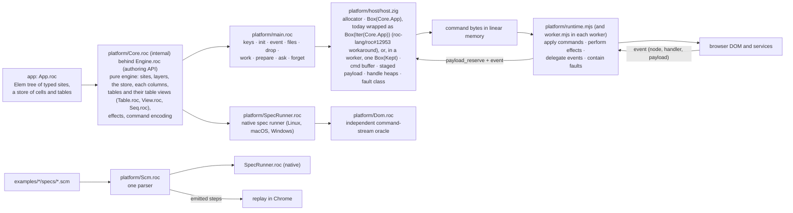

# Roc Signals — Target Design

This document is the single authoritative design for Roc Signals. It describes
the architecture we are building toward and the invariants every part of it
must hold. It is forward-looking and enduring: it describes the system as it is
meant to be, not the state of a work queue. Live work tracking belongs in issues
and pull requests.

## How to read and evolve this design

The main body defines semantic laws, ownership boundaries, complexity
obligations, and the reasons for them. The appendices hold detailed contracts
without making every representation choice a permanent principle:

- [Appendix A](#appendix-a-api-surface) records the engine API surface and the
  target vocabulary above it. Public module documentation and the
  [reference](www/content/docs/reference.md) describe what ships; a target
  signature is not a claim of availability.
- [Appendix B](#appendix-b-wire-protocol) records the Wasm exports, the command
  stream, event records and payload layouts. It is normative for one protocol
  version and evolves only through a coordinated producer/consumer change.

Paragraphs marked **Target** describe intended behaviour the engine does not
implement yet. They are design, not status: they say what the implementation
must converge on, and they never license a different interim meaning.

Internal representations may change when the replacement preserves these
contracts and improves measured cost or clarity. Scope-owned lifetime,
construction-site identity, one holder for each piece of state with what
changed taken from the write, and the command stream as the only output are
architectural laws; a column layout, a hash-table probe sequence, the width
of a signature word or a node-id encoding is an engineering choice. Neither an optimization nor a compiler
workaround may change application meaning.

Current setup, gates and measurement practice belong in
[contributing](www/content/docs/contributing.md); numeric baselines,
implementation gaps and delivery plans belong in issues.

## Thesis

Roc Signals exists so that a Roc developer can build an interactive browser UI
in pure Roc and trust it the way they trust the rest of their Roc code: values
in, values out, and reactive semantics that can be checked without a browser.

The application describes its UI once, as a tree of typed sites. Every dynamic
part of that tree — a piece of local state, a conditional, a keyed list, a
table view, a derived signal, an effect — is a *site*: one Roc closure
that owns its own typed storage. State the whole application shares lives in
a *store* that the root site holds. The reactive engine is ordinary Roc code
inside the platform. Each external input (a DOM event or an effect result) is
one pure turn over the engine's state that returns the next state and
a byte stream of rendering and effect commands. The engine re-evaluates only
the sites and holes that read what the turn wrote, prunes equal values
at every observation point, and emits only the DOM operations those changes
imply. There is no virtual DOM and no per-event re-render.

One rule shapes how state is held: **every write says what it touched.** The
engine never finds a change by comparing a large value with an earlier copy
of it. In Roc a value is updated in place only while it has exactly one
holder, and an earlier copy kept for comparison is a second holder: every
write would then copy what it changes, and the comparison would cost the size
of the value on top. So the engine keeps one holder for each piece of state
and learns what changed from the write itself, at two grains: which pieces of
state a turn wrote and, inside a table, which rows.

The host is deliberately small. A Zig Wasm host allocates memory, holds one
opaque engine state between calls, stages payload bytes and classifies faults.
A JavaScript runtime applies the command stream to the DOM and performs the
requested effects. Neither decides anything the engine has already decided.

The one-sentence wedge: **pure Roc, no VDOM, work local to what changed, and
fast native specs backed by the same specs replayed in a real browser.**

It is for Roc developers building interactive browser applications —
dashboards, forms, routed multi-page apps such as Conduit. It is not a general
replacement for the JavaScript ecosystem, not a UI toolkit for other languages,
not a native desktop GUI platform, and not a server-rendering platform.

## Product Goals

Each goal is a property the platform must hold for its whole life. Gaps between
this document and the implementation are tracked in issues.

1. **The idiomatic way is the correct way.** The simplest thing an author can
   write must be the thing the platform is designed for. An encoding trick, a
   positional convention, or boilerplate the platform could derive is a defect
   of the API, not of the author. A pointer zone's key is an application
   name handed back unchanged, not a workaround encoding: the platform
   never resolves the key or looks anything up by it.
2. **Composition is first-class.** UI is built from typed, reusable
   components: a type, its pure operations, and a view that is handed the
   shared state it uses and owns its local state and effects. A component
   names no application's store, so it can be published as an ordinary Roc
   package.
3. **The scaling promise holds for apps, not just the engine.** Work
   proportional to the changed set is a property authors get by writing
   idiomatic code. Where a natural idiom would defeat it, the platform provides
   the primitive (`derive`, keyed selection, row templates, tables and their
   views) that restores it, and the property is pinned by observable counters.
4. **Failure is controlled and legible.** An app that compiles and whose
   specs pass does not fail at runtime for a reason the platform could have
   told its author earlier, and what does fail is caught at the earliest
   layer that can catch it (see
   [How failure is controlled](#how-failure-is-controlled)). Every contract
   violation — a duplicate key, a value outside a switch's cases, an effect
   feedback loop, a malformed payload, an exhausted resource — is reported
   as a classified, readable diagnostic naming the rule and the construction
   site, identically natively and in the browser.
   A bare trap is never an acceptable way to fail. A silent no-op is
   acceptable only where this design names it, says why no earlier layer can
   catch it and says what the author has in its place: a test that sees it,
   or a rule that avoids it.
5. **There is exactly one door to the outside.** Events enter, and effects
   leave, through the declared effect channel and the command stream. Apps do
   not call JavaScript. A service the platform does not model is reached
   through a *port*: a declared request kind whose messages leave in the
   command stream and whose answers enter as turns, performed by JavaScript
   the page supplies at mount. The host never exposes its state to an app,
   and no JavaScript value enters Roc.
6. **Cost is visible and bounded.** Payload size, startup, per-event work, and
   memory are measured and budgeted, and in-flight work has fixed caps with
   typed refusal.
7. **Testable at the right boundary.** Reactive semantics, ordering, work and
   cleanup are asserted in fast, deterministic native specs. The same specs
   replayed in Chrome establish actual input, focus and integration behaviour.
   A decoded DOM model is evidence within its model, not proof of browser
   behaviour.
8. **Approachable and honest.** A Roc developer can learn the model from the
   documentation alone, and what the documentation says is what the platform
   does.
9. **Interaction and accessibility are part of correctness.** Controlled inputs
   preserve caret, selection and composition; focus is an explicit command;
   moving a surviving row preserves its DOM node.
10. **Intent and coordinated state are expressible directly.** Repeated
    occurrences stay distinct even when their payloads are equal, and one
    event expresses one atomic domain transition, decided by one pure
    function however many pieces of state it spans.

### Success criteria

- **Engine invariants:** native specs with work and effect counters, the
  `Dom.roc` oracle, roc-fuzz property targets, long seeded walks of every
  app in the native spec runner, and soak runs with flat live allocations
  and Wasm pages.
- **Author outcomes:** maintained apps contain no workaround encodings
  (pointer zone keys are names the platform only hands back unchanged); a
  write to one store cell wakes the readers of that cell, wherever they sit,
  and not the rest of the tree; a write to one row of a table costs the same
  engine work whatever the table's size; a one-row change in a keyed list
  does constant engine work outside the list's own reconciliation; every
  contract-error class has a spec asserting its diagnostic.
- **External evidence:** the keyed js-framework-benchmark run against declared
  comparison frameworks, Conduit passing its journey against a RealWorld
  backend in Chrome, and recorded compressed size budgets.

### When a capability is built

The platform builds a browser capability when real applications are expected
to need it. It does not wait for a maintained example to be blocked. What it
requires is that the capability lands whole:

- a stated use in real applications, and what an app must do today without
  it;
- an API in the platform's own vocabulary, with what it deliberately leaves
  out;
- bounds and the behaviour at each bound;
- a failure analysis: each thing that can go wrong, the layer that takes it
  and what happens (see
  [How failure is controlled](#how-failure-is-controlled));
- an Appendix B entry wherever it touches the wire;
- the same meaning in both spec runners, for every step that drives it. An
  input no runner can drive faithfully is named in
  [The `.scm` spec language](#the-scm-spec-language) and held by a contract
  test;
- a runtime contract test;
- a demonstration: an example upgraded to use it or, where no example fits,
  a test app with specs.

A capability is declined for a reason in this design, such as: it cannot
mean the same in both runners, it needs a synchronous answer the engine
cannot give, it crosses a Non-Goal, or a port serves it as well. It is never
declined for want of an example.

### How failure is controlled

Failure is inevitable: the outside world fails, resources run out, and the
platform, the compiler and the browser have bugs. Roc has no
failure-and-unwind channel, so a crash is never caught and resumed: it
poisons the instance. The platform therefore does not promise an app without
runtime errors. It promises that:

- an app that compiles and whose specs pass does not fail at runtime for a
  reason the platform could have told its author earlier;
- what does fail is caught at the earliest layer that can catch it, is
  legible, and does not corrupt what is left.

The layers, in order of preference:

1. **Impossible to write.** A type rules the mistake out and the compiler
   rejects it: opaque types, typed props records with defaults, closed tag
   unions, a payload type that fixes which handler an event takes,
   `EngineOnly`. A later layer is right only when no type expresses the
   rule.
2. **A value the app must handle.** A failure of the outside world arrives
   as typed data the app matches (`Refused`, `Timeout`, `Network`,
   `PortFailed(...)`, `FileFailed(...)`, `WorkLost(...)`, a `Try`), never as
   an exception and never fabricated. A mistake in the program is the next
   layer's: no value may disguise it.
3. **A contract error at the narrowest boundary.** A programmer error no
   type expresses, such as a duplicate key, is rejected where it is first
   knowable (when the program or a catalogue is built, at mount, at the end
   of the turn) with a classified diagnostic naming the rule and the
   construction site. It poisons the instance, and recovery is a fresh one
   (see [Error Containment](#error-containment)). How much outside input
   arrives is a bound instead, the next layer's. Outside data that breaks a
   rule the app must keep, such as two rows with one key in a server's
   answer, is still this layer: the app checks data where it enters.
4. **Bounded.** Every queue, table and buffer that grows with outside input
   has a declared bound and a declared behaviour at it (see
   [Boundedness](#boundedness)): a typed refusal where the work can be
   refused, as the in-flight cap answers `Refused`, and poison only where
   dropping would corrupt, as when a feedback loop fills the ingress queue.
5. **Contained.** What still goes wrong is confined (see
   [Error Containment](#error-containment)): a trap discards its batch and
   never publishes a prefix, a poisoned instance keeps the last applied DOM
   and refuses further calls, a worker fails alone, a port handler's throw
   becomes a value, and an executor fault is contained like a crash. This is
   the floor, never the plan for a failure an earlier layer can take, and it
   does not undo an effect already performed.
6. **Checked by tests the design requires.** An invariant no type expresses
   is held by a test (see [Testing Architecture](#testing-architecture)):
   roc-fuzz targets with reference models, the settle check after every
   step, seeded walks, soaks with flat allocations, contract tests of the
   runtime and the host against the wire, the independent `Dom.roc` oracle,
   both spec runners meaning the same, and pure `expect`s over decisions. A
   rule of an app's own logic, which the platform cannot model, is the last
   layer's.
7. **Left to the app's author.** This is allowed only as a stated
   trade-off: what is left, why no earlier layer can reasonably catch it,
   and what the platform gives the author in its place. That is usually a
   pure test that sees it and, where no test can, a rule that avoids it.
   Among those this design leaves: a component handed the wrong cell of the
   right type, a transition that left out a reset, and a write to a key a
   table does not hold.

A failure is taken at the earliest layer that is **reasonably practicable**,
and backed by later ones where they apply. That weighs API ergonomics, code
size, the Roc compiler as it is and the cost of a check on a hot path. Two
rules are firm:

- **A rule the compiler can carry is never left to a check at mount.** A
  contract error poisons the whole instance, and a check that runs only when
  its site mounts ships a typo in a rarely opened branch.
- **A bound whose count follows the app's data (rows drawn, messages
  received) is never a poison where a typed refusal or a structural bound is
  possible.**

Fuzzing controls the engine's own invariants. Generated sequences, checked
against reference models, hold propagation completeness, identity reuse,
effect lifetime, table views equal to a rebuild, allocation balance and wire
decoders that are total. A capability that adds an engine sequence adds it
to a fuzz target.

A capability's failure analysis is written against these layers, and is part
of landing whole (see
[When a capability is built](#when-a-capability-is-built)).

## Non-Goals

Each item is a scope decision with the condition under which it would be
reconsidered.

- **Server-side rendering, hydration and SEO.** The platform is a client-side
  runtime. Any future server path must keep the command stream as the only
  render output; hydration would be the engine adopting existing DOM ids, never
  JavaScript reconstructing meaning.
- **A native desktop GUI host.** The engine is web-only. A GUI platform would
  be a separate platform consuming its own command vocabulary, not a second
  engine.
- **Multiple roots per Wasm instance.** One mount owns one instance.
  Reconsidered only if many-widget embedding measurements show per-instance
  cost is unacceptable.
- **Recovery from allocation failure inside an instance.** Running out of
  memory, a Roc crash or a failed `expect` poisons the instance; recovery is a
  fresh instance. Separate prepare and commit phases, and allocation-failure unwinding,
  are deliberately not part of the architecture: the engine state is
  Roc data updated in place, and a Roc call has no failure-and-unwind channel.
  Reconsidered only if Roc gains one.
- **Host-held Roc values.** The host never holds, clones, compares or drops a
  Roc value other than the one boxed engine state, a worker instance's one
  boxed prepared state (see [Prepared state](#prepared-state)), and
  the byte lists it exchanges with Roc. Each box is opaque, moves whole
  into one Roc call and back out of it, and is dropped only by Roc, so the
  host needs no rule for sharing a Roc value: it never has one to share. The
  converse is allowed: Roc may hold a handle to a browser object, whose
  allocation is a slot in a typed host heap (see [Files](#files)). The host
  mints it, Roc's reference count is its lifetime, and the host learns of
  its last release when Roc frees it; the host never holds the handle.
- **A general-purpose JavaScript FFI.** A use the effect channel cannot
  express is a reason to extend its typed vocabulary, not to bypass it.
  Ports are that extension for services the page supplies, not a bypass. A
  port is one of three shapes of the effect channel — a command, a call with
  one answer, or a subscription — under a name the program declares and the
  page's JavaScript implements. Roc never calls JavaScript synchronously,
  never holds a JavaScript value, and is never called by it; every message is
  data in a declared encoding with the channel's id, bound, scope and
  lifetime. A capability the platform models (HTTP, storage, timers, history,
  focus, workers, files) is not a port's business, and nothing that needs a
  synchronous answer (a default to prevent, a layout measurement inside a
  turn) can be one. The hosted effects a worker task calls (see
  [Workers](#workers)) are not an FFI either: they are a closed, typed
  vocabulary of the platform (reading a file, building one), callable only
  inside a job in a worker, never an import table an app extends.

## Non-Negotiable Constraints

1. **No compiler changes.** Everything is ordinary Roc plus a thin Zig host.
   Reproducible compiler defects are filed upstream and worked around narrowly
   (see [Compiler limitations](#compiler-limitations)); they never become
   platform semantics.
2. **No guessing or recovery that changes meaning.** Neither the engine nor the
   host guesses what changed, scans to rediscover identity, or repairs invalid
   input. What a turn changed is what its writes say they wrote. Invalid
   input is a contract error.
3. **Work scales with what changed, and the data structures must honour it.**
   An event re-evaluates only the holes and sites that read what it wrote and
   emits only the DOM operations those changes imply. A path that is linear in
   the changed set on paper but reaches it by scanning all nodes, all sites, a
   whole table or the whole DOM, or by comparing a large value with an
   earlier copy of it, is a violation. See
   [Complexity budget](#complexity-budget).
4. **The engine is pure Roc; the host only allocates, stages and classifies,
   and in a worker instance performs the platform's synchronous hosted
   effects on handles through the worker script.**
   All reactive scheduling, structural reconciliation, identity, effect
   lifecycle and ownership policy live in the platform's Roc engine. The Zig
   host owns the allocator, the boxed engine state between calls (in a worker
   instance, at most one boxed prepared state instead), the command buffer,
   one staged payload, the typed heaps behind the handles an app holds, and
   fault classification. JavaScript applies commands and performs effects. Reactive or structural logic in either is a
   defect.
5. **Types are never erased across a boundary that can disagree.** A site's
   storage is typed by the site's own closure; dispatch between sites is by
   message, never by a host-interpreted value. The encoded bytes that cross
   the Roc boundary are the command stream, event payloads, boot bytes,
   worker payloads and port messages, each with a declared encoding that Roc
   decodes and validates (a port message is JSON text in the platform's
   `PortJson` encoding, with its bytes and files beside it, which Roc turns
   into a typed value or a typed decoding error). In a worker instance only,
   and only inside a call that runs a task or a preparation (`work`,
   `prepare`, `ask`), the hosted effects also move a file's raw bytes, which
   carry no encoding and no type: a read (`read!`) answers a fresh
   `List(U8)` that the host allocates, fills from the file and hands to Roc
   with a single reference, and an append (`append!`) gives the host a list
   that it lends to the worker script, which copies the bytes out, and then
   releases. The only other values
   the host builds for Roc are freshly minted handles, each with a single
   reference, and the status codes and sizes a hosted effect answers.
6. **The command stream is the only output of the page's instance.**
   Everything the outside world
   observes — DOM structure, attributes, listeners, effects, navigation,
   storage, title, focus — is a command in the stream returned by one host
   call. There is no side channel, with one narrow exception: the list of
   handles Roc released during a call, which the runtime reads after it has
   applied the call's batch and performed its effects. It decides nothing:
   it names only handles no Roc value can reach any more. A
   worker task's effects act only on handles its job was sent or made, and
   reach the page only as its answer, an ordinary result.

## First Principles, Not Imitation

We derive the model that fits Roc — a pure, value-oriented language with no
mutable globals and no runtime read tracking — rather than porting another
framework.

**Elm** rebuilds the view and diffs per event: O(view size). We keep Elm's
discipline (pure description, effects as data) and reject the mechanism.

**Solid** discovers dependencies by running code under a mutable "current
observer". Roc cannot observe its own reads, so we cannot copy the mechanism.

**Incremental / Adapton** are the lineage we can build on: an explicitly
constructed dependency structure, ordered propagation, and an equality cutoff.

**The reframing for Roc.** Dependencies are *declared*: a `Signal(ctx, a)` carries
a signature of what it reads, the local layers and the store cells, built by
`map`/`map2` and the state, cell and row accessors before anything runs. The
engine never runs a closure to find out what it reads. Nesting gives the
order: a state, derived value or row is a layer at a fixed place on its path,
and a reader can only be mounted below the layers it reads. A store cell is
above every layer, so it is read at any depth.

**What changed comes from the write.** Elm's diff, and a cache of the previous
value in any other design, find a change by holding the value from before.
Roc updates a value in place only while it has one holder, so holding the
value from before turns every write of a large value into a copy, and the
comparison costs the size of the value as well. The engine holds each piece
of state once and has the write name what it touched: a handler answers the
set of layers and cells it wrote, and a table's operations record the rows
they changed. Equality pruning stays where values are small: at holes, at
the rows of a list, at `derive`.

**The tradeoff, stated plainly.** Declared reads are conservative. A hole that
reads `{cond, A, B}` to express `if cond then A else B` is re-evaluated when
`B` changes even while `cond` selects `A`; equality pruning suppresses the
output, not the evaluation. Value-dependent structure uses `when`, `switch`,
`each` and `table_view`, which rebuild a subtree when its shape changes, so
dynamic reactivity and dynamic structure share one mechanism. The same
conservatism has an app-level consequence: one coarse piece of state with
many projections wakes every projection on every change. The partitioning
rule — independently changing concerns are separate cells or separate local
states, rows edited by key are a table, and state that belongs to one row is
that row's — is the documented pattern that keeps app work local.

## Architecture



The engine is `Core.roc` and three modules of its own for tables: `Table.roc`
(rows by key and the changes from a turn, which an app imports
to write a table), `View.roc` (a sorted, filtered, windowed view kept up to
date from those changes) and `Seq.roc` (a table view's ordered keys). `Engine.roc` is
the authoring API over them. `EngineOnly.roc` holds the one value that lets
the engine, and no app, call a table's bookkeeping.

The repository has one platform (`platform/main.roc`), web only, shipped as
one release bundle. An app has one entry, `main.roc`, binding its `program`
as `main`, and the platform builds it for two targets with per-target link
inputs:

- **`--target=wasm32`** compiles the app and engine to Wasm with the thin
  host. It is the product.
- **`--target=x64musl`** (Linux), **`arm64mac`** and **`x64mac`** (macOS)
  and **`x64win`** (Windows) give the app's native `.scm` spec runner: the
  platform's `SpecRunner.roc` drives the same `main` against the `Dom.roc`
  oracle, linked with a small native host (`host/spec.zig`: entry point,
  allocator, file and output services, worker jobs in child processes). The
  Wasm link drops the runner, so the browser module does not grow. Because
  the engine is pure, the runner drives it by calling its turn
  functions and decoding the command stream; there is no simulated host
  with its own semantics. The host is one file for every system: what
  differs between systems (how a file is opened, a process started or
  memory obtained) is a small set of functions in `host/os_posix.zig` and
  `host/os_windows.zig`, never a difference in what a step means, so a spec
  means the same on every system the runner builds for. The Windows host
  links no C runtime, only kernel32, so the platform carries no Microsoft
  library and nothing is fetched for that target.

The same runner walks an app (`--walk`): a seeded sequence of user events
on live controls and of what the browser does around the app, from a fresh
mount, with every worker job run for real in a child process and every
other request answered from the answers the app's own specs give. It is
the platform's test of the engine over long sessions of real apps, built
from each app's ordinary `main.roc`, so an app carries nothing for it.

Fuzz targets cannot share that entry: roc-fuzz requires a `target : Target`
value and links its own libFuzzer host, and a platform has one `requires`.
The platform's own targets, under `fuzz/` and beside the test apps that
drive the engine, are ordinary roc-fuzz apps: a roc-fuzz release is their
platform, and the engine is a package, `platform/main-fuzz.roc`, a package
root beside `main.roc` over the same files that exposes the internal
`Core`, the runner and the oracle. That works because the engine is pure:
no module of the package reaches a hosted function (a job's effects arrive
as values, see [Workers](#workers)), and the modules that do (`Files`,
`Effects`, `Hosted`, `Cli`) belong to the platform alone. The package is
repository-only and not in the release bundle, and no app uses it: an
example that fuzzes its own pure logic does so with roc-fuzz alone, in a
target named for what it checks (`fuzz-<subject>.roc`) that imports
nothing of the platform. roc-fuzz's allocation counters serve the fuzz
targets; the native host counts allocations itself for the spec runner's
walks and soaks.

Both hosts run the one engine and add no semantics of their own. What a test
observes of the engine (its work, its effect table, its allocations) comes
from the engine's own counters, the `Dom.roc` oracle, and the allocator
counters of whichever host runs it.

## Representation: Sites That Own Their Storage

The engine's data model is **one closure per site, each capturing only its
own typed storage**, with the application's shared state in one store that
the root site holds.

### Sites and messages

A mounted site is an `Inst(ctx)`: a closure taking the current environment, a
message and the turn accumulator, and returning its replacement, an
outcome and the accumulator. Messages are:

- `Fire(path, pos, handler, payload)` — route an event or effect result down
  the site path to the block that owns the target.
- `Changed(mask)` — some of what `mask` names changed; refresh what reads it.
- `Dispose(remove)` — release this site, emitting `REMOVE` for its top-level
  nodes when `remove` is set (an ancestor that removes its own DOM passes
  `False` to children).

Every site kind — `state`, `when`, `switch`, `remount_on`, `each`,
`table_view`, `derive`, `resource`, effect sites, and the root site, which
holds the store and the view's top block — implements these three messages.
The engine therefore needs no node table, no erased value registry and no
type tags: the closure's own captures are the typed storage, and the only
dispatch is the message.

### Contexts, layers and cells

A site's environment is a typed context:

- `Root(st)` — the top of the tree. It carries the program's store, whose
  store type is `st` (`{}` for a program without one).
- `In(outer, s)` — inside a state, derived or asynchronous layer of type `s`.
- `Row(outer, item)` — inside one row: of an `each` site (its key and item)
  or of a table view (the table's key).

Each `In` or `Row` adds a *layer*, named by its index on the path from the
root. Values crossing into a nested context are lifted explicitly (`lift`,
`lift_row`). Lifting changes the reader's path through the environment, never
what it reads: a layer keeps its index.

Every context type also answers one method, `store`, with a
`Reach(ctx, st)`: how that context reads the store, and how it returns itself
with a function applied to the store. `Root` answers from what it carries;
`In` and `Row` build theirs on the enclosing context's. A store *cell* is
therefore read and written in any context, at any depth, with no `lift`, and
a function that reaches the store asks of its context:
`where [ctx.store : () -> Engine.Reach(ctx, st)]`. Reading and writing are
one requirement, not two: a reach holds both.

A function that must not occur under a row asks a separate question:
`where [ctx.outside_rows : () -> Engine.OutsideRows(ctx)]`. `Root` answers
it, and `In` forwards its enclosing context's evidence; `Row` does not.
`OutsideRows(ctx)` is opaque, state-free evidence, with no environment or
store reference. Thus `on_document_key` cannot compile in a row or in a
layer nested within one, without a mount-time failure that follows row data.

**Read signatures.** A `Signal(ctx, a)` is `{ mask, read, sel }`: a signature of
what it reads, a reader from the environment, and an optional keyed selector.
A signature has two words. The layers' word has a bit for each layer index
and the cells' word a bit for each cell's position in the store, each taken
modulo the width of its word. A signature can only over-approximate: two
layers far enough apart on one path, or two cells far enough apart in the
store, share a bit, and a shared bit costs an evaluation that equality
pruning then discards. A reader of something that changed is never skipped.
A cell never shares a bit with a layer, so a store of any size leaves the
precision of local state as it was, and layers nest without a limit.

**Write sets.** What an event wrote is kept exactly wherever exactness
decides something. A write set names the layers written by index, without
wrapping, and carries the cells' word beside them. Which site settles a
written layer, what a site hands up, and what a reparented reaction may still
touch are all read from the set, never from a signature. Only the root
settles cells, so for them the word is enough: a write to one cell also
visits the readers of a cell that shares its bit, and they prune.

A `State(ctx, s)` is a piece of state as one context sees it, local or
shared. It is a lens (`get`, `modify`) with what a read of it listens to
and what a write through it reports. A `HandlerOf(ctx, p)` is an environment
transformer over a typed payload that answers what it wrote,
`(ctx, p) -> (ctx, written)` (`Handler(ctx)` is its text alias),
and a `Reaction(ctx, a)` is the same for an effect result. The set is the
handler's answer, not a property fixed before it runs, so a handler that
decides what to write from what it reads reports only the writes it made,
and nothing is declared twice.

### The store

State that more than one part of the application cares about (the session,
the current location, a page's loaded data, the rows of a list) lives in the
*store*: a set of *cells*, each one piece of state read and written through a
`Cell(st, a)`. In a large application
the code that writes a piece of state and the code that reads it are often
far apart; because every context reaches the store, no level between them has
to carry it.

- **Described once.** An app describes its store with Roc's record builder:
  each field is `Engine.cell(init)`, `Engine.table(rows)` or another
  description, so a feature describes its own cells and the app nests them:
  `{ session: Engine.cell(Anonymous), article: Article.cells({}) }.Engine.Cells`.
  The builder combines fields pairwise (`Cells.map2`), so a description's
  storage is the nested pairs of its fields' storage, and each cell's place
  in that nesting is known where the description is built. The builder
  takes two fields or more; a description of one cell is the cell itself,
  named by `map`: `Engine.cell(init).map(|c| { c: c })`.
- **Lenses are generated, never written.** From its place each cell gets its
  position, which gives its signature bit, and its getter and modifier,
  composed from the pair projections on the way down. Two hand-written
  lenses can overlap, and a write through one then leaves a reader of the
  other stale with nothing in the types to catch it; generated from the
  description, each covers exactly its own cell. What is generated is a
  modifier, not a setter: a modifier hands its function the cell's value
  uniquely owned, where a setter is given a value built while the old one
  was still held, which for a large value is a copy. The storage is the
  builder's
  nested pairs, not a record the author wrote, because Roc has no field
  accessor or updater as a value to address such a record with (see
  [Compiler Limitations](#compiler-limitations)). The author never spells
  the storage type: `_` stands for it in every annotation.
- **Named.** `Engine.store(tag, cells)` builds the store, and `tag` is a
  value of a type declared for that store, usually the one tag of the module
  that builds it. The tag is held nowhere. It is part of the storage type,
  `Stored(tag, st)`, and so of every cell, write and reach of that store:
  a cell of another store is a compile error wherever this one is reached,
  even when the two stores' cells have the same types. It is a value, not a
  phantom type fixed by an annotation, because an annotation can be left
  out.
- **Started.** `store.cells()` is the record of cells the description
  described. `store.with_initial(cell, value)` starts a cell at a value that
  depends on the boot data, and `Engine.program_store(cfg, start, view)`
  mounts the view over the store `start(boot)` gives. A start is not a
  write: a table started this way has no changes.
- **Held at the root.** The root site is the store's one holder. For an
  event it moves the store into the root context and takes it back when the
  event has unwound, exactly as a state site moves its value, so a write at
  any depth receives its cell's value uniquely owned. The store sits behind
  the root site's closure, like every site's storage, because the host holds
  one type of box and that type cannot carry an application's storage type.
- **Started again by a write.** A cell lives as long as the instance and is
  never disposed, so state that should start fresh, such as a page's form
  once the reader leaves the page, is started again on purpose.
  `description.with_reset(|cells, reset| ...)` hands a description's cells out
  together with one write that puts every cell it describes back to the
  value it was described with (not a value `with_initial` gave it). The
  write is generated where the lenses are, so a cell added to the feature
  later is covered with no other edit, and it goes through each cell's own
  lens, so a table in the group is put back as a whole rewrite. The engine
  does not apply it: the transition that leaves the page includes it (see
  [Values, Handlers, and Coordinated State](#values-handlers-and-coordinated-state)).

### Blocks and holes

The static content of a site that draws no rows is flattened at mount into a
*block*:

- *holes* — dynamic text, attributes and element properties, each with its read signature, reader
  and last emitted value;
- *reference holes* — named element addresses, whose signal updates the
  reference map without emitting a DOM command;
- *handlers* — in mount order, so a handler number is a dense index;
- *children* — nested sites with their static read signatures;
- the block's node ids and its top-level nodes (for removal).

A refresh with mask `m`, the signature of what changed, re-evaluates the
holes whose signature intersects `m`, emits a command only when the new
value differs from the last one, and
descends only into children whose signature intersects `m`. A site's reads
are computed statically (`elem_reads`) without mounting it, including the
reads of branches that are not currently mounted, so a conditional listens to
everything it could need. A layer site's reads include its own layer and the
layers below it: a pass from above reaches a changed layer only through the
signatures of the sites above it.

An element takes one handler per event type, whatever its policies or payload
kind. Two handlers for one event type on one
element are a `contract` error at mount, naming the event, the element and
the site: the runtime keeps one listener per event and element, so the
second would be dropped without a word. Two things that must both happen are
one handler made with `also` (see
[Values, Handlers, and Coordinated State](#values-handlers-and-coordinated-state)).

### Keyed lists: templates and typed columns

`each(rows, key, template)` draws a list that is a plain value, and it has
its own representation:

- The row template runs **once per site**, against a `RowRef` accessor rather
  than a row value. It compiles to a DOM template (sent once as `TEMPLATE`)
  plus a hole table: text, attribute, property, event, reference and nested-site placeholders.
- Rows are **typed columns** indexed by slot: items, keys, the last value of
  every live hole, nested site instances, dirty marks, plus `order` (slots by
  position), a free-slot list, and an open-addressing key index from the exact
  key bytes to a slot.
- Creating a row costs one `INST` command and column appends. A row whose
  template contains nested sites (`state`, `when`, `each`) is *dynamic* and also
  owns a small list of child instances.
- Handlers in a row template receive the row's key and item through the
  context when they fire; they never capture a row.
- Keyed selection (`keyed` with `RowRef.select`) lets a row depend on "is this
  row the selected one" so a selection change re-evaluates exactly the old and
  the new selected rows.

Reconciliation compares the new list against the site's columns with fast
paths for a common prefix and suffix, swapped ends, pure insertion and pure
removal, and otherwise a keyed move planned with a longest increasing
subsequence, so surviving rows move rather than rebuild. A kept row whose new
item is equal to its old item is pruned; a changed item marks the row dirty and
only its live holes that read the row layer are re-evaluated.

That comparison is linear in the list and needs the list from before, which
is right for a list that is small or computed: the options of a select, the
items of an answer, a list a `derive` produced, a few rows in local state.
Rows the user edits by key, and anything sorted, filtered or long, are a
table drawn through a view.

### Tables and views

A *table* is a store cell that holds rows by key, made with
`Engine.table(rows)`. Its cell is an ordinary `Cell(st, Table(k, v))`; its
value changes only through the table's own operations, and each of them
names the rows it touches.

- **Rows by key.** `Table(k, v)` maps a key to a row, finding it by the key's
  own equality and hash. `insert`, `put`, `replace`, `update` and `remove`
  each touch one key; `load` and `update_all` replace every row. `get`,
  `contains` and `len` read, and so do `fold` and `to_list`, which visit
  every row in no particular order. A table has no order of its own: an
  order the user chooses is a field of the row that a view sorts by.
- **This turn's changes.** Beside its rows a table keeps, for every key
  written in the current turn, the row as it was when the turn began, or the
  fact that it was absent. A key written twice keeps its first entry, so the
  changes are bounded by the distinct keys one turn writes. An operation that
  replaces every row does not record per key: it marks the changes as a whole
  rewrite. The changes are how a keyed write says which rows it touched, and
  where each used to sit.
- **Counted.** A table counts its writes and remembers the count at which its
  changes began. A view remembers the count it is up to date with. A view
  that has seen exactly the count the changes start from can bring itself up
  to date from the changes; any other has missed writes and builds again.
- **No write can leave a view behind.** A table cell's generated modifier
  notes the table's identity and where its changes began before the function
  it applies runs. If what comes back is that same table, changed by its own
  operations, the changes stand. If it is any other table (a new one, another
  cell's, one saved in an earlier turn), the cell stores it as a whole
  rewrite. So a `set` of a new table, a generated reset and a function that
  ignores its argument are all whole rewrites, and none can leave a view
  showing rows the table no longer has.

`Table.update`, `replace` and `remove` of a key the table does not hold leave
it as it was, because an earlier write of the same event may have removed
that row. `Table.insert` of a key already present, and a table built from two
rows with one key, are `contract` errors.

A *table view* (a view in this section) draws part of a table: the rows a query
keeps, in the query's order, and of those only the rows inside a window.
`Engine.table_view(table, { query, plan, window }, template)` is its site.

- **The query is data.** `query` is a value the site can compare: the filter and
  order the user chose, the kind of thing a URL or a saved filter holds. `plan`
  turns it into a `QueryPlan(k, v, s)`, the three functions a view needs: `keep`
  (is this row in the view), `sort` (the value it is ordered by) and `compare`
  (the order of two sort values). A record of functions cannot be compared, so
  with the functions as the query the site could not tell a changed query from
  the same one.
- **The order is total.** `compare` answers `Same` only for a row's own sort
  value. A view finds a row's entry again by its sort value alone; two rows
  that compare `Same` are a `contract` error at mount, after a write, and
  between the keyed writes of one event. The site absorbs the changes one key
  at a time, so two rows that trade places in one event tie once the first
  is placed and the second is not, though they never tie before the event
  or after it. A sort value therefore ends with the key, whatever the
  sorted field.
- **The view's storage.** The site owns the ordered keys of every row the
  query keeps, each with the sort value it was placed by, the window, and the
  keys the window shows. The ordered keys are held in chunks, so placing a
  row moves at most one chunk's entries and finding the chunk is a binary
  search; because an entry carries its sort value, a search never reads a
  row.
- **The window.** `window` is `{ start, count }`. The site keeps the place of
  every row the query keeps but creates nodes only for the `count` rows from
  position `start`. Scrolling is a write of the window. A window that
  reaches past the last row draws the rows there are, and
  `Engine.every_row`, whose count is the largest there is, draws every row
  the query keeps.
- **Kept from the changes.** When its table was written, the site reads the
  changes. For each written key it works out the key's place under the row as
  it was (from the changes) and under the row as it is (from the table). If
  the place is the same, the ordered keys are not touched; otherwise the
  entry is removed and inserted again. The rows drawn are worked out again
  only if a change landed at or before the window's last row.
- **One change of the rows drawn.** A pass that reaches the site brings the
  ordered keys up to date with the table, reads the query and the window,
  and only then changes the rows drawn, once: one comparison of the rows
  drawn before with the window now. An event that writes two of the table,
  the query and the window therefore never takes a row out of the window
  and back. A row drawn before the event and after it is one row
  throughout, and no row is created that the event does not leave drawn.
  The pass that reaches the site carries every write of the event the site
  can read (see
  [Glitch freedom and ordering](#glitch-freedom-and-ordering)): a local
  state written with the table has joined it above the site, and a
  `derive` of that state has followed. So the table, the query and the
  window arrive together, whichever of them are cells and whichever local.
- **Applied as row operations.** The site's rows are an `each` site's rows:
  the same once-per-site template, typed columns, nested sites, fire path and
  disposal. Only reconciliation differs. A row that left the window is
  removed, one that entered is created, one that moved is moved with its
  nodes and anything nested in it, and one whose row was written is marked,
  so its holes that read the row are re-evaluated and pruned there. No list
  of rows is built, kept or compared, and the commands are the ones an
  `each` site emits. Rows that enter in one turn are created from the first
  to the last, each before the next row that stays put, as `each` and a
  mount create them. For rows that own requests that is the order the
  requests are issued in, and so which are refused at the in-flight bound.
- **Rows are found by the typed key.** The site indexes its rows by the
  table's key, through the key's own equality and hash. It never makes a
  text of a key to find a row: an inspected value is a debugging
  representation, and two keys that print alike must not become one row.
  Text keys are the contract of `each` alone.
- **Rebuilt when the changes cannot serve.** The site builds its view again,
  with a pass over the table to filter and a sort of the rows kept, when it
  has missed writes, when the table was rewritten whole, when the query
  changed to an unequal value, and when the changes are so large next to the
  table that absorbing it would cost more. A rebuild costs the table,
  however few of its rows the view keeps, so the changes are weighed against
  the table's size: a view of a few rows of a large table absorbs a write of
  all of them. Rows that are in the window before and after a rebuild are
  kept, not recreated.
- **A drawn row is handed its row.** The template receives the row's key, fixed
  for the drawn row's lifetime, and a `State` of the row. A read is the row at
  that key in that table; a write is `Table.update` of that key through the
  table's cell. A component drawn over a `State` therefore draws a table's row
  unchanged, and a write through the row's `State` can reach no other row and no
  other table. Any other write (remove, insert, a write of several rows) goes
  through the table's cell. A row read after its key left the table in the same
  event is a `contract` error naming the site.
- **Up to date before anything else.** On every `Changed`, whatever it names,
  a view site first brings its view up to date with its table, which is a
  comparison of two counts when nothing was written. The root's pass
  carries every cell a turn wrote and is the turn's first, so a refresh
  that starts at a layer's site afterwards finds the view up to date. The
  site checks all the same: drawing from a view the turn's writes have
  passed would name rows the table no longer has.
- **Cleared when the turn ends.** After the turn's one `Changed` pass the
  root site clears the changes of each table the turn wrote (see
  [One turn](#one-turn)). Every view of a table, wherever it is mounted,
  reads the same changes in that pass; kept longer, the changes would describe
  rows relative to a state no view remembers, and would go on holding their
  earlier values.

A plain reader of a table cell (`todos.signal().map(|t| t.len())`, one row by
key) is an ordinary reader of the cell: it is evaluated on every write to the
table and pruned at its hole. Only a row of a view wakes for its own row
alone.

`Table.inverse` gives the writes that undo what the changes hold, and
`Table.apply` applies such a list, recording each write like any other. The
changes are gone when the turn ends, so an inverse is taken in the event that
made the writes. `Table.changes` reads the changes themselves: each written key
with its row as it was.

The changes' bookkeeping is the engine's alone: clearing them, giving a table
its cell's identity, judging what a write of the cell left, and reading the
two counts. An app that gave another table the cell's identity would pass
it off as the cell's own, and every view would go on showing rows the table
no longer has. Roc has no visibility between a module's own and
everyone's, so each of these operations takes an `EngineOnly` as its last
argument: a value of an opaque type in a module the platform does not
expose, which an app can neither make nor name. The operations are listed
with the type, and an app cannot call them.

**Known limits.**

- A change of query, a whole rewrite of the table, changes large next to
  the table and the mount of a view each cost a pass over the table and a
  sort of the rows kept.
- A move is linear in the rows drawn: the window's changes are found by
  comparing two windows. A view is meant to be windowed; with every row
  drawn, one moved row costs the whole view.
- A row's own state (a `state` nested in its template) goes when the row
  leaves the window, by a scroll, a change of query, or a move past the
  window's edge. State that must outlive that is a field of the row.
- Each view of a table pays for each written key, and each plain reader of
  the table is evaluated on each write to it.
- A table is written with `update`. A `set` of a table built from a reading
  of the same cell is still a keyed write, and copies the table.
- A write to a key the table does not hold writes nothing and reports no
  error, so a row handler that names another table's cell by mistake is
  silent. An error would punish a write that lost a race with its row's
  removal, which no app can avoid. An `expect` over `Store.after` sees that
  the transition wrote no row.

### State, derivation and conditionals

- `state(init, body)` adds a layer holding a typed value per instance of its
  context (per row inside a row). It is *local* state: it is created with the
  piece of the view around it and goes with it. A handler below it writes
  through the state lens; the layer reports itself when written.
- `derive(input, body)` evaluates `input` once per change of what it reads,
  exposes the result as a new layer, and stops propagation when the
  recomputation is equal. Readers that read only the derived value do no work.
- `resource(input, cfg, body)` is the asynchronous counterpart of `derive`: a
  layer whose value is folded from the answers to requests issued for its
  input (see [Supersession and asynchronous layers](#supersession-and-asynchronous-layers)).
- `when(cond, yes, no)` and `switch(sel, cases, body)` build only the selected
  branch, as a block anchored by an empty text node, and rebuild it when the
  selected value changes. `switch` lists every case so its static reads are the
  union over them; a value outside `cases` is a contract error. Because an
  unselected branch is never built, recursive UI is expressed directly.
- `remount_on(key, body)` builds `body()` and, when `key` changes to an
  unequal value, disposes it and builds it again, as `switch` does when its
  case changes. It is how local state that belongs to one key, such as a
  draft for the open message, starts again when the key does. The
  site keeps the key to compare, so a key is small, such as an id.

### In-place ownership

The engine's speed depends on Roc updating each piece of state in place. The
ownership law that makes this hold is:

- **One holder per piece of state.** Exactly one closure references a site's
  storage, and the root site alone references the store. Consuming the
  closure and rebuilding it with the updated storage leaves the storage
  uniquely owned, so list, record and table updates happen in place.
- **The environment is moved, not shared.** A handler receives the context by
  value and returns it. A state's value moves into the environment for the
  reducer and comes back out, and the store moves into the root context and
  comes back out, so a reducer or an `update` sees its value uniquely owned.
- **No earlier copy is kept to find a change.** States and cells do not keep
  the previous value for equality pruning, because that copy would be a
  second holder and every write would copy what it changes. What changed
  comes from the write. Pruning happens at holes, rows of a list and
  `derive`, where the values compared are small.
- **The one earlier state the engine keeps is bounded and brief.** A table's
  changes hold, for each row a turn wrote, that row as it was when the turn
  began. It is one row per row written, never the table, and it is dropped
  when the turn ends. A row that holds a large value and is written in part
  is therefore copied once in a turn that writes it.

Patterns that hold this law against current compiler behaviour (wrapping a
site's captures in a single-tag `Held`, returning a rebuilt site from each
branch directly) are workarounds for upstream issues and are marked as such in
the code. They are not semantics. One defect has no local workaround: in
optimised builds a large value held by a site's closure, a list or a `Dict`
alike, is copied on every write (roc-lang/roc#12957), and every site's
storage and the store are held that way. The design assumes the fix: the law
above is what the engine asks of the compiler, and a write to a large cell
or table is constant only where the compiler honours it.

The same law constrains apps. These patterns copy silently on every update:

- filtering or mapping a list that another reader still holds;
- keeping a large state below smaller ones instead of outermost;
- deriving projections that retain the whole state;
- a `set` of a value built from a reading of the same large cell, or an
  `update` whose function holds that reading. The reading is a second
  holder. An `update` by a function of the value alone is in place.

Per-event allocation counts are how such a copy is caught; a soak's plateau
shows only what is retained.

Memory is reclaimed deterministically by reference counting: disposing a site
drops its closure, which releases everything it captured. The structure is a
tree of closures with no back-references, so there are no reference cycles.

## Values, Handlers, and Coordinated State

A layer or a cell describes a current value. An event describes an
occurrence. Equality prunes value propagation; it never merges two separately
accepted events. A report replaced before delivery was never accepted:
a source declared as a report states a value rather than an occurrence.

State lives in three places, and each is written in its own way:

| Place | Holds | Lives | Written by |
|---|---|---|---|
| Store cell | State more than one part of the app cares about | As long as the instance | A write (`set`, `update`) in a decision's list |
| Table (a store cell) | Rows edited by key and drawn sorted, filtered or long | As long as the instance | The table's operations, in a write of its cell or through a view row's `State` |
| Local state (`Engine.state`) | What one piece of the view cares about: whether a menu is open, the text of a draft | As long as that piece is mounted; `remount_on` starts it again | `State` reducers |

- **A handler is a pure environment transformer.** It runs only when its
  event fires, receives the payload, and answers the environment with its
  writes applied and the set it wrote.
- **Local state is written by reducers.** `update`, `update_by`, `set_value`,
  `set_value_by` and `on_result` are applied to the value the
  state holds at that moment. The same `State` API writes a table view's row, and
  `cell.state()` gives a component written over a `State` a cell to draw
  without knowing it is one.
- **A write to shared state is a value.** `cell.set(value)` replaces what a
  cell holds; `cell.update(f)` applies a function to it. Each is a
  `Write(st)`: which cells, and how. `update` hands `f` the value uniquely
  owned, which is what a large value needs; `set` is for a value that does
  not depend on the old one.
- **A decision is one pure function from a reading to a list of writes.**
  `Engine.handle(|payload| writes)` makes a handler of one and
  `Engine.react(|issued_for, res| writes)` a reaction. `handle_by(signal, ...)`
  and `react_by(signal, ...)` also give the function a reading of `signal`, taken
  once, when the event or the answer arrives and before any of the
  decision's own writes. A reading of several values is one `Signal` of a
  record: `Signal.map2` has the shape Roc's record builder calls, so
  `{ a: va, b: vb }.Engine.Signal` reads what both read.
  `Engine.does(writes)` is the handler of a list that needs neither the
  payload nor a reading. These constructors, the reducers `set_value` and
  `set_value_by`, and handler composition are generic over the event's
  payload: text, files or a later declared kind use the same family. A
  handler of one payload can attach only through a kind of that payload.
  A transition usually touches several cells that must agree. One function
  sees one reading and returns every write, so there is no order to get
  wrong; a reaction per cell would decide the same transition again for each
  cell, each from a different state of the others, and a wrong order would
  give wrong output with no error.
- **The write set is taken from the list.** The engine applies the list in
  order and reports exactly the cells it names. A handler carries no static
  write mask and nothing is declared twice. A decision that returns `[]`
  writes nothing, wakes no one and runs no pass.
- **Order inside a list.** Writes to different cells are each computed from
  the one reading, so their order cannot matter. Two writes to one cell are
  applied in order: an `update` after another write of its cell sees that
  write's result, and a write of one cell after the reset of its group
  refines the reset ("start again, but with this"). Any other `set` or reset
  over a cell the same list already wrote is a `contract` error: every value
  in the list comes from one reading, so it could only throw the earlier
  write away. The rule is per cell. Inside a table, the row operations of
  one list apply in order, and the engine does not see a row replaced twice.
- **`also` makes two handlers one event.** `first.also(second)` runs `first`
  and then `second` for the same event as one transition: `second` receives
  the environment `first` returned, and the event reports the union of what
  both wrote. `Reaction.also` is the same for one result. It is how a local
  write and a decision are one event: a menu that closes itself and records
  the choice in a cell. The same-cell rule above covers one decision's list,
  not a composition: a `set` composed after another handler's write of that
  cell replaces it. A decision composed second takes its reading from the
  environment `first` returned:
  `draft.update(|_| "").also(Engine.handle_by(draft.signal(), ..))` reads the
  emptied draft. Both handlers have the same payload type, including when
  that payload is the files of one event.
- **One event is one atomic transition.** All writes made while an event
  fires are in place before any observation runs.
- **A reset is a write the transition includes.** The generated reset of a
  feature's cells (see [The store](#the-store)) is one more write in the list
  of the transition that leaves the page. The engine cannot know that a
  transition should have included it; a pure test of the transition can.
- **A decision is tested as a function.** `store.after(writes)` applies a
  list to the store's starting storage as a turn applies it, the same-cell
  rule included, and `read(cell)` reads a cell of the result. A transition
  is checked by a top-level `expect` with no engine and no browser. No turn
  ends there, so a table keeps its changes, across chained
  `after`s too: `read(table).inverse()` tells which rows a transition wrote.
- **Equality is an observation contract.** A successful `==` lets the engine
  keep the last emitted value and skip every downstream observation. It must
  imply that no observation can distinguish the two values. A conservative
  comparison that reports a difference only costs extra work.

**Target:** issuing a request is an occurrence, not a value. Today an effect
site issues requests when its watched value changes, so a repeated submission
with an equal payload must carry an app-level serial to issue again. That is a
workaround encoding under Goals 1 and 10; the target is a handler-level
request primitive whose occurrences are distinct by construction, entering the
same effect table and lifetime rules.

## Identity: Construction Site Within Explicit Scopes

There are no author-written node ids or event ids. Three identities serve
different purposes and must not be conflated:

- **Structural identity** is the construction site within a live owning scope:
  the path of child positions from the root through blocks, branches and
  rows. It governs the lifetime of local state, branches and rows.
- **Application identity** is a key within one site: exact text within an
  `each` site, the table's typed key within a view. It preserves a surviving
  row's state across changes to what the site draws, not across disposal or
  across independent sites.
- **A store cell** is its place in its store's description. It does not
  depend on where it is read or written, and it lives as long as the
  instance.

Rules:

- **Scopes contain positional shifting.** Branches, remounted bodies and rows
  are scopes, so adding or removing UI inside one does not shift identities
  in its siblings.
- **An `each` key is exact UTF-8 bytes.** No normalization, case folding or
  hash-only equality. A duplicate key within one site is a `contract`
  diagnostic naming the key and the site path; it is never an alias.
- **A table's key is a typed value.** A table, and every view of it, finds a
  row by the key's own equality and hash, never by a text made from the key.
  A key occurs once in a table by construction: building a table from two
  rows with one key, or inserting a key already present, is a `contract`
  error.
- **Engine ids are private.** DOM node ids, handler numbers, site ids, cell
  positions and effect ids are dense integers minted by the engine. Apps
  never see them; focus targets are named references scoped to the element
  that declares them. A reference's name is an address in the app's
  vocabulary, never a row's identity: rows are found by their keys. Two live
  references with one name are a `contract` error, and the empty name names
  nothing. An app may build a name from a row's key because a typed reference
  carried through the plain-data request channel would need a value registry;
  the duplicate check makes a collision an error rather than an alias.
- **Ids are recycled, never aliased across a live lifetime.** Freed node ids,
  slots and site ids are reused only after their owner is disposed. An event
  that arrives for a freed id finds no route and is dropped.

### Observable lifetime rules

| Change | State and effects | Rendered structure |
|---|---|---|
| Reorder a surviving key | Preserve its row state and active work | Move existing nodes |
| Insert or remove another key | Preserve unaffected rows | Insert or remove only the affected rows |
| Update an item, same key | Preserve the row; re-evaluate holes that read the row | Update only changed holes |
| Remove a key | Dispose the row's sites; stop their scoped effects (subscriptions, timers, operations on files on the page, jobs of tasks that say `on_dispose: Stop`); admitted requests, kept jobs included, reparent to the `each` site | Remove its node |
| Reinsert a removed key | A new row lifetime | Build new structure |
| Change an item's key | End the old row, create a new one | Remove and insert |
| Move an item between `each` sites | Dispose at the old site, create at the new | No cross-site transfer |
| Write a row of a table | Preserve the row in every view whose window holds it before and after; re-evaluate its holes that read the row | Update only changed holes; move its nodes if its place changed |
| A row leaves a table view's window (a scroll, a change of query, a move past the window's edge, removal from the table) | Dispose the row's sites, as for a removed key; its admitted requests reparent to the table view site. The table's row is untouched | Remove its node |
| A row enters a table view's window | A new row lifetime. Rows that enter in one turn are created from the first to the last, as an `each` site creates them | Build new structure |
| One event writes two of a table view's table, query and window | A row in the window before the event and after it is preserved; no row is created that the event does not leave drawn | One change of the rows drawn: move, remove and insert as the window after the event requires |
| Change a table view's query, or rewrite its table whole | Rows in the window before and after are preserved; the rest leave or enter | Move, remove and insert as the new window requires |
| Switch a branch or case | Dispose the departing branch; ancestors survive | Mount the selected branch |
| Change the key of a `remount_on` | Dispose the body; local state inside starts again; admitted requests reparent to the site | Remove the body's nodes and build it again |
| Hide a region with an attribute or class | Its sites stay live | Nodes stay |
| Write a store cell | The cell and everything mounted survive; its readers refresh | Update only changed holes |
| Dispose the root | Dispose everything it owns; drop the store | Remove its nodes |

State that must survive filtering, pagination or route changes belongs in the
store: a cell, or a field of a table's row. Keeping a scope alive is never
inferred from a reused key, and there is no implicit `keep_alive`.

## Explicit Scopes and Disposal

Every site is a scope. Disposing it:

1. disposes its children in order (each child disposes its own);
2. releases registrations outside the node tables with `RELEASE`, before
   emitting `REMOVE` for its top-level nodes when its parent is not already
   removing an ancestor (or `CLEAR` when an `each` or view site is the sole
   child of its parent);
3. frees its node ids, routes, focus references and, for an `each` or view
   site, its site id;
4. stops its scoped effects (`CANCEL`): subscriptions, intervals, timers,
   operations on files on the page and jobs of tasks that say `on_dispose:
   Stop`, and drops queued follow-ups addressed to it (counted stale);
5. hands its admitted requests up as orphans, the jobs of tasks that say
   `on_dispose: Keep` among them (see [Disposal and
   reparenting](#disposal-and-reparenting)).

Dropping the site's closure releases its storage. Nothing is left registered in
the host or the runtime for a disposed scope: the runtime holds DOM nodes by id
and effect handles by id, and the commands above release both. A file handle
the scope's storage held goes when its last reference does, which disposing
the scope brings about unless a value outside it still holds the handle.

A table view site is a scope as an `each` site is, and each row it draws is a
scope. A row is disposed when it leaves the window, whether or not the table
still holds its key: what was the row's own goes, and the table's row stays.
A table view site that is disposed drops its view; the table and its changes are the
store's and are not touched.

The store is not a scope. Its cells are never disposed while the instance
lives, and no disposal starts one again: only a write does. A reaction
reparented from a disposed scope therefore writes cells exactly as it would
have, while its writes to the scope's retired local state are skipped.

**Leak invariant:** after any sequence of events returns the UI to an earlier
shape, live allocations, live effect ids, live file handles and Wasm pages
return to a plateau.
Soak runs assert it natively and in Chrome.

`on_cleanup(name, value, plan)` is a site that renders nothing and reads
nothing while it is live. When its scope is disposed it reads `value` in the
scope's last environment and turns it into commands with `plan`, in the
disposing turn. A plan returns a list of `Command`: the tag union of the
requests that are emitted and forgotten (history, title, storage writes,
focus, port commands, saves) and of nothing else. A request that awaits a
result would outlive its owner, and no value of that type is one, so a
cleanup that asks for one does not compile. The rule is the type's, because
a check made when a scope is disposed would first run in whichever branch
closes last. The engine turns each command into the request it issues with a
total `match`. A function that builds a command (`File.save`, a port
command's `send`) is typed by the one tag it returns, so its value fits a
list of requests and a list of commands alike. Cleanup runs are counted per
name in the engine's work record (Appendix B) so specs assert them
(`expect-cleanup`); `cleanup(name)` is the form that only counts.

## Propagation: Turns, Ordering, and Pruning

### One turn

Every external input — a DOM event or an effect result — is one *turn*:

1. **Route.** A static node's route gives the site path and the handler number
   comes from the event record; a row node gives its site's path and the
   slot. An event for a freed node is dropped without touching state.
2. **Fire.** The event travels down the path. The root site moves the store
   into the root context, and each layer the event passes moves its value
   into the environment. The owning block runs the handler. A reducer is
   applied to the local state it names; a decision takes its reading and
   returns its list of writes, which are applied to the store in order. The
   handler answers the environment and the exact set of layers and cells it
   wrote.
3. **Settle.** The environment travels back up and each layer takes its value
   back. A state layer the event wrote, with nothing written above it on the
   event's path and no cell written, starts the event's pass at its own
   site: it refreshes its own subtree there, so a write to one local state
   never visits the readers of a sibling at the same depth. A written layer
   that has something written above it (an outer layer, or a cell) hands
   its write up and waits at its site for that write's pass. An
   asynchronous layer that an answer changed refreshes its own subtree at
   its site. The root site takes the store back.
4. **Changed pass.** If the turn wrote cells, the root runs one `Changed`
   pass with their signature. Each site refreshes the holes that read
   something in it and descends only into children that read something in
   it. When the pass reaches the site of a layer that waits, the layer
   joins it: the site adds its own layer to what the pass carries, for its
   own subtree. A table view site reads its table's changes here, with its query
   and its window, and changes the rows it draws once. A waiting layer the
   pass did not reach has no reader in common with it, since nothing in its
   subtree reads what the pass carried. The site that started the pass (the
   root for a cell, otherwise the outermost written layer) then sends a
   walk down the event's path, which refreshes each such layer's subtree
   at its own site. A turn that wrote nothing runs no pass.
5. **End of turn.** When the pass has refreshed every reader, the root site
   clears the changes of each table the pass named. When it named none, that
   is one test of the pass's signature against the tables' bits. A table
   whose cell shares a bit with another written cell is cleared too; its
   changes are empty already. A table the turn wrote is cleared whether or not
   a view draws it. The reference names the turn mounted or renamed are
   checked for duplicates, after every departing reference has been removed
   and before focus is resolved. Then focus requests made during the turn are resolved to
   node ids and emitted, and follow-up turns queued by the turn run next, in
   order.

### Glitch freedom and ordering

Every write of a turn is in place before any site refreshes: a decision's
list is applied whole, and handlers composed with `also` run to the end,
before the environment starts back up. So no hole, branch, row or effect site
ever observes a partial write set.

Within a pass, order follows nesting: a `derive` layer is recomputed, and a
`resource` layer begun for a changed input, before anything below it reads
it; a branch decision is made before the branch's holes are refreshed; an
`each` site marks rows for outer-layer and selection changes before
reconciling its list, and a table view site brings its view up to date before it
touches a row, so a row created in this turn is evaluated exactly once.

One pass settles everything an event wrote on its path. When one event
writes more than one thing there, such as a local state and a cell through
`also`, or two nested layers, the pass starts at the outermost write: at the
root for a cell, otherwise at the outermost written layer's own site. Each
layer written below it joins the pass where the pass reaches its site: the
site adds its layer to what the pass carries, for its own subtree. Order
within the pass follows nesting, so when the pass reaches a reader it
carries every write of the event that the reader can read, and every
`derive`, `resource` and row above the reader has followed them. A reader of
two written things is evaluated once.

Two passes, one for each write, would break this in either order. With the
inner layer first, a reader below it that also reads something derived from
the outer write (a `derive`, a `resource`, a row's item) meets the new inner
value beside the old derived one. With the outer write first, a reader of it
and of a `derive` of the inner layer meets the new outer value beside the
old derived one. Each is a pair that never held: a text would be written
twice, and an effect site would issue a request for it.

A layer's bit is added at its own site and nowhere above it. A layer is
readable only below its site, so nothing outside its subtree can need it,
and no reader of a sibling layer at the same index is woken. A waiting layer
the pass does not reach has nothing in its subtree that reads what the pass
carried, so no reader is shared between them. A walk down the event's path
after the pass refreshes that layer's subtree at its own site, where the
layers written below it join in the same way. The walk visits the sites on
the event's path and evaluates nothing outside the subtrees it refreshes.

Effect results and follow-ups are turns of their own, applied in arrival
order, except that a report replaced in place keeps the place of its
source's waiting entry. Which of two concurrent results should win is application state, never
a host inference.

### Equality pruning

Pruning happens at observation points:

- every hole compares its new value to the last emitted value;
- `each` compares a kept row's new item to its old item;
- `derive` compares its recomputation to its last value;
- `resource` compares its layer after each `pending` and `resolve` to its
  previous value;
- `when`/`switch` compare the selected branch, and `remount_on` its key;
- a table view site compares its query and its window with the ones it holds;
- effect sites compare their watched value.

States and cells do not prune on write: a handler that returns an equal value
still reports what it wrote, and the readers below prune. A table does not
compare either: a keyed write records its row whether or not the new row is
equal, a view marks the row, and the row's holes prune. This is deliberate
(see [In-place ownership](#in-place-ownership)).

### Re-entrancy

Synchronous browser callbacks raised while JavaScript applies a batch, or
while Wasm runs, never re-enter the engine. They are queued and delivered as
their own turns after the current batch.

The runtime's ingress queue is bounded at 4096 entries. Reports wait in it
until the frame, one replaceable entry per source; a full queue of waiting
reports drains early. While the runtime is busy, a feedback loop between
the DOM and the engine can fill it. That overflow is not refused event by
event (which would drop non-lossy input or strand an in-flight id): it
poisons the runtime with class `resource_limit`, reported like any other fault.

After its initiating turn, a drain delivers at most 4096 further turns
before the runtime returns to idle. A loop that raises only one further
event per turn never fills the queue, but still cannot settle: a 4097th
further turn poisons with `resource_limit`.
The native runner applies the same bound to the turns one step raises.

### Reports and occurrences

A report source states a current value. `OnlineChanges`,
`VisibilityChanges` and port subscriptions declared `Latest` are report
sources, identified by request id. Other sources join only through a
declaration that states their identity and which results are reports.
An `on_pointer_paced` move is identified by its declaring element, handler
number and pointer id. Element identity, rather than a recycled node id,
keeps a new element's reports separate; two pointers never replace each
other's moves.
Clicks, key presses, input, change, submit, focus and file events, final
request results, `Every` port messages, subscription `Closed` and `Threw`,
interval ticks and `Popstate` are occurrences. Their repeated occurrences
remain distinct. A `Latest` message represented by `PortFailed(TooLarge)`
is still a report; another message can replace it and the subscription
continues.

A report's payload is fixed when reported, never read again at delivery.
The runtime applies the declared delivery policy through one ingress queue:

1. A report source has at most one replaceable entry, reached through its
   source index. A newer report replaces that entry's payload in place,
   keeping the source's position. A quiet source needs no index entry.
2. Queuing an occurrence pins all earlier reports in O(1), by advancing
   the index's epoch. A later report from a pinned source starts a new
   entry behind the occurrence.
3. Reports raised while idle wait for `requestAnimationFrame`, with one
   `FRAME_WAIT_MS = 100` timer alongside it. Whichever fires first drains
   the queue and cancels the other. When `environment.visible()` answers
   false, a microtask drains at the end of the reporting task instead.
   A busy runtime waits until its batch has applied.
4. An occurrence joins the queue and drains it immediately in order when
   idle. Click commands therefore retain user activation. While busy it
   waits for the batch's ordinary drain.
5. Delivery is an ordinary turn through the event or result's existing
   entry, and removes its index entry.
6. A report that finds the queue full while idle drains it early before
   queuing. The number of sources can follow app data and never causes a
   poison merely because reports waited for a frame.

An occurrence arriving at a full idle queue also drains in order. The
oldest report becomes the initiating turn, outside the following drain's
4096-turn budget; the occurrence occupies its freed slot and pins earlier
reports before that initiating turn runs. This preserves both the queue
bound and the order of reports raised during delivery.

An occurrence follows every report queued before it, each with its newest
value from before the occurrence, and precedes every report raised after
it joined. Sources keep the order of their first report since the drain.
`Every` port messages enter ingress when their subscription's turn comes,
not when the handler emits: a report raised between emit and that turn is
delivered first. This retains the bound on port traffic; an app needing a
single order sends both values on one subscription.

A `StorageGet` callback reads storage when it runs, after the preceding
ingress and batch focus work. Its answer is then an occurrence. The native
runner likewise defers the read itself, so a queued occurrence that writes
storage before the callback is reflected in the answer.

`CANCEL` makes all waiting reports of its subscription dead and removes
its source index entry. Draining skips them without delivery or stale
counts. A waiting DOM report follows the
existing element and node identity checks; a new element with a recycled
id cannot replace an old element's report. Poison and unmount discard the
queue and index and cancel scheduled drains.

The frame lets reports from separate browser tasks meet before the page
draws. Hidden pages use the microtask because background timers can be
throttled; the 100 ms timer bounds waiting for a visible page given no
frames. It is a runtime liveness bound, not a mount option. There is only
one frame request and one timer, and the source index is bounded by the
ingress queue. These policies change neither engine turns nor wire bytes.

In `manualEffects` mode reports wait for `releaseReports()`. Spec runners
release after each report step unless `hold-reports` is in force, so a
step is its own frame. An occurrence inside a hold still drains reports
ahead of it and leaves the hold in force. A hold and the replacement count
belong to one document: nesting a hold, releasing without one, ending a
spec while holding or leaving the document while holding is a step error.
`manualWork` and `manualIntervals` alone leave reports on the browser's
frame schedule.

### Complexity budget

The scaling claim must hold in the data structures. N is the total mounted
tree, R the readers (holes and sites) of what a turn wrote, L the row count
of the affected `each` site, K the rows whose item or position changed, T
the rows of a table, W the rows a view draws (its window) and J the distinct
keys a turn wrote in a table.

| Operation | Budget | Forbidden |
|---|---|---|
| Route an event to its handler | O(path depth) | scanning nodes or sites |
| Dispatch a document key | O(live document-key handlers), at most 32; matching is linear in the keymap inspected | scanning nodes or scopes |
| Build a pointer's zone payload | One browser hit test, then O(ancestor depth) to the nearest zone | scanning every zone or keeping a registry of zone values |
| Write a local state | O(R) evaluations, plus the static structure on the path to them, all inside that state's subtree | visiting the readers of a sibling state |
| Write a store cell | O(R) evaluations, plus the static structure on the path to them, whatever the depth of the writer | carrying the cell through the scopes between; comparing the cell's value |
| Write several things in one event (`also`) | One evaluation of each reader of any of them, O(R) over them all, plus a walk of the event's path, O(path depth), for a written layer the pass did not reach | evaluating a reader of two of them twice; visiting the readers of a sibling layer at a written layer's depth |
| Apply a decision's list | O(writes), plus a check of each replacing write against the writes before it | declaring the write set apart from the list |
| Keyed selection change | 2 rows re-evaluated | O(L) row re-evaluation |
| `when`/`switch` flip, `remount_on` key change | O(disposed + mounted subtree) | rebuilding siblings |
| `each` list change | O(L) key and item comparisons, O(K) row evaluations and DOM commands | O(L) row re-evaluation or rebuild; O(L²) planning |
| Row event | O(1) to find the row (slot from the node id) | key or list scan |
| Keyed writes to a table, per table view | Per written key: two placements with the query, a search of the ordered keys and a move inside one chunk. O(W) more when a change reaches the window. O(J) row evaluations and DOM commands at most | a pass over the table; a comparison of two lists of rows; a copy of the table |
| A move of a row within a view | O(W) | O(T) |
| Change a table view's window | O(old window + new window), plus the chunk count to find the position | touching the ordered keys or the table |
| Change a table view's query, rewrite a table whole, write more than a fixed fraction of a table's rows in one turn, mount a view | O(T) to filter, and a sort of the rows kept | — |
| End of turn | One test when no table was written; otherwise O(table cells in the store), clearing those the pass named | visiting a view, or the rows of a table |
| Dispose a scope | O(scope size) | work outside the scope |
| Effect result lookup | O(in-flight), bounded by the cap | unbounded tables |
| Mount, rename, dispose or resolve a reference | One map lookup per affected name; duplicate checks visit only names touched by the turn | scanning all references |

`each` is honest about its cost: comparing a new list value with the site's
columns is linear in the list, as any keyed reconciliation of a list value is.
What it must never do is evaluate or rebuild unchanged rows. A list whose
rows are edited by key at a size where that comparison matters is a table,
whose writes name their rows.

A table view is honest about its costs too: a rebuild is linear in the table, and
a move is linear in the rows drawn. What it must never do is pay the table's
size for a keyed write.

Calling one Roc closure is not a constant-time guarantee for its body; reducer,
comparison, key, `keep` and `sort` costs count toward the operation's budget.

## Components

A component is a *type module*: a type, the pure operations on it, and a
view. Roc organises code around types, so the unit of composition is the
unit the language already has. A component is not a site: the engine mounts
the elements its view returns and knows nothing else about it.

- **The type is the component's state.** It is opaque to everyone else, and
  every change to it is a pure function on the type, tested with a plain
  `expect`.
- **The view is handed the cells it uses.** Shared state reaches a component
  as a props record of cells, and the view is generic over the store and
  over its context: `view : Props(st) -> Elem(ctx)` with
  `Props(st) : { story : Cell(st, Story), session : Cell(st, Session) }` and
  `where [ctx.store : () -> Engine.Reach(ctx, st)]`. The record says exactly
  which shared state the component reads and writes. Because the view names
  no store and no fixed context, it works at any depth, in a row, and in another
  application.
- **Private state stays local.** What only the component cares about is an
  `Engine.state` in its view. It needs no entry in the store, cannot be
  reached by code that has no business with it, and starts again by itself
  when its piece of the view is disposed, or when a `remount_on` around it
  changes key.
- **A feature describes its own cells.** A module exports a description of
  the cells its component needs, with a reset where they should start again,
  and the application nests it in its store.
- **Only a module that composes components imports the store.** The store's
  description names each component's type, so the store's module imports the
  components; a component that imported the store back would make the two
  import each other. The composing module (a page, the application's root)
  imports both and hands each component its cells. Passing is one level
  deep: a cell needs nothing to reach a deeper scope, so nothing is threaded
  through the scopes between.
- **Nothing is sent upward.** There is no action type and no outward
  channel. A component that must tell the rest of the application something
  writes a cell it was handed, in the same decision as its own change, or
  runs a handler or a reaction it was handed, composed with its own by
  `also`. What it needs from above arrives as ordinary values in its props:
  values, cells, an element to place, a handler.

A view has no fixed environment: it is typed over the context it is used in,
so the compiler specialises it for each context type it is mounted under.
That is what lets one view read the store and be drawn in a row with no
ceremony. Its price is code size, since a view used under many context types
is compiled for each; that cost is carried with the compiler issues (see
[Compiler Limitations](#compiler-limitations)) and the open question on
code size.

What the types do not catch: a component handed the wrong cell of the right
type compiles. A view generic over the store accepts any cell of the type it
asks for, which is what lets a component be published (Goal 2). Two cells of
one type are told apart by a spec or by a pure test of the transition, not
by the compiler.

## The Command Stream Is the Only Output

Each host call returns one complete command batch. The engine accumulates
commands into a `List(U8)` in the turn accumulator and hands it to the
host as the call's result; the host keeps it readable through `cmd_ptr` and
`cmd_len` until the next call, which hands the buffer back to Roc for reuse.

Rules:

- **Atomic publication.** A batch becomes visible only when the call returns
  successfully. A trap discards it; JavaScript never observes a prefix of a
  failed call.
- **Apply, then perform.** The runtime applies DOM commands in stream order and
  collects effect commands, then performs the effects after the whole batch is
  applied, so an effect never observes a half-applied DOM.
- **Decided, not interpreted.** The runtime does not diff, reorder, coalesce or
  skip commands. Its only state is the id → DOM node tables, parsed templates
  and live effect handles the commands told it to keep, plus the ingress
  queue and its index of report sources, the keymaps rendered on nodes and
  the document-key registrations commands registered. `RELEASE`, teardown
  and poisoning remove those registrations. Input delivery applies a declared
  policy; it does not decide application meaning.
- **Fresh views.** Any call may grow Wasm memory. The runtime re-reads
  `memory.buffer` after every call that can allocate, including
  `payload_reserve`, and never holds a view across one.
- **Determinism.** The same mount and the same sequence of inputs produce the
  same command bytes.

Element properties, such as a control's live value, are their own commands,
from a closed table in Appendix B. Attribute commands set attributes, and
the runtime interprets only how a boolean attribute or SVG `class` is
written. Each property row fixes its value type, encoding, allowed elements
and the attribute name it claims, if any; the runtime applies the
engine-decided value rather than inferring control state from a name.

## The Effect Channel

Effects are data. An effect site watches a value and, at mount (`watch`,
`watch_latest`) or only on change (`watch_changes`, `on_post`), turns it into a list of
requests. A site's `Reaction` is given the value the request was issued for
and its result, and is a reducer over a local state (`State.on_result`) or a
decision over store cells (`Engine.react`, `react_by`). A `resource` site
turns the answers into a layer instead of a write.

**Requests the user's action asks for.** A handler writes state and never
issues a request: a request issued from a handler would have no site, so no
owner path, reaction, scope or disposal rule, and would be a second
mechanism. A request a click asks for (a save, an add, a write to browser
storage) is instead *posted*: the app keeps an `Outbox(item)` in its state,
usually in a store cell, the reducer or decision that changes the state
posts the item in the same step, and an `on_post`
site over the outbox issues `plan(item)` in that turn, with `watch_changes`'s
lifecycle (nothing at mount, nothing cancelled). The outbox carries a serial
beside its latest post, and two outboxes are equal only when their serials
are, so posting an item equal to the last is still a change and comparing
is O(1). Each request's issued-for value is the outbox as the site saw it,
so its reaction is given its own post's item however many posts are in
flight. The site sees one value per turn, so a second post to one outbox in
one turn would replace the first unseen: the site checks that the serial
moved by at most one since it last looked, and a larger step is a
`contract` error naming the site. Several things sent at once are one post
of a list. Because the outbox is ordinary state, a pure `expect` on the
reducer or the decision sees both what changed and what is sent.

### Request kinds

- **Commands** are emitted and forgotten: history `Push`/`Replace` (`NAV`),
  `Title` (`TITLE`), `StorageSet`/`StorageRemove` (`STORAGE`), and
  `Focus`/`Blur`/`SelectText`/`ApplyValue` on a named reference (`FOCUS`, resolved at the
  end of the turn). With a port's command and a save, below, they are the
  tags of `Command`, the type a cleanup's plan returns (see
  [Explicit Scopes and Disposal](#explicit-scopes-and-disposal)).
- **Awaited requests** get an id: `Http`, `StorageGet`, `Timer`, `Work` and
  the operations on a file the app holds (see [Files](#files)) deliver one
  result; `Interval` and `Popstate` are subscriptions that deliver any number
  of results until stopped.
- **`Work`** runs a job of a task from the program's worker catalogue (see
  [Workers](#workers)), in a Web Worker that instantiates the same compiled
  module. A catalogue entry is a namespaced, unversioned name and an
  effectful entry from input bytes and the handles of the job's files to
  the answer's bytes, registered with `with_workers`; the page's instance
  and every worker instance evaluate the same `main`, so both see the same
  catalogue, and the module is the compatibility unit. A worker instance
  never mounts: its engine calls are a job's (`work`, or `prepare` and `ask`
  for a preparation's task). The job's result is an ordinary result turn:
  `Work({ output, files })`, whose files are now the page's handles, or
  `WorkLost(fault)` when the worker's instance faulted or no worker could
  run it. The request carries the task's timeout, its disposal and cancel
  policies and, for a preparation's task, where the preparation's input
  lies in its own.

  Apps use the typed layer above it, `Worker`: a `Task(input, output,
  error)` is a name and a function over the app's own types, and the bytes
  on the wire are a `Wire` payload the compiler derives from those types, so
  an app writes no codec and a request can only name a task with matching
  types. Because the page and every worker are one module, the payload
  carries no type information or version. A type crosses if it has the
  derived codec hooks: numbers, `Bool`, `Str`, lists, records, tuples, tag
  unions, files (as handles) and nominal types that opt in; functions,
  `State` values and signals do not, which the compiler rejects.
  `Worker.resource` is a `resource` whose requests are jobs of one task: a
  layer holding the task's answer for an input, where a newer input stops
  the job of an older one.
- **`Self`** asks for a follow-up turn whose result is `Now`: how an effect
  site changes state in response to its value changing without writing during
  the turn that is evaluating.
- **Ports** reach a service the page's JavaScript supplies. `PortCommand` is
  a command (`PORT`); `PortCall` is awaited with one result and kept on
  disposal like `Http`; `PortSubscribe` is a scoped subscription. Each
  carries a port name and a message: JSON text in the `PortJson` encoding,
  the byte blocks its `{"$bytes":N}` markers name and the files its
  `{"$file":N}` markers name, which travel beside the text and are never
  encoded as text. The program declares each port with `with_ports` (at
  most 64, each name once, 1 to 128 bytes), and a request for an undeclared
  port, or for a port of another shape, is a `contract` error naming the port
  and the site, checked at the end of the turn like a worker task's name.
  The runtime refuses to mount a page whose `ports` option does not implement
  every declared port with a handler of its shape, or implements one that is
  not declared. Apps use the typed layer, `Port`, whose message types are
  derived like `Wire`'s.

### Workers

A **task** is a registered, named function whose jobs run in a worker
(`Worker.task`): `run! : input => Try(output, error)`. It is roc-gui's
`Action.task` adapted to a separate instance of the module: the body cannot
be a closure at the call site, because a closure cannot cross to a worker,
so it is a top-level value registered once, and the context it needs is its
input. Page code stays pure; a task is where a computation leaves the
page's thread, and the only place effects run.

**One kind of worker function.** A pure calculation, one that can fail, a
question over a prepared state and a job that reads and writes files differ
only in what a job's body does, and the platform does not need to know
that: a `run!` may be a plain
calculation (`run!: |text| Ok(count_words(text))`) or call the hosted
effects below, and the compiler accepts either, since a lambda literal may
fill an effectful field whatever its body. So there is one constructor, one
request kind (`Work`), one result (`Work({ output, files })`), one entry
for a job of a task in each host (`work`; a preparation adds `prepare`,
`ask` and `forget` for its state, below) and one job path in each spec
runner. (The result's `output` is the answer's raw bytes, the encoded `Ok`
value or `Err` error and a flag byte; it is not the task's `output` type
parameter, which `Task.result` decodes it into.) A job always answers a
`Try`: the task's own failures (input that does not parse, a file
the browser can no longer read, a builder over its bound) are values the
app chose, and the typed layer keeps them apart from the platform's:
`Worker.Error(error) : [Failed(error), Timeout, Refused, Lost(WorkFault)]`.
A crash in a job is `Lost`, never `Failed`.

A task that cannot fail names its error `Worker.Never`, a nominal type with
no values, and a `match` on its result needs no `Failed` arm. The empty
union `[]` would say the same, but the compiler derives no `Wire` codec for
it, so the platform supplies a type whose codec it writes by hand (encoding
is unreachable; decoding any bytes is refused). A task's error, like its
input and output, must be `Wire.Sendable`; a top-level task is annotated,
because an error left to inference does not resolve.

- **Same channel.** A `Work` request takes an id, counts against the
  in-flight cap, is answered once in a result turn, and is cancelled,
  superseded and counted as any awaited request is. `Worker.resource`,
  `watch_latest` and `resource` take a task, or a preparation's task, anywhere
  they take a request.
- **Handles cross by token.** A file in a job's input is not read before the
  job runs. The request names its handle and range (FX kind 8); the runtime
  resolves the handle to the browser's `File` when it applies the batch and
  posts the whole file with the job, by reference; the worker's host mints
  a handle of its own for each (`files_stage`), in the request's order, and
  the job's `File` values hold those local handles, with the names and
  ranges the payload gives them. On the way back the answer names the
  instance's tokens of the files it holds; the worker script posts their
  `Blob`s by reference, and the page's runtime mints fresh page handles for
  them through the result path port answers use (result tag 10, staged with
  `files_stage` and delivered with `event_files`). Each instance holds its
  own reference to the browser object, so either side letting go cannot
  invalidate the other's.
- **Effects are synchronous and act on handles.** `File.read!` reads a range
  into the job's memory (`FileReaderSync`), one copy; `contents!` and
  `contents_utf8!` read the whole range. `Files.build!` opens a **builder**,
  `append!` copies bytes out of the job's memory into a part of it,
  `append_file!` adds a range of a file the job holds by reference, and
  `finish!` composes the parts into one immutable file (constant time) the
  answer may hold. A builder may start from a file (`start_from: From(f)`),
  which is how a job appends to an earlier job's output without copying
  it. Every effect is synchronous: a job may block inside one while the
  browser does the work (a read waits for the file), but it cannot await
  anything, since no timer, page event or asynchronous response can reach
  a running job without JSPI or cross-origin isolation, which the platform
  does not adopt. Nothing a job does can be observed until it answers. An
  effect that blocks for a response, such as the synchronous request in the
  Target below, fits this rule; there is none yet.
- **The engine reaches no hosted function; a job's files carry them.** The
  platform root hands the engine its job effects (`Core.JobEffects`, from
  `platform/Effects.roc`) when it starts a job, a preparation or a
  question, and every `File` and `Builder` made in that call carries them,
  so `file.read!` and `out.append!` are methods while the engine's modules
  import nothing hosted and build as a package of their own for the
  platform's fuzz targets (see [Testing Architecture](#testing-architecture)). A file on
  the page carries none: page code cannot call an effect, and one reached
  with a page's file is a contract error. Carried effects take no part in
  a file's equality, inspection or encoding. Opening a builder has no file
  to carry them, so it is the one effect an app reaches through a
  platform-only module, `Files.build!`; an app module that imports `Files`
  builds only on the platform.
- **A written file is an immutable value.** A builder exists only inside the
  call that opened it (a job, or a preparation's `prepare!`), holds its
  parts in the worker script, and cannot be sent anywhere (it is not
  `Wire.Sendable`, so naming one in an answer does not compile). When the
  call returns, the worker script closes every builder it opened, finished
  or not, and a later use is a `contract` error. A cancelled, timed-out,
  crashed or lost job therefore leaves nothing the page can see, "append
  across jobs" is atomic per job (the previous file is unchanged unless the
  new one is delivered), and a builder a prepared state kept cannot make
  one job's answer depend on what an earlier job wrote. A finished file is
  a value and may be kept anywhere, a prepared state included.
- **Disposal and cancellation are the task's choice.** Every task carries
  `on_dispose : [Stop, Keep] ?? Stop` and `on_cancel : [Stop, Finish] ??
  Stop`. `Stop` on disposal is a timer's rule: a computation nobody will read
  is only cost. `Keep` reparents the request as `Http` does, for a job whose
  external effect (a file the user asked for) must not be lost when a panel
  closes; its answer reaches the nearest surviving ancestor. On `CANCEL`
  (disposal with `Stop`, or a `watch_latest` or `resource` site moving on) the
  engine forgets the id as always; `Stop` ends the worker running the job,
  while `Finish` lets the job complete and the runtime drops its answer, so
  the worker, and any prepared state it holds, is kept. A timeout always
  ends the worker, a finishing job's included: a cancelled job that has not
  completed by its timeout, or ten minutes after it was performed when it
  has none, has its worker ended as a timed-out job's is, so no job holds a
  worker for good.
- **Where effects can run.** The hosted effects are imports of the one
  module, linked only when an app's tasks reach them, so a module without
  them imports nothing. The worker script supplies real ones; the page's
  instance and the inline instance get stubs that throw. The host never
  calls one outside a job: each hosted function first checks the flag the
  host sets for the length of `work()`, `prepare()` and `ask()`, and
  otherwise poisons the instance with `contract: <effect> is a worker effect
  and ran outside a job`; a job's entry on a mounted instance is a contract
  fault too. Page code cannot call an effect at all (the compiler rejects
  it). With `workers: "inline"` a job runs on the page's thread in a second
  instance and answers as in a worker when it reaches no hosted effect;
  one that reaches one (`FileReaderSync` exists only in a worker) unwinds
  that instance's call through the stub, is answered
  `WorkLost(Unavailable)`, and the inline instance is replaced for the next
  job, as a faulted worker is. The page's instance is never touched.
- **Bounds.** A job may append at most `maxOutputBytes` (a mount option,
  256 MiB by default) to its builders, counting bytes copied out of its
  memory, not files appended by reference: a builder's parts are in-memory
  `Blob`s, which the browser does not page to disk, and a larger in-memory
  `Blob` was measured unreadable. Beyond it `append!` answers `TooLarge` and
  the job decides. An answer holds at most 16 files, which the worker's
  engine checks (a larger answer is a `contract` error, so the job is
  `Lost(Contract)`); when the page has no free slots for an answer's files
  nothing is minted and the job receives `WorkLost(ResourceLimit)`. A
  job holds at most 64 handles (files and builders) at once, else it is a
  `resource_limit` fault of its worker.
- **The native runner** runs a job in a child process and serves the same
  hosted functions from the spec's files: each file the job was sent holds
  its bytes, a builder collects copies, finishing moves them behind a fresh
  handle, the builders a call opened are closed when it returns, and the
  answer's files come back with their bytes, which the runner then holds
  under the page handles it mints. A spec therefore gives the same answers
  natively and in Chrome.

**Target:** synchronous HTTP in a task (a `Blob` response from a synchronous
`XMLHttpRequest`, measured to work in a worker), an origin-private file
kind with one writer at a time, builders backed by an origin-private file
for output beyond the in-memory bound, and progress reports. Each changes
this section when it lands.

### Prepared state

Some tasks share an expensive first step: three views of a document each
parse it, a search and a facet count each index the same records. A
**preparation** is a step `prepare! : init => Try(state, error)` and any
number of tasks over its state, `run! : state, input => Try(output,
error)`, registered together (`Worker.preparation`, `Preparation.task`,
`Preparation.registration` listing each task's `registration()`). A
preparation's tasks are tasks: the same request kind, policies and result;
to the engine a job of one is a `Work` request whose input begins with the
preparation's. The words: the *preparation* is the registered step and its
tasks; the *prepared state* is the value `prepare!` returns, which a worker
instance may keep between jobs (`Core.Kept` boxes it with the closure that
runs its tasks, and the host holds that box); the monitor names the
preparation whose state an instance keeps in its `held` field.

**Keeping the state is never observable in an answer.** A job's answer is
exactly what preparing afresh and running the task would give. A worker
instance that prepared a state may keep it and run later jobs over the same
input from it, so they cost the task rather than the preparation, but
whether it does is an optimisation the runtime may or may not achieve. It
shows in time and in the monitor, never in a result, and the native spec
runner simply prepares afresh for every job. That holds because a
preparation's answer must be a function of its input: `prepare!` may read
the files its input holds (an immutable handle reads the same bytes every
time) and build files private to it, and nothing else; the hosted effects
are all of that kind.

- **Failure is a value.** `prepare!` answers a `Try`, and its error is the
  error its tasks share, so a preparation that cannot be made (a file the
  browser can no longer read) answers each of its tasks' jobs
  `Failed(error)`, which the app matches like any task's failure, rather
  than a crash the app could only see as `Lost`. Sharing one error type is
  what lets one answer path carry it: the kept closure encodes the
  preparation's failure as the job's answer without knowing which task
  asked.
- **Identity.** A kept state answers a job only for the same preparation and
  the same input: the preparation's name, the exact bytes of its encoded
  input, and the handle token and range of each file the input names.
  Nothing is hashed; the runtime compares the bytes, so its cost is the
  input's size per job, and a large input belongs in a `File`, whose
  identity is its handle and range. Tokens are generation-tagged and never
  alias. A comparison that is conservative only costs a preparation.
- **Holding.** The registration erases the typed state into a closure
  (`Core.Kept`) that runs the preparation's tasks by name. A worker's host
  holds at most one `Box(Kept)`, exactly as a page's host holds `Box(App)`:
  `prepare` builds it, `ask` moves it into one call and back out with the
  answer, and `forget` hands it to Roc to drop. The state never crosses to
  the page, so it need not be `Wire.Sendable`. The files it holds are
  handles of the worker's instance, which stay live with it.
- **Placement** is the runtime's and decides nothing about answers. A job
  runs on the worker holding its key, waiting behind it while it is busy;
  otherwise it prepares on an idle worker holding nothing, a new worker
  while the pool has room, or the least recently used idle holder, whose
  state it replaces.
- **Read-only.** A task cannot change the state: a state-threading task
  would make an answer depend on which jobs ran before it on that worker,
  and a lost worker would need a replay log to recover it. A builder the
  state kept is closed with the call that opened it (see [Workers](#workers)).
- **Release.** No kept state outlives its file: when the page releases a
  handle, every state keyed on it is let go (at once on an idle worker,
  after its job on a busy one). A worker whose linear memory has grown past
  the `maxWorkerBytes` mount option is retired after its job, its state with
  it, since linear memory never shrinks.
- **Cancellation.** `on_cancel: Finish` is what keeps a state across a
  superseded job: the job completes, its answer is dropped, and the worker
  keeps the state for the next job. At most one such job per worker, so the
  pool bounds them, and each in time: a finishing job keeps its timeout,
  and one with none is ended ten minutes after it was performed (the
  longest timeout a request may carry). A timeout always stops the
  worker, and a job's timeout includes its preparation.
- **Faults.** A crash in a preparation or a task poisons that worker only:
  the job is `WorkLost` with the fault class, the state is gone, and the
  next job prepares again elsewhere. Jobs waiting for a lost holder are
  placed again, so none waits forever.

### Ids, results and staleness

- Awaited ids are instance-wide, issued in order from 1. Follow-up ids are a
  separate internal space and never appear on the wire.
- A result enters exactly as a DOM event does: one turn on the reserved effect
  node `0xffffffff` with the id as handler number, firing down the owning
  site's path, where the reaction runs with the issued-for value, followed by
  the Changed pass.
- A result whose id is not in flight — never issued, already delivered,
  cancelled, or purged — is dropped before any state is touched and counted
  `stale`. The owning site also checks that it holds the id, so a successor
  site at the same path never receives its predecessor's results.
- Results are typed: `Http({ status, headers, body })`, `Network(message)`,
  `Timeout`, `Value`, `Missing`, `Fired`, `Location`, `Online(Bool)`,
  `Visible(Bool)`, `Now`, `Refused`, `Work({ output, files })`,
  `WorkLost(fault)`, `Fetched({ status, headers, body })`,
  `FileBytes(bytes)`, `FileText(text)`, `Digest(bytes)`, `FileUrl(url)`,
  `FileFailed(reason)`, `PortAnswer(message)` and `PortFailed(Threw(text) |
  TooLarge | Closed)`. A subscription ends at its first `Threw` or `Closed`,
  which retires its id like a cancel; `TooLarge` reports one message and the
  subscription goes on.
  Application failures are values; contract violations are diagnostics,
  never fabricated results. A worker's diagnostic text goes to the page's
  console, never into its result.
- `http_text` reads an HTTP result as the body of a 2xx response or a typed
  `HttpError`: `Network(message)` (the browser could not reach the server),
  `Timeout`, `Status(code)` (any other status) or `Refused` (the in-flight
  bound). Apps that classify statuses themselves match on `Http` directly.

### Bounds

What an app means is decided in Roc and carried on its requests: a job's
timeout, a call's timeout, how much a read of a file accepts. What a
deployment allows is a mount option, named `max…Bytes` or `maxWorkers`
(`maxWorkers`, `maxWorkerBytes`, `maxFileBytes`, `maxOutputBytes`,
`maxPortBytes`), which caps what any request asks for.

- **In-flight cap.** The in-flight table holds at most 32 awaited requests by
  default (configurable per program). A request beyond it is not issued: it is
  refused, counted, and its owner receives a typed `Refused` result in a
  follow-up turn.
- **Follow-up depth.** What is bounded is a chain of follow-ups, not their
  number. A follow-up queued by an external turn (a DOM event, an effect
  result, the mount) has depth 1; one queued by a follow-up of depth d has
  depth d + 1. A chain deeper than 64 is a `contract` error (an effect
  feedback loop, such as a refusal retried while the table is still full)
  that poisons the instance, naming the depth and the site. One turn may
  fan out into any number of independent follow-ups, such as a refusal for
  each of a hundred rows that fetch at mount: they are all depth 1.
- **Follow-up breadth.** A loop in which each follow-up queues two or more
  would grow exponentially before it reached depth 64, so one host call runs
  at most 64 follow-up turns of depth 2 or more per in-flight slot, and at
  least 4096; one more is a `resource_limit` error naming the site. The
  follow-ups of depth 1 are not counted. The external turn queued them
  itself, one for each request it issued past the in-flight bound and one
  for each `Self`, and nothing adds to them once that turn has returned, so
  their number is bounded by what the one turn issued. It follows the app's
  data: a turn that mounts five thousand rows that each fetch is refused
  about five thousand times. A count that follows the rows drawn is no
  loop, and a poison there is what
  [How failure is controlled](#how-failure-is-controlled) rules out. What
  reaches the bound is a loop that multiplies, or a follow-up whose own turn
  fans out past it.
- **HTTP timeout.** Each request carries `timeout_ms` (0 = none), capped at
  600 s. A timeout delivers `Timeout`; the runtime arms at most one timer per
  admitted request and clears it on completion, failure, timeout or cancel.
- **Work timeout.** Each job carries `timeout_ms` (0 = none), capped at
  600 s like an HTTP timeout. Its expiry stops the job by terminating its
  worker and delivers `Timeout`. A cancelled job that finishes (`on_cancel:
  Finish`) keeps its timeout, and one with none is bounded by the cap, so
  a cancelled job holds its worker for at most 600 s after it was
  performed.
- **Worker pool.** The runtime runs at most `maxWorkers` workers (a mount
  option; by default the browser's core count, at most 8), one job each at a
  time, reusing idle workers. Jobs beyond the pool wait in a FIFO queue, which
  the in-flight cap bounds. Stopping a job — cancel (unless its task says
  `Finish`) or timeout — is terminating its worker, which is replaced when the
  next job needs one; there are no cooperative checkpoints. A worker whose
  linear memory has grown past `maxWorkerBytes` (a mount option, default 128
  MiB) is retired after its job.
- **Prepared states.** At most one per worker, so at most `maxWorkers`;
  each is bounded with its worker by `maxWorkerBytes`.
- **Job output.** A job appends at most `maxOutputBytes` (a mount option,
  default 256 MiB) to its builders, answers with at most 16 files, and
  holds at most 64 handles at once (see [Workers](#workers)).
- **Catalogue.** At most 64 names (a preparation's and each of its tasks'
  count), each once. A duplicate or a 65th is a `contract` error when the
  catalogue is built, naming the task; issuing work for a name the
  catalogue does not hold is a `contract` error naming the task and the
  issuing site.
- **Port messages.** A port's answer or message is at most `maxPortBytes`
  (a mount option, default 4 MiB, at most 64 MiB) of JSON text and bytes
  together, else `PortFailed(TooLarge)`; one that carries more files than
  the page has free handles for is `PortFailed(TooLarge)` too, and none of
  its files is kept. Each subscription declares how its
  undelivered messages wait: `Latest` follows the
  [report rules](#reports-and-occurrences), keeping one replaceable entry;
  `Every(n)` keeps up to n ≤ 1024 in order and refuses `emit` beyond them (it
  returns false and takes nothing). The runtime keeps at most one `Every`
  message per subscription in its ingress queue, so that traffic adds at most the
  in-flight cap to it. A call's `timeout_ms` is capped at 600 s like HTTP's.

### Disposal and reparenting

An admitted effect belongs to the intent that started it, not to the scope that
rendered the control:

- **Subscriptions (port subscriptions included), intervals, timers,
  operations on files on the page (reading one into the page, a digest, an
  object URL) and jobs of tasks that say `on_dispose: Stop` (the default)
  are scoped.** Disposing
  their site emits `CANCEL`, counts them `cancelled` and forgets them; a
  result that arrives later is stale. A job is scoped by default because
  computing an answer nobody will read is only cost. A task decides for
  itself, because its job may have an effect worth keeping: one that says
  `on_dispose: Keep` is kept and reparents like `Http`.
- **Admitted requests (`Http`, `Upload`, `Fetch`, `StorageGet`, port calls,
  jobs of tasks that say `Keep`) reparent** to the nearest surviving
  ancestor site — the `when`, `switch` or `remount_on` that replaced its
  body, or the `each` or view site that removed the row. When the result
  arrives, the reaction runs in that ancestor's current environment.
  Disposed layers are snapshots there: a write to a retired state is skipped
  and counted (`skipped`), writes to surviving states commit, and the write
  set names only surviving layers. The scope that held the state is gone, so
  there is nothing to write. A spec asserts `effects_skipped`. A decision's
  writes to store cells always commit, since the store outlives every scope.
- A reparented orphan retains a snapshot of its retired layers until its
  result arrives; the in-flight cap bounds that retention.
- Only tearing down the instance invalidates delivery.
- A superseded call, or one whose timeout expired, aborts its handler's
  `AbortSignal`; disposal does not, since the call is kept.

Equal requests are distinct occurrences once issued. Abandoning an in-flight
request is application state expressed in what its reaction reads, unless the
site's explicit policy is supersession.

### Supersession and asynchronous layers

The engine never cancels a request because a newer one exists: `watch`,
`watch_changes` and `on_post` keep everything they issued, and which answer wins is the
reaction's decision. Superseding is a policy a site declares, not an
inference:

- **`watch_latest(v, plan, react)`** issues like `watch`, but owns only the requests
  of its current value. Before it issues for a new value it gives up
  everything it still owns from earlier values: every awaited request still in
  flight, of any kind (an admitted `Http` request included), gets `CANCEL`,
  leaves the in-flight table and counts `cancelled`; a follow-up or refusal
  still queued for it is dropped and counts `stale`. A late answer for a
  cancelled id is then stale like any other. A `plan` that returns `[]` makes a
  change a pure cancel. Disposal keeps the per-kind rules above: supersession
  is about a value being replaced, disposal about an owner going away.
- **`resource(input, { init, pending, plan, resolve }, body)`** is a layer whose
  value follows the answers to requests issued for its input. At mount the
  layer is `pending(init, a)` and `plan(a)` is issued. When the input changes to
  an unequal value, the site supersedes exactly as `watch_latest` does, sets the
  layer to `pending(s, a)` and issues `plan(a)`, all in the Changed pass before
  anything below reads the layer, so the turn that changes the input already
  renders the start of the new request. A result for a request the site owns
  sets the layer to `resolve(s, a, res)` with the value `a` it was issued for.
  The layer prunes like `derive`, which means the site holds the previous
  value while `pending` and `resolve` run; they receive it shared, so a large layer
  should be rebuilt rather than updated in place. Inside a row an answer
  refreshes the site's own subtree at once, since the root's Changed pass
  cannot reach the layer by signature there; elsewhere the site reports its
  layer upward, and its static reads include its own layer so that pass
  finds it. The site is a scope: disposing it disposes its body and applies
  the per-kind rules to its requests, and an admitted answer reparented to a
  surviving ancestor writes the retired layer, a snapshot, so the write is
  skipped and counted. Each request a site owns records its position in the
  list `plan(a)` returned, and `resolve` is told it (`resource_at`, the
  engine's form; `resource` ignores it), so a layer built from several
  answers knows which request each answers without comparing results.
- **`gather(asker, inputs, body)`** is a `resource` over a list that asks one
  request per input and holds a `Gathered` layer: each input's job
  (`Working`, `Answered(output)`, `Failed(error)`), settled at its position
  as its result arrives in any order, and `all`, a `Remote` of the outputs in
  input order once no job works, or the first failure in input order. A new
  list marks every job working and `all` pending, keeping its answer, and
  supersedes the old question's requests as `resource` does. It adds no site
  kind and no rule: each job takes an in-flight slot, a refusal is that
  job's failure, and disposal is `resource`'s. `Worker.gather` is this for a
  task's jobs; it neither windows nor retries, so a question is split into
  no more parts than the in-flight bound, and the pool queues the jobs
  beyond `maxWorkers`.

`Remote(output, error)`, the layer `follow` and `gather` hold, is a
transparent nominal type, so its fields, record literals and inspection are
those of the record, and it has `answered()`, the latest answer as a `Try`
(kept while a newer request is pending, `NoAnswer` before the first answer
and after a failure).

A request kind added to the channel needs no rule of its own here: superseding
cancels whatever is in flight, and disposal treats the kind as scoped or kept
according to whether it has an external effect worth preserving.

### Counters

The engine counts `issued`, `delivered`, `stale`, `refused`, `cancelled`
(stopped by disposal or supersession), `reparented` and `skipped`, and exposes
the live ids. They are part of the work record (Appendix B, indices 32–39),
so both spec runners read them: specs assert the cumulative ones as the
`effects_*` metrics; the live gauge is not a metric, and specs assert what is
outstanding with `expect-pending-effects` and `expect-interval` instead. The
effect-channel fuzz model asserts all of them exactly after every step.

### Observation

How work performs is observed from outside the engine and never decided
there. The runtime's monitor (`runtime.monitor`) watches work jobs, worker
instances and turns. The pool and the runtime report each transition to it
after they have acted, so observing changes no scheduling, result or
ordering, and an observer that misbehaves is dropped rather than obeyed. It
offers a snapshot of plain data, synchronous lifecycle events with ordering
guarantees, and optional User Timing entries that the browser's own tools
display. Every time it reports is on the page's clock: a worker's stamps
are converted through that worker's time origin, and spans across threads
carry the browser's timer coarsening, reported as measured rather than
corrected. By default it holds sizes, names and times, never payload bytes.
Its cost is a few clock reads per job, and none for a turn nobody asked to
see. The engine's own account stays the work record: the monitor reads it
and adds nothing to it.

### The environment at boot

Boot bytes and program declarations use tagged, length-bounded sections in
one tag space (Appendix B). Each table row states its declaration body,
boot body, source and default. Every section applicable to that direction
is required once, in ascending tag order; tags do not provide compatibility
or permission to skip unknown data. Empty boot bytes mean all defaults,
including location `/`. Declarations must contain their sections even when
their lists are empty.

A value an app reads at boot is declared through the defaulted
`ProgramProps`; a catalogue of request kinds is a `with_…` method. `Boot`
is a defaulted nominal record, built and read as ordinary record data, so
a later field breaks neither a program nor a pure test that builds one.

The mount's `environment` option supplies read-only fact readers, currently
`online()` and `visible()`. They are called at boot and when the browser's
own event answers a live subscription. Their defaults read `navigator`
and `document` through the runtime's existing window and document options.
Report scheduling also reads `visible()` to choose a frame or the hidden
page's microtask drain.
Services remain separate: `storage`, `fetch` and `ports` perform requests
and writes. The URL comes from the document's location, which navigation
commands write, and deployment limits remain `max…` options.

Unknown environment keys and non-functions refuse mount. A reader that
throws or returns the wrong type refuses mount when boot is being read;
after boot it is an `executor` fault. The runtime never keeps a stale
fact or skips the event to conceal that failure.

The spec parser resolves one `Environment` with stated defaults and owns
cross-form checks; both runners mount from it, and emitted spec JSON
includes it. A cross-document mount carries the current environment
through `next_document`, initially the identity. Replay installs readers
over that value in each new document and seeds storage without an
app-visible marker. A step that sets an unchanged fact dispatches nothing.
A nondeterministic fact added later reaches either runner only from the
spec or its fixed default, never a real clock or entropy source.

A value steps can change is set up with `initial-<name>` and changed by
`set-<name>`; a value fixed for the document uses `(<name> …)`.
Storage predates this naming rule: `local-storage` seeds it and the app's
writes change it. File fixtures and deployment limits are not environment
facts.

### Connectivity and visibility

As sections of [the environment at boot](#the-environment-at-boot), whether
the browser is online and the page visible is part of the boot bytes
(`Boot.online`, `Boot.visible`), and the `OnlineChanges` and
`VisibilityChanges` subscriptions report the browser's state: changes
raised before the next frame reach the app as one turn with the newest
value, delivered as
`Online(Bool)` or `Visible(Bool)` from the browser's `online`/`offline` and
`visibilitychange` events. Like every subscription they are scoped: disposing
their site stops them.

### Storage availability

Whether local storage can be used at all is part of the boot environment too
(`Boot.storage_available`). The runtime reports it unavailable when there is
no `localStorage`, reaching it throws, or reading a declared key throws (as in
a browser with site data disabled); the boot storage is then empty rather than
partial, and storage writes persist nothing. Availability is fixed for the
instance, so an app that promises reloads survive can say when they will not.

### Files

A file the user gives the app — chosen in a file input, dropped or pasted —
reaches it as a **handle**, never as bytes on the page. The browser keeps
the file; the runtime holds its `File` under a token; the host mints a
`Box(U64)` holding the token in its blob heap; and the engine pairs each
handle with the name, size and type the event's file record carries into a
`File` value the handler's reducer receives (`State.set_value`). The page's
heap holds a few dozen bytes per file whatever its size.

A handle's lifetime is Roc's reference count. A `File` is an ordinary value:
it can be kept in a state, put in a list, compared, sliced
(`File.slice`, a range of the same file) and sent to a worker task. When
the last value holding a handle goes — its state is written without it, or
the scope holding that state is disposed — Roc frees the box, the host
retires the slot, and after the call the runtime lets the `File` go. No
handle dangles: nothing can name a file once nothing holds it. What keeps a
file alive is what keeps any value alive, including the less visible holders
— a `resource` site's previous value, a reparented request's snapshot, or a
slice of a list that held it, which keeps the whole list's elements alive —
and `expect-files` makes it assertable.

An instance holds at most 64 handles at once. An event that carries more
files than there are free slots delivers the ones that fit and counts the
rest in `Received.refused`; nothing is minted for them. A result that
carries files is all or nothing: a job's answer with no room for its
files is `WorkLost(resource_limit)`, a port's answer or message is
`PortFailed(TooLarge)` and a fetched body `FileFailed(TooLarge)`.

**Reading a file is delegation to a worker.** A task's input may hold
files: `File` is `Wire.Sendable`, and its encoding is its place in the
request's file list plus its name, type, size and range, while the handles
and ranges travel beside the payload in the `FX` (Appendix B). When the
runtime performs the request it resolves each handle to its `File` while
the batch's released handles still name their files, and posts the whole
files with the job: a `Blob` crosses to the worker by reference, so no byte
is copied on the page and nothing is read before the job runs. The job
receives handles and reads exactly the ranges it asks for through effects
(`File.read!`, `contents!`, `contents_utf8!`; see [Workers](#workers)), so
how much of a file enters the job's memory, and when, is the task's
decision, and a large file is read in chunks. Every read in a job is an
effect: there is no pure accessor that would crash on the page, so page
code that tries to read a file in a job's way is rejected by the compiler.
The page's heap never holds a file's bytes. On the page a file has no bytes
until the app asks for them with a request (below).

A file that can no longer be read (the user's file changed or went away) is
a read answering `Unreadable`, which the task passes on in its own error
(`Failed(Unreadable)`) or handles: a file the user changed is not a fault of
the task or its instance.

`FileError` is one closed type for every operation on a file, so an app
names a file's failure the same way whichever operation met it; each
operation states which of its arms it can produce.

**Reading a file on the page is an explicit, awaited request.** For a small
file, or a simple app, bringing the bytes into the page is acceptable, and
the author says so: `File.read_bytes` and `File.read_utf8` are requests
answered by `FileBytes(bytes)` or `FileText(text)`, never pure accessors,
because the bytes are not on the page until the browser has read them. The
runtime reads the file's range into a buffer of its own on the page's thread
and copies it once into the instance's memory as the result; the engine
checks text is UTF-8 and answers `FileFailed(InvalidUtf8)` when it is not,
since that is a fact about the file, not a broken protocol. A range over the
read's own `max_bytes` (`File.read_bytes({ max_bytes })`, 8 MiB unless the
app says otherwise), or over the page's `maxFileBytes` ceiling whatever the
app asks, is `FileFailed(TooLarge)`, unread. How much a read accepts is the
app's decision, made in Roc and carried on the request; what a deployment
allows is the mount's. The default is deliberately modest, because each
read in flight holds a whole copy on the page, and larger files belong in a
worker. A read
belongs to its site like a timer: disposal or supersession cancels it, and
the bytes the browser was reading are dropped.

**Operations act on a file where it lives.** Most of what an app does with
a user's file needs none of its bytes in Wasm, so the channel offers it as
requests that take the handle and are performed on the browser's own file:

- `File.upload` is an HTTP request whose body is the file or its range
  (`Upload`, FX kind 12). The browser streams it from the file; it is
  answered as `Http` is, and like `Http` it has an external effect worth
  preserving, so it is kept when its site is disposed and reparents. A file
  the browser can no longer read fails it as the browser reports that, a
  network failure.
- `File.sha256` digests the range with WebCrypto and answers the 32 bytes
  (`Digest`). WebCrypto has no incremental digest, so the runtime reads the
  range into a buffer of its own, outside the instance's memory, bounded by
  `maxFileBytes`; a browser without WebCrypto (a page outside a secure
  context) answers `FileFailed(Unavailable)`.
- `File.object_url` answers a URL that shows the range (`FileUrl`), for an
  `` or `<video>`. It is a request, not a rendering primitive: the URL
  is a value the app renders through ordinary attributes, and making it is
  a service of the browser like any other. Its lifetime is the handle's:
  the runtime makes one URL per range of a handle, answers the same URL for
  the same range, and revokes a handle's URLs when it drains the handle's
  release, so the app keeps the file beside the URL for as long as it shows
  it. A handle gives at most 16 ranges URLs; a further range is
  `FileFailed(TooLarge)`.

Digests and URLs are pure in effect, like a read, so they are scoped.

**Files leave the app as downloads, and arrive from the network.**

- `File.save` is a command (`SAVE`, opcode 20) that saves the file's range
  as a download under its own name or another. The runtime resolves the
  handle when it applies the batch and, after the batch, clicks a link
  with a `download` attribute over an object URL it revokes a moment
  later. A save issued in a click's turn runs inside that click's listener,
  so the browser sees the user's gesture; a save issued later (from a
  task's answer) runs without one, and Chrome may hold back a second
  automatic download, which the platform documents rather than hides. The
  browser tells the page nothing when it does, so no layer can report it
  and no spec can see it. A save issued in the turn of the click that asks
  for it carries the user's gesture. The save picker (`showSaveFilePicker`)
  is not built.
- `File.fetch` is an HTTP request whose response body becomes a file the
  page holds (`Fetch`, FX kind 15, answered `Fetched({ status, headers,
  body })`, result tag 21 with one staged handle). The body is the
  browser's `Blob` and never enters the instance's memory: a large one
  stays on disk, measured. A body over `maxFileBytes` is
  `FileFailed(TooLarge)`; otherwise it fails and is kept on disposal as
  `Http` is. The file is a file like any other: it can be read, digested,
  shown, uploaded, saved, or sent to a task.

There is no pure `File.join` (a file that is several files in order, on the
page): every request kind, the wire format and the native runner would need
a composite handle, while a task's builder already joins files by reference
with `append_file!`.

**A request holds its browser file until it is answered.** The runtime
resolves every handle a request names when it applies the batch, before it
drains the handles the batch released, and the request keeps that `File`
(or its slice) until its answer is delivered or it is cancelled. A request
can therefore name a file whose last handle Roc drops in the same batch, and
the runtime's handle table holds only the files of live handles.

### Target effects

**Target:** further browser services, each as a request kind or subscription
in this channel, each landed whole (see
[When a capability is built](#when-a-capability-is-built)):

- session storage alongside local storage, declared at boot the same way;
- an entropy seed in the boot bytes;
- sampled time, if an app needs wall-clock values rather than timer ticks;
- a save destination the user picks (`showSaveFilePicker`, Chromium only and
  needing a gesture), as a request answering `[Canceled, Chosen(handle)]`.

## Browser Events and Policies

The runtime installs two delegated listeners per event type on the mount root,
one capturing and one bubbling, the first time a `LISTEN` command or a template
event hole names that type. The event's own `bubbles` flag decides which acts.
A bubbling event walks up from the target to the nearest element with a
handler for that type. A key handler is passed over unless its rendered
keymap hears the key; document declarations are considered only by the
document listener, never by this ancestor walk. An event that does not bubble reaches only a handler
on its target. The runtime then finds the nearest element carrying a routing
node id and dispatches `(node, handler, payload)`. A row reference's command
id does not change routing: its events still use the row's id.

The set of event types is open, so `Engine.on` takes text. A misspelt type,
or an event declared on an element that never raises it, reaches nothing.
Nothing reports that silent outcome: an earlier check would need a closed
list kept in step with every browser and custom element.
Typed attach functions cover the events of `Html`'s controls and helpers;
a spec that expects a handler to run fails in both runners.

What an event carries is decided by its handler's declaration: a payload
kind from a closed, versioned set (Appendix B). The text kind carries UTF-8
text decided by event type, and the files kind carries the files the event
holds. A handler is generic over its payload, and a kind is attached only
to the event types its row allows. Decoding happens once, after routing,
and a malformed payload is a `contract` fault naming the site.

### Keyboard input

`on_key` attaches one `HandlerOf(ctx, Key)` with a required signal of
`Keymap`, an optional `on: Down|Up` (default `Down`) and `stop` (default
false). `Key` carries `key`, `code`, Ctrl, Alt, Shift, Meta, repeat and
composing flags, and `heard`, the original declared `Chord` that matched.
`Chord.plain` and its modifier methods build chords; `primary` returns
Ctrl and Meta alternatives. The ordinary handler constructors and `also`
serve this payload too. `Html.on_keydown` is removed: a text-kind
`keydown` or `keyup` is a mount `contract` error naming `on_key`.

`Keymap.prevent` and `keep` list ordered chords with their default policy.
`concat` lists the left entries first; `outside_text` restricts entries to
targets outside text-entry inputs, textarea, select and contenteditable.
`every` catches all keys, including composing ones, and prevents nothing.
Concatenation keeps one `every`, heard anywhere if either operand's is.
An empty keymap hears nothing. A keymap is an ordinary rendered value,
with equality pruning, including a property hole in a row template.

Matching first filters entries by their target restriction. It then tries
all exact matches in listed order, all physical fallbacks in listed order,
and finally `every`. Ctrl, Alt and Meta must equal the chord's. One ASCII
letter compares without case; other keys compare exactly. Shift must equal
except when the chord is exactly one Unicode scalar with general category
Punctuation or Symbol (`P*` or `S*`) in Unicode **18.0.0**. Space, digits,
letters of other alphabets and named keys still compare Shift. Both
implementations pin that Unicode data rather than using the host's version.
The source is `UnicodeData.txt`, SHA-256
`0736451de439ae7baf1425136617da495e09ee5afbe6e394374db7009ea08950`,
under the [Unicode data license](https://www.unicode.org/license.txt).

A physical fallback is available only to a chord naming one ASCII letter
or digit, when the event's key is not an ASCII letter or digit and its code
is the corresponding `KeyK` or `Digit1`. Thus Cyrillic Ctrl+K can match a
Latin shortcut, whereas Dvorak's ASCII key keeps its labelled meaning.
Exact matches outrank fallbacks anywhere in the list. Composing events
(`isComposing` or keyCode 229) skip both and can reach only `every`.
`heard` is the declared chord, so a handler never repeats these rules;
under `every` it is the event's own chord. Missing or empty event keys do
not dispatch; a heard event's key and code must be well-formed Unicode.

A matching entry decides prevention synchronously. A policy is matched
against the DOM the browser dispatched over; the turn that delivers the
event can follow a later batch. The captured payload is never rematched.
A key nobody hears costs no turn. A keymap has no separate size limit:
like another rendered value, it can follow data; duplicate chords use the
first entry whose restriction holds. An empty declared chord is valid but
unhearable; browser event keys remain nonempty.

`on_document_key` takes the same props and handler but asks for
`outside_rows`. Its declaring element owns its lifetime. Of this mount's
live document declarations, the most recently mounted matching one wins.
It hears only events reaching the document that no local handler of this
mount dispatched. Focus may be on the body or outside the root. Disposing
a modal restores the shell's older shortcuts. At most 32 document handlers
are live per instance; a 33rd is a mount `contract` error naming its site.
`RELEASE node` removes its registrations before `REMOVE` or `CLEAR`.
The independent oracle rejects a node leaving without that release.
Poisoning, unmount and recovery remove document listeners too.

`stop` keeps its ordinary `stopPropagation` meaning. At the root it stops
an event before document listeners; at the document it stops propagation
to window. Other listeners on that same document still run. Each mount
installs its keydown and keyup document listeners at initialization, even
before a conditional declaration appears. These two instance-owned listeners
run in mount order; no mount can undo a
listener that already ran.

Reserved browser chords cannot be prevented: Chrome's Ctrl/Cmd+N, T and W,
and macOS Cmd+backquote and Cmd+Tab. macOS emits no keyup for a key released
while Cmd is held, and Windows AltGr reports Ctrl+Alt. An app must account
for these limits; layout fallback does not turn reserved keys into app keys.

### Pointer input

`on_pointer` chooses `[Down, Move, Up, Cancel]` and a
`HandlerOf(ctx, Pointer)`. The pointer record carries its id, kind, changed
button, held buttons, modifiers, whether it is primary, and
`at: Outside` or `In({ zone, x, y })`. The fractions `x` and `y` are in
1/10000 of a zone's box, from 0 to 10000. No pixels or element size reach
Roc. A drag's target is therefore pure arithmetic, reproducible by the
native oracle. A splitter or swipe can use fractions; a drag ghost that
follows the pointer in pixels is outside this API.

`Prop.pointer_zone`, set through `prop` or `prop_s`, marks any element with
a zone key. It claims and mirrors no attribute. An empty key marks no
zone and is passed over. At each pointer dispatch the runtime calls
`document.elementFromPoint`, unaffected by capture, and walks up to the
nearest nonempty zone inside the mount. It rounds and clamps fractions
of that zone's box. This is one hit test per raised event, including a
move later replaced before delivery; a report never reads layout again
at delivery. A nearest zone with non-positive width or height has no
representable point and reports `Outside`; the runtime does not choose
another ancestor zone. Event coordinates and box coordinates must be
finite, never converted from invalid numbers to invented fractions.
`pointercancel` always carries `Outside`.

The key is application text. The platform hands it back unchanged and
never resolves it, while an app parses it with one pure, tested function.
It has no role in site or table identity and needs no value registry.

`on_pointer_capture` attaches a `pointerdown` that calls
`setPointerCapture(pointerId)` on the declaring element before dispatch,
even when its turn must wait in ingress. Waiting for a Roc result would
miss the browser's synchronous window. The browser releases capture at
up or cancel; the runtime holds none. A refused capture still dispatches
and is reported by the monitor's `page.captureRefused` count and passive
`pointer-capture-refused` event. Reporting never changes dispatch.

`on_pointer_paced` attaches a `pointermove` as a report source: the newest
waiting move for each declaring element, handler and pointer replaces
the earlier one. Down, up and cancel are occurrences, so an up cannot
overtake its waiting move. An app drawing a stroke chooses ordinary
`on_pointer(Move, …)` when each sample matters.

The event tag and separate capture and pacing attach functions make a
misspelt event, capture on a move, pacing on a press or another payload's
handler impossible to attach. Public `Policy` remains the record of
`prevent` and `stop`; capture and pacing cross as the private bits of
those typed declarations. Capture here is pointer capture, distinct from
the DOM's listener phase.

Disposing a capturing element can lose its up. An app where that can
happen supplies up and cancel handlers on a stable ancestor, knowing it
will also hear ordinary pointer events there. The platform cannot infer
which state a lost event should reset. Kanban instead keeps its grip
stable during a drag and supplies all four handlers; the drop itself
writes the cards and clears the drag together, with the keyboard buttons
still available. Its target markers are read through a per-lane `derive`,
so a move does not wake every card's marker reader.

### Other event policies

A declaration may carry policies from a closed table, as a record the
compiler checks (`{ prevent: True }`). They are static, because the
browser's synchronous response window closes before the engine could
decide, and they cross the wire as bits. `prevent` calls `preventDefault`
when the handler dispatches. `stop` calls `stopPropagation` for an event
that bubbles, so listeners above the mount root do not receive it.
Nearest-handler dispatch already isolates handlers within the mount.
For an event that does not bubble, `stop` does nothing: stopping it at the
capturing root would keep it from its own target.

Event types are bare text. A type ending in a retired suffix (`:prevent`,
`:files` or `:prevent:files`) is a `contract` error at mount naming
`on_with` or `on_files`. Another colon is part of the type, so a custom
event such as `x:y` remains valid.

`on_files` takes its event as `[Change, Drop, Paste]`, so a files handler
cannot attach to an event that carries no files. The runtime captures the
files during dispatch, before a drop's or paste's list is emptied. The
files kind's `Drop` prevents the default of both `drop` and `dragover` on
its element, without another turn, so a file is dropped there rather than
opened by the browser. An event carrying no files dispatches nothing. A
file input needs no policy: its chooser opens on the user's own click.

Keymaps provide dynamic prevention over an engine-rendered value. Form-data
payloads are declined: controlled inputs already write fields into state as
they are typed, including browser autofill, so a submit reads that state.

## Attributes

An attribute's text and its presence are separate facts. `attr(name, text)`
and `attr_s(name, signal)` set a present attribute, including when its text
is empty. Empty text has HTML meaning: `alt=""` marks a decorative image,
and an option's `value=""` is a real empty choice rather than its text.
Only the boolean attributes in Appendix B retain the empty/`"false"`
absence rule.

`attr_presence(name, signal)` takes a signal of `[Absent, Present(Str)]`.
`Absent` removes the attribute; `Present("")` keeps it with empty text.
This is one attribute mechanism: the string constructors wrap their value
as `Present`, and the same hole owns its reader and last observation.
The reader runs once, and equality pruning compares presence as well as
text, including in row templates. A change between absent and empty emits
one attribute command without changing the element's identity.

A conditional URL or chart attribute expresses its missing case as
`Absent`. The runtime never guesses absence from an empty string or a
name. `Html.flag_maybe` is `Present("true")` while its flag is true and
`Absent` otherwise. A static attribute that should not exist is normally
omitted from its element's attributes.

## Controlled Inputs

The `value` property is a guarded update, not a blind assignment:

- an equal value is a no-op, so caret and selection stay;
- a differing value is deferred while the control is focused or composing
  (IME), and applied on blur, unless a later input echo already matched it.

`ApplyValue(name)` explicitly applies the last rendered `Prop.value` at
that reference after the whole turn, even while focused and even when an
equal signal produced no new property command. The runtime retains that
rendered value independently of the deferred write. A composing control
waits until `compositionend`; an input that already equals it clears the
pending write. This command is the app's explicit choice to replace a draft,
not an exception for all key turns. A reference without a declared
`Prop.value` on input, textarea, select or option is an end-of-turn
`contract` error naming the reference and site. An absent reference is
stale, as for focus. A file input still cannot take `Prop.value`.

This applies to text-like controls (text inputs, number-input draft strings,
textarea). The `checked` property takes a `Bool`. A `<select>`'s value is re-applied
when an option is inserted below it or an option's value changes. Forms are
app-managed: the runtime prevents the default of every `submit` that reaches
the mount root, so a submit never navigates the page.

Focus is an explicit command on a named reference (`ref(name)` on an element;
`Focus`/`Blur`/`SelectText`/`ApplyValue` requests). A reference that is not mounted at the
end of the turn is counted stale: it may leave in the turn that asks for it,
so rejecting the request would punish a race the app cannot avoid.
`expect-focused` checks the resulting focus in both runners. Focusing an
element that cannot take focus leaves focus where it was, as `element.focus()`
does; the engine does not interpret focusability.

`ref_s(signal)` lets the name follow a signal, including a row's key in an
`each` or table view template. A rename emits no DOM command. The empty name
holds no reference and can be used for unselected rows. References live in a
map from name to live nodes and their construction sites: mounting adds one
node, disposal removes that node, and a rename does both. Each touched name
is checked at the end of the turn; more than one live node is a `contract`
error naming the name and both sites. Checking then lets a departing row
and an entering row share a name within a turn. Resolution is one lookup.

App `focus`/`blur` handlers listen to the
bubbling `focusin`/`focusout` and carry the control's value. A disposed target
never receives a delayed focus or value write.

Native specs model this contract through the oracle; they do not establish
real IME, keyboard or assistive-technology behaviour. Chrome tests (typing,
mid-text edits, a CDP IME composition) do.

Properties are a closed table, attached with `prop` or `prop_s`, and pruned
like attributes, including in row templates. A property on an element its
row does not allow, a property declared twice on an element, and an
attribute with a name a row claims on that element are `contract` errors
at mount. Outside that row's elements the name remains an ordinary
attribute: `value` on a custom element sets its attribute only.

A `value` property on a file input is a `contract` error when applied,
naming the node, in the runtime and the oracle alike. The input's `type`
can follow a signal, so a mount check cannot decide it. `Html.file_input`
offers no value property.

## The Thin Wasm Host

The Zig host (`platform/host/host.zig`) owns exactly:

- **one opaque `Box(Core.App)`** — the engine state between calls. Until
  roc-lang/roc#12953 is resolved, the box crosses the boundary wrapped in a
  one-item `Iter`, as `Box(Iter(Core.App))`, still one pointer to the host
  (see [Compiler Limitations](#compiler-limitations));
- **the command buffer** — the last call's `List(U8)`;
- **one staged payload** — a Roc `List(U8)` allocated by `payload_reserve`;
- **the allocator** — `roc_alloc`/`roc_dealloc`/`roc_realloc` over the Wasm page
  allocator with an inline header, and always-on counters (allocations,
  deallocations, requested bytes, reallocations, live count, live bytes). An
  allocation of a megabyte or more takes whole Wasm pages rather than the
  page allocator's power-of-two classes, so a large list costs its own size
  in linear memory, not up to twice that;
- **the fault state** — a class and a bounded diagnostic buffer reserved
  statically.

- **in a worker instance, at most one opaque `Box(Kept)`** — a
  preparation's state between jobs (see [Prepared state](#prepared-state)),
  and the flag that says a job is running.

It never interprets the state or the commands. Each engine call clears the
host's slots *before* moving the state, buffer and payload into Roc, then
stores what Roc returns, so a trap mid-call cannot leave a dangling owner.

Payload staging lays out a Roc `List(U8)` exactly as Roc expects: one
refcount word (1) before the elements, capacity stored shifted left by one
(the low bit marks a seamless slice). At most one staged payload exists; staging
again frees the undelivered one. The host never holds a seamless slice.

There is no other host state. No registry of values, closures, listeners,
timers or tasks lives in Zig: timers, network requests and work are performed
by the runtime from `FX` commands and come back as events.

The one table the host keeps is the **blob heap** of file handles (see
[Files](#files)): a fixed array of slots in static storage, each the
allocation of one `Box(U64)` Roc holds, whose payload is the token the
runtime knows a browser `Blob` by. It is not a registry of Roc values: the
host never holds a handle, and Roc's own reference count decides when one
goes. `roc_dealloc` offers each address to the heap first (two compares, no
scan); the heap retires a slot whose last reference went instead of freeing
it, so its token stays valid until the runtime has performed the call's
effects, which may still name it, and then drains the released tokens with
`files_released`. A drop inside a Roc call therefore never reaches
JavaScript. Handles for an event are staged like its payload: at most one
staged set, released by the host itself if no call takes it. The host lays
the set out as Roc lays out a list of refcounted values, with the list's
length and then its refcount before the elements; a list of plain bytes has
only the refcount. A freed or
resized address inside the heap that is not a handle's last release is an
incoherent instance and poisons it.

A worker instance is the same module with the same host, used through the
entries of a job. `work` moves the staged payload and the handles
`files_stage` minted for the job's files into `roc_engine_work`, sets the
in-job flag for the length of the call, and keeps the answer (`n:u32
(token:u64)* output:rest`) in the command buffer's slot until the next call,
releasing the previous answer first. It never mounts, so it holds no engine
state, and a job's entry called on an instance that has one is a contract
fault. The engine hands the host a list of its own, never a slice of the
input.

A preparation's task runs through two more entries. `prepare` first hands
any kept state to `roc_engine_forget`, then moves the staged payload and
handles into `roc_engine_prepare`, with the in-job flag set, and keeps the
`Box(Kept)` it returns. `ask` clears the slot, moves the box, the staged
payload and handles into `roc_engine_ask`, with the flag set, and stores the
box and answer it returns. `forget` hands the box to Roc to drop. Ownership
is therefore always single: before a call the host owns the box; during it
Roc does; after it the host owns what Roc returned; on a trap the box is
abandoned with the heap, as the engine state is; and a terminated worker
abandons it with its memory.

A job's hosted effects are exported Zig functions (`roc_task_*`) that refuse
to act unless the in-job flag is set, and each calls one import of the
worker script (`env.js_*`): the host moves bytes in and out of linear
memory, allocates a read's list, mints handles in the blob heap, and
releases the lists it was given; it holds no builder, part or `Blob`, which
live in the worker script under the instance's tokens. When a call returns,
the worker script closes every builder the call opened, and the handles the
call let go have been released by Roc (retired, not freed), so the worker
script reads the answer's tokens, posts their objects, and then drains
`files_released`, leaving the instance holding only what a kept state
holds.

## Error Containment

A Roc crash, a failed `expect`, or an allocation failure **poisons** the
instance:

1. The host records a class from a closed set and up to 512 bytes of
   diagnostic text in static storage (no allocation).
2. It discards the staged commands and payload and abandons the state (the Roc
   heap may be mid-mutation, so nothing is freed).
3. It traps.

The classes are `contract`, `resource_limit`, `out_of_memory`, `app_crash` and
`expect_failed`. The engine raises `contract:` and `resource_limit:` crashes
with a message naming the rule and, where there is one, the construction-site
path — for example `contract: duplicate key "r0" in each at site /3/0`. Any
other crash is `app_crash`.

A poisoned instance never re-enters Roc: every engine entry point traps
immediately, and only `fault`, `err_ptr`/`err_len`, `metric` and `cmd_len`
answer. `drop` is idempotent at the containment boundary.

The runtime catches every trap, reads the class and diagnostic through fresh
memory views, reports them, detaches its listeners and cancels its effects,
drops queued events and staged effects, keeps the last applied DOM as fallback,
and refuses later calls without entering Wasm. An executor failure (a bug in
applying a command) is contained the same way with class `executor`.
`recover()` mounts a fresh instance from the same module; it never resumes a
poisoned one. External effects already performed are not undone. Poisoning
or unmounting the page's runtime terminates every worker it started and
lets go of every file the app was given: the heap is abandoned with the
instance.

A worker instance is contained the same way, alone: a fault while it runs a
job poisons that instance only. The runtime discards the worker, answers
its job with `WorkLost` carrying the instance's class (`executor` when the
worker script itself failed, `unavailable` when the browser has no workers
or an inline job reached a worker effect), and reports the diagnostic to the
console; the page's instance is untouched. A prepared state the worker kept
is gone with it, and the next job over that input prepares again. A job's
builders and their parts go with a discarded worker too: nothing a failed
job wrote is ever delivered.

**Contract errors the engine raises:** duplicate key; switch value not in its
cases; row template not a single element; two live references with one name;
two handlers for one event on one element; a decision whose list
replaces a cell an earlier write of the same list wrote (named by the site
whose handler or reaction fired, the cell's position in the store and the
two writes' places in the list, since the record builder hands the engine
no field names); `Table.insert` of a key
already present; a table built from two rows with one key; two rows of a
view that compare `Same`; a table view's row read after its key left the table in
the same event;
an effect follow-up chain deeper than 64;
`http_text` given a non-HTTP result; a worker catalogue with a
duplicate name or more than 64 names; work issued for a task the
catalogue does not hold; an upload whose method is `GET` or `HEAD`;
a port catalogue with a duplicate name, more than
64 ports, a name that is empty or longer than 128 bytes or an `Every` bound
outside 1–1024; a request for an undeclared port or for a port of another
shape; a hosted effect reached outside a job, or a job's entry called on
the page's instance; `Builder.append!`, `append_file!` or `finish!` on a
builder that was finished, or that the call which opened it has left
behind (a builder a prepared state kept); `File.read!` of a range outside
the file; a job's answer holding more than 16 files or nesting deeper than
the page decodes; in the worker, a job for a name that is not a task of
its own (a preparation's name, or a preparation's task through `work`),
and a job of a task its preparation does not list; event payload not
valid for its handler's payload kind (for text, not UTF-8); an event type
ending in a retired policy or files suffix; a property on an element its
row does not allow, a property declared twice on an element, or an
attribute with a name a property row claims on that element; a text-kind
key handler, a 33rd live document-key handler, or `ApplyValue` without a
declared value property at its reference; boot
bytes or an effect result that do not follow Appendix B (truncated, trailing
bytes, unknown tag, flags other than 0 or 1, text that is not UTF-8).
Boot faults include unknown, repeated, missing or out-of-order sections,
storage pairs while storage is unavailable, and a pair for a key the
program did not declare; the diagnostic names the section.
**Resource limits:** node ids (2³² − 2 live nodes); any count the template
encoding carries in one byte —
static attributes, children, holes, hole path depth, row handlers — above 255;
more follow-up turns of depth 2 or more in one host call than the breadth
backstop allows.
Each is checked before it could wrap. The runtime adds `resource_limit` for
ingress-queue overflow or a drain delivering more than 4096 turns before
returning to idle, and refuses a module of another protocol version
before running it, and a page whose port handlers do not match the
program's declarations before mounting it.
It also raises `contract` for a `value` property applied to a file input,
which `Dom.roc` raises too: the element's current type makes the program's
mistake knowable only where the property is applied.

A port handler is the page's own JavaScript and is contained like a
browser service: a handler that throws or rejects, or answers with
something that is not JSON data (a `Map`, a function, a cycle, a NaN), answers
its request `PortFailed(Threw(message))`, an answer that is too large answers
it `PortFailed(TooLarge)`, and a command handler's failure is
reported to the console and the `onPortFault` mount option. None of them
poisons the instance. A command has no result to carry a failure. An app
that must know its message was handled declares a call, whose failure is a
value.

**Target:** the diagnostic names the construction path for every contract
error (some messages lack it).

## Boundedness

Every queue, table and buffer that grows with external input has a declared
bound and a declared behaviour at the bound:

| Resource | Bound | At the bound |
|---|---|---|
| Awaited requests in flight | 32 (per-program setting) | Typed `Refused` follow-up |
| Follow-up chain depth per host call | 64 | `contract` poison |
| Follow-up turns of depth 1 per host call | One for each request the external turn issued past the in-flight cap, and one for each `Self` it asked for | All run |
| Follow-up turns of depth 2 or more per host call | 64 per in-flight slot, at least 4096 | `resource_limit` poison |
| HTTP timeout, work timeout | 600 s | Capped |
| A cancelled job that finishes (`on_cancel: Finish`) | Its timeout, else 600 s after it was performed | Its worker is terminated as at a timeout |
| Worker catalogue | 64 names (a preparation's and its tasks' each count) | `contract` poison |
| Port catalogue | 64 ports, names 1–128 bytes | `contract` poison |
| A port answer or message | `maxPortBytes` (default 4 MiB, at most 64 MiB) | Typed `PortFailed(TooLarge)` |
| Replaceable `Latest` report or `Every` backlog per subscription | 1 (`Latest`) or n ≤ 1024 (`Every(n)`) | `Latest` replaces; `Every` refuses `emit`; reports pinned by occurrences count within ingress |
| `Every` port messages in the ingress queue | 1 per subscription | The next waits for its turn |
| Replaceable reports per source | 1 | A newer report replaces its payload in place |
| Report entries per source | 1 plus entries pinned by queued occurrences | Counted within ingress |
| Report source index | At most the ingress queue | Removed when delivered or cancelled |
| Scheduled report drains | One frame request and one timer | Hidden pages use a microtask instead |
| Wait for a frame | 100 ms | Timer drains |
| Workers per runtime | `maxWorkers` (default: core count, at most 8) | Jobs queue |
| Prepared states | One per worker | The least recently used idle holder's is replaced |
| A worker's linear memory | `maxWorkerBytes` (default 128 MiB), checked after each job | The worker is retired, its state with it |
| Queued and running jobs | The in-flight cap | Typed `Refused` follow-up |
| Worker output held by the host | 1 | Previous one freed |
| Staged payloads | 1 | Previous one freed |
| Diagnostic text | 512 bytes | Truncated |
| File handles live in one instance | 64 | The event's further files are not delivered and are counted in `Received.refused` |
| Bytes one read of a file into the page takes | The read's `max_bytes` (default 8 MiB), at most `maxFileBytes`; reads in flight are bounded by the in-flight cap | Typed `FileFailed(TooLarge)`, unread |
| Bytes one digest reads | `maxFileBytes` (default 256 MiB) | Typed `FileFailed(TooLarge)`, unread |
| Object URLs of one file handle | 16 ranges, revoked with the handle | Typed `FileFailed(TooLarge)` |
| Bytes one job appends to its builders | `maxOutputBytes` (default 256 MiB) | `append!` answers `TooLarge`; the job decides |
| Files one job's answer holds | 16 | `contract` fault of that worker: `WorkLost(Contract)` |
| Page slots for a result's files | The page's free handle slots | A job's result `WorkLost(ResourceLimit)`, a port's answer or message `PortFailed(TooLarge)`, a fetched body `FileFailed(TooLarge)`; nothing minted |
| Handles one job holds at once | 64 (the worker's heap) | `resource_limit` fault of that worker |
| Bytes of one fetched body | `maxFileBytes` (default 256 MiB) | Typed `FileFailed(TooLarge)` |
| Live node ids (rows included) | 2³² − 2 | `resource_limit` poison |
| A table's changes | One earlier row for each distinct key one turn writes | Cleared when the turn ends |
| Runtime ingress queue | 4096 occurrences and reports | A report drains a full queue early while idle; overflow while busy is `resource_limit` poison |
| Live document-key handlers | 32 per instance, structurally outside rows | `contract` at mount naming the site |
| Manual pointer log | 4096 dispatch records, taken after each input step | `resource_limit` on overflow; production retains no log |
| Spec driver pointers | One mouse/pen gesture or up to 16 touches, without overlap between modes | Step error before input; no such limit on production pointer dispatch |
| Turns one drain delivers | 4096 | `resource_limit` poison |
| Payload kinds and element properties | Closed tables with one-byte indices | Unknown wire numbers are contained as `executor` |
| Event policies | Closed table of 32 bits | Unknown fields do not compile; unknown wire bits are contained as `executor` |
| Monitor job history | `history` option (default 128, at most 1024) | Oldest overwritten, counted |
| Monitor retired instances | 16 | Oldest overwritten, counted |
| Monitor per-task figures | 64 names (the catalogue) | Further names under `*` |
| Monitor subscribers | 16 | A further subscribe throws |
| Monitor User Timing entries | 1024 per thread | Its own entries cleared |

Wasm memory growth is an allocator mechanism, not a resource policy. Persistent
columns and free lists must plateau under repeated valid activity; soak runs
assert it.

## Testing Architecture

### The `.scm` spec language

`.scm` specs are the platform's Playwright-style test language and the single
source of truth for application-visible behaviour. A spec names a test, an
optional setup (the environment resolved by the parser with stated
defaults, and the files and limits the spec gives the app), and a list
of steps written against the rendered UI:

- **Locators** — `role` (implicit or explicit role plus accessible name),
  `label` (`aria-label`), `text` (the element holding a text node),
  `test-id` (`data-testid`).
- **Actions** — click and real-click, fill, change, select an option, check
  and uncheck, submit, focus and blur, navigation and history back/forward,
  and giving the app setup files: `choose-files` in a file input,
  `drop-files` and `paste-files` on an element. A setup file, `(file NAME
  TYPE TEXT [REPEAT])`, is its contents written in the spec, so both runners
  give the app the same bytes: the native runner mints the files' handles in
  its host's heap, and the browser runner sets them on the input through
  DevTools or carries them in the browser's own drag and clipboard events,
  and fails if Chrome gives a chosen file another type than the declared
  one.
- **Assertions** — text, value, checked, disabled, attribute presence and
  value, visibility and absence, location, document title, local storage,
  pending effects.
- **Effects** — `stub-http` and `run-effect N` (answer the N-th awaited HTTP
  request or upload with the staged answer, fire a timer, run a worker job,
  or perform an operation on a file, in issue order), `expect-upload N FILE
  START LEN` (the N-th is a pending upload of that range of a setup file),
  `lose-work` and
  `time-out-work` (answer a pending worker job `WorkLost` with a fault class,
  or `Timeout`, without running it), `expect-pending-work`, interval ticks,
  `set-visibility`, `set-online`. A fetch takes the staged `stub-http`
  answer, its body becoming the file. `(max-output-bytes N)` in the setup is
  the runtime's
  `maxOutputBytes`; `expect-saved K NAME TEXT` asserts the K-th file the app
  saved in this document (its name and contents) and `expect-saves N` how
  many it saved.
- **Ports** — neither runner calls the page's port handlers; port traffic
  is stubbed as HTTP is. A port call shares `run-effect`'s occurrence
  numbering: `expect-port-call N port json` checks its message and
  `answer-port N reply|throw|too-large|timeout` answers it (an answer's JSON
  is delivered as written, so a spec can answer what the app's type does
  not accept). Subscriptions are addressed by port: `emit-port`,
  `close-port`, `fail-port` and `expect-port-subscriptions`. Commands are
  logged per document: `expect-port-sent port K json` and
  `expect-port-sends port n`. Replacement is observable in both runners
  through `hold-reports`, `release-reports` and `expect-reports-replaced`;
  real frames and timers are covered by runtime contract tests.
- **Work** — `mark-metrics`, `expect-metric-delta`,
  `expect-metric-delta-at-most`, `expect-updates`, `expect-cleanup`,
  `expect-interval`.

The grammar has **one parser, written in Roc** (`platform/Scm.roc`), which
produces a typed list of steps. Both runners consume it:

- the **native runner** (`SpecRunner.roc`, which the platform bundles: each app's `main.roc` built for `x64musl`, `arm64mac`, `x64mac` or `x64win`) drives
  the engine directly and asserts against the `Dom.roc` model;
- the **browser runner** replays the same steps, emitted as data by the same
  parser, against the real runtime in headless Chrome.

**Both runners implement every step, and the browser is the reference.** A
step means what it does in Chrome; the native runner models that against the
oracle and never defines a meaning of its own. In particular:

- effects are always manual: HTTP requests, timers and worker jobs wait for
  `run-effect`, which fires a timer, answers an HTTP request with the one
  staged answer, and runs a worker job — in Chrome in a real worker, the step
  waiting for its result turn; natively in a child process the runner
  starts from its own executable on every system, a fresh instance as a
  worker is, which reads the job through a pipe and calls the same entries
  a worker instance calls (`work`, or
  `prepare` and `ask`) and serves the job's hosted effects from the setup
  files' bytes and builders of its own (see [Workers](#workers)), so a task
  that crashes loses only its job, with the crash's fault class, as it does
  in a worker. There is one job path in each runner, whatever the task's
  body does. A job that has not finished after 30 s fails the step in both
  runners. A spec's time is manual: a job's timeout never expires on its
  own — the runtime's manual mode arms no timeout timer — and
  `time-out-work` expires it. A preparation's task runs the same way: the
  native child prepares afresh and asks, which is what keeping a state must
  equal, so a spec observes answers, never whether a worker kept a state.
  Storage reads answer by themselves in the
  following turn, as the runtime answers them. An operation on a file is
  performed on the setup file's bytes: a read or a URL by the native runner
  itself (its URL names the handle and range, so a spec asserts what the
  app does with a URL rather than its text), a digest through its host,
  which computes SHA-256 as WebCrypto does, so both runners give the same
  digest. A job's answer's files come back with their bytes, which the
  runner holds under the handles it mints, so a later read, digest
  or save of them gives the same bytes in both runners. A save is logged by
  both runners in manual mode instead of downloading;
- a click is a real mouse click with the browser's default actions (a
  checkbox toggles and a radio checks, each with `input` and `change`; a
  submit button submits its form if the form's controls are valid; a link
  navigates) unless the dispatched handler's `prevent` policy prevented
  them. Before the default action it delivers `pointermove`, `mousemove`,
  `pointerdown`, `mousedown`, the focus change, `pointerup`, `mouseup` and
  `click`, in that order. A prevented `pointerdown` suppresses `mousedown`,
  `mouseup` and the focus change; `click` still fires. `real-click` differs
  only in failing on a disabled control;
- focus moves as in Chrome, and a text control the user changed gets
  `change` when it loses focus. Engine `FOCUS` commands are applied after
  the batch and raise the same focus events as programmatic focus in
  Chrome, each as a turn. `expect-focused LOC` checks the active element,
  and `expect-no-focus` checks that focus is on the document body;
- `fill` is Playwright's: it refuses a control that cannot hold the value;
- a navigation to a URL that differs from the current one only in its
  fragment stays in the document; any other mounts the app afresh in a new
  document. History traversal across documents is refused, because a
  browser may restore a cached page rather than mount afresh;
- the parser resolves the spec's environment once: location `/`, local
  storage available with no seeded pairs, online and visible unless a
  setup form says otherwise. `set-online` and `set-visibility` carry their
  current values into a later document and dispatch nothing when unchanged.

### Pointer steps

`pointer-down LOC` accepts `:at X Y`, `:button main|middle|secondary`,
`:pointer mouse|pen|touch`, `:id N` and `:modifiers (shift ctrl alt meta)`.
`pointer-move LOC` and `pointer-up LOC` accept `:at X Y` and `:id N`;
`pointer-cancel` accepts `:id N` and only a touch pointer. Down defaults
to main, mouse and no modifiers, with id 1 for mouse or 2 for pen and
touch. Move and up default to id 1, and cancel to id 2; they never guess
the current pointer. Mouse always uses id 1 and nonmouse pointers cannot
use that id. A pointer already down, an up or cancel for one not down,
or a cancel for a nontouch pointer is a step error. A buttonless mouse
move is allowed.

The automation channel supports only one active non-touch press, mouse or
pen. Overlapping mouse/pen presses share a compatibility-mouse target in
Chrome, so both runners reject a second non-touch gesture before input.
Touch and non-touch gestures also share compatibility-mouse state, so
they cannot overlap in a spec. The driver supports either one mouse/pen
gesture or up to 16 touch pointers. A 17th touch fails before input, as
the browser driver refuses it and can otherwise leave its input state
incoherent. Replay maps full U32 local aliases to small reusable driver
contact slots; it never wraps the aliases. Browser-assigned pointer ids
are separate. These bounds apply to the spec driver, not production input.

Ids track active pointers, not persistent objects. Native nonmouse ids
are the spec's names; Chrome assigns its own and replay maps them back
only when checking the pointer log. App logic can compare active ids;
specs must not assert the browser's numeric choices.

`X Y` are integer percentages, 0–100, of the nearest nonempty zone at or
above LOC. Without `:at`, a zone's centre is 50 50 and an element in no
zone is outside. LOC inside another element's zone requires `:at` in
that zone, because the oracle cannot locate its centre. Chrome computes
the point from the zone's box and checks that its hit test finds LOC or
a descendant with the same nearest zone. A nested zone covering the
point, a box without positive area or another hit fails the step rather
than changing the target. Its logged fraction must equal `X × 100` and
`Y × 100` exactly.

A click's pointer sequence follows the same centre rule only when it
reaches a pointer-kind handler. A click that reaches none is unaffected
by its zones. A paced pointer move is a report step, released at the end
of the step unless held; an up first delivers its waiting moves.

The native model keeps each pointer's buttons, down target and capture
target. Capture retargets events but not the zone beneath the point.
Touch captures implicitly. Mouse and pen produce compatibility mouse
events and focus; a main-button up produces click, while a nonmain up
produces auxclick. A single-contact touch tap produces mousemove, mousedown, mouseup and
click after its up; preventing its down suppresses those compatibility
mouse events while click still occurs. A touch that moved produces none.
Once a touch set has contained multiple contacts, none of its releases
produces compatibility mouse events or click; this state ends only when
the last contact ends. Chrome checks `touch-action:none` before a touch
down. An unchanged logical touch move fails in
both runners, and Chrome also refuses physical movement within its tap
slop, which the oracle's layout-free model cannot measure.

An up's click targets the capturing element, or the nearest common
ancestor of the pressed and released elements without capture. If the
up's turn removes or moves the pressed element or any ancestor, mouseup
instead targets the old parent of the detached node and no click follows.
`MOVE` counts because insertion removes and reinserts the node. The
oracle records detach history and checks only the pressed ancestor path;
it retains no earlier DOM and scans no whole tree.

The browser's automation API cancels all active touches together. To
preserve the meaning of `pointer-cancel :id`, both runners refuse it when
more than one touch is active; they never cancel unnamed pointers or
fabricate a per-pointer event. Cross-document navigation with a pointer
down is also a step error, since a physical press can outlive the old
document while the native browser model starts afresh. Same-document
navigation keeps the gesture.

Manual pointer logs hold at most 4096 records and are taken and cleared
after each input step. Overflow is `resource_limit`, never silent loss;
each document starts with an empty log. Walks drive complete pointer
gestures over live zones, ending with up or a supported cancel.

### Grammar boundaries

There are no native-only or Chrome-only steps. Hover is outside the grammar:
neither runner delivers `pointerover`, `pointerout`, `pointerenter`,
`pointerleave` or their four mouse counterparts. The browser replay stops
them at `window` before the app loads. Which element is under the cursor
after layout shifts needs layout the oracle lacks, and Chrome can raise
these events without a step. Contract tests cover their dispatch, and an
author can test a hover handler as a pure function.

`contextmenu` is also excluded from both runners. Chromium sends it on
press on Mac/Linux and release on Windows, so one portable native meaning
cannot reproduce it. Replay stops it at the window and prevents its
default menu. Production runtime dispatch remains available and is
covered by its contract tests. This is an explicit limit of pointer
steps; secondary pointer payloads and auxclick remain in the grammar.
The platform-dependent placement follows
[Chromium's mouse-up implementation](https://chromium.googlesource.com/chromium/src/+/refs/heads/main/third_party/blink/renderer/core/frame/web_frame_widget_impl.cc).

`gotpointercapture` and `lostpointercapture` are likewise outside the
spec grammar: its capture model drives the four pointer events above and
their stated mouse and focus followers, rather than capture lifecycle
callbacks. Replay filters them; production generic dispatch remains
available and contract-tested.

### Keyboard steps

`(press LOC "Shift+ArrowDown")` focuses the locator, then raises keydown
and keyup. `(press "Escape")` instead uses the current focus or body. Prefixes
are `Control`, `Alt`, `Shift` and `Meta`, with exact modifiers. There is no
platform-dependent `ControlOrMeta`. One US-key table in `Scm.roc` supplies
key, code and modifiers to both runners through the emitted JSON. It
contains printable ASCII, Enter, Escape, Tab, Space, Backspace, Delete,
arrows, Home, End, PageUp, PageDown and F1–F12. Write `Shift+?` and
`Shift+A`; `?`, `A` without Shift and `Shift+a` are parse errors.

Unprevented Tab follows positive tabindex then DOM order, skipping disabled
and hidden elements. Enter activates a button or link and supports implicit
form submission. Enter on a file or color input clicks that control instead
of submitting; the chooser UI is outside the DOM model, as for a mouse click.
Ctrl or Meta suppresses button, file/color and implicit-form activation;
Alt and Shift retain it. Space activates buttons, checkboxes and radios on
keyup, including with modifiers, only while the original pressed control
still holds focus and its pressed ancestry has not been detached.
Escape, function keys and caret-only movement have no modelled change.
Modified Enter on a link has platform-dependent navigation, download or
new-context defaults. Both runners refuse it unless the app prevented the
default, for any Ctrl, Alt, Shift or Meta modifier. Plain Enter remains
supported. The model does not type text or edit a caret. Both runners
refuse an unprevented default they cannot model: printable keys or Space without
Ctrl/Meta, Backspace/Delete and Ctrl/Meta+A/C/V/X/Y/Z in text entry; Enter
in textarea or contenteditable; arrows, Home, End and PageUp/PageDown in
selects, radios and number, range, date, time, month, week or datetime-local
inputs. These key/control rules and their input-type selectors are data in
`Scm.roc`, emitted once for Chrome rather than restated there. A prevented
key is allowed. Use `fill` to enter text. Composition remains a runtime contract
test, not a spec step. Escape grants no user activation.

Inputs no runner implements — composition and custom events,
and session storage — are
not part of the grammar: IME composition is covered by the runtime's
contract tests, and session storage is a **Target** service. An unknown step
is a hard parse error in both runners, and neither runner may weaken a step;
it fails. Coverage is checked: the native runner's step dispatch is an
exhaustive `match`, and `check` compares the browser runner's handler table
with the parser's form tables (`replay.mjs --check-grammar`).

### The `Dom.roc` oracle

`Dom.roc` decodes the command stream into a small DOM model, independently of
the engine: it shares no code with `Core.roc`. Every native assertion reads
that model, never engine state. It mirrors the runtime's delegated dispatch
(nearest handler, then nearest engine id) and decodes effect commands in
stream order, so specs can model a browser — location and history, title,
storage, pending requests, live subscriptions — driven only by what the engine
emitted. Because the oracle sees only the wire, a spec that passes natively
exercises the same protocol the browser runtime consumes.

### Work assertions

Work assertions read the engine's own counters. The engine keeps them as plain
fields of one record in its turn accumulator — commands emitted by opcode, and
the named counters below — and the effect counters in its effect table, so
counting never allocates, and returns them with every host call as the work
record (Appendix B). Both runners read that record: natively through the
program's call results, in Chrome through the `metric` export and
`workRecord()`. The native runner also checks, at every work step, that the
per-opcode counters agree with the commands the `Dom.roc` oracle decoded (and
the issued and cancelled effect counters with its `FX` and `CANCEL` commands),
and the walks and the effect-channel fuzz target check it after every batch. A
metric name not in this table is a parse error. What an instance retains has no
metric: soak plateaus assert it.

| Step or metric | Definition |
|---|---|
| `mark-metrics` | Snapshot every counter |
| `expect-reports-replaced n` | Waiting reports replaced in this document, read from the runner's ingress model or the runtime's manual count; separate from engine work counters |
| `rows_created` | `INST` commands: rows created by mount, by an `each` reconciliation or by a table view's window |
| `rows_removed` | Rows a reconciliation removed and rows that left a table view's window (a row disposed with its whole site is a disposed scope, not a removed row) |
| `rows_reused` | Old rows an `each` reconciliation kept. A reconciliation whose list is equal to the old one (nothing created, removed, moved or changed) counts nothing, and a view, which compares no list, counts none |
| `rows_updated` | Rows kept whose content was written: a row of an `each` site whose item changed, and a row a view draws before and after the turn whose row in the table was written. With `rows_created`, `rows_removed` and `rows_moved` it says exactly what a turn did to the rows a view draws |
| `rows_moved` | `MOVE` commands |
| `create_element`, `bind_event`, `set_metadata` | `ELEM`, `LISTEN` and `TITLE` commands |
| `set_text` | `SETTEXT` and `TEXT` commands |
| `set_value`, `set_checked` | Control state the engine set: `PROP` and `HPROP` for the `value` / `checked` rows, and `INST` property holes of those rows |
| `patches_emitted` | DOM commands (opcodes 1–12 and `PROP`/`HPROP`, 21–22) |
| `derived_calls_into_roc` | Evaluations of app closures: holes, conditions, list reads, `derive` inputs, `remount_on` keys, watched values, cleanup values; for a table view, each read of its query or its window and each row it places with the query's `keep` and `sort` (two for a written key it absorbs, the row before and after; every row of the table for a mount or a rebuild). A table view's comparisons are not counted |
| `scopes_created` / `scopes_disposed` | Scopes mounted / disposed: `when` and `switch` branches, `remount_on` bodies, and the rows of `each` and table view sites |
| `dirty_source_roots` | What a turn wrote: one for each cell, and one for each layer when its readers are refreshed, whether its site started the pass, joined it or was reached by the walk after it (a layer disposed before then counts none; a `resource` answer that folds to an equal value writes none, and a decision that returns no write counts nothing) |
| `each_key_hashes` / `each_key_compares` | Keys hashed and full-key comparisons made by keyed reconciliation (lookups and inserts; a key hashed for a lookup is not hashed again to insert it, and a removal uses the stored hash) |
| `effects_issued`, `effects_delivered`, `effects_stale`, `effects_refused`, `effects_cancelled`, `effects_reparented`, `effects_skipped` | The engine's effect counters (The Effect Channel, "Counters"): awaited requests issued (one `FX` each), results delivered to a reaction, stale results dropped, requests refused at the in-flight cap, requests cancelled (one `CANCEL` each), requests reparented to a surviving ancestor, and reparented writes skipped because their state was retired |
| `expect-updates loc n` | The located element's creation plus every later `ATTR`, `HATTR`, `SETTEXT` or `TEXT` that wrote it or a text node directly inside it, and `PROP`/`HPROP` whose row claims an attribute; natively from the oracle, in Chrome from a MutationObserver of the mirrored attributes |
| `expect-interval ms n` | Live `INTERVAL` subscriptions with period `ms` |
| `tick-interval ms` | Deliver `Fired` to every live interval with period `ms`; a step with none live fails. `tick-interval-if-active` is a no-op when none is live |
| `expect-cleanup name n` | Runs of `on_cleanup` sites named `name` |
| `expect-files n` | File handles live in the app's instance after the last call: natively from the native host's heap, in Chrome from `metric(6)` |

The browser runner holds intervals for `tick-interval` (they never fire on
their own during a replay) and drives `set-online` and `set-visibility`
through the runtime's `environment` readers. It dispatches the browser's
own events only when the value changes, exercising the real listeners.
`local-storage-unavailable` makes `window.localStorage` throw before the app
loads; seeding storage in the same setup is a spec error in both runners.

### Decisions as functions

A decision is a pure function, so a transition is tested by a top-level
`expect` with no engine and no browser: `store.after(writes)` applies a list
to the store's starting storage as a turn applies it, the same-cell rule
included, and `read(cell)` reads a cell of the result. No turn ends there,
so a table read from the result still holds its changes, and
`read(table).inverse()` tells which rows the transition wrote. A component's
operations on its own type are tested the same way. This is the check that
sees a transition that left out a reset or wrote the wrong cell of the right
type, which no propagation check can.

### Fuzzing, walks, soak and contract tests

Each kind of test lives where its subject does. An app's behaviour is its
`.scm` specs, beside it. The engine's behaviour over long sessions of real
apps is the spec runner's walk, run by the repository's scripts over every
app's ordinary `main.roc`. The engine's rules over generated programs are
the platform's roc-fuzz targets, under `fuzz/` and beside the test apps.
An example's own pure logic may have roc-fuzz targets of its own, which
know nothing of the platform.

- **The platform's roc-fuzz targets** (`fuzz/`, and `fuzz-<subject>.roc`
  beside the effect-channel and controls test apps; roc-fuzz apps on the
  engine package) decode arbitrary bytes into valid programs and check the
  engine against a reference model: keyed reconciliation, tables and their
  views (generated keyed writes, whole rewrites, many writes in one event,
  changes of query and window, and events that write several of them at
  once, against a model that filters and sorts the table from scratch and
  takes each view from the window before an event to the window after it
  in one change), effect lifecycle (issue, supersede, dispose,
  reparent, deliver, refuse, cancel, stale), generated site trees, and the
  spec, wire and port formats. Their oracles, not their inputs, carry the
  value.
- **Walks.** The native spec runner walks an app (`RUNNER --walk STEPS
  --seed N FILE.scm...`) from a fresh mount, mounted as the first spec's
  setup: each step is a user event on a live control (chosen from the live
  DOM, disabled controls skipped, typing one of a fixed pool or a value the
  specs type into that control) or, while there is one, a service of the
  browser around the app: answering a pending request, ticking a live
  interval, changing visibility or connectivity for a live subscription,
  or delivering a message the specs emit on a port. A worker job runs for
  real in a child process, as a spec runs it, unless the walk loses it with
  a fault class, times it out or leaves it pending for disposal to cancel.
  Every other request is answered from the app's own specs: an HTTP request
  with an HTTP response they give its URL (else its path), a 503 or a timeout; a
  port call with an answer they give that port, a throw or its timeout.
  After every step the settle check must pass and the counters must agree
  with the commands; at the end the walk must leave no allocation, byte or
  file handle live. A walk needs nothing written for it, so it covers every
  app with specs. Unlike a fuzz target's, its sequences are not
  coverage-guided: generated programs (`fuzz/structure`) and the
  effect-channel model are where coverage guidance meets the engine.
- **The settle check** is the oracle every walk shares, and the native spec
  runner applies it after every step (`Core.settled`). After a turn, a root
  `Changed` pass that names every layer and every cell, run on a copy of the
  instance that is then dropped, must emit no command and change nothing in
  the effect channel. That pass re-evaluates every hole and descends into
  every child whatever the read signatures say, and the sites that settle
  their own layers pass it inward whole. Since every observation point
  prunes against what it last emitted or holds, a complete turn leaves it
  nothing to do, and a reader the turn missed (a signature or a write set
  that left out a layer or a cell, a site that was not descended into) shows
  up as the command the turn should have emitted. It needs no model of the
  app, so every walk checks propagation completeness for free.

  A table view site keeps its storage from its table's changes, not by comparing
  values, so pruning alone would not catch a table view a turn left behind. In the
  same pass each table view site therefore also builds its view from scratch, for
  the query and the window as they read then, and requires the one it holds
  to equal it: the ordered keys of the whole view, the window, the rows
  drawn, the count of writes it is up to date with, and the table's changes
  cleared. A difference fails the check with the site's path, and the pass
  stops at that site, whose rows may name keys the table no longer has. This
  second check costs a rebuild of every table view at every step.

  The check sees only propagation: a wrong reducer or decision, a
  mis-encoded command or a wrong `last` agree with themselves and pass.
  While the copy lives it shares the instance's storage, so the pass copies
  what it touches; it stays out of measured regions.
- **Generated structure** (`fuzz/structure`) decodes bytes into a site tree
  over every site kind, bounded in depth and size, and a session of clicks
  and timer and worker-job answers over it, so the settle check meets
  nestings no fixed app contains. When every write goes to the root state,
  the page is a function of that state, and after every step it must equal a
  fresh mount started at it. The settle check sees where a turn ends, not
  what it emitted on the way, so the target also holds each turn to what a
  reader may see. One click may write two layers, and a generated reader
  shows a layer, a `derive` of it and a second layer together, in a text
  and in a `watch`'s title: a turn may write a node once, never a node it
  created, and a title must name a derived value that follows its layer. A
  reader evaluated between two of an event's writes breaks one of these.
  The generator stays monomorphic by nesting layers a fixed number deep: a
  generator recursing through `state` would need polymorphic recursion.
- **Soak.** Every app runs a long random walk in Chrome, with Wasm pages
  and live allocations asserted flat across repeated round trips. Natively,
  each app's round trip is an ordinary spec that the spec runner also
  soaks (`--soak`): it runs the spec once, records the calls its steps make
  into the engine after the last `mark-metrics`, replays them on the engine
  alone, and requires the native host's live allocation and byte counters
  flat after a warm-up. A recorded answer goes to the request at the same
  place among those in flight, so the soak needs no knowledge of the app.
- **Contract tests** (`tests/`) cover the host (`host.zig` tests: staging,
  containment, refusal after poison) and the runtime (`runtime.mjs` against the
  wire protocol: every opcode, payload encoding, effect performance and
  cancellation, controlled inputs, containment and recovery).

## Tooling

Tooling follows the roc-automation model. Only the parts that shape the
architecture are recorded here:

- **Pinned tooling, floating compiler.** `Blueprint.roc` and its lock pin the
  scripts' Roc nightly (`roc-stable`), Zig, Node and Chrome. The platform,
  the examples and the tests are built with `roc`, the latest Roc nightly,
  which is never pinned: each pull request answers whether the change works
  with the compiler users install today. No platform or example file names a
  compiler or carries an absolute path.
- **Roc scripts.** Automation is Roc scripts under `scripts/`; one `check`
  task runs formatting, `roc test`, every example's specs natively and in
  Chrome, fuzz corpus replay, size budgets, and the host
  and runtime contract tests. CI calls Blueprint tasks, never script paths;
  on macOS and Windows, where Blueprint does not run, CI builds apps' spec
  runners with `roc` and runs their specs, as an app author there does.
- **Fuzzing.** Short corpus replays run in pull-request CI; long campaigns
  run on a schedule.
- **Releases.** A release publishes the one platform bundle (engine, Wasm
  host and runtime, and the native spec runner with its link inputs for
  Linux x86-64, macOS and Windows), `runtime.mjs`, an examples archive naming that bundle, and the
  generated API docs; `check` builds the same assets as a dry run. The shared
  roc-automation nightly runner builds the latest release's examples with the
  latest Roc nightly. Changing `roc-stable` is a maintainer's pull request.
- **Docs samples compile.** Every Roc sample in the documentation is a file
  that `check` type-checks, and a sample app's specs run in both runners.
- **Documentation stays on the site.** Contributor and user documentation live
  under `www/content/docs/`, not `docs/*.adoc` — a deliberate departure from
  the model, because the site is the product's documentation surface.

## Compiler Limitations

These are upstream compiler defects, missing features and observed dependency
compatibility failures; a reported failure alone does not establish compiler
cause. Each workaround is narrow, carries a link to its issue beside the
code, and is removed once the compiler or dependency contains the fix. None
of them is platform semantics.

| Issue | Defect | Effect on the engine |
|---|---|---|
| [roc-lang/roc#12978](https://github.com/roc-lang/roc/issues/12978) | Since `nightly-2026-11-11-7679cc5`, a method's nominal defaulted props reject `{}` inside a callback stored in a record passed to a generic function | The File Effects test app gives its empty read props the explicit `Engine.ReadProps` type before constructing the callback, preserving the default read bound and every spec |
| [roc-lang/roc#12949](https://github.com/roc-lang/roc/pull/12949) | Native links now require PIC libraries and PIE startup; roc-fuzz 0.6.0's immutable Linux inputs predate that requirement | The platform builds matching PIC musl inputs with its pinned Zig. Fuzz examples and campaigns explicitly report `SKIP` on `nightly-2026-11-11-7679cc5` until roc-fuzz supplies PIC inputs; the next nightly retries, and the engine targets also require the optimizer fix below |
| [roc-lang/roc#12976](https://github.com/roc-lang/roc/issues/12976) | `nightly-2026-11-11-7679cc5` crashes in `spec_constr` optimizing a function that returns a value beside a closure capturing it; every store example reaches this shape | On that exact nightly the site builds the examples with `--opt=dev`, and optimized walks, browser soaks and worker scaling explicitly report `SKIP`. Ordinary native/browser specs and dev native soaks remain enabled. The next nightly retries optimized builds automatically |
| [roc-lang/basic-cli#555](https://github.com/roc-lang/basic-cli/issues/555) | Windows CI with `nightly-2026-11-11-7679cc5` reported two `Locale` compile-time stack overflows with basic-cli 0.27 and 0.28; other 0.28 runs reported varying subsets of those and a `Path.roc:739:1` literal overflowing in `Bundle:30:17`. The underlying cause is not established | CI always attempts the current CLI init and prints its retained log. On Windows with that nightly, failed init quarantines the remaining CLI journey only when its diagnostics form a nonempty subset of the three exact captured basic-cli 0.28 failures, each once, and every error, cause and summary agrees; successful init continues it, other failures remain fatal, and native specs still run. Remove the quarantine when basic-cli#555 is resolved; the next nightly retries without it |
| [roc-lang/roc#12846](https://github.com/roc-lang/roc/issues/12846) | A record captured by one closure is copied on every update under `--opt=speed/size` in some call shapes | Sites return rebuilt closures from each branch; row sites rebuilt before running a handler |
| [roc-lang/roc#12841](https://github.com/roc-lang/roc/issues/12841) | A list captured by two closures is copied on every update | One closure per site's storage |
| [roc-lang/roc#12847](https://github.com/roc-lang/roc/issues/12847) | Calling a closure from a borrowed position emits a second copy of its body | Owned child-call loops; code size |
| [roc-lang/roc#12848](https://github.com/roc-lang/roc/issues/12848) | Every proc gets `inlinehint`; `--opt=size` emits no `minsize` | Code size of larger apps |
| [roc-lang/roc#12835](https://github.com/roc-lang/roc/issues/12835) | Annotated polymorphic recursion hangs `roc test`/`roc check` under `--specialize=yes` | Recursive site types annotated with care |
| [roc-lang/roc#12869](https://github.com/roc-lang/roc/issues/12869) | An unused closure capturing a function passed to a branching self-recursive closure makes monotype lowering exponential: a lambda that hands a function to a site whose instance calls itself from several branches makes `roc check` take minutes or not finish. Fixed upstream in nightlies after 2026-11-10 | The view site's getter is a function of its own (`view_source` in `Core.roc`), and the Log Explorer's `stepped` handler is a function of its module instead of a local closure, only while a pinned compiler predates the fix |
| [roc-lang/roc#12836](https://github.com/roc-lang/roc/issues/12836) | `Box.box` of a capture-free callable allocates on every call | Extra allocations per call |
| [roc-lang/roc#12953](https://github.com/roc-lang/roc/issues/12953) | Since roc-lang/roc#12887, the host boundary rejects an opaque `Box` of a value that contains functions, though it accepts the same value as `Box(Iter(...))` | The engine state crosses as `Box(Iter(Core.App))`, wrapped and unwrapped in `platform/main.roc`; `Core.Kept` holds its task runner as a `Box` of its own |
| [roc-lang/roc#12945](https://github.com/roc-lang/roc/issues/12945) | Under `--specialize=no`, a derived record decode leaks on every call | Worker instances grow per job in that build, so the scaling task's memory checks fail for it |
| [roc-lang/roc#12951](https://github.com/roc-lang/roc/issues/12951) | A lambda passed to a generic function is rejected when its body uses `?` on a method of its own parameter and then `?` again | A task whose `run!` reads a file and then uses `?` again is written as a named function, not a lambda in the props record; the Workers guide says so |
| [roc-lang/roc#12957](https://github.com/roc-lang/roc/issues/12957) | In optimised builds (`--opt=size`, `--opt=speed`) a large value held by a closure that is itself kept in a list is copied on every write, a list and a `Dict` alike | Every site's storage and the store are held this way, so a write to a large state, cell or table copies it in a shipping build. There is no local workaround: the design assumes the fix (see [In-place ownership](#in-place-ownership)) |
| [roc-lang/roc#12963](https://github.com/roc-lang/roc/issues/12963) | Roc has no field accessor or updater as a value | A store's storage cannot be a record the author wrote, addressed field by field. The record builder generates it as nested pairs, with a lens for each position (see [The store](#the-store)) |
| [roc-lang/roc#12965](https://github.com/roc-lang/roc/issues/12965) | Punned fields in a record builder (`{ x, y }.T`) are reported as unused, which fails `roc check` and `roc test` | A description of cells writes each field out: `{ x: x, y: y }.Engine.Cells` |
| [roc-lang/roc#12962](https://github.com/roc-lang/roc/issues/12962) | A member of a type's `.{ }` block and a top-level definition of the same name resolve by declaration order: the member binds to itself when the top-level definition comes after the type, so `roc check` passes and `roc test` hangs | A helper in a type module is never given the name of a top-level function |
| [roc-lang/roc#12971](https://github.com/roc-lang/roc/issues/12971) | Under `--opt=size` and `--opt=speed`, a `while` loop over a `var` holding a record of two `Dict`s, which a table is, copies both on every iteration when the function holding the loop has two or more callers | Many writes to a table in one event are a fold over the keys (`List.fold`), never a loop over a `var` that holds the table |
| [roc-lang/roc#12970](https://github.com/roc-lang/roc/issues/12970) | `roc check` rejects a function that returns a function whose local helper is called after its parameter meets a `where` clause, such as a function that returns a table view's row template | A row template is not returned from a helper. The helper takes the key and the row as arguments, and the site is given a lambda that passes them on with whatever else it needs |

Code size is the main open cost of the architecture and is tracked against
#12847 and #12848, with each over-budget app's size budget linking its issue.
In-place writes of large values in shipping builds are tracked against
#12957.

## Measures of Effectiveness

1. **One engine, thin host.** All reactive and structural logic is in the
   engine's Roc modules (`Core.roc`, with `Table.roc`, `View.roc` and
   `Seq.roc`). `host.zig` and `runtime.mjs` contain no reactive decision.
   *Holds when:* the same engine runs in the browser module and the native spec runner with
   the same command stream.
2. **App semantics agree natively and in the browser.** Every maintained app's
   specs pass under both runners from one parser.
3. **Work scales with change.** Work counters and command counts in specs
   bound per-event work; sparse operations show identical allocation counts
   across 10× data, and a keyed write to a table costs the same evaluations
   and commands whatever the table's size.
4. **No leaks; reclamation is deterministic.** Live allocations, live effect
   ids and Wasm pages plateau across long sessions, natively and in Chrome.
5. **Determinism.** The same spec produces the same command bytes every run.
6. **Legible failure.** Each contract-error class has a spec or contract test
   asserting its class and diagnostic text.

## Architectural Evidence

What a row and an event cost is decided by the representation: typed per-site
storage, rows as columns with a once-per-site template, and no host-held
values. That the engine is Roc code is not what keeps the cost low: an engine
that kept each value type-erased behind the edges of a dependency graph
would pay for that on every row, in any language.

The evidence for the representation is run, not recorded here:

- **Speed and memory:** the official keyed js-framework-benchmark in headless
  Chrome, run against declared comparison frameworks.
- **Real apps:** every maintained example's specs pass natively and replay in
  Chrome, with flat soak runs.

The cost the evidence exposes is code size: compressed Wasm per app, driven
by the compiler issues above and by per-type specialization.

## Open Questions

These are unresolved mechanism choices within the contracts above.

- **A restart a group declares.** Whether a group of cells should declare
  the value it restarts on, so that a reset cannot be left out of a
  transition. It needs a rule for an event that changes that value and also
  writes the group: either the event's own writes win over the restart, or a
  group's starting values become functions of the value.
- **A moved row without the window comparison.** Whether one moved row can be
  placed without comparing two windows, which would lift the need for a table view
  to be windowed.
- **Row state beyond the window.** Whether a row's own state should outlive
  the row's leaving the window, and where it would be held.
- **Reading a table view from a handler.** How a handler reaches what only a table view
  knows (the neighbours of a row, for an order the user chooses by dragging),
  and how an inverse taken from a table's changes reaches the cell that keeps
  a history, without a reading of the table that would copy it.
- **Row writes that name their row.** Whether a write to a table should say
  which row it writes, so that the same-cell rule can refuse a row replaced
  twice in one decision's list.
- **Tables outside the store.** Whether a table may live in local state, with
  changes that some site other than the root clears.
- **Code-size levers.** How much of the per-state-type, per-context and
  per-`each`-site code cost `derive` and compiler fixes recover, and whether
  a coarser site representation is needed for the largest apps.
- **Many-widget embedding.** Whether one instance per mount is acceptable for
  pages with many small widgets.
- **First paint.** Whether streaming compilation and a smaller initial module
  close the startup gap that larger modules open.

## Appendix A: API Surface

The authoring API as it stands (`Engine.roc`). Types are abbreviated; `ctx` is
the context a value or handler is used in.

**The authoring API is the whole public surface.** The reactive and storage
types `Signal`, `State`, `HandlerOf`, `Prop`, `RowRef`, `Cell`, `Cells` and `Store` are
opaque wrappers whose methods are documented here, and the contexts, `Elem`,
`Attr`, `Keyed`, `Write`, `Reach`, `Stored`, `Reaction`, `Program`,
`Registration` and `Outbox` are aliases of opaque types in the internal
`Core` module, which holds the implementation. `Core` is not exposed, so an
app can neither name a representation nor call the interfaces only hosts and
harnesses use (`Core.driver`, `mount`, `event`, `result`, `take_cmds`,
`settled`, the effect and work counters); the generated API docs list the
authoring API and nothing else. `Request`, `Command`, `Result`, `WorkFault`,
`FileError`, `HttpError`, `Pointer`, `Key`, `QueryPlan` and `Window` are plain data and
stay structural; `Boot` and `ProgramProps` are nominal records with defaulted
fields, built and read as records. `Remote` is a transparent nominal type over a record, so an app
reads and builds it as the record and calls its methods. `Table` is an
opaque type in a module of its own, which an app imports to write a table.
The operations of `Table` that only the engine may call take an
`EngineOnly`, an opaque value of a module the platform does not expose, so
they are outside the surface too.

`Handler(ctx)` and `FilesHandler(ctx)` are aliases of `HandlerOf` at
`Str` and `Received`, so both use one family of reducers, decisions and
composition methods. `Policy` is a nominal props record with defaulted
fields. A payload kind and its decoder are Core-only: an app chooses one
through an attach function rather than supplying an unchecked codec.

```roc
# Program entry
program : (() -> Elem(Root)) -> Program
ProgramProps := { storage_keys : List(Str) ?? [], max_inflight : U64 ?? 32 }
program_boot : ProgramProps, (Boot -> Elem(Root)) -> Program
program_store : ProgramProps, (Boot -> Store(st, h)),
                (Boot -> Elem(StoreRoot(st))) -> Program             # the store start(boot) gives, held at the root
Root                                          # the top context of a program without a store
StoreRoot(st)                                 # the top context of a program whose store's storage is st
Boot := { url : Str ?? "/", storage : List((Str, Str)) ?? [], online : Bool ?? True,
          visible : Bool ?? True, storage_available : Bool ?? True }
Program                                       # opaque; the app binds it as `main`
Program.with_workers : Program, List(Registration) -> Program   # the worker catalogue
Registration                                  # opaque: a task or preparation; Worker makes one
Program.with_ports : Program, List(PortRegistration) -> Program # the ports the page supplies
PortRegistration                              # opaque: a port's name and shape; Port makes one

# Signals
const : a -> Signal(ctx, a)
Signal.map : Signal(ctx, a), (a -> b) -> Signal(ctx, b)
Signal.map2 : Signal(ctx, a), Signal(ctx, b), (a, b -> c) -> Signal(ctx, c)   # what the record builder calls:
                                              # { a: va, b: vb }.Engine.Signal is a Signal of the record
Signal.lift : Signal(ctx, a) -> Signal(In(ctx, s), a)
Signal.lift_row : Signal(ctx, a) -> Signal(Row(ctx, item), a)

# The store: cells, their description and the store built from it
cell : a -> Cells(whole, a, Cell(whole, a))                       # one cell starting at a value; a store of
                                              # one cell: Engine.cell(x).map(|c| { c: c })
table : List({ key : k, row : v })                                # one cell holding rows by key;
        -> Cells(whole, Table(k, v), Cell(whole, Table(k, v)))    # k has is_eq and to_hash
Cells(whole, st, h)                           # opaque: a description; { a: .., b: .. }.Engine.Cells
Cells.map2 : Cells(whole, a, ha), Cells(whole, b, hb), (ha, hb -> hc)
             -> Cells(whole, (a, b), hc)      # what the record builder calls
Cells.map : Cells(whole, st, h), (h -> k) -> Cells(whole, st, k)
Cells.with_reset : Cells(whole, st, h), (h, Write(whole) -> k) -> Cells(whole, st, k)
store : tag, Cells(Stored(tag, st), st, h) -> Store(Stored(tag, st), h)
Stored(tag, st)                               # opaque: the type of the store `tag` names
Store.cells : Store(st, h) -> h
Store.with_initial : Store(st, h), Cell(st, a), a -> Store(st, h)   # a start: a table's changes stay empty
Store.after : Store(st, h), List(Write(st)) -> Store(st, h)      # a decision's writes applied, for a pure expect;
                                              # no turn ends, so a table keeps its changes
Store.read : Store(st, h), Cell(st, a) -> a
Reach(ctx, st)                                # opaque: how the context ctx reaches the store
# Everything below that reads or writes a cell in a context asks of that context:
#     where [ctx.store : () -> Engine.Reach(ctx, st)]
Cell.signal : Cell(st, a) -> Signal(ctx, a)
Cell.state : Cell(st, a) -> State(ctx, a)     # the cell as a State of the calling context
Cell.set : Cell(st, a), a -> Write(st)
Cell.update : Cell(st, a), (a -> a) -> Write(st)
Write(st)                                     # opaque: one write to the store

# Decisions: one pure function from a reading to a list of writes
handle : (p -> List(Write(st))) -> HandlerOf(ctx, p)                # given the event's payload
handle_by : Signal(ctx, b), (b, p -> List(Write(st))) -> HandlerOf(ctx, p)   # b read before the decision's own writes
does : List(Write(st)) -> HandlerOf(ctx, p)                          # a list that needs neither payload nor reading
react : (r, Result -> List(Write(st))) -> Reaction(ctx, r)          # given what the request was issued for
react_by : Signal(ctx, b), (b, r, Result -> List(Write(st))) -> Reaction(ctx, r)

# Local state and handlers
state : s, (State(In(ctx, s), s) -> Elem(In(ctx, s))) -> Elem(ctx)
State.signal : State(ctx, s) -> Signal(ctx, s)
HandlerOf(ctx, p)                             # opaque: a handler of payload p
Handler(ctx) : HandlerOf(ctx, Str)              # text events
FilesHandler(ctx) : HandlerOf(ctx, Received)    # file events; same constructors and methods
State.update : State(ctx, s), (s -> s) -> HandlerOf(ctx, p)
State.update_by : State(ctx, s), Signal(ctx, b), (s, b -> s) -> HandlerOf(ctx, p)
State.set_value : State(ctx, s), (s, p -> s) -> HandlerOf(ctx, p)
State.set_value_by : State(ctx, s), Signal(ctx, b), (s, b, p -> s) -> HandlerOf(ctx, p)
State.on_result : State(ctx, s), (s, a, Result -> s) -> Reaction(ctx, a)
State.lift, State.lift_row, HandlerOf.lift, HandlerOf.lift_row
HandlerOf.also : HandlerOf(ctx, p), HandlerOf(ctx, p) -> HandlerOf(ctx, p)  # both for one event, in order
Reaction.also : Reaction(ctx, a), Reaction(ctx, a) -> Reaction(ctx, a)

# Structure
element : Str, List(Attr(ctx)), List(Elem(ctx)) -> Elem(ctx)
text : Str -> Elem(ctx)
text_s : Signal(ctx, Str) -> Elem(ctx)
when : Signal(ctx, Bool), (() -> Elem(ctx)), (() -> Elem(ctx)) -> Elem(ctx)
switch : Signal(ctx, k), List(k), (k -> Elem(ctx)) -> Elem(ctx)
remount_on : Signal(ctx, k), (() -> Elem(ctx)) -> Elem(ctx)         # built again when the key changes; k has is_eq
derive : Signal(ctx, a), (Signal(In(ctx, a), a) -> Elem(In(ctx, a))) -> Elem(ctx)
resource : Signal(ctx, a), { init : s, pending : (s, a -> s), plan : (a -> List(Request)), resolve : (s, a, Result -> s) },
           (Signal(In(ctx, s), s) -> Elem(In(ctx, s))) -> Elem(ctx)
Remote(output, error) := { request : [Idle, Pending],                 # what Worker.resource and
                           answer : [Unanswered, Answered(output), Failed(error)] }  # Port.resource hold
Remote.answered : Remote(output, error) -> Try(output, [NoAnswer])      # kept while Pending
gather : asker, Signal(ctx, List(input)),                                  # one request per input
         (Signal(In(ctx, Gathered(output, error)), Gathered(output, error)) -> Elem(...)) -> Elem(ctx)
Gathered(output, error) : { all : Remote(List(output), error), jobs : List(JobState(output, error)) }
JobState(output, error) : [Working, Answered(output), Failed(error)]
each : Signal(ctx, List(item)), (item -> Str), (RowRef(ctx, item) -> Elem(Row(ctx, item))) -> Elem(ctx)
RowRef.key : RowRef(o, item) -> Signal(Row(o, item), Str)
RowRef.field : RowRef(o, item), (item -> a) -> Signal(Row(o, item), a)
RowRef.item : RowRef(o, item) -> Signal(Row(o, item), item)         # the whole item
RowRef.select : RowRef(o, item), Keyed(o, v) -> Signal(Row(o, item), v)
keyed : Signal(ctx, Str), v, v -> Keyed(ctx, v)
TableViewProps(ctx, q, k, v, s) : { query : Signal(ctx, q), plan : (q -> QueryPlan(k, v, s)), window : Signal(ctx, Window) }
table_view : Cell(st, Table(k, v)), TableViewProps(ctx, q, k, v, s),
            (Signal(Row(ctx, k), k), State(Row(ctx, k), v) -> Elem(Row(ctx, k))) -> Elem(ctx)   # q has is_eq
QueryPlan(k, v, s) : { keep : k, v -> Bool, sort : k, v -> s, compare : s, s -> [Before, Same, After] }
Window : { start : U64, count : U64 }
every_row : Window                            # the window that draws every row a view keeps

# Attributes and events
attr, attr_s, class, class_s, test_id, test_id_s
attr_presence : Str, Signal(ctx, [Absent, Present(Str)]) -> Attr(ctx)
                                              # explicit presence; empty text remains present
on : Str, Handler(ctx) -> Attr(ctx)          # bare event type; text kind, no policy
Policy := { prevent : Bool ?? False, stop : Bool ?? False }
on_with : Str, Policy, Handler(ctx) -> Attr(ctx)
on_click : Handler(ctx) -> Attr(ctx)
Pointer : { id : U32, kind : [Mouse, Pen, Touch, Other],
            button : [None, Main, Middle, Secondary, Back, Forward, Other(U8)],
            buttons : U16, modifiers : { shift : Bool, ctrl : Bool, alt : Bool, meta : Bool },
            primary : Bool, at : [Outside, In({ zone : Str, x : U16, y : U16 })] }
Key : { key : Str, code : Str, ctrl : Bool, alt : Bool, shift : Bool,
        meta : Bool, repeat : Bool, composing : Bool, heard : Chord }
Chord                                        # opaque; compares with ==
Chord.plain : Str -> Chord
Chord.with_ctrl, Chord.with_alt, Chord.with_shift, Chord.with_meta : Chord -> Chord
Chord.primary : Chord -> List(Chord)         # Ctrl and Meta alternatives
Keymap                                       # opaque ordered chords with policies
Keymap.prevent, Keymap.keep : List(Chord) -> Keymap
Keymap.every : Keymap
Keymap.concat : Keymap, Keymap -> Keymap
Keymap.outside_text : Keymap -> Keymap
KeyProps(ctx) := { keymap : Signal(ctx, Keymap), on : [Down, Up] ?? Down, stop : Bool ?? False }
DocumentKeyProps(ctx) := { keymap : Signal(ctx, Keymap), on : [Down, Up] ?? Down, stop : Bool ?? False }
OutsideRows(ctx)                             # opaque state-free evidence; Root and In outside rows
on_key : KeyProps(ctx), HandlerOf(ctx, Key) -> Attr(ctx)
on_document_key : DocumentKeyProps(ctx), HandlerOf(ctx, Key) -> Attr(ctx)
                                              where [ctx.outside_rows : () -> OutsideRows(ctx)]
on_pointer : [Down, Move, Up, Cancel], HandlerOf(ctx, Pointer) -> Attr(ctx)
on_pointer_capture : HandlerOf(ctx, Pointer) -> Attr(ctx)  # pointerdown; capture before dispatch
on_pointer_paced : HandlerOf(ctx, Pointer) -> Attr(ctx)    # pointermove; newest report per pointer
Prop(a)                                      # opaque: a closed property row and its value encoding
Prop.value : Prop(Str)                        # input, textarea, select, option; guarded live value
Prop.checked : Prop(Bool)                     # input's checked state
Prop.pointer_zone : Prop(Str)                 # any element; empty key marks no zone; no attribute mirror
prop : Prop(a), a -> Attr(ctx)
prop_s : Prop(a), Signal(ctx, a) -> Attr(ctx)
ref : Str -> Attr(ctx)                        # named focus reference
ref_s : Signal(ctx, Str) -> Attr(ctx)          # reactive name; allowed in a row; empty names nothing

# Files
File                                          # opaque handle: a file, or a range of one
File.name, File.mime : File -> Str
File.size : File -> U64                       # bytes in this file or range
File.slice : File, { start : U64, len : U64 } -> File   # contract error outside the file
File.spans : File, U64 -> List({ start : U64, len : U64 })   # ranges of n bytes covering it, for read!
File.read_bytes, File.read_utf8 : File, ReadProps -> Request   # awaited reads into the page
ReadProps := { max_bytes : U64 ?? 8388608 }    # under the page's maxFileBytes
File.upload : File, UploadProps -> Request        # the file as an HTTP body
UploadProps := { url : Str, method : Str ?? "POST", headers : List((Str, Str)) ?? [],
                 timeout : [Unlimited, Ms(U32)] ?? Unlimited }
File.sha256 : File -> Request                     # answered Digest(32 bytes)
File.object_url : File -> Request                 # answered FileUrl(url), valid while the handle lives
file_bytes, file_digest : Result -> Try(List(U8), FileError)
file_text, file_url : Result -> Try(Str, FileError)
File.save : File, { name : [Same, Named(Str)] ?? Same }
            -> [Save({ file : File, name : Str })]   # a command: a download; typed by its one tag,
                                              # so it fits a List(Request) and a List(Command)
File.fetch : { url : Str, method : Str ?? "GET", headers : List((Str, Str)) ?? [],
               timeout : [Unlimited, Ms(U32)] ?? Unlimited } -> Request   # answered Fetched
fetched : Result -> Try(File, FetchError)
FetchError : [Network(Str), Timeout, Status(U16), TooLarge, Refused]
# In a worker job only (a task's run!, a preparation's prepare!; effects):
File.read! : File, { start : U64, len : U64 } => Try(List(U8), [Unreadable])
File.contents! : File => Try(List(U8), [Unreadable])
File.contents_utf8! : File => Try(Str, [Unreadable, InvalidUtf8])
Files.build! : { name : Str, mime : [Auto, Mime(Str)] ?? Auto,
                start_from : [Empty, From(File)] ?? Empty } => Builder
Builder.append! : Builder, List(U8) => Try({}, [TooLarge])   # past maxOutputBytes
                                              # a builder used after the call that opened it: contract error
Builder.append_file! : Builder, File => {}                    # by reference
Builder.finish! : Builder => File
Received : { files : List(File), refused : U64 }
on_files : [Change, Drop, Paste], FilesHandler(ctx) -> Attr(ctx)

# Effects
watch : Signal(ctx, a), (a -> List(Request)), Reaction(ctx, a) -> Elem(ctx)
watch_changes : Signal(ctx, a), (a -> List(Request)), Reaction(ctx, a) -> Elem(ctx)
watch_latest : Signal(ctx, a), (a -> List(Request)), Reaction(ctx, a) -> Elem(ctx)   # supersedes
Outbox(item)                                  # opaque: the latest post and its serial
outbox : {} -> Outbox(item)
Outbox.post : Outbox(item), item -> Outbox(item)   # one post per turn; a second is a contract error
Outbox.last : Outbox(item) -> [Unposted, Posted(item)]
on_post : Signal(ctx, Outbox(item)), (item -> List(Request)), Reaction(ctx, item) -> Elem(ctx)
ignore : {} -> Reaction(ctx, a)
on_cleanup : Str, Signal(ctx, a), (a -> List(Command)) -> Elem(ctx)   # an awaited request does not compile
cleanup : Str -> Elem(ctx)
Request : [Http({ method, url, headers, body, timeout_ms }), StorageGet(Str), Timer(U32),
       Work({ task : Str, input : List(U8), files : List(File), timeout_ms : U32,
              on_dispose : [Stop, Keep], on_cancel : [Stop, Finish],
              prepared : [Unprepared, Prepared({ name : Str, input_len : U64, input_files : U64 })] }),
       Interval(U32), Popstate, OnlineChanges, VisibilityChanges, Self, Push(Str),
       Replace(Str), Title(Str), Focus(Str), Blur(Str), SelectText(Str), ApplyValue(Str),
       StorageSet(Str, Str), StorageRemove(Str), ReadBytes({ file, max_bytes }),
       ReadUtf8({ file, max_bytes }),
       Upload({ method, url, headers, body : File, timeout_ms }), Sha256(File), ObjectUrl(File),
       PortCommand({ port, message }), PortCall({ port, message, timeout_ms }),
       PortSubscribe({ port, message }),
       Save({ file : File, name : Str }), Fetch({ method, url, headers, timeout_ms })]
Command : [Push(Str), Replace(Str), Title(Str), Focus(Str), Blur(Str), SelectText(Str), ApplyValue(Str),
       StorageSet(Str, Str), StorageRemove(Str), PortCommand({ port, message }),
       Save({ file : File, name : Str })]     # the requests that await nothing: a cleanup's plan
Result : [Http({ status, headers, body }), Network(Str), Timeout, Value(Str), Missing,
       Fired, Location(Str), Online(Bool), Visible(Bool), Now, Refused,
       Work({ output : List(U8), files : List(File) }), WorkLost(WorkFault), FileFailed(FileError),
       FileBytes(List(U8)), FileText(Str), Digest(List(U8)), FileUrl(Str),
       PortAnswer(PortMessage), PortFailed(PortFailure),
       Fetched({ status : U16, headers : List((Str, Str)), body : File })]
FileError : [Unreadable, TooLarge, InvalidUtf8, Unavailable, Refused]
PortMessage : { json : Str, blobs : List(List(U8)), files : List(File) }
PortFailure : [Threw(Str), TooLarge, Closed]
PortDelivery : [Latest, Every(U32)]
WorkFault : [Contract, ResourceLimit, OutOfMemory, AppCrash, ExpectFailed, Unavailable, Executor]
HttpError : [Network(Str), Timeout, Status(U16), Refused]
http_text : Result -> Try(Str, HttpError)
```

`Table` (`platform/Table.roc`) is the value a table cell holds. Its key type
has `is_eq` and `to_hash`:

```roc
Table(k, v)                                   # opaque: rows by key and this turn's changes
Table.from_list : List({ key : k, row : v }) -> Table(k, v)             # two rows with one key: contract error
Table.load : Table(k, v), List({ key : k, row : v }) -> Table(k, v)     # replace every row: a whole rewrite
Table.insert : Table(k, v), k, v -> Table(k, v)                         # a key already present: contract error
Table.put : Table(k, v), k, v -> Table(k, v)                            # insert or replace
Table.replace : Table(k, v), k, v -> Table(k, v)                        # a missing key: unchanged
Table.update : Table(k, v), k, (v -> v) -> Table(k, v)                  # a missing key: unchanged
Table.remove : Table(k, v), k -> Table(k, v)                            # a missing key: unchanged
Table.update_all : Table(k, v), (k, v -> v) -> Table(k, v)              # change every row: a whole rewrite
Table.get : Table(k, v), k -> Try(v, [Missing])
Table.contains : Table(k, v), k -> Bool
Table.len : Table(k, v) -> U64
Table.fold : Table(k, v), state, (state, k, v -> state) -> state       # in no particular order
Table.to_list : Table(k, v) -> List({ key : k, row : v })               # in no particular order
Table.changes : Table(k, v) -> [Keyed(Dict(k, [Absent, Was(v)])), Rewritten]   # this turn's changes
Table.inverse : Table(k, v) -> Try(List([Put(k, v), Remove(k)]), [Rewritten])   # undoes this turn's writes
Table.apply : Table(k, v), List([Put(k, v), Remove(k)]) -> Table(k, v)
# The engine's bookkeeping of the changes. An app cannot make an EngineOnly, so it cannot call these:
Table.version, Table.changes_start : Table(k, v), EngineOnly -> U64
Table.clear_changes : Table(k, v), EngineOnly -> Table(k, v)
Table.with_id : Table(k, v), U64, EngineOnly -> Table(k, v)
Table.mark : Table(k, v), EngineOnly -> { id : U64, start : U64, version : U64 }
Table.kept : Table(k, v), { id : U64, start : U64, version : U64 }, EngineOnly -> Table(k, v)
```

Everything above the last six lines is for apps. `changes`, `inverse` and
`apply` read and replay the changes of the current turn: an undo history
takes an inverse in the event that made the writes, and a pure test reads
which rows a transition wrote.

`Worker` (`platform/Worker.roc`) is the typed layer over `Work` requests, and
`Wire` (`platform/Wire.roc`) the payload format it derives:

```roc
Worker.task : TaskProps(input, output, error) -> Task(input, output, error)
    where [input.Wire.Sendable, output.Wire.Sendable, error.Wire.Sendable]
Worker.TaskProps(input, output, error) := { name : Str, run! : input => Try(output, error),
    timeout : [Unlimited, Ms(U32)] ?? Unlimited, on_dispose : [Stop, Keep] ?? Stop,
    on_cancel : [Stop, Finish] ?? Stop }
Task.registration : Task(input, output, error) -> Registration
Task.name : Task(input, output, error) -> Str                            # what requests and the monitor name its jobs by
Task.request : Task(input, output, error), input -> Request                 # a Work request
Task.result : Task(input, output, error), Result -> Try(output, Worker.Error(error))
Worker.Error(error) : [Failed(error), Timeout, Refused, Lost(WorkFault)]
Worker.Never := []                             # the error of a task that cannot fail; Wire.Sendable
Worker.preparation : PreparationProps(init, state, error) -> Preparation(init, state, error)
    where [init.Wire.Sendable, error.Wire.Sendable]
Worker.PreparationProps(init, state, error) := { name : Str, prepare! : init => Try(state, error) }
Preparation.task : Preparation(init, state, error), PreparedTaskProps(state, input, output, error)
    -> PreparedTask(init, state, input, output, error)
    where [input.Wire.Sendable, output.Wire.Sendable, error.Wire.Sendable]
Worker.PreparedTaskProps(state, input, output, error) := { name : Str,
    run! : (state, input => Try(output, error)), timeout ?? Unlimited,
    on_dispose ?? Stop, on_cancel ?? Stop }    # as TaskProps
Preparation.registration : Preparation(init, state, error), List(PreparedTaskEntry(state)) -> Registration
PreparedTask.registration : PreparedTask(init, state, input, output, error) -> PreparedTaskEntry(state)
PreparedTask.name : PreparedTask(init, state, input, output, error) -> Str
PreparedTask.request : PreparedTask(init, state, input, output, error), Question(init, input) -> Request
PreparedTask.result : PreparedTask(init, state, input, output, error), Result -> Try(output, Worker.Error(error))
Worker.PreparedTaskEntry(state)               # opaque: a preparation's task, for its registration
Worker.Question(init, input) : { init : init, input : input }
Worker.resource : work, Signal(ctx, input),         # a Task or a PreparedTask
    (Signal(In(ctx, Remote(output, Worker.Error(error))), Remote(output, Worker.Error(error))) -> Elem(...)) -> Elem(ctx)
Worker.resource_when : work, Signal(ctx, [Run(input), Skip]), ... -> Elem(ctx)
Worker.gather : work, Signal(ctx, List(input)),   # one job per input
    (Signal(In(ctx, Gathered(output, Worker.Error(error))), ...) -> Elem(...)) -> Elem(ctx)
Worker.status : Remote(output, Worker.Error(error)) -> Worker.Status(output, error)
Worker.Status(output, error) : [Unasked, Working, Answered(output), Failed(error), Timeout, Refused, Lost(WorkFault)]
Wire.encode : a -> List(U8)                    where [a.Wire.Sendable]
Wire.try_encode : a -> Try(List(U8), [TooDeep]) where [a.Wire.Sendable]   # refuses what decode would
Wire.decode : List(U8) -> Try(a, Wire.Error)   where [a.Wire.Sendable]
Wire.Bytes                                     # a byte payload that crosses as one block
```

`Port` (`platform/Port.roc`) is the typed layer over the port requests, and
`PortJson` (`platform/PortJson.roc`) the message format it derives:

```roc
Port.command : CommandProps -> Command(output)          where [output.PortJson.Sendable]
Port.CommandProps := { name : Str }
Port.call : CallProps -> Call(input, output)            where [input.PortJson.Sendable, output.PortJson.Sendable]
Port.CallProps := { name : Str, timeout : [Unlimited, Ms(U32)] ?? Unlimited }
Port.subscription : SubscriptionProps -> Subscription(arg, msg)   where [arg.PortJson.Sendable, msg.PortJson.Sendable]
Port.SubscriptionProps := { name : Str, delivery : Delivery }
Command.registration, Call.registration, Subscription.registration : ... -> PortRegistration
Command.send : Command(output), output -> [PortCommand({ port : Str, message : PortMessage })]
                                              # typed by its one tag, as File.save is
Call.request : Call(input, output), input -> Request       # a PortCall
Call.result : Call(input, output), Result -> Try(output, Port.Error)
Subscription.subscribe : Subscription(arg, msg), arg -> Request   # a PortSubscribe
Subscription.message : Subscription(arg, msg), Result -> Try(msg, Port.Error)
Port.Error : [Refused, Timeout, Threw(Str), TooLarge, Closed, Undecodable(Str)]
Port.Delivery : [Latest, Every(U32)]
Port.resource : Call(input, output), Signal(ctx, input),
    (Signal(In(ctx, Remote(output, Port.Error)), Remote(output, Port.Error)) -> Elem(...)) -> Elem(ctx)
Port.resource_when : Call(input, output), Signal(ctx, [Run(input), Skip]), ... -> Elem(ctx)
```

`Html` (`platform/Html.roc`) is the typed element vocabulary above `Engine`:
structure (`div`, `section`, `p`, `h1`–`h3`, `ul`/`li`, `pre_s`, `link`),
controls (`button`, `action_button`, `text_input`, `number_input`, `textarea`,
`checkbox`, `radio`, `select`/`option`, `form`, `submit_button`, `file_input`,
whose props are `FileInputProps := { selection : [Single, Multiple] ?? Single,
accept : [Any, Types(Str)] ?? Any }`), accessibility attributes (`aria_label`,
`aria_invalid`, `aria_describedby`) and event helpers (`on_input`, `on_change`,
`on_focus`, `on_blur`, `on_submit`, `on_drop_files`,
`on_paste_files`, `on_pointer_down`, `on_pointer_down_capture`,
`on_pointer_move`, `on_pointer_move_paced`, `on_pointer_up`,
`on_pointer_cancel`) and zone properties (`zone`, `zone_s`). Accessible names go in `aria-label`, which the spec locators
match.

**Target vocabulary.** An `Svg` module and a typed style API, session storage, an entropy seed, and handler-level
request occurrences. Each lands with an engine change,
a native spec, a runtime contract test, a demonstration and, where it
touches the wire, an Appendix B entry.

## Appendix B: Wire Protocol

All integers are little-endian. `u32` ids. `str` is `u32` byte length followed
by UTF-8 bytes. `rest` is the remaining bytes of a payload as UTF-8.

This appendix is protocol version **10**. The engine declares it
(`Core.protocol_version`), the host exports it (`protocol_version()`), the
runtime refuses to mount a module of another version before running it, and
the native spec runner refuses a program whose version differs from the one
`Dom.roc` decodes. A change to the wire bytes below bumps the version and updates the
engine's encoder and decoders, `Dom.roc`, both hosts (`host.zig`,
`spec.zig`), `runtime.mjs`, `worker.mjs`, the contract tests and this
appendix together. Renaming a label without changing its bytes does not
change the protocol version.

### Roc ↔ host

The platform provides (`platform/main.roc`). The engine state is
`Box(Core.App)` by design; the signatures below show it as it crosses
today, wrapped as `Box(Iter(Core.App))`, a workaround for
roc-lang/roc#12953 (see [Compiler Limitations](#compiler-limitations)).

| Symbol | Signature | Meaning |
|---|---|---|
| `roc_engine_version` | `() -> u32` | The protocol version (10) |
| `roc_engine_keys` | `() -> List(U8)` | The program's declaration sections, described under Boot below. An invalid port catalogue is a `contract` crash |
| `roc_engine_init` | `List(U8) -> { cmds, state, work }` | Mount with the boot bytes |
| `roc_engine_event` | `Box(Iter(Core.App)), List(U8), List(U8), u32, u32, List(U8) -> { cmds, state, work }` | One turn: state, recycled command buffer, recycled work buffer, node, handler, payload |
| `roc_engine_files` | `Box(Iter(Core.App)), List(U8), List(U8), u32, u32, List(U8), List(Box(U64)) -> { cmds, state, work }` | A files-kind event: as `roc_engine_event`, with the file record as the payload and the handles the host minted for it, in the record's order; a record that does not match them is a `contract` crash. On the effect node it is a result that carries files, whose files are those handles, in order: a job's answer (result tag 10), a port answer (14) or a fetched file (21) |
| `roc_engine_drop` | `Box(Iter(Core.App)), List(U8), List(U8) -> {}` | Teardown |
| `roc_engine_work` | `List(U8), List(Box(U64)) => List(U8)` | A worker instance's job (effectful): payload `name:str input:rest` and the handles the instance's host minted for the files the request named, in its order; returns the answer, `n:u32 (token:u64)*n output:rest`: the instance's tokens of the files the answer holds (in the order its payload refers to them), then the answer's bytes, a list of its own. `name` is a `str` (a `u32` length), while `input` is a `Wire` payload whose counts are LEB128, so a harness meets both encodings in one buffer. `output` is the `Wire` encoding of the job's `Ok` value or `Err` error followed by one byte, `0` or `1`, which the typed layer writes and reads. A name the catalogue does not hold, a preparation's name or a preparation's task's name, a payload without a name, or an answer holding more than 16 files, is a `contract` crash (it poisons that worker instance only) |
| `roc_engine_prepare` | `List(U8), List(Box(U64)) => Box(Core.Kept)` | Prepare a state to keep (effectful): payload `prep:str init:rest` (the preparation's name and its own input) and the handles of the preparation's files; returns the state. A name that is not a preparation is a `contract` crash |
| `roc_engine_ask` | `Box(Core.Kept), List(U8), List(Box(U64)) => { held, out }` | A job of a preparation's task on the kept state (effectful): payload `task:str input:rest` (the task's own input) and the handles of the task's own files; returns the state (`held`) and the answer (`out`, as `roc_engine_work`'s). A task the state's preparation does not list is a `contract` crash |
| `roc_engine_forget` | `Box(Core.Kept) -> {}` | Drop the kept state |

The host provides `roc_alloc`, `roc_dealloc`, `roc_realloc`, `roc_dbg`,
`roc_expect_failed` and `roc_crashed`, and the hosted functions a job
calls, each `roc_task_*` in both hosts (`platform/Hosted.roc`, reached only
through `platform/Effects.roc`): `read`
`(token, start, len) -> List(U8)` (exactly `len` bytes, or none when the
file cannot be read), `size (token) -> u64`, `mint () -> Box(U64)`, `open
(token, name:List(U8), mime:List(U8), from, start, len) -> u8` (`from` 0:
empty), `append (token, bytes:List(U8)) -> u8` (`0` appended, `1` over the
output bound, `2` not an open builder, `3` a builder the call that opened it
has left behind), `append_file (token, file, start, len) -> u8` and `finish
(token, file) -> u8` (`0`, `2` or `3` as for `append`). Each takes tokens as
`u64`, owns and releases its list arguments, and refuses to act outside a
job (`work()`, `prepare()`, `ask()`). In the Wasm host each calls one import
of the worker script: `env.js_file_read(token, start, len, dst) -> u32` (`1`
read, `0` unreadable), `env.js_file_size(token) -> u64`,
`env.js_builder_open(token, name, name_len, mime, mime_len, from, start,
len) -> u32`, `env.js_builder_append(token, src, len) -> u32`,
`env.js_builder_append_file(token, file, start, len) -> u32` and
`env.js_builder_finish(token, file) -> u32`; the worker script closes every
builder a call opened when the call returns, so a later use answers `3`.
Every module imports all of them, since the platform hands each job the
whole set; the page's instance and the inline instance supply stubs that
throw. The result record's three fields are
pointer-aligned, so Roc lays them out alphabetically: `cmds`, `state`,
`work`. The host owns both lists between calls and lends them back, so after
warm-up neither allocates.

### Host exports to JavaScript

| Export | Meaning |
|---|---|
| `boot_keys()` | Before mount: make the program's declaration sections readable through `cmd_ptr`/`cmd_len` |
| `payload_reserve(len) -> ptr` | Allocate the next call's payload (`0` for `len = 0`); JS writes `len` bytes at `ptr` after refreshing its memory view |
| `init()` | Mount with the staged boot bytes; mount commands become readable |
| `event(node, handler)` | One turn with the staged payload; its commands become readable |
| `files_stage(n) -> u32` | Mint handles for the next `event_files`, as many of `n` as the blob heap has free slots (64 at most live), and return how many; their tokens (`u64` each) are readable at `files_tokens()`. Releases an undelivered staged set first |
| `event_files(node, handler)` | A files-kind event: the staged payload (its file record) and the staged handles move into `roc_engine_files` |
| `files_released() -> u32` | After a batch is applied and its effects performed: free the slots of the handles Roc released since the last drain and return how many; their tokens are readable at `files_tokens()`, and the runtime lets their files go. `0` when poisoned |
| `files_tokens() -> ptr` | The tokens `files_stage` or `files_released` left |
| `work()` | A worker instance's job: the staged payload and the handles staged with `files_stage` move into `roc_engine_work`, the hosted effects may act for the length of the call, and the answer stays readable through `cmd_ptr`/`cmd_len` until the next call, the previous one released first. Traps when the instance is poisoned; a `contract` fault when an engine state is mounted in this instance (the page's) |
| `prepare()` | In a worker instance: release the kept state, if any, and the previous answer, then prepare a new state from the staged payload and handles (`roc_engine_prepare`, effects allowed) and keep it. Refuses like `work()` |
| `ask()` | In a worker instance: run the staged payload and handles, a job of a preparation's task, on the kept state (`roc_engine_ask`, effects allowed); the answer is readable as for `work()`. Traps when no state is kept, and refuses like `work()` |
| `forget()` | In a worker instance: release the kept state, if any, and the previous answer. No-op when poisoned |
| `protocol_version() -> u32` | The engine's protocol version; answers before mount and when poisoned |
| `cmd_ptr()`, `cmd_len()` | The current command batch (in a worker instance, the last job's answer), valid until the next call of `boot_keys`, `init`, `event`, `event_files`, `work`, `prepare`, `ask`, `forget` or `drop` |
| `work_ptr()`, `work_len()` | The work record returned with the last call, valid until the next `event` or `drop` |
| `drop()` | Teardown; no-op when poisoned or already dropped |
| `fault() -> u32` | `0` healthy, `1` contract, `2` resource_limit, `3` out_of_memory, `4` app_crash, `5` expect_failed |
| `err_ptr()`, `err_len()` | Diagnostic text (≤ 512 bytes) |
| `metric(i) -> u64` | Allocator counters: `0` allocations, `1` deallocations, `2` requested bytes, `3` reallocations, `4` live allocations, `5` live bytes; `6` live file handles (retired ones included until drained); `8` whether a prepared state is kept (`1` or `0`). `16 + k`: counter `k` of the work record (0 past its end) |
| `reset_metrics()` | Reset counters 0–3 |
| `memory` | Linear memory |

The host also answers `metric(100..131)` with the sizes of the first 32
allocations since reset; that is a measurement probe, not protocol.

### Boot

1. `boot_keys()`; read and validate the declaration sections below, including
   the port table, before calling `init()`.
2. Read the declared storage keys and environment facts; stage the boot
   sections with `payload_reserve`.
3. `init()`; apply the mount batch.

Both buffers are sequences of `tag:u8 len:u32 body:len`. They share one tag
space. A dash means that section does not occur in that direction.

| Tag | Section | Declaration body | Boot body | Source and default |
|---|---|---|---|---|
| 1 | location | — | `url:str` | Document `pathname + search + hash`; `/` |
| 2 | local-storage | `n:u32 (key:str)*n` | `available:u8 n:u32 (key:str value:str)*n` | `storage` service; available, no pairs |
| 3 | connectivity | — | `online:u8` | `environment.online()`, otherwise the browser; true |
| 4 | visibility | — | `visible:u8` | `environment.visible()`, otherwise the browser; true |
| 5 | ports | `n:u32 (name:str kind:u8 delivery:u8 bound:u32)*n` | — | `Program.with_ports`; empty catalogue |

Each applicable section is required exactly once, in ascending tag order:
boot has 1–4 and declarations have 2 and 5. Unknown, repeated, out-of-order
or missing sections are errors; tags are not a compatibility mechanism.
The length bounds the body exactly, with no trailing bytes. Flags are
strictly `0` or `1`; strings must be UTF-8. A body that overruns its section,
an unavailable storage section with pairs, or a pair for a key the program
did not declare is a `contract` fault naming the section. Unreadable
declarations refuse mount before `init()`.

Empty boot bytes alone mean all defaults, including URL `/`. Empty
declarations are invalid: sections 2 and 5 occur even for empty lists.
Storage declarations have no additional bound or duplicate check; declaring
a key twice reads it twice. Only existing keys are included in boot pairs.
`Core.read_boot` is the total structural decoder used by harnesses; mount
also checks storage-key membership against the program's declarations.

In the port table, `kind` is `1` command, `2` call, `3` subscription;
`delivery` is `0` for a command or call, `1` every or `2` latest;
`bound` is n for every, `1` for latest, `0` otherwise. The catalogue's
existing bounds and validation apply within its section.

### Work record

Returned with every call (`work_ptr`/`work_len`):
`count:u32 (counter:u64)*count n:u32 (name:str runs:u64)*n`. The counters are
cumulative over the instance; the trailing table lists each `on_cleanup` name
that has run, in first-run order, with its run count.

| Index | Counter |
|---|---|
| 1–18 | Commands emitted, by opcode (`1` is `INST`, `4` `MOVE`, …) |
| 19 | `set_value`: control values set (`PROP`/`HPROP` for property 1, and `INST` value property holes) |
| 20 | `set_checked`: the same for `checked` |
| 21 | Evaluations of app closures (`derived_calls_into_roc`) |
| 22 | Rows removed by reconciliation, and rows that left a table view's window (`rows_removed`) |
| 23 | Rows reused by a reconciliation that changed something (`rows_reused`) |
| 24 | Kept rows whose item changed, and rows a view kept whose row in the table was written (`rows_updated`) |
| 25, 26 | Scopes created, disposed |
| 27 | Layers and cells a turn wrote (`dirty_source_roots`) |
| 28, 29 | Key hashes, full-key comparisons in reconciliation |
| 30 | Turns |
| 31 | Cleanup runs, all names |
| 32–38 | Effect counters (The Effect Channel, "Counters"): requests issued, results delivered, stale results, requests refused at the in-flight cap, requests cancelled, requests reparented, writes skipped |
| 39 | Live awaited ids now (a gauge, not cumulative) |
| 40 | Port commands sent (`PORT`, opcode 19, which is counted here and not at index 19) |
| 41, 42 | `PROP`, `HPROP` commands (opcodes 21, 22; counted here rather than by opcode) |
| 43 | `RELEASE` commands (`registrations_released`; opcode 23, counted here rather than as rows reused; excluded from `patches_emitted`) |

Index 0 is unused. The metric names the spec language accepts map onto these
indices (`platform/Scm.roc`, `metric_names`).

### Event records

An event is `event(node, handler)` with the payload staged first:

- **Text-kind DOM events:** `node` is the nearest engine node id at or above the handler
  element, `handler` the handler number from `LISTEN` or the template's event
  hole. Payload (UTF-8): `click`/`submit` → empty (and the runtime prevents
  the default of every `submit` that reaches the mount root); `input` → the
  target's value; `change` → `"true"`/`"false"` for a checkbox or radio, else the value;
  `focus`/`blur` (listened as
  `focusin`/`focusout`) → the target's value.
- **Files-kind DOM events:** a handler declared with the files kind on
  `change`, `drop` or `paste` receives the target's `files`, the drop's
  `dataTransfer.files` or the paste's `clipboardData.files`, captured while
  the event is dispatched; an event that carries none dispatches nothing.
  The runtime stages handles with `files_stage`, then the file record
  `minted:u32 refused:u32 (size:u64 name:str type:str)*minted` (the files
  in event order, `refused` those the heap had no slot for), and calls
  `event_files`.
- **Effect results:** `node = 0xffffffff`, `handler` = request id. Payload:

| Tag | Layout | Result |
|---|---|---|
| 1 | `status:u16 n:u32 (name:str value:str)* body:rest` | `Http` |
| 2 | `message:rest` | `Network` |
| 3 | `value:rest` | `Value` (storage hit) |
| 4 | — | `Missing` (storage miss) |
| 5 | — | `Fired` (timer or interval) |
| 6 | `url:rest` | `Location` (popstate) |
| 7 | — | `Timeout` (an HTTP timeout, or a work timeout that stopped its worker) |
| 8 | `online:u8` | `Online(Bool)` (connectivity change) |
| 9 | `visible:u8` | `Visible(Bool)` (visibility change) |
| 10 | `n:u32 (size:u64 name:str type:str)*n output:rest` | `Work({ output, files })`: a job's answer. With files (`n > 0`) it is delivered through `event_files` on the effect node, the files being the staged handles in order; otherwise through `event` with `n` `0`. `output` is the task's `Wire` payload and its `Ok`/`Err` byte, which refers to the files by their place |
| 11 | `class:u8` | `WorkLost(fault)`: `1` contract, `2` resource_limit (the worker instance's, or the page had no slots for an answer's files), `3` out_of_memory, `4` app_crash, `5` expect_failed (the worker instance's fault class), `6` unavailable (no `Worker`, or an inline job reached a worker effect), `7` executor (the worker script failed) |
| 12 | — | Reserved |
| 13 | `reason:u8` | `FileFailed(reason)`, for an operation on a file on the page (never a job): `1` unreadable (a file the request named could not be read), `2` too_large (more bytes than the operation reads, or a 17th range given a URL), `3` unavailable (the browser cannot perform the operation) |
| 14 | `json:str nblobs:u32 (len:u32 bytes)* nfiles:u32 (size:u64 name:str type:str)*` | `PortAnswer(message)`: a call's answer or a subscription's message. With files it is delivered through `event_files` on the effect node, and the files are the staged handles in order; otherwise `nfiles` is `0` |
| 15 | `class:u8 [detail:rest]` | `PortFailed(failure)`: `1` threw (`detail` is the message), `2` too_large, `3` closed |
| 16 | `bytes` (the rest, raw) | `FileBytes(List(U8))`: a file's range read into the page |
| 17 | `bytes` (the rest, raw) | `FileText(Str)`, or `FileFailed(InvalidUtf8)` when the bytes are not UTF-8 |
| 18 | `digest:32 bytes` | `Digest(List(U8))`: a SHA-256 digest |
| 19 | `url:rest` | `FileUrl(Str)` |
| 20 | — | Free |
| 21 | `status:u16 n:u32 (name:str value:str)*n size:u64 name:str type:str` | `Fetched({ status, headers, body })`, delivered through `event_files` with exactly one staged handle, the body |

A result payload that does not follow this table (unknown tag, bytes after a
bare tag, a flag other than `0`/`1`, a fault class outside `1`–`7`, a file
failure other than `1`–`3`, a digest that is not 32 bytes, a port failure other
than `1`–`3`, a port answer, job answer or fetched body whose file count is not
the handles staged with it, a truncated HTTP record, text that is not UTF-8) is
a `contract` fault.

### Node ids

- `0` is the mount root.
- Every other node the engine creates — elements, text nodes, anchors,
  nested-site placeholders and row roots alike — takes a `u32` id from one
  dense pool, `1 … 2³² − 2`. A removed node's id returns to a free list and is
  reused. Running out is a `resource_limit` poison.
- The engine keeps a **routes table** indexed by node id: a static node's
  entry is its block path and handler, a row root's entry is its `each`
  site and slot. Delivering an event is one O(1) lookup plus the site's
  path. A freed id has no route, so an event for it is dropped.
- `each` sites have their own dense, recycled ids (the template id of
  `TEMPLATE`, `INST` and `CLEAR`), independent of node ids.
- The runtime indexes nodes by id alone. It records each row root's site, so
  `CLEAR parent site` forgets exactly that site's rows through a per-site row
  set; `Dom.roc` does the same.
- Because ids are reused, the runtime drops a queued DOM event whose element
  has left the document or whose id now names a different element, before it
  reaches the engine.
- `0xffffffff` is the effect node and never names a DOM node.

### Commands

| Op | Name | Operands |
|---|---|---|
| 1 | `INST` | `node parent before tpl`, then per template hole in order: text/property → `str`; attribute → `presence:u8 [value:str]`; event → nothing; nested site → `u32` node id for its placeholder; reference → `u32` command node id for its element |
| 2 | `TEXT` | `node hole:u8 str` — row text hole |
| 3 | `HATTR` | `node hole:u8 presence:u8 [value:str]` — row attribute hole |
| 4 | `MOVE` | `node before` (`0` = append to the parent's end) |
| 5 | `REMOVE` | `node` |
| 6 | `CLEAR` | `parent site` — remove all children; forget the site's rows |
| 7 | `TEMPLATE` | `tpl len bytes` — define a row template |
| 8 | `ELEM` | `node parent before tag:str` |
| 9 | `ATTR` | `node name:str presence:u8 [value:str]` |
| 10 | `TEXTNODE` | `node parent before text:str` |
| 11 | `LISTEN` | `node handler:u32 type:str kind:u8 policies:u32` |
| 12 | `SETTEXT` | `node text:str` |
| 13 | `FX` | `id kind:u8 …` (below) |
| 14 | `CANCEL` | `id` |
| 15 | `NAV` | `mode:u8 url:str` (`1` push, `2` replace) |
| 16 | `STORAGE` | `op:u8 key:str [value:str]` (`1` set with value, `2` remove) |
| 17 | `TITLE` | `text:str` |
| 18 | `FOCUS` | `op:u8 node` (`1` focus, `2` blur, `3` focus and select text, `4` apply rendered value) |
| 19 | `PORT` | `port:str message` — a port command; `message` is `json:str nblobs:u32 (len:u32 bytes)* nfiles:u32 (token:u64 start:u64 len:u64)*` |
| 20 | `SAVE` | `token:u64 start:u64 len:u64 name:str` — save a file's range as a download named `name`; not counted by opcode (index 20 of the work record is `set_checked`) |
| 21 | `PROP` | `node prop:u8 value:str` — set an element property from the closed table below |
| 22 | `HPROP` | `node hole:u8 value:str` — set a row property hole |
| 23 | `RELEASE` | `node` — release all document registrations for this node, before removal |

`before = 0` appends to `parent`; otherwise the node is inserted before
`before` (and `parent` is that node's parent). Opcodes 13–18 are collected while
the batch is applied and performed after it, as are 19 and 20 (a save's
file is resolved when the batch is applied).

**`FX` kinds:**

| Kind | Operands | Request |
|---|---|---|
| 1 | `method:str url:str n:u32 (name:str value:str)* body:str timeout_ms:u32` | HTTP |
| 2 | `key:str` | Storage read (answered one task later) |
| 3 | `ms:u32` | Timer |
| 4 | `ms:u32` | Interval (subscription) |
| 5 | — | Popstate (subscription) |
| 6 | — | Connectivity (subscription; `online`/`offline` events) |
| 7 | — | Visibility (subscription; `visibilitychange` events) |
| 8 | `task:str input:u32+bytes n:u32 (token:u64 start:u64 len:u64)*n timeout_ms:u32 cancel:u8 prepared:u8 [prep:str input_len:u32 input_files:u32]` | Work: a job of the task `task`. `input` is a `u32` length and raw bytes, not necessarily UTF-8; then the files the input refers to, each a handle's token and a range of its file, which cross whole, as handles a worker mints, and are read by the job; `timeout_ms` 0 = none, capped at 600 000; `cancel` is the task's cancel policy (`1` stop, `2` finish). `prepared` is `0` for a task of its own and `1` for a preparation's task, which then names its preparation, how many bytes at the start of `input` are the preparation's input (`input_len`; the task's own input is the rest) and how many of the files are the preparation's (the first `input_files`). A disposal policy is the engine's and does not cross. Any other value, or operands that do not lie within the request, are a `contract` fault |
| 9 | `port:str message timeout_ms:u32` | Port call (`message` as for `PORT`); `timeout_ms` 0 = none, capped at 600 000 |
| 10 | `port:str message` | Port subscription |
| 11 | `mode:u8 token:u64 start:u64 len:u64 max_bytes:u64` | Read a file's range into the page: `mode` `1` bytes (answered tag 16), `2` text (tag 17); a range longer than `max_bytes`, or than the runtime's `maxFileBytes`, is answered tag 13 `TooLarge` unread |
| 12 | `method:str url:str n:u32 (name:str value:str)* token:u64 start:u64 len:u64 timeout_ms:u32` | HTTP with a file's range as the body (answered as kind 1); a method of `GET` or `HEAD` is a `contract` error in the engine |
| 13 | `algorithm:u8 token:u64 start:u64 len:u64` | Digest of a file's range: `algorithm` `1` SHA-256 (tag 18) |
| 14 | `token:u64 start:u64 len:u64` | A URL that shows a file's range (tag 19) |
| 15 | `method:str url:str n:u32 (name:str value:str)* timeout_ms:u32` | HTTP whose response body becomes a file (tag 21; failures as kind 1, a body over `maxFileBytes` tag 13 reason 2) |

**Template encoding** (`TEMPLATE` bytes): a node tree, then a hole table.

```text
node  := 1 tag:str nattr:u8 (name:str value:str)* nchild:u8 node*
       | 2 text:str
holes := nholes:u8 hole*
hole  := kind:u8 depth:u8 path:u8{depth} extra
extra := (kind 1, text)   —
       | (kind 2, attr)   name:str
       | (kind 3, event)  handler:u8 type:str kind:u8 policies:u32
       | (kind 4, site)   —
       | (kind 5, reference) —
       | (kind 6, property) prop:u8
```

Text and nested-site holes have an empty text node in the tree as their
placeholder. `path` is child indices from the template root. Hole targets are
resolved once per row at `INST`, so later insertions by nested sites do not
shift them.

A reference hole carries no name on the wire: the engine alone holds the
name. Its `INST` operand assigns its element an id for commands such as
`FOCUS`, freed with the row. The runtime keeps that command address separate
from event routing, which still uses the row's id.

**Attribute presence and values.** In `ATTR`, `HATTR` and an attribute
hole's `INST` operand, `presence` is `0` (remove, with no value operand)
or `1` (set, followed by `value:str`). Any other flag is an `executor`
fault. The static attributes in a template's node tree are always present
and remain plain name/value strings; they use the same value rules.

An empty value keeps a non-boolean attribute present. `disabled`,
`selected`, `readonly`, `required`, `hidden`, `multiple` and `open` are present
for any value other than `""` and `"false"`; those two values remove
them. `class` on an SVG element is set as an attribute, including when
empty. Explicit absence removes any attribute.

**Payload kinds.** A handler's declaration chooses its payload, decoded once
at its routed site. A malformed payload is a `contract` fault naming that
site; an unknown kind number in commands is an `executor` fault.

| Kind | Payload layout | Delivering export | Allowed event types |
|---|---|---|---|
| 1 Text | UTF-8, with the per-type meanings in Event records | `event` | Any bare type except `keydown` and `keyup` |
| 2 Files | `minted:u32 refused:u32 (size:u64 name:str type:str)*minted`, with staged handles in order | `event_files` | `change`, `drop`, `paste`; no files means no dispatch. `drop` prevents both its default and `dragover`'s default |
| 3 Pointer | `id:u32 kind:u8 button:u8 buttons:u16 mods:u8 primary:u8 at:u8 [x:u16 y:u16 zone:str]` | `event` | `pointerdown`, `pointermove`, `pointerup`, `pointercancel` |
| 4 Key | `flags:u8 key:str code:str heard:u8 heard_key:str` | `event` | `keydown`, `keyup`; pass over a local handler whose keymap hears nothing |

Key kind **4** is allowed only on `keydown` and `keyup`, delivered by
`event`. Its payload is `flags:u8 key:str code:str heard:u8 heard_key:str`.
`flags` contains Ctrl `1`, Alt `2`, Shift `4`, Meta `8`, repeat `16` and
composing `32`. `heard` has only the first four modifier bits and names the
original chord, or the event's chord for `every`. `key` and `heard_key` must be nonempty;
code may be empty. Unknown bits, invalid UTF-8, truncation and trailing
bytes are a routed-site `contract` fault. Dispatch passes over a local
handler whose rendered keymap does not hear the event, as specified above;
a document declaration participates only in the document registry.

In a pointer record, `kind` is `0` mouse, `1` pen, `2` touch or `3` other.
`button` is the DOM button plus one: `0` none, `1` main, `2` middle,
`3` secondary, `4` back, `5` forward; larger bytes denote other buttons.
`buttons` is the DOM held-button mask. `mods` contains only `1` shift,
`2` ctrl, `4` alt and `8` meta; `primary` is strictly `0` or `1`.
`at` is `0` outside or `1` in a zone; only `1` carries the trailing fields.
Fractions `x` and `y` are 0–10000 and the zone key is nonempty UTF-8.
`pointercancel` must be outside. Unknown tags or bits, invalid flags,
out-of-range fractions, empty zone keys, truncated or trailing bytes and
invalid UTF-8 are a `contract` fault naming the routed site. Roc never
clamps malformed wire fractions; rounding and clamping belong to the
browser's conversion of a valid point and zone box.

**Policies.** `policies:u32` is a bit set. Unknown bits are an `executor`
fault. Policies are applied when the handler dispatches, never inferred
from the event type or decided by an engine result.

| Bit | Policy | Dispatch behavior |
|---|---|---|
| 0 (`1`) | `prevent` | Call `preventDefault` |
| 1 (`2`) | `stop` | Call `stopPropagation` only when `event.bubbles` is true; a non-bubbling event must still reach its target |
| 2 (`4`) | `capture` | The typed capturing `pointerdown` calls `setPointerCapture(pointerId)` on its declaring element before dispatch; refusal still dispatches and is observed |
| 3 (`8`) | `paced` | A typed paced `pointermove` is a report source keyed by declaring element, handler and pointer id |
| 4 (`16`) | `document` | Register a key-kind handler for document dispatch, owned by its declaring node |

`capture` is valid only for pointer-kind `pointerdown` and `paced` only
for pointer-kind `pointermove`; `document` only for key-kind declarations.
Key-kind prevention comes from the keymap, never a static prevent bit. A known bit on another declaration is an
`executor` fault, just as an unknown policy bit is.

**Event declarations.** Types are bare text, keyed independently of their
kind and policies. Two handlers for one type on one element are a
`contract` error at mount. Types ending in `:prevent`, `:files` or
`:prevent:files` are retired syntax and a `contract` error naming the typed
replacement. Any other colon is part of the type. `focus` and `blur` are
listened as `focusin` and `focusout`.

**Element properties.** `PROP`, `HPROP` and property holes use this closed
table. Each encoded value is a `str`; the row decides its type and meaning.
All rows apply in stream order. `value` and `checked` mirror their
attribute; `pointer_zone` has no attribute mirror. An empty
`value` sets the live value to empty text and keeps `value=""`, so an
option remains the empty choice. A false `checked` removes its mirrored
attribute; true keeps it present.

| Index | Property | Elements | Type and encoding | Claims attribute |
|---|---|---|---|---|
| 1 | `value` | `input`, `textarea`, `select`, `option` | `Str`, UTF-8; the controlled-input guard and select settle apply | `value` |
| 2 | `checked` | `input` | `Bool`, exactly `"true"` or `"false"` | `checked` |
| 3 | `pointer_zone` | Any element | `Str`, UTF-8; empty key marks no zone | None |
| 4 | `keymap_down` | Any element | Encoded keymap for its paired keydown handler | None |
| 5 | `keymap_up` | Any element | Encoded keymap for its paired keyup handler | None |

Rows 4 and 5 are private to `on_key` and `on_document_key`, never exposed
as `Prop` constructors. Each entry concatenates policy `p` (prevent) or
`k` (keep), place `a` (anywhere) or `o` (outside text), four modifier
characters `C/- A/- S/- M/-` without spaces, canonical decimal UTF-8 byte length (zero, or no leading zero),
`:`, then the key's bytes. `every` is a final `a*` or `o*`, at most once.
Zero length is a valid, unhearable declared chord. The empty string hears
nothing. For example prevent Ctrl+backquote is
`paC---1:` followed by the backquote byte. A malformed encoding is an
`executor` fault. Parsing counts UTF-8 bytes, never UTF-16 code units.

A property on another element, one declared twice, and an attribute using
a name claimed by a row on that element are `contract` errors at mount.
A `value` property on an input whose current `type` is `file` is a
`contract` error when applied, naming the node, in the runtime and oracle.
The type can follow a signal, so this check cannot be made at mount.
An unknown index or a value outside its row's encoding is contained as
`executor`.

**Namespaces.** `<svg>` and its descendants are created in the SVG namespace; a
row template first instantiated under an SVG parent is re-created in the SVG
namespace once.
