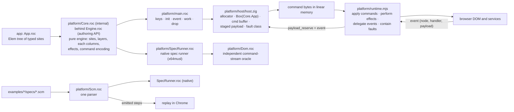

# Roc Signals — Target Design

This document is the single authoritative design for Roc Signals. It describes
the architecture we are building toward and the invariants every part of it
must hold. It is forward-looking and enduring: it describes the system as it is
meant to be, not the state of a work queue. Live work tracking belongs in issues
and pull requests.

## How to read and evolve this design

The main body defines semantic laws, ownership boundaries, complexity
obligations, and the reasons for them. The appendices hold detailed contracts
without making every representation choice a permanent principle:

- [Appendix A](#appendix-a-api-surface) records the engine API surface and the
  target vocabulary above it. Public module documentation and the
  [reference](www/content/docs/reference.md) describe what ships; a target
  signature is not a claim of availability.
- [Appendix B](#appendix-b-wire-protocol) records the Wasm exports, the command
  stream, event records and payload layouts. It is normative for one protocol
  version and evolves only through a coordinated producer/consumer change.

Paragraphs marked **Target** describe intended behaviour the engine does not
implement yet. They are design, not status: they say what the implementation
must converge on, and they never license a different interim meaning.

Internal representations may change when the replacement preserves these
contracts and improves measured cost or clarity. Scope-owned lifetime,
construction-site identity, and the command stream as the only output are
architectural laws; a column layout, a hash-table probe sequence or a node-id
encoding is an engineering choice. Neither an optimization nor a compiler
workaround may change application meaning.

Current setup, gates and measurement practice belong in
[contributing](www/content/docs/contributing.md); numeric baselines,
implementation gaps and delivery plans belong in issues.

## Thesis

Roc Signals exists so that a Roc developer can build an interactive browser UI
in pure Roc and trust it the way they trust the rest of their Roc code: values
in, values out, and reactive semantics that can be checked without a browser.

The application describes its UI once, as a tree of typed sites. Every dynamic
part of that tree — a piece of state, a conditional, a keyed list, a derived
value, a component, an effect — is a *site*: one Roc closure that owns its own
typed storage. The reactive engine is ordinary Roc code inside the platform.
Each external input (a DOM event or an effect result) is one pure transaction
over the engine's state that returns the next state and a byte stream of
rendering and effect commands. The engine re-evaluates only the sites and holes
that read a changed layer, prunes equal values at every observation point, and
emits only the DOM operations those changes imply. There is no virtual DOM and
no per-event re-render.

The host is deliberately small. A Zig Wasm host allocates memory, holds one
opaque engine state between calls, stages payload bytes and classifies faults.
A JavaScript runtime applies the command stream to the DOM and performs the
requested effects. Neither decides anything the engine has already decided.

The one-sentence wedge: **pure Roc, no VDOM, work local to what changed, and
fast native specs backed by the same specs replayed in a real browser.**

It is for Roc developers building interactive browser applications —
dashboards, forms, routed multi-page apps such as Conduit. It is not a general
replacement for the JavaScript ecosystem, not a UI toolkit for other languages,
not a native desktop GUI platform, and not a server-rendering platform.

## Product Goals

Each goal is a property the platform must hold for its whole life. Gaps between
this document and the implementation are tracked in issues.

1. **The idiomatic way is the correct way.** The simplest thing an author can
   write must be the thing the platform is designed for. An encoding trick, a
   positional convention, or boilerplate the platform could derive is a defect
   of the API, not of the author.
2. **Composition is first-class.** UI is built from typed, reusable components
   that take inputs, own their local state and effects, report outward actions,
   and can be published as ordinary Roc packages.
3. **The scaling promise holds for apps, not just the engine.** Work
   proportional to the changed set is a property authors get by writing
   idiomatic code. Where a natural idiom would defeat it, the platform provides
   the primitive (`derive`, keyed selection, row templates) that restores it,
   and the property is pinned by observable counters.
4. **Failure is legible.** Every contract violation — a duplicate key, a value
   outside a switch's cases, an effect feedback loop, a malformed payload, an
   exhausted resource — is reported as a classified, readable diagnostic naming
   the rule and the construction site, identically natively and in the browser.
   A bare trap or a silent no-op is never an acceptable way to fail.
5. **There is exactly one door to the outside.** Events enter, and effects
   leave, through the declared effect channel and the command stream. Apps do
   not call JavaScript. A service the platform does not model is reached
   through a *port*: a declared request kind whose messages leave in the
   command stream and whose answers enter as turns, performed by JavaScript
   the page supplies at mount. The host never exposes its state to an app,
   and no JavaScript value enters Roc.
6. **Cost is visible and bounded.** Payload size, startup, per-event work, and
   memory are measured and budgeted, and in-flight work has fixed caps with
   typed refusal.
7. **Testable at the right boundary.** Reactive semantics, ordering, work and
   cleanup are asserted in fast, deterministic native specs. The same specs
   replayed in Chrome establish actual input, focus and integration behaviour.
   A decoded DOM model is evidence within its model, not proof of browser
   behaviour.
8. **Approachable and honest.** A Roc developer can learn the model from the
   documentation alone, and what the documentation says is what the platform
   does.
9. **Interaction and accessibility are part of correctness.** Controlled inputs
   preserve caret, selection and composition; focus is an explicit command;
   moving a surviving row preserves its DOM node.
10. **Intent and coordinated state are expressible directly.** Repeated
    occurrences stay distinct even when their payloads are equal, and one
    event can express one atomic domain transition.

### Success criteria

- **Engine invariants:** native specs with work and effect counters, the
  `Dom.roc` oracle, roc-fuzz property targets, and long-session soak runs
  with flat live allocations and Wasm pages.
- **Author outcomes:** maintained apps contain no workaround encodings; a
  one-row change in a large keyed list does constant engine work outside the
  list's own reconciliation; every contract-error class has a spec asserting
  its diagnostic.
- **External evidence:** the keyed js-framework-benchmark run against declared
  comparison frameworks, Conduit passing its journey against a RealWorld
  backend in Chrome, and recorded compressed size budgets.

## Non-Goals

Each item is a scope decision with the condition under which it would be
reconsidered.

- **Server-side rendering, hydration and SEO.** The platform is a client-side
  runtime. Any future server path must keep the command stream as the only
  render output; hydration would be the engine adopting existing DOM ids, never
  JavaScript reconstructing meaning.
- **A native desktop GUI host.** The engine is web-only. A GUI platform would
  be a separate platform consuming its own command vocabulary, not a second
  engine.
- **Multiple roots per Wasm instance.** One mount owns one instance.
  Reconsidered only if many-widget embedding measurements show per-instance
  cost is unacceptable.
- **Recovery from allocation failure inside an instance.** Running out of
  memory, a Roc crash or a failed `expect` poisons the instance; recovery is a
  fresh instance. Prepare/commit transactions and allocation-failure
  unwinding are deliberately not part of the architecture: the engine state is
  Roc data updated in place, and a Roc call has no failure-and-unwind channel.
  Reconsidered only if Roc gains one.
- **Host-held Roc values.** The host never holds, clones, compares or drops a
  Roc value other than the one boxed engine state, a worker instance's one
  boxed prepared state (see [Prepared state](#prepared-state)), and
  the byte lists it exchanges with Roc. There are no capabilities, retained
  cells or split-and-replace rules because there is nothing for them to
  govern: each box is opaque, moves whole into one Roc call and back out of
  it, and is dropped only by Roc. The
  converse is allowed: Roc may hold a host resource, a handle whose
  allocation is a slot in a typed host heap (see [Files](#files)). The host
  mints it, Roc's reference count is its lifetime, and the host learns of
  its last release when Roc frees it; the host never holds the handle.
- **A general-purpose JavaScript FFI.** A use the effect channel cannot
  express is a reason to extend its typed vocabulary, not to bypass it.
  Ports are that extension for services the page supplies, not a bypass. A
  port is one of three shapes of the effect channel — a command, a call with
  one reply, or a subscription — under a name the program declares and the
  page's JavaScript implements. Roc never calls JavaScript synchronously,
  never holds a JavaScript value, and is never called by it; every message is
  data in a declared encoding with the channel's id, bound, scope and
  lifetime. A capability the platform models (HTTP, storage, timers, history,
  focus, workers, files) is not a port's business, and nothing that needs a
  synchronous answer (a default to prevent, a layout measurement inside a
  turn) can be one. The hosted effects a worker task calls (see
  [Workers](#workers)) are not an FFI either: they are a closed, typed
  vocabulary of the platform (reading a file, building one), callable only
  inside a job in a worker, never an import table an app extends.

## Non-Negotiable Constraints

1. **No compiler changes.** Everything is ordinary Roc plus a thin Zig host.
   Reproducible compiler defects are filed upstream and worked around narrowly
   (see [Compiler limitations](#compiler-limitations)); they never become
   platform semantics.
2. **No guessing or recovery that changes meaning.** Neither the engine nor the
   host guesses what changed, scans to rediscover identity, or repairs invalid
   input. Invalid input is a contract error.
3. **Work scales with what changed, and the data structures must honour it.**
   An event re-evaluates only the holes and sites that read a changed layer and
   emits only the DOM operations those changes imply. A path that is linear in
   the changed set on paper but reaches it by scanning all nodes, all sites or
   the whole DOM is a violation. See [Complexity budget](#complexity-budget).
4. **The engine is pure Roc; the host only allocates, stages and classifies,
   and in a worker instance performs the platform's synchronous hosted
   effects on resource handles through the worker script.**
   All reactive scheduling, structural reconciliation, identity, effect
   lifecycle and ownership policy live in the platform's Roc engine. The Zig
   host owns the allocator, the boxed engine state between calls (in a worker
   instance, at most one boxed prepared state instead), the command
   buffer, one staged payload, the typed heaps behind resource handles, and
   fault classification. JavaScript applies
   commands and performs effects. Reactive or structural logic in either is a
   defect.
5. **Types are never erased across a boundary that can disagree.** A site's
   storage is typed by the site's own closure; dispatch between sites is by
   message, never by a host-interpreted value. The only bytes that cross the
   Roc boundary are the command stream, event payloads, boot bytes, worker
   payloads and port messages, each with a declared encoding that Roc decodes
   and validates (a port message is JSON text in the platform's `PortJson`
   encoding, with its bytes and files beside it, which Roc turns into a typed
   value or a typed decoding error);
   the only values the host builds for Roc beyond them are freshly minted
   resource handles, each with a single reference.
6. **The command stream is the only output of the page's instance.**
   Everything the outside world
   observes — DOM structure, attributes, listeners, effects, navigation,
   storage, title, focus — is a command in the stream returned by one host
   call. There is no side channel, with one narrow exception: the list of
   resource handles Roc released during a call, which the runtime reads after
   it has applied the call's batch and performed its effects. It decides
   nothing: it names only resources no Roc value can reach any more. A
   worker task's effects act only on handles its job was sent or made, and
   reach the page only as its answer, an ordinary result.

## First Principles, Not Imitation

We derive the model that fits Roc — a pure, value-oriented language with no
mutable globals and no runtime read tracking — rather than porting another
framework.

**Elm** rebuilds the view and diffs per event: O(view size). We keep Elm's
discipline (pure description, effects as data) and reject the mechanism.

**Solid** discovers dependencies by running code under a mutable "current
observer". Roc cannot observe its own reads, so we cannot copy the mechanism.

**Incremental / Adapton** are the lineage we can build on: an explicitly
constructed dependency structure, ordered propagation, and an equality cutoff.

**The reframing for Roc.** Dependencies are *declared*: a `Val(ctx, a)` carries
the set of layers it reads as a bit mask, built by `map`/`map2` and the state
and row accessors before anything runs. The engine never runs a closure to find
out what it reads. Nesting gives the order: a state, derived value or row is a
layer at a fixed depth of its context, and a reader can only be mounted below
the layers it reads.

**The tradeoff, stated plainly.** Declared reads are conservative. A hole that
reads `{cond, A, B}` to express `if cond then A else B` is re-evaluated when
`B` changes even while `cond` selects `A`; equality pruning suppresses the
output, not the evaluation. Value-dependent structure uses `when`, `switch`
and `each`, which rebuild a subtree when its shape changes, so dynamic
reactivity and dynamic structure share one mechanism. The same conservatism
has an app-level consequence: one coarse state record with many projections
wakes every projection on every change. The partitioning rule — independently
changing concerns are independent states or `derive` layers, and row-local
state is row state — is the documented pattern that keeps app work local.

## Architecture



The repository has one platform (`platform/main.roc`), web only, shipped as
one release bundle. An app has one entry, `main.roc`, binding its `program`
as `main`, and the platform builds it for two targets with per-target link
inputs:

- **`--target=wasm32`** compiles the app and engine to Wasm with the thin
  host. It is the product.
- **`--target=x64musl`** gives the app's native `.scm` spec runner: the
  platform's `SpecRunner.roc` drives the same `main` against the `Dom.roc`
  oracle, linked with a small native host (`host/spec.zig`: entry point,
  allocator, file and output services). The Wasm link drops the runner, so
  the browser module does not grow. Because the engine is pure, the runner
  drives it by calling its transaction functions and decoding the command
  stream; there is no simulated host with its own semantics.

Fuzz targets cannot share that entry: roc-fuzz requires a `target : Target`
value and links its own libFuzzer host, and a platform has one `requires`.
They stay a separate entry, each app's `main-fuzz.roc`, built with
`roc build --fuzz` on a second root, `platform/fuzz.roc`: a vendored roc-fuzz
platform that shares the platform's modules and also exposes the internal
`Core`, the runner, the oracle and the soak walk. It is repository-only and
not in the release bundle. The leak-checked soaks live there too, because
they rely on roc-fuzz's allocation scopes.

There is no native semantic host and no shared Zig engine. Observability that
the old native host provided (work counters, effect tables, allocation
ledgers) comes from the engine's own counters, the `Dom.roc` oracle, and the
allocator counters of whichever host runs it.

## Representation D

"Representation D" is the engine's data model: **one closure per site, each
capturing only its own typed storage.**

### Sites and messages

A mounted site is an `Inst(ctx)`: a closure taking the current environment, a
message and the transaction accumulator, and returning its replacement, an
outcome and the accumulator. Messages are:

- `Fire(path, pos, handler, payload)` — route an event or effect result down
  the site path to the block that owns the target.
- `Changed(mask)` — some layers in `mask` changed; refresh what reads them.
- `Dispose(remove)` — release this site, emitting `REMOVE` for its top-level
  nodes when `remove` is set (an ancestor that removes its own DOM passes
  `False` to children).

Every site kind — `state`, `when`, `switch`, `each`, `derive`, `resource`,
`component`, effect sites, and the root block — implements these three
messages. The engine
therefore needs no node table, no erased value registry and no type tags: the
closure's own captures are the typed storage, and the only dispatch is the
message.

### Contexts and layers

A site's environment is a typed context:

- `Root` — the top of the tree.
- `In(outer, s)` — inside a state or derived layer of type `s`.
- `Row(outer, item)` — inside one row of an `each` site (key and item).
- `Comp(p, a)` — inside a component: its prop `p` and its outward action list.

Each `In` or `Row` adds a *layer* at the next depth. A layer's identity in a
mask is its bit, `1 << depth`. A `Val(ctx, a)` is `{ mask, read, sel }`: the
layers it reads, a reader from the environment, and an optional keyed
selector. A `State(ctx, s)` is a lens (`get`, `modify`) plus its layer bit. A
`Handler(ctx)` is an environment transformer `(ctx, payload) -> ctx` plus the
mask of the layer it writes.

Values crossing into a nested context are lifted explicitly (`lift`,
`lift_row`). Lifting changes the reader's path through the environment, never
its mask: a layer keeps its absolute depth.

A component resets depth: inside `Comp(p, a)` the prop is layer 0 and inner
layers count from there, so masks are bounded by the nesting depth within one
component, not by the depth of the whole app.

Masks are 64-bit, so a component body may nest at most 63 layers below its
prop. A deeper `state`, `derive` or `each` is a `resource_limit` diagnostic at
mount naming the construction site; a layer bit never wraps.

### Blocks and holes

The static content of a non-`each` site is flattened at mount into a *block*:

- *holes* — dynamic text and attributes, each with its read mask, reader and
  last emitted value;
- *handlers* — in mount order, so a handler number is a dense index;
- *children* — nested sites with their static read masks;
- the block's node ids and its top-level nodes (for removal).

A refresh with mask `m` re-evaluates the holes whose mask intersects `m`,
emits a command only when the new value differs from the last one, and
descends only into children whose read mask intersects `m`. A site's read mask
is computed statically (`elem_reads`) without mounting it, including the reads
of branches that are not currently mounted, so a conditional listens to
everything it could need. A layer site's reads include the layers below it
(and its own, for a layer a write or an answer changes): outside a row or a
component those writes report their bits upward, and the Changed pass can
only reach them through the masks of the sites above.

### Keyed lists: templates and typed columns

`each(rows, key, template)` is where most of the work in a real UI happens, so
it has its own representation:

- The row template runs **once per site**, against a `RowRef` accessor rather
  than a row value. It compiles to a DOM template (sent once as `TEMPLATE`)
  plus a hole table: text, attribute, event and nested-site placeholders.
- Rows are **typed columns** indexed by slot: items, keys, the last value of
  every live hole, nested site instances, dirty marks, plus `order` (slots by
  position), a free-slot list, and an open-addressing key index from the exact
  key bytes to a slot.
- Creating a row costs one `INST` command and column appends. A row whose
  template contains nested sites (`state`, `when`, `each`) is *dynamic* and also
  owns a small list of child instances.
- Handlers in a row template receive the row's key and item through the
  context when they fire; they never capture a row.
- Keyed selection (`keyed` with `RowRef.select`) lets a row depend on "is this
  row the selected one" so a selection change re-evaluates exactly the old and
  the new selected rows.

Reconciliation compares the new list against the site's columns with fast
paths for a common prefix and suffix, swapped ends, pure insertion and pure
removal, and otherwise a keyed move planned with a longest increasing
subsequence, so surviving rows move rather than rebuild. A kept row whose new
item is equal to its old item is pruned; a changed item marks the row dirty and
only its live holes that read the row layer are re-evaluated.

### State, derivation and conditionals

- `state(init, body)` adds a layer holding a typed value per instance of its
  context (per row inside a row). A handler below it writes through the state
  lens; the layer reports its bit when written.
- `derive(input, body)` evaluates `input` once per change of the layers it
  reads, exposes the result as a new layer, and stops propagation when the
  recomputation is equal. Readers that read only the derived value do no work.
- `resource(input, cfg, body)` is the asynchronous counterpart of `derive`: a
  layer whose value is folded from the answers to requests issued for its
  input (see [Supersession and asynchronous layers](#supersession-and-asynchronous-layers)).
- `when(cond, yes, no)` and `switch(sel, cases, body)` build only the selected
  branch, as a block anchored by an empty text node, and rebuild it when the
  selected value changes. `switch` lists every case so its static reads are the
  union over them; a value outside `cases` is a contract error. Because an
  unselected branch is never built, recursive UI is expressed directly.

### In-place ownership

The engine's speed depends on Roc updating each site's storage in place. The
ownership law that makes this hold is:

- **Exactly one closure references a site's storage.** Consuming the closure
  and rebuilding it with the updated storage leaves the storage uniquely owned,
  so list and record updates happen in place.
- **The environment is moved, not shared.** A handler receives the context by
  value and returns it; a state's value moves into the environment for the
  reducer and comes back out, so the reducer sees it uniquely owned.
- **No second reference is kept for convenience.** The component boundary does
  not retain its prop, and states do not keep the previous value for equality
  pruning, because either would force a copy of whatever they reference.
  Pruning happens at holes, rows and `derive` instead.

Patterns that hold this law against current compiler behaviour (wrapping a
site's captures in a single-tag `Held`, returning a rebuilt site from each
branch directly) are workarounds for upstream issues and are marked as such in
the code. They are not semantics.

The same law constrains apps. Ports found three patterns that silently copy
on every update: filtering or mapping a list that another reader still holds,
keeping a large state below smaller ones instead of outermost, and deriving
projections that retain the whole state. Soak plateaus and per-event
allocation counts are how such a copy is caught.

Memory is reclaimed deterministically by reference counting: disposing a site
drops its closure, which releases everything it captured. The structure is a
tree of closures with no back-references, so there are no reference cycles.

## Values, Handlers, and Coordinated State

A layer describes a current value. An event describes an occurrence. Equality
prunes value propagation; it never merges two separately accepted events.

- **A handler is a pure environment transformer.** It runs only when its event
  fires, receives the payload, and returns the environment with its writes
  applied. Reducers (`update`, `update_by`, `set_value`, `set_value_by`) are
  applied to the value the state holds at that moment.
- **One event is one atomic transition.** All writes made while an event fires
  are in place before any observation runs. Writes to several fields of one
  domain transition belong in one state; a component's outward actions are
  delivered to the caller's sinks in order, inside the same turn, before the
  caller's observation pass.
- **Equality is an observation contract.** A successful `==` lets the engine
  keep the last emitted value and skip every downstream observation. It must
  imply that no observation can distinguish the two values. A conservative
  comparison that reports a difference only costs extra work.

**Target:** issuing a request is an occurrence, not a value. Today an effect
site issues requests when its watched value changes, so a repeated submission
with an equal payload must carry an app-level serial to issue again. That is a
workaround encoding under Goals 1 and 10; the target is a handler-level
request primitive whose occurrences are distinct by construction, entering the
same effect table and lifetime rules.

## Identity: Construction Site Within Explicit Scopes

There are no author-written node ids or event ids. Two identities serve
different purposes and must not be conflated:

- **Structural identity** is the construction site within a live owning scope:
  the path of child positions from the root through blocks, branches, rows and
  components. It governs the lifetime of state, branches, components and rows.
- **Application identity** is an exact key within one `each` site. It preserves
  a surviving row's state across list changes, not across disposal or across
  independent sites.

Rules:

- **Scopes contain positional shifting.** Components, branches and rows are
  scopes, so adding or removing UI inside one does not shift identities in its
  siblings.
- **Keys are exact UTF-8 bytes.** No normalization, case folding or hash-only
  equality. A duplicate key within one site is a `contract` diagnostic naming
  the key and the site path; it is never an alias.
- **Engine ids are private.** DOM node ids, handler numbers, site ids and
  effect ids are dense host-visible integers minted by the engine. Apps never
  see them; focus targets are named references scoped to the element that
  declares them.
- **Ids are recycled, never aliased across a live lifetime.** Freed node ids,
  slots and site ids are reused only after their owner is disposed. An event
  that arrives for a freed id finds no route and is dropped.

### Observable lifetime rules

| Change | State and effects | Rendered structure |
|---|---|---|
| Reorder a surviving key | Preserve its row state and active work | Move existing nodes |
| Insert or remove another key | Preserve unaffected rows | Insert or remove only the affected rows |
| Update an item, same key | Preserve the row; re-evaluate holes that read the row | Update only changed holes |
| Remove a key | Dispose the row's sites; stop its subscriptions, timers and work; admitted requests reparent to the `each` site | Remove its node |
| Reinsert a removed key | A new row lifetime | Build new structure |
| Change an item's key | End the old row, create a new one | Remove and insert |
| Move an item between `each` sites | Dispose at the old site, create at the new | No cross-site transfer |
| Switch a branch or case | Dispose the departing branch; ancestors survive | Mount the selected branch |
| Hide a region with an attribute or class | Its sites stay live | Nodes stay |
| Dispose a component or root | Dispose everything it owns | Remove its nodes |

State that must survive filtering, pagination or route changes belongs in an
explicit longer-lived owner keyed by domain identity. Keeping a scope alive is
never inferred from a reused key, and there is no implicit `keep_alive`.

## Explicit Scopes and Disposal

Every site is a scope. Disposing it:

1. disposes its children in order (each child disposes its own);
2. emits `REMOVE` for its top-level nodes when its parent is not already
   removing an ancestor (or `CLEAR` when an `each` site is the sole child of its
   parent);
3. frees its node ids, routes, focus references and, for `each`, its site id;
4. stops its subscriptions, intervals, timers and work (`CANCEL`), and drops queued
   follow-ups addressed to it (counted stale);
5. hands its admitted requests up as orphans (see
   [The effect channel](#the-effect-channel)).

Dropping the site's closure releases its storage. Nothing is left registered in
the host or the runtime for a disposed scope: the runtime holds DOM nodes by id
and effect handles by id, and the commands above release both. A file handle
the scope's storage held goes when its last reference does, which disposing
the scope brings about unless a value outside it still holds the handle.

**Leak invariant:** after any sequence of events returns the UI to an earlier
shape, live allocations, live effect ids, live file handles and Wasm pages
return to a plateau.
Soak runs assert it natively and in Chrome.

`on_cleanup(name, value, plan)` is a site that renders nothing and reads
nothing while it is live. When its scope is disposed it reads `value` in the
scope's last environment and turns it into requests with `plan`, in the
disposing turn. Only commands are allowed (history, title, storage writes,
focus): a request that awaits a result would outlive its owner, so asking for
one is a `contract` error. Cleanup runs are counted per name in the engine's
work record (Appendix B) so specs assert them (`expect-cleanup`); `cleanup(name)`
is the form that only counts.

## Propagation: Turns, Ordering, and Pruning

### One turn

Every external input — a DOM event or an effect result — is one *turn*:

1. **Route.** A static node's route gives the site path and the handler number
   comes from the event record; a row node gives the `each` site's path and the
   slot. An event for a freed node is dropped without touching state.
2. **Fire.** The event travels down the path. Each layer it passes moves its
   value into the environment; the owning block runs the handler; the
   environment travels back up, and each state layer takes its value back.
3. **Settle locally.** A layer inside a row or component that is the highest
   layer the event changed refreshes its own subtree immediately, for itself
   and every layer written below it (a component's sinks can write several
   nested layers in one turn), as does an asynchronous layer that an answer
   changed; anything else reports its mask upward. A component hands its pushed actions to the
   caller's sinks, which become ordinary writes in the caller's context.
4. **Changed pass.** The root runs one `Changed(mask)` pass with the union of
   every layer written. Each site refreshes the holes that read a changed layer
   and descends only into children that read one.
5. **End of turn.** Focus requests made during the turn are resolved to node ids
   and emitted. Follow-up turns queued by the turn run next, in order.

### Glitch freedom and ordering

Because all writes are applied while firing and observation happens only in
the Changed pass that follows, no hole, branch, row or effect site ever
observes a partial write set. Order follows nesting: a `derive` layer is
recomputed, and a `resource` layer begun for a changed input, before anything
below it reads it, a branch decision is made before
the branch's holes are refreshed, and `each` marks rows for outer-layer and
selection changes before reconciling its list, so a row created in this turn
is evaluated exactly once.

Effect results and follow-ups are turns of their own, applied in arrival
order. Which of two concurrent results should win is application state, never
a host inference.

### Equality pruning

Pruning happens at observation points:

- every hole compares its new value to the last emitted value;
- `each` compares a kept row's new item to its old item;
- `derive` compares its recomputation to its last value;
- `resource` compares its layer after each `pending` and `resolve` to its
  previous value;
- `when`/`switch` compare the selected branch;
- effect sites compare their watched value.

States do not prune on write: a handler that returns an equal value still
reports its layer, and the readers below prune. This is deliberate (see
[In-place ownership](#in-place-ownership)).

### Re-entrancy

Synchronous browser callbacks raised while JavaScript applies a batch, or
while Wasm runs, never re-enter the engine. They are queued and delivered as
their own turns after the current batch.

The runtime's ingress queue is bounded at 4096 events. Only a feedback loop
between the DOM and the engine fills it, so overflow is not refused event by
event (that would drop non-lossy input or strand an in-flight id): it poisons
the runtime with class `resource_limit`, reported like any other fault.

### Complexity budget

The scaling claim must hold in the data structures. N is the total mounted
tree, R the readers (holes and sites) of the changed layers, L the row count
of the affected `each` site, and K the rows whose item or position changed.

| Operation | Budget | Forbidden |
|---|---|---|
| Route an event to its handler | O(path depth) | scanning nodes or sites |
| Non-structural update | O(R) evaluations, plus the static structure on the path to them | refreshing subtrees that do not read the layer |
| Keyed selection change | 2 rows re-evaluated | O(L) row re-evaluation |
| `when`/`switch` flip | O(disposed + mounted subtree) | rebuilding siblings |
| `each` list change | O(L) key and item comparisons, O(K) row evaluations and DOM commands | O(L) row re-evaluation or rebuild; O(L²) planning |
| Row event | O(1) to find the row (slot from the node id) | key or list scan |
| Dispose a scope | O(scope size) | work outside the scope |
| Effect result lookup | O(in-flight), bounded by the cap | unbounded tables |

`each` is honest about its cost: comparing a new list value with the site's
columns is linear in the list, as any keyed reconciliation of a list value is.
What it must never do is evaluate or rebuild unchanged rows. A ported app that
needs sparse list updates without the linear comparison is the trigger for a
keyed-delta primitive, not for a scan elsewhere.

Calling one Roc closure is not a constant-time guarantee for its body; reducer,
comparison and key costs count toward the operation's budget.

## The Component Boundary

`component(prop, sink, body)` is the unit of composition and the boundary that
keeps code size and specialization in check.

- **Fixed environment.** The body is typed over `Comp(p, a)` only, never over
  the caller's context, so it is specialized once per prop and action type,
  not once per call site. This is what bounds code size as apps grow.
- **Props are read, not retained.** The body sees the prop as layer 0. The
  boundary re-reads it from the caller's environment when a caller layer it
  reads changes and when an event enters the component.
- **Actions flow outward.** The body gets a write handle on the component's
  outward action list (`push`, `push_by`, `push_value_by`). When an event inside
  the component settles, each pushed action is handed, in order, to the
  caller's `Sink`, which turns it into an ordinary write of a caller state.
  `split` routes actions to two sinks.
- **Disposal crosses the boundary.** A disposed component's admitted requests
  reparent to the caller: their reactions re-read the prop from the caller,
  discard inner writes (counted as skipped), and deliver pushed actions through
  the sink as a live event would.

**Target:** callback props (a typed function in the prop that the body can
attach to a handler) and the full typed prop vocabulary needed by the ported
apps, defined so that a callback is data in the prop, not a captured caller
context.

## The Command Stream Is the Only Output

Each host call returns one complete command batch. The engine accumulates
commands into a `List(U8)` in the transaction accumulator and hands it to the
host as the call's result; the host keeps it readable through `cmd_ptr` and
`cmd_len` until the next call, which hands the buffer back to Roc for reuse.

Rules:

- **Atomic publication.** A batch becomes visible only when the call returns
  successfully. A trap discards it; JavaScript never observes a prefix of a
  failed call.
- **Apply, then perform.** The runtime applies DOM commands in stream order and
  collects effect commands, then performs the effects after the whole batch is
  applied, so an effect never observes a half-applied DOM.
- **Decided, not interpreted.** The runtime does not diff, reorder, coalesce or
  skip commands. Its only state is the id → DOM node tables, parsed templates
  and live effect handles the commands told it to keep.
- **Fresh views.** Any call may grow Wasm memory. The runtime re-reads
  `memory.buffer` after every call that can allocate, including
  `payload_reserve`, and never holds a view across one.
- **Determinism.** The same mount and the same sequence of inputs produce the
  same command bytes.

Attribute commands carry the engine's decided value. The runtime's
interpretation of a few attribute names (`value` and `checked` as live control
state, boolean attributes, `class` on SVG) is part of the protocol in
Appendix B, not a decision about application state.

## The Effect Channel

Effects are data. An effect site watches a value and, at mount (`watch`,
`latest`) or only on change (`on_change`), turns it into a list of requests.
A site's `Reaction` is a reducer over a state given the value the request was
issued for and its result. A `resource` site turns the answers into a layer
instead of a state write.

### Request kinds

- **Commands** are emitted and forgotten: history `Push`/`Replace` (`NAV`),
  `Title` (`TITLE`), `StorageSet`/`StorageRemove` (`STORE`), and
  `Focus`/`Blur`/`SelectText` on a named reference (`FOCUS`, resolved at the
  end of the turn).
- **Awaited requests** get an id: `Http`, `StorageGet`, `Timer`, `Work` and
  the operations on a file the app holds (see [Files](#files)) deliver one
  result; `Interval` and `Popstate` are subscriptions that deliver any number
  of results until stopped.
- **`Work`** runs a job of a task from the program's worker catalogue (see
  [Workers](#workers)), in a Web Worker that instantiates the same compiled
  module. A catalogue entry is a namespaced, unversioned name and an
  effectful entry from input bytes and the handles of the job's files to
  the answer's bytes, registered with `with_workers`; the page's instance
  and every worker instance evaluate the same `main`, so both see the same
  catalogue, and the module is the compatibility unit. A worker instance
  never mounts: its engine calls are a job's (`work`, or `prepare` and `ask`
  for a preparation's task). The job's result is an ordinary result turn:
  `Work({ output, files })`, whose files are now the page's handles, or
  `WorkLost(fault)` when the worker's instance faulted or no worker could
  run it. The request carries the task's deadline, its disposal and cancel
  policies and, for a preparation's task, where the preparation's input
  lies in its own.

  Apps use the typed layer above it, `Worker`: a `Task(input, output,
  error)` is a name and a function over the app's own types, and the bytes
  on the wire are a `Wire` payload the compiler derives from those types, so
  an app writes no codec and a request can only name a task with matching
  types. Because the page and every worker are one module, the payload
  carries no type information or version. A type crosses if it has the
  derived codec hooks: numbers, `Bool`, `Str`, lists, records, tuples, tag
  unions, files (as handles) and nominal types that opt in; functions,
  state handles and reactive values do not, which the compiler rejects.
  `Worker.derive` is a `resource` whose requests are jobs of one task: a
  layer holding the task's answer for an input, where a newer input stops
  the job of an older one.
- **`Self`** asks for a follow-up turn whose result is `Now`: how an effect
  site changes state in response to its value changing without writing during
  the turn that is evaluating.
- **Ports** reach a service the page's JavaScript supplies. `PortCommand` is
  a command (`PORT`); `PortCall` is awaited with one result and kept on
  disposal like `Http`; `PortSubscribe` is a scoped subscription. Each
  carries a port name and a message: JSON text in the `PortJson` encoding,
  the byte blocks its `{"$bytes":N}` markers name and the files its
  `{"$file":N}` markers name, which travel beside the text and are never
  encoded as text. The program declares each port with `with_ports` (at
  most 64, each name once, 1 to 128 bytes), and a request for an undeclared
  port, or for a port of another shape, is a `contract` error naming the port
  and the site, checked at the end of the turn like a worker task's name.
  The runtime refuses to mount a page whose `ports` option does not implement
  every declared port with a handler of its shape, or implements one that is
  not declared. Apps use the typed layer, `Port`, whose message types are
  derived like `Wire`'s.

### Workers

A **task** is a registered, named function whose jobs run in a worker
(`Worker.task`): `run! : input => Try(output, error)`. It is roc-gui's
`Action.task` adapted to a separate instance of the module: the body cannot
be a closure at the call site, because a closure cannot cross to a worker,
so it is a top-level value registered once, and the context it needs is its
input. Page code stays pure; a task is where a computation leaves the
page's thread, and the only place effects run.

**One kind of worker function.** A pure calculation, one that can fail, a
question over a prepared state and a job that reads and writes files differ
only in what a job's body does, and the platform does not need to know
that: a `run!` may be a plain
calculation (`run!: |text| Ok(count_words(text))`) or call the hosted
effects below, and the compiler accepts either, since a lambda literal may
fill an effectful field whatever its body. So there is one constructor, one
request kind (`Work`), one result (`Work({ output, files })`), one worker
entry in each host and one job path in each spec runner. A job always
answers a `Try`: the task's own failures (input that does not parse, a file
the browser can no longer read, a builder over its bound) are values the
app chose, and the typed layer keeps them apart from the platform's:
`Worker.Error(error) : [Failed(error), Timeout, Refused, Lost(WorkFault)]`.
A crash in a job is `Lost`, never `Failed`.

A task that cannot fail names its error `Worker.Never`, a nominal type with
no values, and a `match` on its result needs no `Failed` arm. The empty
union `[]` would say the same, but the compiler derives no `Wire` codec for
it, so the platform supplies a type whose codec it writes by hand (encoding
is unreachable; decoding any bytes is refused). A task's error, like its
input and output, must be `Wire.Sendable`; a top-level task is annotated,
because an error left to inference does not resolve.

- **Same channel.** A `Work` request takes an id, counts against the
  in-flight cap, is answered once in a result turn, and is cancelled,
  superseded and counted as any awaited request is. `Worker.derive`,
  `latest` and `resource` take a task, or a preparation's task, anywhere
  they take a request.
- **Handles cross by token.** A file in a job's input is not read before the
  job runs. The request names its handle and range (FX kind 8); the runtime
  resolves the handle to the browser's `File` when it applies the batch and
  posts the whole file with the job, by reference; the worker's host mints
  a handle of its own for each (`files_stage`), in the request's order, and
  the job's `File` values hold those local handles, with the names and
  ranges the payload gives them. On the way back the answer names the
  instance's tokens of the files it holds; the worker script posts their
  `Blob`s by reference, and the page's runtime mints fresh page handles for
  them through the result path port replies use (result tag 10, staged with
  `files_stage` and delivered with `event_files`). Each instance holds its
  own reference to the browser object, so either side letting go cannot
  invalidate the other's.
- **Effects are synchronous and act on handles.** `File.read!` reads a range
  into the job's memory (`FileReaderSync`), one copy; `contents!` and
  `contents_utf8!` read the whole range. `File.build!` opens a **builder**,
  `append!` copies bytes out of the job's memory into a part of it,
  `append_file!` adds a range of a file the job holds by reference, and
  `finish!` composes the parts into one immutable file (constant time) the
  answer may hold. A builder may start from a file (`start_from: From(f)`),
  which is how a job appends to an earlier job's output without copying
  it. A job cannot wait: there is no timer, event or response it can block
  on without JSPI or cross-origin isolation, which the platform does not
  adopt, and nothing it does can be observed until it answers.
- **A written file is an immutable value.** A builder exists only inside the
  call that opened it (a job, or a preparation's `prepare!`), holds its
  parts in the worker script, and cannot be sent anywhere (it is not
  `Wire.Sendable`, so naming one in an answer does not compile). When the
  call returns, the worker script closes every builder it opened, finished
  or not, and a later use is a `contract` error. A cancelled, timed-out,
  crashed or lost job therefore leaves nothing the page can see, "append
  across jobs" is atomic per job (the previous file is unchanged unless the
  new one is delivered), and a builder a prepared state kept cannot make
  one job's answer depend on what an earlier job wrote. A finished file is
  a value and may be kept anywhere, a prepared state included.
- **Disposal and cancellation are the task's choice.** Every task carries
  `on_dispose : [Stop, Keep] ?? Stop` and `on_cancel : [Stop, Finish] ??
  Stop`. `Stop` on disposal is a timer's rule: a computation nobody will read
  is only cost. `Keep` reparents the request as `Http` does, for a job whose
  external effect (a file the user asked for) must not be lost when a panel
  closes; its answer reaches the nearest surviving ancestor. On `CANCEL`
  (disposal with `Stop`, or a `latest` or `derive` site moving on) the
  engine forgets the id as always; `Stop` ends the worker running the job,
  while `Finish` lets the job complete and the runtime drops its answer, so
  the worker, and any prepared state it holds, is kept. A deadline always
  ends the worker.
- **Where effects can run.** The hosted effects are imports of the one
  module, linked only when an app's tasks reach them, so a module without
  them imports nothing. The worker script supplies real ones; the page's
  instance and the inline instance get stubs that throw. The host never
  calls one outside a job: each hosted function first checks the flag the
  host sets for the length of `work()`, `prepare()` and `ask()`, and
  otherwise poisons the instance with `contract: <effect> is a worker effect
  and ran outside a job`; a job's entry on a mounted instance is a contract
  fault too. Page code cannot call an effect at all (the compiler rejects
  it). With `workers: "inline"` a job runs on the page's thread in a second
  instance and answers as in a worker when it reaches no hosted effect;
  one that reaches one (`FileReaderSync` exists only in a worker) unwinds
  that instance's call through the stub, is answered
  `WorkLost(Unavailable)`, and the inline instance is replaced for the next
  job, as a faulted worker is. The page's instance is never touched.
- **Bounds.** A job may append at most `maxOutputBytes` (a mount option,
  256 MiB by default) to its builders, counting bytes copied out of its
  memory, not files appended by reference: a builder's parts are in-memory
  `Blob`s, which the browser does not page to disk, and a larger in-memory
  `Blob` was measured unreadable. Beyond it `append!` answers `TooLarge` and
  the job decides. An answer holds at most 16 files, which the worker's
  engine checks (a larger answer is a `contract` error, so the job is
  `Lost(Contract)`); when the page has no free slots for an answer's files
  nothing is minted and the job is answered `WorkLost(ResourceLimit)`. A
  job holds at most 64 handles (files and builders) at once, else it is a
  `resource_limit` fault of its worker.
- **The native runner** runs a job in a child process and serves the same
  hosted functions from the spec's files: each file the job was sent holds
  its bytes, a builder collects copies, finishing moves them behind a fresh
  handle, the builders a call opened are closed when it returns, and the
  answer's files come back with their bytes, which the runner then holds
  under the page handles it mints. A spec therefore gives the same answers
  natively and in Chrome.

**Target:** synchronous HTTP in a task (a `Blob` response from a synchronous
`XMLHttpRequest`, measured to work in a worker), an origin-private file
kind with one writer at a time, builders backed by an origin-private file
for output beyond the in-memory bound, and progress reports. Each changes
this section when it lands.

### Prepared state

Some tasks share an expensive first step: three views of a document each
parse it, a search and a facet count each index the same records. A
**preparation** is a step `prepare! : init => Try(state, error)` and any
number of tasks over its state, `run! : state, query => Try(output,
error)`, registered together (`Worker.prepared`, `Preparation.task`,
`Preparation.registration` listing each task's `registration()`). A
preparation's tasks are tasks: the same request kind, policies and result;
to the engine a job of one is a `Work` request whose input begins with the
preparation's.

**Keeping the state is never observable in an answer.** A job's answer is
exactly what preparing afresh and running the task would give. A worker
instance that prepared a state may keep it and run later jobs over the same
input from it, so they cost the task rather than the preparation, but
whether it does is an optimisation the runtime may or may not achieve. It
shows in time and in the monitor, never in a result, and the native spec
runner simply prepares afresh for every job. That holds because a
preparation's answer must be a function of its input: `prepare!` may read
the files its input holds (an immutable handle reads the same bytes every
time) and build files private to it, and nothing else; the hosted effects
are all of that kind.

- **Failure is a value.** `prepare!` answers a `Try`, and its error is the
  error its tasks share, so a preparation that cannot be made (a file the
  browser can no longer read) answers each of its tasks' jobs
  `Failed(error)`, which the app matches like any task's failure, rather
  than a crash the app could only see as `Lost`. Sharing one error type is
  what lets one answer path carry it: the kept closure encodes the
  preparation's failure as the job's answer without knowing which task
  asked.
- **Identity.** A kept state answers a job only for the same preparation and
  the same input: the preparation's name, the exact bytes of its encoded
  input, and the handle token and range of each file the input names.
  Nothing is hashed; the runtime compares the bytes, so its cost is the
  input's size per job, and a large input belongs in a `File`, whose
  identity is its handle and range. Tokens are generation-tagged and never
  alias. A comparison that is conservative only costs a preparation.
- **Holding.** The registration erases the typed state into a closure
  (`Core.Kept`) that runs the preparation's tasks by name. A worker's host
  holds at most one `Box(Kept)`, exactly as a page's host holds `Box(App)`:
  `prepare` builds it, `ask` moves it into one call and back out with the
  answer, and `forget` hands it to Roc to drop. The state never crosses to
  the page, so it need not be `Wire.Sendable`. The files it holds are
  handles of the worker's instance, which stay live with it.
- **Placement** is the runtime's and decides nothing about answers. A job
  runs on the worker holding its key, waiting behind it while it is busy;
  otherwise it prepares on an idle worker holding nothing, a new worker
  while the pool has room, or the least recently used idle holder, whose
  state it replaces.
- **Read-only.** A task cannot change the state: a state-threading task
  would make an answer depend on which jobs ran before it on that worker,
  and a lost worker would need a replay log to recover it. A builder the
  state kept is closed with the call that opened it (see [Workers](#workers)).
- **Release.** No kept state outlives its file: when the page releases a
  handle, every state keyed on it is let go (at once on an idle worker,
  after its job on a busy one). A worker whose linear memory has grown past
  the `maxWorkerBytes` mount option is retired after its job, its state with
  it, since linear memory never shrinks.
- **Cancellation.** `on_cancel: Finish` is what keeps a state across a
  superseded job: the job completes, its answer is dropped, and the worker
  keeps the state for the next job. At most one such job per worker, so the
  pool bounds them. A deadline always stops the worker, and a job's
  deadline includes its preparation.
- **Faults.** A crash in a preparation or a task poisons that worker only:
  the job is `WorkLost` with the fault class, the state is gone, and the
  next job prepares again elsewhere. Jobs waiting for a lost holder are
  placed again, so none waits forever.

### Ids, results and staleness

- Awaited ids are instance-wide, issued in order from 1. Follow-up ids are a
  separate internal space and never appear on the wire.
- A result enters exactly as a DOM event does: one turn on the reserved effect
  node `0xffffffff` with the id as handler number, firing down the owning
  site's path, where the reaction runs with the issued-for value, followed by
  the Changed pass.
- A result whose id is not in flight — never issued, already delivered,
  cancelled, or purged — is dropped before any state is touched and counted
  `stale`. The owning site also checks that it holds the id, so a successor
  site at the same path never receives its predecessor's results.
- Results are typed: `Http({ status, headers, body })`, `Network(message)`,
  `Timeout`, `Value`, `Missing`, `Fired`, `Location`, `Online(Bool)`,
  `Visible(Bool)`, `Now`, `Refused`, `Work({ output, files })`,
  `WorkLost(fault)`, `Fetched({ status, headers, body })`,
  `FileBytes(bytes)`, `FileText(text)`, `Digest(bytes)`, `FileUrl(url)`,
  `FileFailed(reason)`, `PortReply(message)` and `PortFailed(Threw(text) |
  TooLarge | Closed)`. A subscription ends at its first `Threw` or `Closed`,
  which retires its id like a cancel; `TooLarge` reports one message and the
  subscription goes on.
  Application failures are values; contract violations are diagnostics,
  never fabricated results. A worker's diagnostic text goes to the page's
  console, never into its result.
- `http_text` reads an HTTP result as the body of a 2xx response or a typed
  `HttpError`: `Network(message)` (the browser could not reach the server),
  `Timeout`, `Status(code)` (any other status) or `Refused` (the in-flight
  bound). Apps that classify statuses themselves match on `Http` directly.

### Bounds

What an app means is decided in Roc and carried on its requests: a job's
deadline, a call's timeout, how much a read of a file accepts. What a
deployment allows is a mount option, named `max…Bytes` or `maxWorkers`
(`maxWorkers`, `maxWorkerBytes`, `maxFileBytes`, `maxPortBytes`), which caps
what any request asks for.

- **In-flight cap.** The in-flight table holds at most 32 awaited requests by
  default (configurable per program). A request beyond it is not issued: it is
  refused, counted, and its owner receives a typed `Refused` result in a
  follow-up turn.
- **Follow-up depth.** What is bounded is a chain of follow-ups, not their
  number. A follow-up queued by an external turn (a DOM event, an effect
  result, the mount) has depth 1; one queued by a follow-up of depth d has
  depth d + 1. A chain deeper than 64 is a `contract` error (an effect
  feedback loop, such as a refusal retried while the table is still full)
  that poisons the instance, naming the depth and the site. One turn may
  fan out into any number of independent follow-ups, such as a refusal for
  each of a hundred rows that fetch at mount: they are all depth 1.
- **Follow-up breadth.** A loop in which each follow-up queues two or more
  would grow exponentially before it reached depth 64, so one host call runs
  at most 64 follow-up turns per in-flight slot, and at least 4096. Only a
  multiplying loop, or a fan-out refusing more than 64 requests per slot of
  the in-flight table, reaches it; it is a `resource_limit` error. The total
  is in the app's hands: it is set by `max_inflight` and by how many requests
  its sites issue in one turn.
- **HTTP timeout.** Each request carries `timeout_ms` (0 = none), capped at
  600 s. A timeout delivers `Timeout`; the runtime arms at most one timer per
  admitted request and clears it on completion, failure, timeout or cancel.
- **Work deadline.** Each job carries `deadline_ms` (0 = none), capped at
  600 s like an HTTP timeout. Its expiry stops the job by terminating its
  worker and delivers `Timeout`.
- **Worker pool.** The runtime runs at most `maxWorkers` workers (a mount
  option; by default the browser's core count, at most 8), one job each at a
  time, reusing idle workers. Jobs beyond the pool wait in a FIFO queue,
  which the in-flight cap bounds. Stopping a job — cancel or deadline — is
  terminating its worker, which is replaced when the next job needs one;
  there are no cooperative checkpoints. A worker whose linear memory has
  grown past `maxWorkerBytes` (a mount option, default 128 MiB) is retired
  after its job.
- **Prepared states.** At most one per worker, so at most `maxWorkers`;
  each is bounded with its worker by `maxWorkerBytes`.
- **Job output.** A job appends at most `maxOutputBytes` (a mount option,
  default 256 MiB) to its builders, answers with at most 16 files, and
  holds at most 64 handles at once (see [Workers](#workers)).
- **Catalogue.** At most 64 names (a preparation's and each of its tasks'
  count), each once. A duplicate or a 65th is a `contract` error when the
  catalogue is built, naming the task; issuing work for a name the
  catalogue does not hold is a `contract` error naming the task and the
  issuing site.
- **Port messages.** A port's answer or message is at most `maxPortBytes`
  (a mount option, default 4 MiB, at most 64 MiB) of JSON text and bytes
  together, else `PortFailed(TooLarge)`. Each subscription declares how its
  undelivered messages wait: `Latest` keeps one and a newer one replaces it;
  `Every(n)` keeps up to n ≤ 1024 in order and refuses `emit` beyond them (it
  returns false and takes nothing). The runtime keeps at most one message per
  subscription in its ingress queue, so port traffic adds at most the
  in-flight cap to it. A call's `timeout_ms` is capped at 600 s like HTTP's.

### Disposal and reparenting

An admitted effect belongs to the intent that started it, not to the scope that
rendered the control:

- **Subscriptions (port subscriptions included), intervals, timers and jobs
  of tasks that say `on_dispose: Stop` (the default) are scoped.** Disposing
  their site emits `CANCEL`, counts them `cancelled` and forgets them; a
  result that arrives later is stale. A job is scoped by default because
  computing an answer nobody will read is only cost. A task decides for
  itself, because its job may have an effect worth keeping: one that says
  `on_dispose: Keep` is kept and reparents like `Http`.
- **Admitted requests (`Http`, `Upload`, `Fetch`, `StorageGet`, port calls,
  jobs of tasks that say `Keep`) reparent** to the nearest surviving
  ancestor site — the `when`/`switch` that changed branch, the `each` that
  removed the row, or the component's caller. When the result arrives, the
  reaction runs in that ancestor's current environment. Disposed layers are
  snapshots there: a write to a retired state is skipped and counted
  (`skipped`), writes to surviving states commit, and the change mask reports
  only surviving layers.
- A reparented orphan retains a snapshot of its retired layers until its
  result arrives; the in-flight cap bounds that retention.
- Only tearing down the instance invalidates delivery.
- A superseded call, or one whose timeout expired, aborts its handler's
  `AbortSignal`; disposal does not, since the call is kept.

Equal requests are distinct occurrences once issued. Abandoning an in-flight
request is application state expressed in what its reaction reads, unless the
site's explicit policy is supersession.

### Supersession and asynchronous layers

The engine never cancels a request because a newer one exists: `watch` and
`on_change` keep everything they issued, and which answer wins is the
reaction's decision. Superseding is a policy a site declares, not an
inference:

- **`latest(v, plan, react)`** issues like `watch`, but owns only the requests
  of its current value. Before it issues for a new value it gives up
  everything it still owns from earlier values: every awaited request still in
  flight, of any kind (an admitted `Http` request included), gets `CANCEL`,
  leaves the in-flight table and counts `cancelled`; a follow-up or refusal
  still queued for it is dropped and counts `stale`. A late answer for a
  cancelled id is then stale like any other. A `plan` that returns `[]` makes a
  change a pure cancel. Disposal keeps the per-kind rules above: supersession
  is about a value being replaced, disposal about an owner going away.
- **`resource(input, { init, pending, plan, resolve }, body)`** is a layer whose
  value follows the answers to requests issued for its input. At mount the
  layer is `pending(init, a)` and `plan(a)` is issued. When the input changes to
  an unequal value, the site supersedes exactly as `latest` does, sets the
  layer to `pending(s, a)` and issues `plan(a)`, all in the Changed pass before
  anything below reads the layer, so the turn that changes the input already
  renders the start of the new request. A result for a request the site owns
  sets the layer to `resolve(s, a, res)` with the value `a` it was issued for.
  The layer prunes like `derive`, which means the site holds the previous
  value while `pending` and `resolve` run; they receive it shared, so a large layer
  should be rebuilt rather than updated in place. Inside a row or a component
  an answer refreshes the site's own subtree at once, since the root's Changed
  pass cannot reach the layer by mask there; elsewhere the site reports its
  layer upward, and its static read mask includes its own layer so that pass
  finds it. The site is a scope: disposing it disposes its body and applies
  the per-kind rules to its requests, and an admitted answer reparented to a
  surviving ancestor writes the retired layer, a snapshot, so the write is
  skipped and counted.

A request kind added to the channel needs no rule of its own here: superseding
cancels whatever is in flight, and disposal treats the kind as scoped or kept
according to whether it has an external effect worth preserving.

### Counters

The engine counts `issued`, `delivered`, `stale`, `refused`, `cancelled`
(stopped by disposal or supersession), `reparented` and `skipped`, and exposes
the live ids. They are part of the work record (Appendix B, indices 32–39),
so both spec runners read them: specs assert the cumulative ones as the
`effects_*` metrics; the live gauge is not a metric, and specs assert what is
outstanding with `expect-pending-effects` and `expect-interval` instead. The
effect-channel fuzz model asserts all of them exactly after every step.

### Observation

How work performs is observed from outside the engine and never decided
there. The runtime's monitor (`runtime.monitor`) watches work jobs, worker
instances and turns. The pool and the runtime report each transition to it
after they have acted, so observing changes no scheduling, result or
ordering, and an observer that misbehaves is dropped rather than obeyed. It
offers a snapshot of plain data, synchronous lifecycle events with ordering
guarantees, and optional User Timing entries that the browser's own tools
display. Every time it reports is on the page's clock: a worker's stamps
are converted through that worker's time origin, and spans across threads
carry the browser's timer coarsening, reported as measured rather than
corrected. By default it holds sizes, names and times, never payload bytes.
Its cost is a few clock reads per job, and none for a turn nobody asked to
see. The engine's own account stays the work record: the monitor reads it
and adds nothing to it.

### Connectivity and visibility

Whether the browser is online and the page visible is part of the boot bytes
(`Boot.online`, `Boot.visible`), and the `OnlineChanges` and
`VisibilityChanges` subscriptions deliver every later change as
`Online(Bool)` or `Visible(Bool)` from the browser's `online`/`offline` and
`visibilitychange` events. Like every subscription they are scoped: disposing
their site stops them.

### Storage availability

Whether local storage can be used at all is part of the boot bytes too
(`Boot.storage_available`). The runtime reports it unavailable when there is
no `localStorage`, reaching it throws, or reading a declared key throws (as in
a browser with site data disabled); the boot storage is then empty rather than
partial, and storage writes persist nothing. Availability is fixed for the
instance, so an app that promises reloads survive can say when they will not.

### Files

A file the user gives the app — chosen in a file input, dropped or pasted —
reaches it as a **handle**, never as bytes on the page. The browser keeps
the file; the runtime holds its `File` under a token; the host mints a
`Box(U64)` holding the token in its blob heap; and the engine pairs each
handle with the name, size and type the event's file record carries into a
`File` value the handler's reducer receives (`State.on_files`). The page's
heap holds a few dozen bytes per file whatever its size.

A handle's lifetime is Roc's reference count. A `File` is an ordinary value:
it can be kept in a state, put in a list, compared, sliced
(`File.slice`, a range of the same file) and sent to a worker task. When
the last value holding a handle goes — its state is written without it, or
the scope holding that state is disposed — Roc frees the box, the host
retires the slot, and after the call the runtime lets the `File` go. No
handle dangles: nothing can name a file once nothing holds it. What keeps a
file alive is what keeps any value alive, including the less visible holders
— a `resource` site's previous value, a reparented request's snapshot, or a
slice of a list that held it, which keeps the whole list's elements alive —
and `expect-files` makes it assertable.

An instance holds at most 64 handles at once. An event that carries more
files than there are free slots delivers the ones that fit and counts the
rest in `Received.refused`; nothing is minted for them.

**Reading a file is delegation to a worker.** A task's input may hold
files: `File` is `Wire.Sendable`, and its encoding is its place in the
request's file list plus its name, type, size and range, while the handles
and ranges travel beside the payload in the `FX` (Appendix B). When the
runtime performs the request it resolves each handle to its `File` while
the batch's released handles still name their files, and posts the whole
files with the job: a `Blob` crosses to the worker by reference, so no byte
is copied on the page and nothing is read before the job runs. The job
receives handles and reads exactly the ranges it asks for through effects
(`File.read!`, `contents!`, `contents_utf8!`; see [Workers](#workers)), so
how much of a file enters the job's memory, and when, is the task's
decision, and a large file is read in chunks. Every read in a job is an
effect: there is no pure accessor that would crash on the page, so page
code that tries to read a file in a job's way is rejected by the compiler.
The page's heap never holds a file's bytes. On the page a file has no bytes
until the app asks for them with a request (below).

A file that can no longer be read (the user's file changed or went away) is
a read answering `Unreadable`, which the task passes on in its own error
(`Failed(Unreadable)`) or handles: a file the user changed is not a fault of
the task or its instance.

`FileError` is one closed type for every operation on a file, so an app
names a file's failure the same way whichever operation met it; each
operation states which of its arms it can produce.

**Reading a file on the page is an explicit, awaited request.** For a small
file, or a simple app, bringing the bytes into the page is acceptable, and
the author says so: `File.read_bytes` and `File.read_utf8` are requests
answered by `FileBytes(bytes)` or `FileText(text)`, never pure accessors,
because the bytes are not on the page until the browser has read them. The
runtime reads the file's range into a buffer of its own on the page's thread
and copies it once into the instance's memory as the result; the engine
checks text is UTF-8 and answers `FileFailed(InvalidUtf8)` when it is not,
since that is a fact about the file, not a broken protocol. A range over the
read's own `max_bytes` (`File.read_bytes({ max_bytes })`, 8 MiB unless the
app says otherwise), or over the page's `maxFileBytes` ceiling whatever the
app asks, is `FileFailed(TooLarge)`, unread. How much a read accepts is the
app's decision, made in Roc and carried on the request; what a deployment
allows is the mount's. The default is deliberately modest, because each
read in flight holds a whole copy on the page, and larger files belong in a
worker. A read
belongs to its site like a timer: disposal or supersession cancels it, and
the bytes the browser was reading are dropped.

**Operations act on a file where it lives.** Most of what an app does with
a user's file needs none of its bytes in Wasm, so the channel offers it as
requests that take the handle and are performed on the browser's own file:

- `File.upload` is an HTTP request whose body is the file or its range
  (`Upload`, FX kind 12). The browser streams it from the file; it is
  answered as `Http` is, and like `Http` it has an external effect worth
  preserving, so it is kept when its site is disposed and reparents. A file
  the browser can no longer read fails it as the browser reports that, a
  network failure.
- `File.sha256` digests the range with WebCrypto and answers the 32 bytes
  (`Digest`). WebCrypto has no incremental digest, so the runtime reads the
  range into a buffer of its own, outside the instance's memory, bounded by
  `maxFileBytes`; a browser without WebCrypto (a page outside a secure
  context) answers `FileFailed(Unavailable)`.
- `File.object_url` answers a URL that shows the range (`FileUrl`), for an
  `` or `<video>`. It is a request, not a rendering primitive: the URL
  is a value the app renders through ordinary attributes, and making it is
  a service of the browser like any other. Its lifetime is the handle's:
  the runtime makes one URL per range of a handle, answers the same URL for
  the same range, and revokes a handle's URLs when it drains the handle's
  release, so the app keeps the file beside the URL for as long as it shows
  it. A handle gives at most 16 ranges URLs; a further range is
  `FileFailed(TooLarge)`.

Digests and URLs are pure in effect, like a read, so they are scoped.

**Files leave the app as downloads, and arrive from the network.**

- `File.save` is a command (`SAVE`, opcode 20) that saves the file's range
  as a download under its own name or another. The runtime resolves the
  handle when it applies the batch and, after the batch, clicks a link
  with a `download` attribute over an object URL it revokes a moment
  later. A save issued in a click's turn runs inside that click's listener,
  so the browser sees the user's gesture; a save issued later (from a
  task's answer) runs without one, and Chrome may hold back a second
  automatic download, which the platform documents rather than hides. The
  save picker (`showSaveFilePicker`) is not built.
- `File.fetch` is an HTTP request whose response body becomes a file the
  page holds (`Fetch`, FX kind 15, answered `Fetched({ status, headers,
  body })`, result tag 21 with one staged handle). The body is the
  browser's `Blob` and never enters the instance's memory: a large one
  stays on disk, measured. A body over `maxFileBytes` is
  `FileFailed(TooLarge)`; otherwise it fails and is kept on disposal as
  `Http` is. The file is a file like any other: it can be read, digested,
  shown, uploaded, saved, or sent to a task.

A pure `File.join` (a file that is several files in order, on the page) was
weighed and left out: every request kind, the wire format and the native
runner would need a composite handle, while a task's builder already joins
files by reference with `append_file!`.

**A request holds its browser file until it is answered.** The runtime
resolves every handle a request names when it applies the batch, before it
drains the handles the batch released, and the request keeps that `File`
(or its slice) until its answer is delivered or it is cancelled. A request
can therefore name a file whose last handle Roc drops in the same batch, and
the runtime's handle table holds only the files of live handles.

### Target effects

**Target:** further browser services, each as a request kind or subscription
in this channel with an Appendix B entry and a runtime contract test, when a
ported app needs it:

- session storage alongside local storage, declared at boot the same way;
- an entropy seed in the boot bytes;
- sampled time, if an app needs wall-clock values rather than timer ticks;
- a save destination the user picks (`showSaveFilePicker`, Chromium only and
  needing a gesture), as a request answering `[Canceled, Chosen(handle)]`.

## Browser Events and Policies

The runtime installs one delegated listener per event type on the mount root,
the first time a `LISTEN` command or a template event hole names that type.
When an event fires it walks up from the target to the nearest element with a
handler for that type, then to the nearest element carrying an engine node id,
and dispatches `(node, handler, payload)`.

Event payloads are UTF-8 text decided by event type (Appendix B). An event name
may carry a policy suffix: `click:prevent` calls `preventDefault` when the
handler dispatches. The policy is static, fixed at the time the handler is
declared, because the browser's synchronous response window closes before the
engine could decide.

A handler declared with the `:files` suffix receives the files the event
carries instead of text: a file input's `change`, a `drop` and a `paste`
(see [Files](#files)). The runtime captures them while the event is
dispatched, because the browser empties a drop's or a paste's file list
afterwards. A `drop:files` handler also makes the runtime prevent the
default of `dragover` on its element, without a turn, so the drop happens
there instead of the browser opening the file. A file input needs no
policy: the browser opens its chooser on the user's own click, so user
activation never depends on the engine.

**Target:** `stopPropagation` as a static policy; dynamic `preventDefault`
expressed as a declared policy over a value the engine has already rendered
(never decided after the event); pointer coordinates and form-data payloads
if the ported apps use them. Each is a protocol change with a contract test.

## Controlled Inputs

A `value` attribute is a guarded update, not a blind assignment:

- an equal value is a no-op, so caret and selection stay;
- a differing value is deferred while the control is focused or composing
  (IME), and applied on blur, unless a later input echo already matched it.

This applies to text-like controls (text inputs, number-input draft strings,
textarea). `checked` is set as a property. A `<select>`'s value is re-applied
when an option is inserted below it or an option's value changes. Forms are
app-managed: the runtime prevents the default of every `submit` that reaches
the mount root, so a submit never navigates the page.

Focus is an explicit command on a named reference (`ref(name)` on an element;
`Focus`/`Blur`/`SelectText` requests). A reference that is not mounted at the
end of the turn is counted stale. App `focus`/`blur` handlers listen to the
bubbling `focusin`/`focusout` and carry the control's value. A disposed target
never receives a delayed focus or value write.

Native specs model this contract through the oracle; they do not establish
real IME, keyboard or assistive-technology behaviour. Chrome tests (typing,
mid-text edits, a CDP IME composition) do.

## The Thin Wasm Host

The Zig host (`platform/host/host.zig`) owns exactly:

- **one opaque `Box(Core.App)`** — the engine state between calls;
- **the command buffer** — the last call's `List(U8)`;
- **one staged payload** — a Roc `List(U8)` allocated by `payload_reserve`;
- **the allocator** — `roc_alloc`/`roc_dealloc`/`roc_realloc` over the Wasm page
  allocator with an inline header, and always-on counters (allocations,
  deallocations, requested bytes, reallocations, live count, live bytes). An
  allocation of a megabyte or more takes whole Wasm pages rather than the
  page allocator's power-of-two classes, so a large list costs its own size
  in linear memory, not up to twice that;
- **the fault state** — a class and a bounded diagnostic buffer reserved
  statically.

- **in a worker instance, at most one opaque `Box(Kept)`** — a
  preparation's state between jobs (see [Prepared state](#prepared-state)),
  and the flag that says a job is running.

It never interprets the state or the commands. Each engine call clears the
host's slots *before* moving the state, buffer and payload into Roc, then
stores what Roc returns, so a trap mid-call cannot leave a dangling owner.

Payload staging lays out a Roc `List(U8)` exactly as Roc expects: one
refcount word (1) before the elements, capacity stored shifted left by one
(the low bit marks a seamless slice). At most one staged payload exists; staging
again frees the undelivered one. The host never holds a seamless slice.

There is no other host state. No registry of values, closures, listeners,
timers or tasks lives in Zig: timers, network requests and work are performed
by the runtime from `FX` commands and come back as events.

The one table the host keeps is the **blob heap** of file handles (see
[Files](#files)): a fixed array of slots in static storage, each the
allocation of one `Box(U64)` Roc holds, whose payload is the token the
runtime knows a browser `Blob` by. It is not a registry of Roc values: the
host never holds a handle, and Roc's own reference count decides when one
goes. `roc_dealloc` offers each address to the heap first (two compares, no
scan); the heap retires a slot whose last reference went instead of freeing
it, so its token stays valid until the runtime has performed the call's
effects, which may still name it, and then drains the released tokens with
`files_released`. A drop inside a Roc call therefore never reaches
JavaScript. Handles for an event are staged like its payload: at most one
staged set, released by the host itself if no call takes it. The host lays
the set out as Roc lays out a list of refcounted values, with the list's
length and then its refcount before the elements; a list of plain bytes has
only the refcount. A freed or
resized address inside the heap that is not a handle's last release is an
incoherent instance and poisons it.

A worker instance is the same module with the same host, used through the
entries of a job. `work` moves the staged payload and the handles
`files_stage` minted for the job's files into `roc_engine_work`, sets the
in-job flag for the length of the call, and keeps the answer (`n:u32
(token:u64)* output:rest`) in the command buffer's slot until the next call,
releasing the previous answer first. It never mounts, so it holds no engine
state, and a job's entry called on an instance that has one is a contract
fault. The engine hands the host a list of its own, never a slice of the
input.

A preparation's task runs through two more entries. `prepare` first hands
any kept state to `roc_engine_forget`, then moves the staged payload and
handles into `roc_engine_prepare`, with the in-job flag set, and keeps the
`Box(Kept)` it returns. `ask` clears the slot, moves the box, the staged
payload and handles into `roc_engine_ask`, with the flag set, and stores the
box and answer it returns. `forget` hands the box to Roc to drop. Ownership
is therefore always single: before a call the host owns the box; during it
Roc does; after it the host owns what Roc returned; on a trap the box is
abandoned with the heap, as the engine state is; and a terminated worker
abandons it with its memory.

A job's hosted effects are exported Zig functions (`roc_task_*`) that refuse
to act unless the in-job flag is set, and each calls one import of the
worker script (`env.js_*`): the host moves bytes in and out of linear
memory, allocates a read's list, mints handles in the blob heap, and
releases the lists it was given; it holds no builder, part or `Blob`, which
live in the worker script under the instance's tokens. When a call returns,
the worker script closes every builder the call opened, and the handles the
call let go have been released by Roc (retired, not freed), so the worker
script reads the answer's tokens, posts their objects, and then drains
`files_released`, leaving the instance holding only what a kept state
holds.

## Error Containment

A Roc crash, a failed `expect`, or an allocation failure **poisons** the
instance:

1. The host records a class from a closed set and up to 512 bytes of
   diagnostic text in static storage (no allocation).
2. It discards the staged commands and payload and abandons the state (the Roc
   heap may be mid-mutation, so nothing is freed).
3. It traps.

The classes are `contract`, `resource_limit`, `out_of_memory`, `app_crash` and
`expect_failed`. The engine raises `contract:` and `resource_limit:` crashes
with a message naming the rule and, where there is one, the construction-site
path — for example `contract: duplicate key "r0" in each at site /3/0`. Any
other crash is `app_crash`.

A poisoned instance never re-enters Roc: every engine entry point traps
immediately, and only `fault`, `err_ptr`/`err_len`, `metric` and `cmd_len`
answer. `drop` is idempotent at the containment boundary.

The runtime catches every trap, reads the class and diagnostic through fresh
memory views, reports them, detaches its listeners and cancels its effects,
drops queued events and staged effects, keeps the last applied DOM as fallback,
and refuses later calls without entering Wasm. An executor failure (a bug in
applying a command) is contained the same way with class `executor`.
`recover()` mounts a fresh instance from the same module; it never resumes a
poisoned one. External effects already performed are not undone. Poisoning
or unmounting the page's runtime terminates every worker it started and
lets go of every file the app was given: the heap is abandoned with the
instance.

A worker instance is contained the same way, alone: a fault while it runs a
job poisons that instance only. The runtime discards the worker, answers
its job with `WorkLost` carrying the instance's class (`executor` when the
worker script itself failed, `unavailable` when the browser has no workers
or an inline job reached a worker effect), and reports the diagnostic to the
console; the page's instance is untouched. A prepared state the worker kept
is gone with it, and the next job over that input prepares again. A job's
builders and their parts go with a discarded worker too: nothing a failed
job wrote is ever delivered.

**Contract errors the engine raises:** duplicate key; switch value not in its
cases; row template not a single element; focus reference inside a row
template; an effect follow-up chain deeper than 64; a cleanup asking for an awaited
request; `http_text` given a non-HTTP result; a worker catalogue with a
duplicate name or more than 64 names; work issued for a task the
catalogue does not hold; an upload whose method is `GET` or `HEAD`;
a port catalogue with a duplicate name, more than
64 ports, a name that is empty or longer than 128 bytes or an `Every` bound
outside 1–1024; a request for an undeclared port or for a port of another
shape; a hosted effect reached outside a job, or a job's entry called on
the page's instance; `Builder.append!`, `append_file!` or `finish!` on a
builder that was finished, or that the call which opened it has left
behind (a builder a prepared state kept); `File.read!` of a range outside
the file; a job's answer holding more than 16 files or nesting deeper than
the page decodes; in the worker, a job for a name that is not a task of
its own (a preparation's name, or a preparation's task through `work`),
and a job of a task its preparation does not list; event payload not
UTF-8; boot
bytes or an effect result that do not follow Appendix B (truncated, trailing
bytes, unknown tag, flags other than 0 or 1, text that is not UTF-8).
**Resource limits:** node ids (2³² − 2 live nodes); more than 63 nested layers
in one component; any count the template encoding carries in one byte —
static attributes, children, holes, hole path depth, row handlers — above 255;
more follow-up turns in one host call than the breadth backstop allows.
Each is checked before it could wrap. The runtime adds `resource_limit` for
ingress-queue overflow and refuses a module of another protocol version
before running it, and a page whose port handlers do not match the
program's declarations before mounting it.

A port handler is the page's own JavaScript and is contained like a
browser service: a handler that throws or rejects, or answers with
something that is not JSON data (a `Map`, a function, a cycle, a NaN), answers
its request `PortFailed(Threw(message))`, an answer that is too large answers
it `PortFailed(TooLarge)`, and a command handler's failure is
reported to the console and the `onPortFault` mount option. None of them
poisons the instance.

**Target:** the diagnostic names the construction path for every contract
error (some messages lack it).

## Boundedness

Every queue, table and buffer that grows with external input has a declared
bound and a declared behaviour at the bound:

| Resource | Bound | At the bound |
|---|---|---|
| Awaited requests in flight | 32 (per-program setting) | Typed `Refused` follow-up |
| Follow-up chain depth per host call | 64 | `contract` poison |
| Follow-up turns per host call | 64 per in-flight slot, at least 4096 | `resource_limit` poison |
| HTTP timeout, work deadline | 600 s | Capped |
| Worker catalogue | 64 names (a preparation's and its tasks' each count) | `contract` poison |
| Port catalogue | 64 ports, names 1–128 bytes | `contract` poison |
| A port answer or message | `maxPortBytes` (default 4 MiB, at most 64 MiB) | Typed `PortFailed(TooLarge)` |
| Undelivered messages per port subscription | 1 (`Latest`) or n ≤ 1024 (`Every(n)`) | `Latest` replaces; `Every` refuses `emit` |
| Port messages in the ingress queue | 1 per subscription | The next waits for its turn |
| Workers per runtime | `maxWorkers` (default: core count, at most 8) | Jobs queue |
| Prepared states | One per worker | The least recently used idle holder's is replaced |
| A worker's linear memory | `maxWorkerBytes` (default 128 MiB), checked after each job | The worker is retired, its state with it |
| Queued and running jobs | The in-flight cap | Typed `Refused` follow-up |
| Worker output held by the host | 1 | Previous one freed |
| Staged payloads | 1 | Previous one freed |
| Diagnostic text | 512 bytes | Truncated |
| File handles live in one instance | 64 | The event's further files are not delivered and are counted in `Received.refused` |
| Bytes one read of a file into the page takes | The read's `max_bytes` (default 8 MiB), at most `maxFileBytes`; reads in flight are bounded by the in-flight cap | Typed `FileFailed(TooLarge)`, unread |
| Bytes one digest reads | `maxFileBytes` (default 256 MiB) | Typed `FileFailed(TooLarge)`, unread |
| Object URLs of one file handle | 16 ranges, revoked with the handle | Typed `FileFailed(TooLarge)` |
| Bytes one job appends to its builders | `maxOutputBytes` (default 256 MiB) | `append!` answers `TooLarge`; the job decides |
| Files one job's answer holds | 16 | `contract` fault of that worker: `WorkLost(Contract)` |
| Page slots for an answer's files | The page's free handle slots | `WorkLost(ResourceLimit)`, nothing minted |
| Handles one job holds at once | 64 (the worker's heap) | `resource_limit` fault of that worker |
| Bytes of one fetched body | `maxFileBytes` (default 256 MiB) | Typed `FileFailed(TooLarge)` |
| Live node ids (rows included) | 2³² − 2 | `resource_limit` poison |
| Runtime ingress queue | 4096 queued events | `resource_limit` poison |
| Monitor job history | `history` option (default 128, at most 1024) | Oldest overwritten, counted |
| Monitor retired instances | 16 | Oldest overwritten, counted |
| Monitor per-task figures | 64 names (the catalogue) | Further names under `*` |
| Monitor subscribers | 16 | A further subscribe throws |
| Monitor User Timing entries | 1024 per thread | Its own entries cleared |

Wasm memory growth is an allocator mechanism, not a resource policy. Persistent
columns and free lists must plateau under repeated valid activity; soak runs
assert it.

## Testing Architecture

### The `.scm` spec language

`.scm` specs are the platform's Playwright-style test language and the single
source of truth for application-visible behaviour. A spec names a test, an
optional setup (initial location, local storage and its availability,
connectivity, visibility, the files the spec can give the app), and a list
of steps written against the rendered UI:

- **Locators** — `role` (implicit or explicit role plus accessible name),
  `label` (`aria-label`), `text` (the element holding a text node),
  `test-id` (`data-testid`).
- **Actions** — click and real-click, fill, change, select an option, check
  and uncheck, submit, focus and blur, navigation and history back/forward,
  and giving the app setup files: `choose-files` in a file input,
  `drop-files` and `paste-files` on an element. A setup file, `(file NAME
  TYPE TEXT [REPEAT])`, is its contents written in the spec, so both runners
  give the app the same bytes: the native runner mints the files' handles in
  its host's heap, and the browser runner sets them on the input through
  DevTools or carries them in the browser's own drag and clipboard events,
  and fails if Chrome gives a chosen file another type than the declared
  one.
- **Assertions** — text, value, checked, disabled, attribute presence and
  value, visibility and absence, location, document title, local storage,
  pending effects.
- **Effects** — `stub-http` and `run-effect N` (answer the N-th awaited HTTP
  request or upload with the staged answer, fire a timer, run a worker job,
  or perform an operation on a file, in issue order), `expect-upload N FILE
  START LEN` (the N-th is a pending upload of that range of a setup file),
  `lose-work` and
  `time-out-work` (answer a pending worker job `WorkLost` with a fault class,
  or `Timeout`, without running it), `expect-pending-work`, interval ticks,
  `set-visibility`, `set-online`. A fetch takes the staged `stub-http`
  answer, its body becoming the file. `(max-output-bytes N)` in the setup is
  the runtime's
  `maxOutputBytes`; `expect-saved K NAME TEXT` asserts the K-th file the app
  saved in this document (its name and contents) and `expect-saves N` how
  many it saved.
- **Ports** — neither runner calls the page's port handlers; port traffic
  is stubbed as HTTP is. A port call shares `run-effect`'s occurrence
  numbering: `expect-port-call N port json` checks its message and
  `answer-port N reply|throw|too-large|timeout` answers it (a reply's JSON
  is delivered as written, so a spec can answer what the app's type does
  not accept). Subscriptions are addressed by port: `emit-port`,
  `close-port`, `fail-port` and `expect-port-subscriptions`. Commands are
  logged per document: `expect-port-sent port K json` and
  `expect-port-sends port n`. Delivery policies are runtime behaviour,
  covered by its contract test.
- **Work** — `mark-metrics`, `expect-metric-delta`,
  `expect-metric-delta-at-most`, `expect-updates`, `expect-cleanup`,
  `expect-interval`.

The grammar has **one parser, written in Roc** (`platform/Scm.roc`), which
produces a typed list of steps. Both runners consume it:

- the **native runner** (`SpecRunner.roc`, which the platform bundles: each app's `main.roc` built for `x64musl`) drives
  the engine directly and asserts against the `Dom.roc` model;
- the **browser runner** replays the same steps, emitted as data by the same
  parser, against the real runtime in headless Chrome.

**Both runners implement every step, and the browser is the reference.** A
step means what it does in Chrome; the native runner models that against the
oracle and never defines a meaning of its own. In particular:

- effects are always manual: HTTP requests, timers and worker jobs wait for
  `run-effect`, which fires a timer, answers an HTTP request with the one
  staged answer, and runs a worker job — in Chrome in a real worker, the step
  waiting for its result turn; natively in a child process of the runner,
  which calls the same entries a worker instance calls (`work`, or
  `prepare` and `ask`) and serves the job's hosted effects from the setup
  files' bytes and builders of its own (see [Workers](#workers)), so a task
  that crashes loses only its job, with the crash's fault class, as it does
  in a worker. There is one job path in each runner, whatever the task's
  body does. A job that has not finished after 30 s fails the step in both
  runners. A spec's time is manual: a job's deadline never expires on its
  own — the runtime's manual mode arms no deadline timer — and
  `time-out-work` expires it. A preparation's task runs the same way: the
  native child prepares afresh and asks, which is what keeping a state must
  equal, so a spec observes answers, never whether a worker kept a state.
  Storage reads answer by themselves in the
  following turn, as the runtime answers them. An operation on a file is
  performed on the setup file's bytes: a read or a URL by the native runner
  itself (its URL names the handle and range, so a spec asserts what the
  app does with a URL rather than its text), a digest through its host,
  which computes SHA-256 as WebCrypto does, so both runners give the same
  digest. A job's answer's files come back with their bytes, which the
  runner holds under the handles it mints, so a later read, digest
  or save of them gives the same bytes in both runners. A save is logged by
  both runners in manual mode instead of downloading;
- a click is a real mouse click with the browser's default actions (a
  checkbox toggles and a radio checks, each with `input` and `change`; a
  submit button submits its form if the form's controls are valid; a link
  navigates) unless the dispatched handler's `:prevent` policy prevented
  them; `real-click` differs only in failing on a disabled control;
- focus moves as in Chrome, and a text control the user changed gets
  `change` when it loses focus;
- `fill` is Playwright's: it refuses a control that cannot hold the value;
- a navigation to a URL that differs from the current one only in its
  fragment stays in the document; any other mounts the app afresh in a new
  document. History traversal across documents is refused, because a
  browser may restore a cached page rather than mount afresh;
- a spec without `initial-location` starts at `/`.

There are no native-only or Chrome-only steps. Inputs no runner implements —
pointer, keyboard, composition and custom events, and session storage — are
not part of the grammar: IME composition is covered by the runtime's
contract tests, and session storage is a **Target** service. An unknown step
is a hard parse error in both runners, and neither runner may weaken a step;
it fails. Coverage is checked: the native runner's step dispatch is an
exhaustive `match`, and `check` compares the browser runner's handler table
with the parser's form tables (`replay.mjs --check-grammar`).

### The `Dom.roc` oracle

`Dom.roc` decodes the command stream into a small DOM model, independently of
the engine: it shares no code with `Core.roc`. Every native assertion reads
that model, never engine state. It mirrors the runtime's delegated dispatch
(nearest handler, then nearest engine id) and decodes effect commands in
stream order, so specs can model a browser — location and history, title,
storage, pending requests, live subscriptions — driven only by what the engine
emitted. Because the oracle sees only the wire, a spec that passes natively
exercises the same protocol the browser runtime consumes.

### Work assertions

Work assertions read the engine's own counters. The engine keeps them as
plain fields of one record in its transaction accumulator — commands emitted
by opcode, and the named counters below — and the effect counters in its
effect table, so counting never allocates, and
returns them with every host call as the work record (Appendix B). Both runners read that record: natively through
the program's call results, in Chrome through the `metric` export and
`workRecord()`. The native runner also checks, at every work step, that the
per-opcode counters agree with the commands the `Dom.roc` oracle decoded
(and the issued and cancelled effect counters with its `FX` and `CANCEL`
commands), and the soak walks and the effect-channel fuzz target check it after every batch.
A metric name not in this table is a parse error; metrics of the deleted Zig
engine (`active_graph_records_rebuilt`, closure retain/release counts, host
retained bytes) have no meaning here, and their property is asserted through
soak plateaus instead.

| Step or metric | Definition |
|---|---|
| `mark-metrics` | Snapshot every counter |
| `rows_created` | `INST` commands: rows created by mount or reconciliation |
| `rows_removed` | Rows a reconciliation removed (a row disposed with its whole `each` site is a disposed scope, not a removed row) |
| `rows_reused` | Old rows a reconciliation kept. A reconciliation whose list is equal to the old one (nothing created, removed, moved or changed) counts nothing |
| `rows_moved` | `MOVE` commands |
| `create_element`, `bind_event`, `set_metadata` | `ELEM`, `LISTEN` and `TITLE` commands |
| `set_text` | `SETTEXT` and `TEXT` commands |
| `set_value`, `set_checked` | Control state the engine set: `ATTR` and `HATTR` named `value` / `checked`, and `INST` attribute holes with those names |
| `patches_emitted` | DOM commands (opcodes 1–12) |
| `derived_calls_into_roc` | Evaluations of app closures: holes, conditions, list reads, `derive` inputs, prop reads, watched values, cleanup values |
| `scopes_created` / `scopes_disposed` | Scopes mounted / disposed: `when` and `switch` branches, components and `each` rows |
| `dirty_source_roots` | State and asynchronous layers written: per turn, the layers a row or component settled locally plus the layers in the root's Changed mask (a `resource` answer that folds to an equal value writes none) |
| `each_key_hashes` / `each_key_compares` | Keys hashed and full-key comparisons made by keyed reconciliation (lookups and inserts; a key hashed for a lookup is not hashed again to insert it, and a removal uses the stored hash) |
| `effects_issued`, `effects_delivered`, `effects_stale`, `effects_refused`, `effects_cancelled`, `effects_reparented`, `effects_skipped` | The engine's effect counters (The Effect Channel, "Counters"): awaited requests issued (one `FX` each), results delivered to a reaction, stale results dropped, requests refused at the in-flight cap, requests cancelled (one `CANCEL` each), requests reparented to a surviving ancestor, and reparented writes skipped because their state was retired |
| `expect-updates loc n` | The located element's creation plus every later `ATTR`, `HATTR`, `SETTEXT` or `TEXT` that wrote it or a text node directly inside it; natively from the oracle, in Chrome from a MutationObserver |
| `expect-interval ms n` | Live `INTERVAL` subscriptions with period `ms` |
| `tick-interval ms` | Deliver `Fired` to every live interval with period `ms`; a step with none live fails. `tick-interval-if-active` is a no-op when none is live |
| `expect-cleanup name n` | Runs of `on_cleanup` sites named `name` |
| `expect-files n` | File handles live in the app's instance after the last call: natively from the native host's heap, in Chrome from `metric(6)` |

The browser runner holds intervals for `tick-interval` (they never fire on
their own during a replay) and drives `set-online` and `set-visibility` by
overriding `navigator.onLine` and `document.visibilityState` and dispatching
the browser's own events, so the runtime's real listeners are exercised.
`local-storage-unavailable` makes `window.localStorage` throw before the app
loads; seeding storage in the same setup is a spec error in both runners.

### Fuzzing, soak and contract tests

- **roc-fuzz targets** (each app's `main-fuzz.roc`, and `fuzz/` for targets of
  the shared support) decode arbitrary bytes into valid programs and
  check the engine against a reference model: keyed reconciliation, effect
  lifecycle (issue, supersede, dispose, reparent, deliver, refuse, cancel,
  stale), and the
  explorer-driven soak walk over the live DOM. Their oracles, not their inputs,
  carry the value.
- **The settle check** is the oracle every walk shares, and the native spec
  runner applies it after every step. After a turn, a root `Changed` pass
  with every layer bit set, run on a copy of the instance that is then
  dropped, must emit no command and change nothing in the effect channel.
  That pass re-evaluates every hole and descends into every child whatever
  the read masks say, and the sites that settle their own layers (rows,
  component bodies) pass it inward whole. Since every observation point
  prunes against what it last emitted or holds, a complete turn leaves it
  nothing to do, and a reader the turn missed (a mask that left out a layer,
  a site that was not descended into) shows up as the command the turn
  should have emitted. It needs no model of the app, so every walk checks
  propagation completeness for free. It sees only propagation: a wrong
  reducer, a mis-encoded command or a wrong `last` agree with themselves
  and pass. While the copy lives it shares the instance's storage, so the
  pass copies what it touches; it stays out of measured regions.
- **Generated structure** (`fuzz/structure`) decodes bytes into a site tree
  over every site kind, bounded in depth and size, and a session of clicks
  (one of which can push two actions through a component's sink) and timer
  and worker-job answers over it, so the settle check meets nestings no
  fixed app contains. When every write goes to the root state, the page is a
  function of that state, and after every step it must equal a fresh mount
  started at it. The generator stays monomorphic by nesting layers three
  deep per typed level and recursing only through component bodies, whose
  context type is fixed: a generator recursing through `state` would need
  polymorphic recursion.
- **Soak.** Every app runs a long random walk natively (leak-checked) and in
  Chrome, with live allocations and Wasm pages asserted flat across repeated
  round trips. A walk has no host to run a job's effects on, so a worker
  app's target answers its jobs with a stand-in made from the app's pure
  function (`Task.stand_in`, framed by `SpecRunner.encode_answer` and
  delivered by `SpecRunner.answer_work`, walked
  with `Soak.walk_with`); a walk of an app that issues no work uses
  `Soak.walk`, where a job is a finding. The native walk answers pending
  worker jobs from its bytes — most through the stand-in, inside the leak
  check, the rest lost with a fault class, timed out or left for disposal to
  cancel — so a worker app's walk terminates, stays deterministic, and
  exercises its tasks' answers and their failure paths. The tasks' bodies
  themselves run in the specs, in both runners.
- **Contract tests** (`tests/`) cover the host (`host.zig` tests: staging,
  containment, refusal after poison) and the runtime (`runtime.mjs` against the
  wire protocol: every opcode, payload encoding, effect performance and
  cancellation, controlled inputs, containment and recovery).

## Tooling

Tooling follows the roc-automation model. Only the parts that shape the
architecture are recorded here:

- **Pinned tooling, floating compiler.** `Blueprint.roc` and its lock pin the
  scripts' Roc nightly (`roc-stable`), Zig, Node and Chrome. The platform,
  the examples and the tests are built with `roc`, the latest Roc nightly,
  which is never pinned: each pull request answers whether the change works
  with the compiler users install today. No platform or example file names a
  compiler or carries an absolute path.
- **Roc scripts.** Automation is Roc scripts under `scripts/`; one `check`
  task runs formatting, `roc test`, every example's specs natively and in
  Chrome, fuzz corpus replay, size budgets, and the host
  and runtime contract tests. CI calls Blueprint tasks, never script paths.
- **Fuzzing.** Short corpus replays run in pull-request CI; long campaigns
  run on a schedule.
- **Releases.** A release publishes the one platform bundle (engine, Wasm
  host and runtime, and the native spec runner with its x64musl link
  inputs), `runtime.mjs`, an examples archive naming that bundle, and the
  generated API docs; `check` builds the same assets as a dry run. The shared
  roc-automation nightly runner builds the latest release's examples with the
  latest Roc nightly. Changing `roc-stable` is a maintainer's pull request.
- **Docs samples compile.** Every Roc sample in the documentation is a file
  that `check` type-checks, and a sample app's specs run in both runners.
- **Documentation stays on the site.** Contributor and user documentation live
  under `www/content/docs/`, not `docs/*.adoc` — a deliberate departure from
  the model, because the site is the product's documentation surface.

## Compiler Limitations

These are upstream defects in the Roc nightly. Each workaround is narrow,
carries a link to its issue beside the code, and is removed once the nightly
contains the fix. None of them is platform semantics.

| Issue | Defect | Effect on the engine |
|---|---|---|
| [roc-lang/roc#12846](https://github.com/roc-lang/roc/issues/12846) | A record captured by one closure is copied on every update under `--opt=speed/size` in some call shapes | Site captures wrapped in `Held`; sites return rebuilt closures from each branch; row sites rebuilt before running a handler |
| [roc-lang/roc#12841](https://github.com/roc-lang/roc/issues/12841) | A list captured by two closures is copied on every update | One closure per site's storage |
| [roc-lang/roc#12847](https://github.com/roc-lang/roc/issues/12847) | Calling a closure from a borrowed position emits a second copy of its body | Owned child-call loops; code size |
| [roc-lang/roc#12848](https://github.com/roc-lang/roc/issues/12848) | Every proc gets `inlinehint`; `--opt=size` emits no `minsize` | Code size of larger apps |
| [roc-lang/roc#12851](https://github.com/roc-lang/roc/issues/12851) | An undeclared type in a `provides` annotation segfaults monotype | Platform header discipline |
| [roc-lang/roc#12835](https://github.com/roc-lang/roc/issues/12835) | Annotated polymorphic recursion hangs `roc test`/`roc check` under `--specialize=yes` | Recursive site types annotated with care |
| [roc-lang/roc#12869](https://github.com/roc-lang/roc/issues/12869) | An unused closure capturing a function passed to a branching self-recursive closure makes monotype lowering exponential | A Kanban Board helper is a top-level function instead of a local closure |
| [roc-lang/roc#12836](https://github.com/roc-lang/roc/issues/12836) | `Box.box` of a capture-free callable allocates on every call | Extra allocations per call |
| [roc-lang/roc#12946](https://github.com/roc-lang/roc/issues/12946) | A `--specialize=no` build that reuses cache entries a specialized build wrote segfaults in boxy lowering | The scaling task's `--specialize=no` build skips the cache |
| [roc-lang/roc#12945](https://github.com/roc-lang/roc/issues/12945) | Under `--specialize=no`, a derived record decode leaks on every call | Worker instances grow per job in that build, so the scaling task's memory checks fail for it |

Code size is the main open cost of the architecture and is tracked against
#12847 and #12848, with each over-budget app's size budget linking its issue.

## Measures of Effectiveness

1. **One engine, thin host.** All reactive and structural logic is in
   `Core.roc`. `host.zig` and `runtime.mjs` contain no reactive decision.
   *Holds when:* the same engine runs in the browser module and the native spec runner with
   the same command stream.
2. **App semantics agree natively and in the browser.** Every maintained app's
   specs pass under both runners from one parser.
3. **Work scales with change.** Work counters and command counts in specs
   bound per-event work; sparse operations show identical allocation counts
   across 10× data.
4. **No leaks; reclamation is deterministic.** Live allocations, live effect
   ids and Wasm pages plateau across long sessions, natively and in Chrome.
5. **Determinism.** The same spec produces the same command bytes every run.
6. **Legible failure.** Each contract-error class has a spec or contract test
   asserting its class and diagnostic text.

## Architectural Evidence

The engine replaced a Zig engine with a host-owned node table, per-edge
erasure through capabilities, and prepare/commit transactions. The evidence
for the change, from the official keyed js-framework-benchmark in headless
Chrome:

- **Speed:** the Roc-owned engine ran at a weighted geometric mean of
  0.82–0.90× Solid's, against 2.98× for the previous engine.
- **Memory:** about 10 MB (dominated by the Wasm linear-memory baseline),
  against 88–115 MB for the previous engine.
- **Real apps:** all eight kept examples — form-builder, kanban-board,
  data-grid, markdown-editor, Conduit, field-notes, status-page and
  spreadsheet-lite — were ported with their original specs. Every spec passes
  natively and replays in Chrome, with flat soak runs and per-event costs a
  small fraction of the previous engine's.

The decisive change was representation, not location: an earlier experiment
that moved the old API into Roc without removing per-edge erasure kept the old
per-row cost. Typed per-site storage, rows as columns with a once-per-site
template, and no host-held values are what remove it.

The cost the evidence exposes is code size: compressed Wasm per app is
comparable to or larger than the previous engine's, driven by the compiler
issues above and by per-type specialization, which the component boundary
exists to contain.

## Open Questions

These are unresolved mechanism choices within the contracts above.

- **Keyed deltas.** Whether apps with very large lists need a delta primitive
  so an `each` update avoids the linear comparison. Answered by measurement on
  ported apps.
- **Code-size levers.** How much of the per-state-type and per-`each`-site
  code cost the component boundary, `derive` and compiler fixes recover, and
  whether a coarser site representation is needed for the largest apps.
- **Many-widget embedding.** Whether one instance per mount is acceptable for
  pages with many small widgets.
- **First paint.** Whether streaming compilation and a smaller initial module
  close the startup gap that larger modules open.
- **High-frequency values.** Whether frame-aligned delivery of continuous
  inputs helps; any coalescing must be an explicit policy on the source.

## Appendix A: API Surface

The authoring API as it stands (`Engine.roc`). Types are abbreviated; `ctx` is
the context a value or handler is used in.

**The authoring API is the whole public surface.** Every `Engine` type is
opaque: `Val`, `State`, `Handler` and `RowRef` are opaque wrappers whose
methods are documented here, and the contexts, `Elem`, `Attr`, `Keyed`,
`Sink`, `Reaction`, `Program` and `Registration` are aliases of opaque types in the internal
`Core` module, which holds the implementation. `Core` is not exposed, so an
app can neither name a representation nor call the interfaces only hosts and
harnesses use (`Core.driver`, `mount`, `event`, `result`, `take_cmds`, the
effect and work counters); the generated API docs list the authoring API and
nothing else. `Req`, `Res`, `WorkFault`, `FileError`, `HttpError` and `Boot` are plain data and stay
structural.

```roc
# Program entry
program : (() -> Elem(Root)) -> Program
program_boot : { storage_keys : List(Str), max_inflight : U64 }, (Boot -> Elem(Root)) -> Program
Boot : { url : Str, storage : List((Str, Str)), online : Bool, visible : Bool, storage_available : Bool }
Program                                       # opaque; the app binds it as `main`
Program.with_workers : Program, List(Registration) -> Program   # the worker catalogue
Registration                                  # opaque: a task or preparation; Worker makes one
Program.with_ports : Program, List(PortRegistration) -> Program # the ports the page supplies
PortRegistration                              # opaque: a port's name and shape; Port makes one

# Values
const : a -> Val(ctx, a)
Val.map : Val(ctx, a), (a -> b) -> Val(ctx, b)
Val.map2 : Val(ctx, a), Val(ctx, b), (a, b -> c) -> Val(ctx, c)
Val.lift : Val(ctx, a) -> Val(In(ctx, s), a)
Val.lift_row : Val(ctx, a) -> Val(Row(ctx, item), a)

# State and handlers
state : s, (State(In(ctx, s), s) -> Elem(In(ctx, s))) -> Elem(ctx)
State.val : State(ctx, s) -> Val(ctx, s)
State.update : State(ctx, s), (s -> s) -> Handler(ctx)
State.update_by : State(ctx, s), Val(ctx, b), (s, b -> s) -> Handler(ctx)
State.set_value : State(ctx, s), (s, Str -> s) -> Handler(ctx)
State.set_value_by : State(ctx, s), Val(ctx, b), (s, b, Str -> s) -> Handler(ctx)
State.on_result : State(ctx, s), (s, a, Res -> s) -> Reaction(ctx, a)
State.lift, State.lift_row, Handler.lift, Handler.lift_row

# Structure
element : Str, List(Attr(ctx)), List(Elem(ctx)) -> Elem(ctx)
text : Str -> Elem(ctx)
text_v : Val(ctx, Str) -> Elem(ctx)
when : Val(ctx, Bool), (() -> Elem(ctx)), (() -> Elem(ctx)) -> Elem(ctx)
switch : Val(ctx, k), List(k), (k -> Elem(ctx)) -> Elem(ctx)
derive : Val(ctx, a), (Val(In(ctx, a), a) -> Elem(In(ctx, a))) -> Elem(ctx)
resource : Val(ctx, a), { init : s, pending : (s, a -> s), plan : (a -> List(Req)), resolve : (s, a, Res -> s) },
           (Val(In(ctx, s), s) -> Elem(In(ctx, s))) -> Elem(ctx)
Remote(output, error) : { request : [Idle, Pending],                  # what Worker.derive and
                          answer : [Unanswered, Answered(output), Failed(error)] }   # Port.derive hold
each : Val(ctx, List(item)), (item -> Str), (RowRef(ctx, item) -> Elem(Row(ctx, item))) -> Elem(ctx)
RowRef.key : RowRef(o, item) -> Val(Row(o, item), Str)
RowRef.field : RowRef(o, item), (item -> a) -> Val(Row(o, item), a)
RowRef.select : RowRef(o, item), Keyed(o, v) -> Val(Row(o, item), v)
keyed : Val(ctx, Str), v, v -> Keyed(ctx, v)

# Attributes and events
attr, attr_v, class, class_v, test_id, test_id_v
on : Str, Handler(ctx) -> Attr(ctx)          # event name, optional ":prevent"
on_click : Handler(ctx) -> Attr(ctx)
ref : Str -> Attr(ctx)                        # named focus reference

# Files
File                                          # opaque handle: a file, or a range of one
File.name, File.mime : File -> Str
File.size : File -> U64                       # bytes in this file or range
File.slice : File, { start : U64, len : U64 } -> File   # contract error outside the file
File.read_bytes, File.read_utf8 : File, ReadProps -> Req   # awaited reads into the page
ReadProps := { max_bytes : U64 ?? 8388608 }    # under the page's maxFileBytes
File.upload : File, UploadProps -> Req        # the file as an HTTP body
UploadProps := { url : Str, method : Str ?? "POST", headers : List((Str, Str)) ?? [],
                 timeout : [Unlimited, Ms(U32)] ?? Unlimited }
File.sha256 : File -> Req                     # answered Digest(32 bytes)
File.object_url : File -> Req                 # answered FileUrl(url), valid while the handle lives
file_bytes, file_digest : Res -> Try(List(U8), FileError)
file_text, file_url : Res -> Try(Str, FileError)
File.save : File, { name : [Same, Named(Str)] ?? Same } -> Req   # a command: a download
File.fetch : { url : Str, method : Str ?? "GET", headers : List((Str, Str)) ?? [],
               timeout : [Unlimited, Ms(U32)] ?? Unlimited } -> Req   # answered Fetched
fetched : Res -> Try(File, FetchError)
FetchError : [Network(Str), Timeout, Status(U16), TooLarge, Refused]
# In a worker job only (a task's run!, a preparation's prepare!; effects):
File.read! : File, { start : U64, len : U64 } => Try(List(U8), FileError)
File.contents! : File => Try(List(U8), FileError)
File.contents_utf8! : File => Try(Str, FileError)
File.build! : { name : Str, mime : [Auto, Mime(Str)] ?? Auto,
                start_from : [Empty, From(File)] ?? Empty } => Builder
Builder.append! : Builder, List(U8) => Try({}, FileError)   # TooLarge past maxOutputBytes
                                              # a builder used after the call that opened it: contract error
Builder.append_file! : Builder, File => {}                    # by reference
Builder.finish! : Builder => File
Received : { files : List(File), refused : U64 }
State.on_files : State(ctx, s), (s, Received -> s) -> FilesHandler(ctx)
on_files : Str, FilesHandler(ctx) -> Attr(ctx)   # "change", "drop" or "paste"

# Components
component : Val(ctx, p), Sink(ctx, a), (Val(Comp(p, a), p), State(Comp(p, a), List(a)) -> Elem(Comp(p, a))) -> Elem(ctx)
State.push, State.push_by, State.push_value_by   # append an outward action
sink : State(ctx, s), (s, a -> s) -> Sink(ctx, a)
discard : {} -> Sink(ctx, a)
split : Sink(ctx, a), Sink(ctx, b), (c -> [L(a), R(b)]) -> Sink(ctx, c)

# Effects
watch : Val(ctx, a), (a -> List(Req)), Reaction(ctx, a) -> Elem(ctx)
on_change : Val(ctx, a), (a -> List(Req)), Reaction(ctx, a) -> Elem(ctx)
latest : Val(ctx, a), (a -> List(Req)), Reaction(ctx, a) -> Elem(ctx)   # supersedes
ignore : {} -> Reaction(ctx, a)
on_cleanup : Str, Val(ctx, a), (a -> List(Req)) -> Elem(ctx)   # commands only
cleanup : Str -> Elem(ctx)
Req : [Http({ method, url, headers, body, timeout_ms }), StorageGet(Str), Timer(U32),
       Work({ task : Str, input : List(U8), files : List(File), deadline_ms : U32,
              on_dispose : [Stop, Keep], on_cancel : [Stop, Finish],
              prepared : [Unprepared, Prepared({ name : Str, input_len : U64, input_files : U64 })] }),
       Interval(U32), Popstate, OnlineChanges, VisibilityChanges, Self, Push(Str),
       Replace(Str), Title(Str), Focus(Str), Blur(Str), SelectText(Str),
       StorageSet(Str, Str), StorageRemove(Str), ReadBytes({ file, max_bytes }),
       ReadUtf8({ file, max_bytes }),
       Upload({ method, url, headers, body : File, timeout_ms }), Sha256(File), ObjectUrl(File),
       PortCommand({ port, message }), PortCall({ port, message, timeout_ms }),
       PortSubscribe({ port, message }),
       Save({ file : File, name : Str }), Fetch({ method, url, headers, timeout_ms })]
Res : [Http({ status, headers, body }), Network(Str), Timeout, Value(Str), Missing,
       Fired, Location(Str), Online(Bool), Visible(Bool), Now, Refused,
       Work({ output : List(U8), files : List(File) }), WorkLost(WorkFault), FileFailed(FileError),
       FileBytes(List(U8)), FileText(Str), Digest(List(U8)), FileUrl(Str),
       PortReply(PortMessage), PortFailed(PortFailure),
       Fetched({ status : U16, headers : List((Str, Str)), body : File })]
FileError : [Unreadable, TooLarge, InvalidUtf8, Unavailable, Refused]
PortMessage : { json : Str, blobs : List(List(U8)), files : List(File) }
PortFailure : [Threw(Str), TooLarge, Closed]
PortDelivery : [Latest, Every(U32)]
WorkFault : [Contract, ResourceLimit, OutOfMemory, AppCrash, ExpectFailed, Unavailable, Executor]
HttpError : [Network(Str), Timeout, Status(U16), Refused]
http_text : Res -> Try(Str, HttpError)
```

`Worker` (`platform/Worker.roc`) is the typed layer over `Work` requests, and
`Wire` (`platform/Wire.roc`) the payload format it derives:

```roc
Worker.task : TaskProps(input, output, error) -> Task(input, output, error)
    where [input.Wire.Sendable, output.Wire.Sendable, error.Wire.Sendable]
Worker.TaskProps(input, output, error) := { name : Str, run! : input => Try(output, error),
    deadline : [Unlimited, Ms(U32)] ?? Unlimited, on_dispose : [Stop, Keep] ?? Stop,
    on_cancel : [Stop, Finish] ?? Stop }
Task.registration : Task(input, output, error) -> Registration
Task.name : Task(input, output, error) -> Str                            # what requests and the monitor name its jobs by
Task.request : Task(input, output, error), input -> Req                 # a Work request
Task.result : Task(input, output, error), Res -> Try(output, Worker.Error(error))
Task.stand_in : Task(input, output, error), (input -> Try(output, error))
    -> (List(U8), List(U8) -> List(U8))       # for fuzz targets and soak walks
Worker.Error(error) : [Failed(error), Timeout, Refused, Lost(WorkFault)]
Worker.Never := []                             # the error of a task that cannot fail; Wire.Sendable
Worker.prepared : PreparationProps(init, state, error) -> Preparation(init, state, error)
    where [init.Wire.Sendable, error.Wire.Sendable]
Worker.PreparationProps(init, state, error) := { name : Str, prepare! : init => Try(state, error) }
Preparation.task : Preparation(init, state, error), PreparedTaskProps(state, query, output, error)
    -> PreparedTask(init, state, query, output, error)
    where [query.Wire.Sendable, output.Wire.Sendable, error.Wire.Sendable]
Worker.PreparedTaskProps(state, query, output, error) := { name : Str,
    run! : (state, query => Try(output, error)), deadline ?? Unlimited,
    on_dispose ?? Stop, on_cancel ?? Stop }    # as TaskProps
Preparation.registration : Preparation(init, state, error), List(PreparedTaskEntry(state)) -> Registration
PreparedTask.registration : PreparedTask(init, state, query, output, error) -> PreparedTaskEntry(state)
PreparedTask.name : PreparedTask(init, state, query, output, error) -> Str
PreparedTask.request : PreparedTask(init, state, query, output, error), Question(init, query) -> Req
PreparedTask.result : PreparedTask(init, state, query, output, error), Res -> Try(output, Worker.Error(error))
PreparedTask.stand_in : PreparedTask(init, state, query, output, error), (init, query -> Try(output, error))
    -> (List(U8), List(U8) -> List(U8))
Worker.PreparedTaskEntry(state)               # opaque: a preparation's task, for its registration
Worker.Question(init, query) : { input : init, query : query }
Worker.derive : work, Val(ctx, input),         # a Task or a PreparedTask
    (Val(In(ctx, Remote(output, Worker.Error(error))), Remote(output, Worker.Error(error))) -> Elem(...)) -> Elem(ctx)
Worker.derive_when : work, Val(ctx, [Run(input), Skip]), ... -> Elem(ctx)
Wire.encode : a -> List(U8)                    where [a.Wire.Sendable]
Wire.try_encode : a -> Try(List(U8), [TooDeep]) where [a.Wire.Sendable]   # refuses what decode would
Wire.decode : List(U8) -> Try(a, Wire.Error)   where [a.Wire.Sendable]
Wire.Bytes                                     # a byte payload that crosses as one block
```

`Port` (`platform/Port.roc`) is the typed layer over the port requests, and
`PortJson` (`platform/PortJson.roc`) the message format it derives:

```roc
Port.command : CommandProps -> Command(output)          where [output.PortJson.Sendable]
Port.CommandProps := { name : Str }
Port.call : CallProps -> Call(input, output)            where [input.PortJson.Sendable, output.PortJson.Sendable]
Port.CallProps := { name : Str, timeout : [Unlimited, Ms(U32)] ?? Unlimited }
Port.subscription : SubscriptionProps -> Subscription(arg, msg)   where [arg.PortJson.Sendable, msg.PortJson.Sendable]
Port.SubscriptionProps := { name : Str, delivery : Delivery }
Command.registration, Call.registration, Subscription.registration : ... -> PortRegistration
Command.send : Command(output), output -> Req          # a PortCommand
Call.request : Call(input, output), input -> Req       # a PortCall
Call.result : Call(input, output), Res -> Try(output, Port.Error)
Subscription.subscribe : Subscription(arg, msg), arg -> Req   # a PortSubscribe
Subscription.message : Subscription(arg, msg), Res -> Try(msg, Port.Error)
Port.Error : [Refused, Timeout, Threw(Str), TooLarge, Closed, Undecodable(Str)]
Port.Delivery : [Latest, Every(U32)]
Port.derive : Call(input, output), Val(ctx, input),
    (Val(In(ctx, Remote(output, Port.Error)), Remote(output, Port.Error)) -> Elem(...)) -> Elem(ctx)
Port.derive_when : Call(input, output), Val(ctx, [Run(input), Skip]), ... -> Elem(ctx)
```

`Html` (`platform/Html.roc`) is the typed element vocabulary above `Engine`:
structure (`div`, `section`, `p`, `h1`–`h3`, `ul`/`li`, `pre_v`, `link`),
controls (`button`, `action_button`, `text_input`, `number_input`,
`textarea`, `checkbox`, `radio`, `select`/`option`, `form`, `submit_button`,
`file_input`, whose props are
`FileInputProps := { selection : [Single, Multiple] ?? Single, accept : [Any, Types(Str)] ?? Any }`),
accessibility attributes (`aria_label`, `aria_invalid`, `aria_describedby`)
and event helpers (`on_input`, `on_change`, `on_focus`, `on_blur`,
`on_keydown`, `on_submit`, `on_drop_files`, `on_paste_files`). Accessible names go in `aria-label`, which the
spec locators match.

**Target vocabulary.** An `Svg` module and a typed style API, callback and
non-`Str` component props, event policies beyond `:prevent`, session storage,
an entropy seed, and handler-level request occurrences. Each lands with an engine change,
a native spec, a runtime contract test and, where it touches the wire, an
Appendix B entry.

## Appendix B: Wire Protocol

All integers are little-endian. `u32` ids. `str` is `u32` byte length followed
by UTF-8 bytes. `rest` is the remaining bytes of a payload as UTF-8.

This appendix is protocol version **4**. The engine declares it
(`Engine.protocol_version`), the host exports it (`protocol_version()`), the
runtime refuses to mount a module of another version before running it, and
the native spec runner refuses a program whose version differs from the one
`Dom.roc` decodes. Any change below bumps the version and updates the encoder,
`Dom.roc`, `runtime.mjs`, the contract tests and this appendix together.

### Roc ↔ host

The platform provides (`platform/main.roc`):

| Symbol | Signature | Meaning |
|---|---|---|
| `roc_engine_version` | `() -> u32` | The protocol version (4) |
| `roc_engine_keys` | `() -> List(U8)` | Declared storage keys, then the port table: `count:u32 (key:str)* nports:u32 (name:str kind:u8 delivery:u8 bound:u32)*`, where `kind` is `1` command, `2` call, `3` subscription, `delivery` is `0` (not a subscription), `1` every or `2` latest, and `bound` is n for every, `1` for latest, `0` otherwise. An invalid port catalogue is a `contract` crash |
| `roc_engine_init` | `List(U8) -> { cmds, state, work }` | Mount with the boot bytes |
| `roc_engine_event` | `Box(Core.App), List(U8), List(U8), u32, u32, List(U8) -> { cmds, state, work }` | One transaction: state, recycled command buffer, recycled work buffer, node, handler, payload |
| `roc_engine_files` | `Box(Core.App), List(U8), List(U8), u32, u32, List(U8), List(Box(U64)) -> { cmds, state, work }` | A `:files` event: as `roc_engine_event`, with the file record as the payload and the handles the host minted for it, in the record's order; a record that does not match them is a `contract` crash. On the effect node it is a port reply (result tag 14) whose files are those handles, in order |
| `roc_engine_drop` | `Box(Core.App), List(U8), List(U8) -> {}` | Teardown |
| `roc_engine_work` | `List(U8), List(Box(U64)) => List(U8)` | A worker instance's job (effectful): payload `name:str input:rest` and the handles the instance's host minted for the files the request named, in its order; returns the answer, `n:u32 (token:u64)*n output:rest`: the instance's tokens of the files the answer holds (in the order its payload refers to them), then the answer's bytes, a list of its own. `name` is a `str` (a `u32` length), while `input` is a `Wire` payload whose counts are LEB128, so a harness meets both encodings in one buffer. `output` is the `Wire` encoding of the job's `Ok` value or `Err` error followed by one byte, `0` or `1`, which the typed layer writes and reads. A name the catalogue does not hold, a preparation's name or a preparation's task's name, a payload without a name, or an answer holding more than 16 files, is a `contract` crash (it poisons that worker instance only) |
| `roc_engine_prepare` | `List(U8), List(Box(U64)) => Box(Core.Kept)` | Prepare a state to keep (effectful): payload `prep:str init:rest` (the preparation's name and its own input) and the handles of the preparation's files; returns the state. A name that is not a preparation is a `contract` crash |
| `roc_engine_ask` | `Box(Core.Kept), List(U8), List(Box(U64)) => { held, out }` | A job of a preparation's task on the kept state (effectful): payload `task:str input:rest` (the task's own input) and the handles of the task's own files; returns the state (`held`) and the answer (`out`, as `roc_engine_work`'s). A task the state's preparation does not list is a `contract` crash |
| `roc_engine_forget` | `Box(Core.Kept) -> {}` | Drop the kept state |

The host provides `roc_alloc`, `roc_dealloc`, `roc_realloc`, `roc_dbg`,
`roc_expect_failed` and `roc_crashed`, and the hosted functions a job
calls, each `roc_task_*` in both hosts (`platform/Hosted.roc`): `read`
`(token, start, len) -> List(U8)` (exactly `len` bytes, or none when the
file cannot be read), `size (token) -> u64`, `mint () -> Box(U64)`, `open
(token, name:List(U8), mime:List(U8), from, start, len) -> u8` (`from` 0:
empty), `append (token, bytes:List(U8)) -> u8` (`0` appended, `1` over the
output bound, `2` not an open builder, `3` a builder the call that opened it
has left behind), `append_file (token, file, start, len) -> u8` and `finish
(token, file) -> u8` (`0`, `2` or `3` as for `append`). Each takes tokens as
`u64`, owns and releases its list arguments, and refuses to act outside a
job (`work()`, `prepare()`, `ask()`). In the Wasm host each calls one import
of the worker script: `env.js_file_read(token, start, len, dst) -> u32` (`1`
read, `0` unreadable), `env.js_file_size(token) -> u64`,
`env.js_builder_open(token, name, name_len, mime, mime_len, from, start,
len) -> u32`, `env.js_builder_append(token, src, len) -> u32`,
`env.js_builder_append_file(token, file, start, len) -> u32` and
`env.js_builder_finish(token, file) -> u32`; the worker script closes every
builder a call opened when the call returns, so a later use answers `3`. A
module imports exactly those its tasks reach; the page's instance and the
inline instance supply stubs that throw. The result record's three fields are
pointer-aligned, so Roc lays them out alphabetically: `cmds`, `state`,
`work`. The host owns both lists between calls and lends them back, so after
warm-up neither allocates.

### Host exports to JavaScript

| Export | Meaning |
|---|---|
| `boot_keys()` | Before mount: make the declared key list readable through `cmd_ptr`/`cmd_len` |
| `payload_reserve(len) -> ptr` | Allocate the next call's payload (`0` for `len = 0`); JS writes `len` bytes at `ptr` after refreshing its memory view |
| `init()` | Mount with the staged boot bytes; mount commands become readable |
| `event(node, handler)` | One transaction with the staged payload; its commands become readable |
| `files_stage(n) -> u32` | Mint handles for the next `event_files`, as many of `n` as the blob heap has free slots (64 at most live), and return how many; their tokens (`u64` each) are readable at `files_tokens()`. Releases an undelivered staged set first |
| `event_files(node, handler)` | A `:files` event: the staged payload (its file record) and the staged handles move into `roc_engine_files` |
| `files_released() -> u32` | After a batch is applied and its effects performed: free the slots of the handles Roc released since the last drain and return how many; their tokens are readable at `files_tokens()`, and the runtime lets their files go. `0` when poisoned |
| `files_tokens() -> ptr` | The tokens `files_stage` or `files_released` left |
| `work()` | A worker instance's job: the staged payload and the handles staged with `files_stage` move into `roc_engine_work`, the hosted effects may act for the length of the call, and the answer stays readable through `cmd_ptr`/`cmd_len` until the next call, the previous one released first. Traps when the instance is poisoned; a `contract` fault when an engine state is mounted in this instance (the page's) |
| `prepare()` | In a worker instance: release the kept state, if any, and the previous answer, then prepare a new state from the staged payload and handles (`roc_engine_prepare`, effects allowed) and keep it. Refuses like `work()` |
| `ask()` | In a worker instance: run the staged payload and handles, a job of a preparation's task, on the kept state (`roc_engine_ask`, effects allowed); the answer is readable as for `work()`. Traps when no state is kept, and refuses like `work()` |
| `forget()` | In a worker instance: release the kept state, if any, and the previous answer. No-op when poisoned |
| `protocol_version() -> u32` | The engine's protocol version; answers before mount and when poisoned |
| `cmd_ptr()`, `cmd_len()` | The current command batch (in a worker instance, the last job's answer), valid until the next `event`, `work`, `ask` or `drop` |
| `work_ptr()`, `work_len()` | The work record returned with the last call, valid until the next `event` or `drop` |
| `drop()` | Teardown; no-op when poisoned or already dropped |
| `fault() -> u32` | `0` healthy, `1` contract, `2` resource_limit, `3` out_of_memory, `4` app_crash, `5` expect_failed |
| `err_ptr()`, `err_len()` | Diagnostic text (≤ 512 bytes) |
| `metric(i) -> u64` | Allocator counters: `0` allocations, `1` deallocations, `2` requested bytes, `3` reallocations, `4` live allocations, `5` live bytes; `6` live file handles (retired ones included until drained); `8` whether a prepared state is kept (`1` or `0`). `16 + k`: counter `k` of the work record (0 past its end) |
| `reset_metrics()` | Reset counters 0–3 |
| `memory` | Linear memory |

The spike host also answers `metric(100..131)` with the sizes of the first 32
allocations since reset; that is a measurement probe, not protocol.

### Boot

1. `boot_keys()`; read `count:u32 (key:str)*`.
2. Read each key from storage; stage the boot bytes with `payload_reserve`:
   `url:str count:u32 (key:str value:str)* online:u8 visible:u8
   storage:u8`, listing only keys that exist. `url` is `pathname + search +
   hash`; `online` is `navigator.onLine`, `visible` is
   `document.visibilityState != "hidden"`, and `storage` is whether local
   storage is available (no key/value pairs when it is not), each `0` or `1`.
   Empty boot bytes mean no boot data (online, visible, storage available).
   Anything else that does not follow this layout is a `contract` fault.
3. `init()`; apply the mount batch.

### Work record

Returned with every call (`work_ptr`/`work_len`):
`count:u32 (counter:u64)*count n:u32 (name:str runs:u64)*n`. The counters are
cumulative over the instance; the trailing table lists each `on_cleanup` name
that has run, in first-run order, with its run count.

| Index | Counter |
|---|---|
| 1–18 | Commands emitted, by opcode (`1` is `INST`, `4` `MOVE`, …) |
| 19 | `set_value`: control values set (`ATTR`/`HATTR` named `value`, `INST` value holes) |
| 20 | `set_checked`: the same for `checked` |
| 21 | Evaluations of app closures (`derived_calls_into_roc`) |
| 22 | Rows removed by reconciliation |
| 23 | Rows reused by a reconciliation that changed something |
| 24 | Kept rows whose item changed |
| 25, 26 | Scopes created, disposed |
| 27 | State layers written (`dirty_source_roots`) |
| 28, 29 | Key hashes, full-key comparisons in reconciliation |
| 30 | Turns |
| 31 | Cleanup runs, all names |
| 32–38 | Effect counters (The Effect Channel, "Counters"): requests issued, results delivered, stale results, requests refused at the in-flight cap, requests cancelled, requests reparented, writes skipped |
| 39 | Live awaited ids now (a gauge, not cumulative) |
| 40 | Port commands sent (`PORT`, opcode 19, which is counted here and not at index 19) |

Index 0 is unused. The metric names the spec language accepts map onto these
indices (`platform/Scm.roc`, `metric_names`).

### Event records

An event is `event(node, handler)` with the payload staged first:

- **DOM events:** `node` is the nearest engine node id at or above the handler
  element, `handler` the handler number from `LISTEN` or the template's event
  hole. Payload (UTF-8): `click`/`submit` → empty (and the runtime prevents
  the default of every `submit` that reaches the mount root); `input` → the
  target's value; `change` → `"true"`/`"false"` for a checkbox or radio, else the value;
  `keydown`/`keyup` → the key; `focus`/`blur` (listened as
  `focusin`/`focusout`) → the target's value.
- **File events:** a handler declared `change:files`, `drop:prevent:files`
  or `paste:files` receives the target's `files`, the drop's
  `dataTransfer.files` or the paste's `clipboardData.files`, captured while
  the event is dispatched; an event that carries none dispatches nothing.
  The runtime stages handles with `files_stage`, then the file record
  `minted:u32 refused:u32 (size:u64 name:str type:str)*minted` (the files
  in event order, `refused` those the heap had no slot for), and calls
  `event_files`.
- **Effect results:** `node = 0xffffffff`, `handler` = request id. Payload:

| Tag | Layout | Result |
|---|---|---|
| 1 | `status:u16 n:u32 (name:str value:str)* body:rest` | `Http` |
| 2 | `message:rest` | `Network` |
| 3 | `value:rest` | `Value` (storage hit) |
| 4 | — | `Missing` (storage miss) |
| 5 | — | `Fired` (timer or interval) |
| 6 | `url:rest` | `Location` (popstate) |
| 7 | — | `Timeout` (an HTTP timeout, or a work deadline that stopped its worker) |
| 8 | `online:u8` | `Online(Bool)` (connectivity change) |
| 9 | `visible:u8` | `Visible(Bool)` (visibility change) |
| 10 | `n:u32 (size:u64 name:str type:str)*n output:rest` | `Work({ output, files })`: a job's answer. With files (`n > 0`) it is delivered through `event_files` on the effect node, the files being the staged handles in order; otherwise through `event` with `n` `0`. `output` is the task's `Wire` payload and its `Ok`/`Err` byte, which refers to the files by their place |
| 11 | `class:u8` | `WorkLost(fault)`: `1` contract, `2` resource_limit (the worker instance's, or the page had no slots for an answer's files), `3` out_of_memory, `4` app_crash, `5` expect_failed (the worker instance's fault class), `6` unavailable (no `Worker`, or an inline job reached a worker effect), `7` executor (the worker script failed) |
| 12 | — | Reserved |
| 13 | `reason:u8` | `FileFailed(reason)`, for an operation on a file on the page (never a job): `1` unreadable (a file the request named could not be read), `2` too_large (more bytes than the operation reads, or a 17th range given a URL), `3` unavailable (the browser cannot perform the operation) |
| 14 | `json:str nblobs:u32 (len:u32 bytes)* nfiles:u32 (size:u64 name:str type:str)*` | `PortReply(message)`: a call's answer or a subscription's message. With files it is delivered through `event_files` on the effect node, and the files are the staged handles in order; otherwise `nfiles` is `0` |
| 15 | `class:u8 [detail:rest]` | `PortFailed(failure)`: `1` threw (`detail` is the message), `2` too_large, `3` closed |
| 16 | `bytes` (the rest, raw) | `FileBytes(List(U8))`: a file's range read into the page |
| 17 | `bytes` (the rest, raw) | `FileText(Str)`, or `FileFailed(InvalidUtf8)` when the bytes are not UTF-8 |
| 18 | `digest:32 bytes` | `Digest(List(U8))`: a SHA-256 digest |
| 19 | `url:rest` | `FileUrl(Str)` |
| 20 | — | Free |
| 21 | `status:u16 n:u32 (name:str value:str)*n size:u64 name:str type:str` | `Fetched({ status, headers, body })`, delivered through `event_files` with exactly one staged handle, the body |

A result payload that does not follow this table (unknown tag, bytes after a
bare tag, a flag other than `0`/`1`, a fault class outside `1`–`7`, a file failure other than `1`–`3`, a digest that is not 32 bytes, a port failure other than `1`–`3`, a port reply, job answer or fetched body whose file count is not the handles staged with it, a
truncated HTTP record, text that is not UTF-8) is a `contract` fault.

### Node ids

- `0` is the mount root.
- Every other node the engine creates — elements, text nodes, anchors,
  nested-site placeholders and row roots alike — takes a `u32` id from one
  dense pool, `1 … 2³² − 2`. A removed node's id returns to a free list and is
  reused. Running out is a `resource_limit` poison.
- The engine keeps a **routes table** indexed by node id: a static node's
  entry is its block path and handler, a row root's entry is its `each`
  site and slot. Delivering an event is one O(1) lookup plus the site's
  path. A freed id has no route, so an event for it is dropped.
- `each` sites have their own dense, recycled ids (the template id of
  `TEMPLATE`, `INST` and `CLEAR`), independent of node ids.
- The runtime indexes nodes by id alone. It records each row root's site, so
  `CLEAR parent site` forgets exactly that site's rows through a per-site row
  set; `Dom.roc` does the same.
- Because ids are reused, the runtime drops a queued DOM event whose element
  has left the document or whose id now names a different element, before it
  reaches the engine.
- `0xffffffff` is the effect node and never names a DOM node.

### Commands

| Op | Name | Operands |
|---|---|---|
| 1 | `INST` | `node parent before tpl`, then per template hole in order: text/attr → `str`; event → nothing; nested site → `u32` node id for its placeholder |
| 2 | `TEXT` | `node hole:u8 str` — row text hole |
| 3 | `HATTR` | `node hole:u8 str` — row attribute hole |
| 4 | `MOVE` | `node before` (`0` = append to the parent's end) |
| 5 | `REMOVE` | `node` |
| 6 | `CLEAR` | `parent site` — remove all children; forget the site's rows |
| 7 | `TEMPLATE` | `tpl len bytes` — define a row template |
| 8 | `ELEM` | `node parent before tag:str` |
| 9 | `ATTR` | `node name:str value:str` |
| 10 | `TEXTNODE` | `node parent before text:str` |
| 11 | `LISTEN` | `node handler:u32 event:str` |
| 12 | `SETTEXT` | `node text:str` |
| 13 | `FX` | `id kind:u8 …` (below) |
| 14 | `CANCEL` | `id` |
| 15 | `NAV` | `mode:u8 url:str` (`1` push, `2` replace) |
| 16 | `STORE` | `op:u8 key:str [value:str]` (`1` set with value, `2` remove) |
| 17 | `TITLE` | `text:str` |
| 18 | `FOCUS` | `op:u8 node` (`1` focus, `2` blur, `3` focus and select text) |
| 19 | `PORT` | `port:str message` — a port command; `message` is `json:str nblobs:u32 (len:u32 bytes)* nfiles:u32 (token:u64 start:u64 len:u64)*` |
| 20 | `SAVE` | `token:u64 start:u64 len:u64 name:str` — save a file's range as a download named `name`; not counted by opcode (index 20 of the work record is `set_checked`) |

`before = 0` appends to `parent`; otherwise the node is inserted before
`before` (and `parent` is that node's parent). Opcodes 13–18 are collected while
the batch is applied and performed after it, as are 19 and 20 (a save's
file is resolved when the batch is applied).

**`FX` kinds:**

| Kind | Operands | Request |
|---|---|---|
| 1 | `method:str url:str n:u32 (name:str value:str)* body:str timeout_ms:u32` | HTTP |
| 2 | `key:str` | Storage read (answered one task later) |
| 3 | `ms:u32` | Timer |
| 4 | `ms:u32` | Interval (subscription) |
| 5 | — | Popstate (subscription) |
| 6 | — | Connectivity (subscription; `online`/`offline` events) |
| 7 | — | Visibility (subscription; `visibilitychange` events) |
| 8 | `task:str input:u32+bytes n:u32 (token:u64 start:u64 len:u64)*n deadline_ms:u32 cancel:u8 prepared:u8 [prep:str input_len:u32 input_files:u32]` | Work: a job of the task `task`. `input` is a `u32` length and raw bytes, not necessarily UTF-8; then the files the input refers to, each a handle's token and a range of its file, which cross whole, as handles a worker mints, and are read by the job; `deadline_ms` 0 = none, capped at 600 000; `cancel` is the task's cancel policy (`1` stop, `2` finish). `prepared` is `0` for a task of its own and `1` for a preparation's task, which then names its preparation, how many bytes at the start of `input` are the preparation's input (`input_len`; the task's own input is the rest) and how many of the files are the preparation's (the first `input_files`). A disposal policy is the engine's and does not cross. Any other value, or operands that do not lie within the request, are a `contract` fault |
| 9 | `port:str message timeout_ms:u32` | Port call (`message` as for `PORT`); `timeout_ms` 0 = none, capped at 600 000 |
| 10 | `port:str message` | Port subscription |
| 11 | `mode:u8 token:u64 start:u64 len:u64 max_bytes:u64` | Read a file's range into the page: `mode` `1` bytes (answered tag 16), `2` text (tag 17); a range longer than `max_bytes`, or than the runtime's `maxFileBytes`, is answered tag 13 `TooLarge` unread |
| 12 | `method:str url:str n:u32 (name:str value:str)* token:u64 start:u64 len:u64 timeout_ms:u32` | HTTP with a file's range as the body (answered as kind 1); a method of `GET` or `HEAD` is a `contract` error in the engine |
| 13 | `algorithm:u8 token:u64 start:u64 len:u64` | Digest of a file's range: `algorithm` `1` SHA-256 (tag 18) |
| 14 | `token:u64 start:u64 len:u64` | A URL that shows a file's range (tag 19) |
| 15 | `method:str url:str n:u32 (name:str value:str)* timeout_ms:u32` | HTTP whose response body becomes a file (tag 21; failures as kind 1, a body over `maxFileBytes` tag 13 reason 2) |

**Template encoding** (`TEMPLATE` bytes): a node tree, then a hole table.

```text
node  := 1 tag:str nattr:u8 (name:str value:str)* nchild:u8 node*
       | 2 text:str
holes := nholes:u8 hole*
hole  := kind:u8 depth:u8 path:u8{depth} extra
extra := (kind 1, text)   —
       | (kind 2, attr)   name:str
       | (kind 3, event)  handler:u8 event:str
       | (kind 4, site)   —
```

Text and nested-site holes have an empty text node in the tree as their
placeholder. `path` is child indices from the template root. Hole targets are
resolved once per row at `INST`, so later insertions by nested sites do not
shift them.

**Attribute values.** `""` removes the attribute. `value` is set as the live
control value under the controlled-input rule and mirrored as an attribute;
`checked` is set as a property from `"true"`; `disabled`, `selected`,
`readonly`, `required`, `hidden` and `multiple` are present for any value other
than `""` and `"false"`. `class` on an SVG element is set as an attribute.

**Event names.** `name[:suffix]*`: `prevent` calls `preventDefault` when the
handler dispatches; `files` makes the payload the event's files (above),
and on `drop` also makes the runtime prevent `dragover`'s default on the
element. `focus` and `blur` are listened as `focusin` and `focusout`.

**Namespaces.** `<svg>` and its descendants are created in the SVG namespace; a
row template first instantiated under an SVG parent is re-created in the SVG
namespace once.
