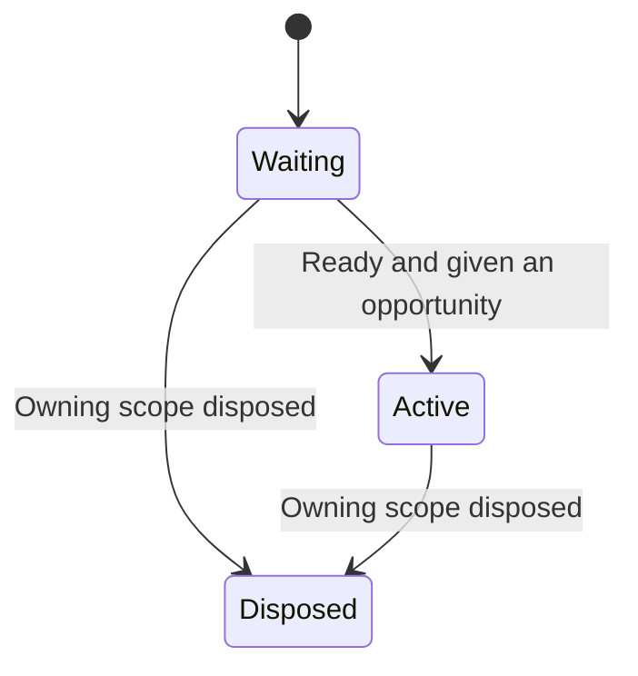

+++
title = "Startup and Deferred Content"
description = "Declare deterministic entry routes, retain the first page, and activate explicit placeholders through ordinary scoped turns."
weight = 7
template = "page.html"
+++

# Startup and Deferred Content

A site can draw useful content before its engine loads. Declare its concrete
entry routes with `Engine.entries`, then use `Engine.program_startup` or
`Engine.program_startup_store`. The initial callbacks receive the selected
route. They construct the same initial UI in the build and browser:

{{ sample(file="startup/main.roc", region="entries") }}

The catalogue supplies checked root-relative paths for links as well as the
build's route list. `Entries.path` finds a route's `EntryPath`; its `link`
method produces the value accepted by `Html.link`. Paths have no query or
fragment. A plain page load selects its pathname in Roc; query and fragment
arrive later through the environment request. An unknown pathname needs an
explicit declared fallback or fails with a diagnostic.

`roc signals.roc build` writes a prerendered page for every declared entry.
Parameterized routes must enumerate concrete entries or declare a fixed shell
with an explicit hosting fallback. This is a finite catalogue, not an attempt
to discover every possible URL. `--no-prerender` builds a plain page when
prerendering is deliberately unwanted. Legacy `program`, `program_boot` and
`program_store` remain available for pages that construct their initial UI from
live boot facts; migrate those initial callbacks before using the default
prerendered build.

The catalogue also declares the mount element's namespace, prefix and local
name; the default is an HTML `div`. The HTML template and browser mount must
use that same element. The generated frame and module belong to one build.
Serve the generated module URL intact, including its explicit build receipt,
or pass the matching `startupBuildToken` when integrating a custom loader.

## Retaining initial content

Ordinary initial content survives startup. A video, image, animation or iframe
in that frame remains the same browser node while the engine attaches its
handlers and references. Later signal changes and scope disposal still work
normally.

The producer writes standard `data-roc-*` annotations describing its logical
nodes, text boundaries and controls. Startup binds the whole frame and checks
that description. It tolerates browser text partitioning within the declared
representation, without guessing which application node some different DOM
might mean. The three no-namespace names `data-roc-frame`, `data-roc-node` and
`data-roc-children` are reserved. Do not edit the generated frame or mix assets
from different builds. A mismatch fails visibly; explicit recovery starts a
fresh instance rather than repairing selected regions.

Controls whose early interaction could be lost are temporarily gated. Native
links and resource loading continue where the declared ownership permits.
Authored `inert` and disabled states are preserved. Startup applies the whole
cold frame, restores producer gates and performs its initial effects, then
acknowledges the frame and drains queued initial reactions. The mount completes
after this acknowledgement. An initial reaction can update the page then; it
does not change which page was adopted.

## Explicit placeholders

`Html.placeholder` owns static content and a deferred live body. Its static
content is `Html.Static`: a checked fixed markup literal or escaped computed
text from `Html.Static.text`. It cannot contain live handlers, state, references
or engine effects. Images and styles may still load through normal browser
resource behavior.

{{ sample(file="startup/main.roc", region="placeholder") }}

Readiness defaults to True. Supply `PlaceholderProps.ready` when a signal
should control eligibility. While waiting, changing readiness to False removes
the site from the ready queue; changing it back to True appends it. Once active,
readiness no longer changes its lifetime. Dispose it with an ordinary branch,
row or enclosing scope.

Each browser-task opportunity activates at most one eligible body in FIFO order.
A nested placeholder becomes eligible only when its parent's live body mounts.
This service works even with `max_inflight` set to zero. Progress follows the
browser's task execution; suspended pages and a blocked event loop have no
wall-clock guarantee. Native and manual browser specs supply it explicitly with
`(run-opportunity)`.

The body sees current state when it mounts, including writes made while its
placeholder was visible. Preparing its immutable description may happen earlier
to establish declared reads. Its local state, references and requests start
only when activated. A prepared ordinary description can therefore be reused
without sharing mounted storage between instances.

Give the container ordinary size or aspect-ratio constraints when replacement
should preserve space. Use a native video poster when the video should already
exist; an explicit image placeholder is useful when constructing the live player
should wait. The platform does not infer geometry or promise zero layout shift.

## Reading live facts

Deterministic construction does not read the current time, storage, connectivity
or other live facts. Request them with `Engine.environment` and update ordinary
state from its typed result:

{{ sample(file="startup/main.roc", region="environment") }}

The answer has the familiar `Boot` fields, sampled after construction. Declare
needed storage keys, session keys and media queries in `ProgramProps`; the
request uses those declarations. It occupies a normal awaited slot and answers
`Err(Refused)` when admission exceeds `max_inflight`. A synchronous host answer
cannot run a reaction midway through the cold frame. Subsequent subscriptions
and requests use the same effect channel as any other app turn.
